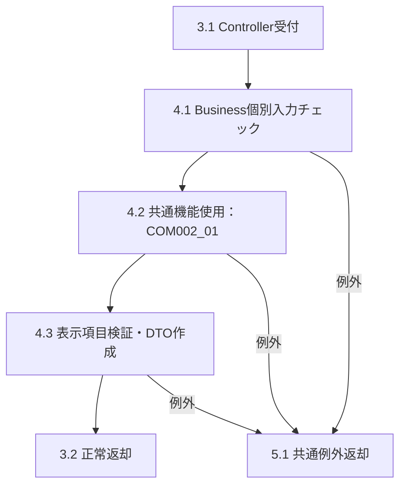

# APA001_01_管理者情報・権限確認

作成日：2026-11-17。改訂：管理者認可をCOM002_01へ集約。ECSアプリケーション側の処理設計。

## 0. 処理フロー



認証ヘッダーの共通チェックはController到達前に完了している。本APIではCognito認証・JWT検証・セッション作成を行わない。

## 1. 基本情報

| 項目 | 内容 |
| --- | --- |
| 機能ID／旧ID | APA001_01／API-A01 |
| 論理名／物理名 | 管理者情報・権限確認／get-admin-summary |
| HTTP | GET /api/v1/admin/auth/me |
| 対応画面 | SCA-01〜SCA-07、CMN-03 |
| API Gateway認証 | 管理者JWT必須。会員プールのJWTは受け付けない |
| Controller | AdminAuthController.getSummary |
| Business | GetAdminSummaryBusiness.execute |
| 使用する共通部品 | COM002_01：AdminAccessService.requireActiveAdmin |
| DB参照 | admins |
| DB登録・更新・削除 | なし。未登録管理者を自動作成しない |
| 外部通信 | なし。Cognito属性取得・SNS・SES・SQS呼出なし |
| べき等キー | 不要 |
| DBアクセス | 単一SELECT。行ロックなし。書込TX・操作履歴登録なし |
| 応答 | ECSで捕捉可能な正常・例外はHTTP 200。data／errorで判定 |

### 1.1 呼出契機・責務

| 契機 | 目的 |
| --- | --- |
| Amplifyで管理者ログイン成功後 | 事前登録済みの業務管理者であることを確認 |
| 管理画面を開く・再読み込み・タブ復帰 | 現在の有効状態と権限、ヘッダー表示情報を確認 |
| SCA-07で再確認 | 権限状態の回復を確認 |

ログイン済みというだけでは管理者権限ありとしない。フロントが本APIの成功を保持していても、他の管理者業務APIはそれぞれ実行時に管理者の登録・状態・権限を確認する。本APIの応答は後続APIの許可証ではない。

## 2. リクエスト

### 2.1 項目

| 場所 | 項目 | 必須 | 内容・担当 |
| --- | --- | --- | --- |
| ヘッダー | Authorization | ○ | Bearer管理者アクセストークン。親Controller到達前の共通受付で確認 |
| パス | 個別項目なし | — | 固定パス |
| クエリ | なし | — | 1項目でも指定されたらBusinessでINVALID_REQUEST |
| ボディ | なし | — | 空ボディのみ。JSONオブジェクト・配列・null文字列も受け付けない |
| Cookie | 使用しない | — | 管理者判定・セッション作成に使用しない |

adminId・cognitoSub・email・roleをクライアントに指定させない。本人特定には共通受付が渡す検証済みsubだけを使用する。

### 2.2 リクエスト例

```http
GET /api/v1/admin/auth/me HTTP/1.1
Authorization: Bearer <管理者アクセストークン>
Accept: application/json
```

リクエストJSONは存在しない。`{}`も送らない。

## 3. Controller

### 3.1 受付・Business呼出

| 処理 | 内容 |
| --- | --- |
| 親Controllerから受取 | 検証済みAuthenticatedActor、クエリの有無、ボディの有無 |
| Command作成 | actor、hasQuery、hasBodyをGetAdminSummaryCommandへ設定 |
| Business呼出 | GetAdminSummaryBusiness.execute(command) |

ヘッダー検証や認証情報の解析は個別Controllerに再実装しない。hasBodyは共通受付が実際に受信した本文の有無とし、Content-Lengthだけで判定しない。JWT・メール・管理者IDを追加で解析・取得しない。

### 3.2 返却

- 正常時は **共通機能使用：COM001_07 共通レスポンス生成**。
- 例外時は **共通機能使用：COM001_08 共通例外変換**。
- Content-Typeはapplication/json; charset=UTF-8、Cache-Controlはno-store。
- Cookie・認証トークンを発行・変更・削除しない。
- 個別Controllerで独自の認証状態キャッシュを保存しない。

## 4. Business

### 4.1 個別入力チェック

| 判定対象 | 条件 | NG時 |
| --- | --- | --- |
| Command | null以外 | INTERNAL_ERROR（内部呼出不備） |
| クエリ | hasQuery=false | INVALID_REQUEST |
| 本文 | hasBody=false | INVALID_REQUEST |
| 共通受付からの本人情報 | actorが存在すること（管理者actorの確認はCOM002_01） | INTERNAL_ERROR。信頼済み内部引数の受渡し不備。別領域へ切り替えて続行しない |

Authorizationの文字数・形式・issuer等はここで再検証しない。個別入力フィールドがないためDTOフィールド用の単項目アノテーションは不要。項目間チェックもない。

入力不正ではDBを検索しない。エラーは一般的な文言とfieldErrors=[]で返し、許可される内部状態値や認証設定値を開示しない。

### 4.2 管理者の利用権限確認

**共通機能使用：COM002_01 管理者検索・利用権限確認。**

| 項目 | 内容 |
| --- | --- |
| 呼出 | AdminAccessService.requireActiveAdmin(actor) |
| 入力 | 共通受付済みの管理者actor（Controllerから受渡し） |
| 成功 | AuthorizedAdmin（adminId・displayName）を受け取り4.3へ |
| 例外 | FORBIDDEN・DB例外等を5.1の共通例外処理へ伝播 |

DB検索・有効状態・権限判定を本Businessへ重複実装しない。

### 4.3 表示項目検証・DTO作成

| 共通機能の戻り値 | 処理 | 返却先 |
| --- | --- | --- |
| adminId | 共通機能で正のLongを保証済み。10進文字列へ変換 | admin.id |
| displayName | 空白だけでなく1〜50コードポイントであることを検証 | admin.displayName |
| 共通機能の正常終了 | accessStatus=AUTHORIZEDを設定 | accessStatus |

表示名が不正ならINTERNAL_ERROR。デフォルト名で補完せず、DBへの書戻しもしない。表示名の検証は表示する本APIの責務とし、商品等のAPIには不要。

role・statusのDBコード、cognito_sub、メールアドレス、JWT、登録日時・更新日時は返さない。現在はマスター管理者のみのため権限一覧・ロール切替情報を追加しない。

## 5. 例外・復旧・画面連携

### 5.1 例外返却

**共通機能使用：COM001_08 共通例外変換、COM001_09 安全なログ出力。**

| 条件 | error.code | error.message | fieldErrors |
| --- | --- | --- | --- |
| 不要なクエリ・ボディ | INVALID_REQUEST | 入力内容をご確認ください。 | [] |
| 管理者未登録・無効・権限なし | FORBIDDEN | このアカウントには管理画面へのアクセス権限がありません。 | [] |
| DB接続失敗・タイムアウト等の一時障害 | SERVICE_UNAVAILABLE | 処理を完了できませんでした。時間をおいて再試行してください。 | [] |
| 多重取得・不正表示値・SQL／マッピング不備・予期しない例外 | INTERNAL_ERROR | 処理を完了できませんでした。 | [] |

ECSで捕捉できた例外はHTTP 200、data=null。共通認証失敗は共通受付のUNAUTHENTICATED等に従い、本Businessは実行しない。API GatewayがJWTを拒否した場合やECSへ到達しない障害では非200・共通JSON以外の応答となり得る。

ログはrequestId、機能ID、処理箇所、固定理由コード等に限定する。JWT・ヘッダー全文・メール・表示名・レスポンス全体・SQL例外の生メッセージを出力しない。

### 5.2 データ復旧方法

本APIはDB登録・更新・削除を行わないため、ロールバック・補償更新は不要。

| 状況 | 対応 |
| --- | --- |
| DB一時障害・応答断 | 復旧後に同じGETを再実行可能。二重登録なし |
| 管理者未登録 | 初期構築・運用でadminsと管理者Cognitoプールのsub紐付けを確認。本APIで自動登録しない |
| 無効・権限なし | 権限不足画面へ。必要な設定修正は運用で実施 |
| データ不整合 | 原因を調査して運用で修復。本APIは自動補完しない |

管理者ログアウト・会員側認証情報の破棄を本APIから行わない。

### 5.3 画面との対応

| 結果 | フロントの動作 |
| --- | --- |
| 正常 | CMN-03に表示名と業務メニューを表示。SCA-01では有効な戻り先、なければSCA-02へ |
| FORBIDDEN | 業務データ・復元キャッシュを破棄しSCA-07へ。すでにSCA-07ならそのまま権限不足表示 |
| UNAUTHENTICATED／Gateway認証拒否 | 共通認証制御に従い再ログインへ。単に401であるだけでは期限切れと断定しない |
| SERVICE_UNAVAILABLE／INTERNAL_ERROR・通信失敗 | 未ログインや権限なしと断定せず、確認失敗と再試行を表示。業務データを表示しない |

SCA-06などの例外画面では各画面の遷移仕様を優先する。画面の再確認だけで業務操作を自動再実行しない。

### 5.4 確認ケース

| ケース | 期待結果 |
| --- | --- |
| ACTIVE・MASTER_ADMIN | 正常。ID・表示名を返す |
| subに対応するadminsなし | FORBIDDEN。DB登録なし |
| DISABLED | FORBIDDEN |
| roleが未対応・状態null／未知値 | FORBIDDEN。安全側で拒否 |
| 表示名空欄・過長、id不正 | INTERNAL_ERROR |
| 会員JWT | 共通認証段階で拒否。admins検索なし |
| 不要なクエリ／本文 | INVALID_REQUEST、fieldErrors=[]。DB検索なし |
| DB障害 | 取得エラー。FORBIDDENへ変換しない |
| 同じGETを繰り返す | DB・セッション・注文・カートに変更なし |
| 成功確認後に管理者を無効化 | 次回の管理者業務APIで拒否。本APIの過去の成功を信用しない |

## 6. 返却項目

### 6.1 ヘッダー・共通項目

| 項目 | 型・値 | 内容 |
| --- | --- | --- |
| HTTPステータス | 200 | ECSで捕捉・返却できた場合 |
| Content-Type | application/json; charset=UTF-8 | JSON |
| Cache-Control | no-store | 管理者情報をキャッシュしない |
| requestId | string | 共通要求追跡ID |
| data | object / null | 成功時のみ設定 |
| error | object / null | 失敗時のみ設定 |
| error.code | string | 5.1のコード |
| error.message | string | 利用者向け文言 |
| error.fieldErrors | array | 本APIは空配列 |

### 6.2 data

| 項目 | 型 | null | 内容 |
| --- | --- | --- | --- |
| accessStatus | string | 不可 | AUTHORIZED固定。今回のDB確認時点で管理画面を利用可能 |
| admin | object | 不可 | 管理者表示情報 |
| admin.id | string | 不可 | admins.id。JSONでは数値にしない |
| admin.displayName | string | 不可 | admins.display_name（初期値：マスター管理者） |

### 6.3 正常JSON

```json
{
  "requestId": "req-admin-summary-001",
  "data": {
    "accessStatus": "AUTHORIZED",
    "admin": {"id": "1", "displayName": "マスター管理者"}
  },
  "error": null
}
```

### 6.4 権限不足JSON（HTTP 200）

```json
{
  "requestId": "req-admin-summary-002",
  "data": null,
  "error": {
    "code": "FORBIDDEN",
    "message": "このアカウントには管理画面へのアクセス権限がありません。",
    "fieldErrors": []
  }
}
```

### 6.5 DB接続失敗JSON（HTTP 200）

```json
{
  "requestId": "req-admin-summary-003",
  "data": null,
  "error": {
    "code": "SERVICE_UNAVAILABLE",
    "message": "処理を完了できませんでした。時間をおいて再試行してください。",
    "fieldErrors": []
  }
}
```
