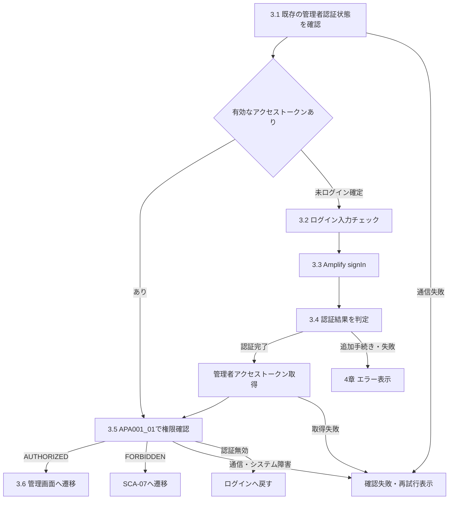

# APA001_02_管理者ログイン

作成日：2026-11-17。フロント・Cognito・ECSの連携設計。

## 0. 処理フロー



## 1. 基本情報・実装範囲

| 項目 | 内容 |
| --- | --- |
| 機能ID／旧ID | APA001_02／API-A02 |
| 論理名／物理名 | 管理者ログイン／login-admin |
| 対応画面 | SCA-01、CMN-03 |
| 主な実装先 | HTML・JavaScriptの管理者ログイン画面 |
| 認証処理 | Amplify Auth signIn → 管理者専用Cognitoユーザープール |
| 独自HTTPエンドポイント | なし。POST /admin/auth/loginは作らない |
| ECSのController／Business | 本機能としては作成しない |
| 後続ECS API | APA001_01：GET /api/v1/admin/auth/me |
| DB操作 | 本機能ではなし。APA001_01がadminsを参照する |
| 対象外 | 管理者の自動登録・招待・カート統合・パスワード再設定画面・追加認証画面 |

認証はCognito、管理者としての利用可否はAPA001_01が判定する。ECSへパスワードを送信しない。本書のフロント処理をECSのBusinessへ実装しない。

### 1.1 構成前提

- 初期管理者は事前作成1件。管理者Cognitoプールとadmins.cognito_subを初期構築で紐付ける。
- 初期パスワード変更・メール確認等、初回ログインに必要な準備は運用者が事前に完了させる。
- 会員用と管理者用のCognitoプール・アプリクライアント・認証ストアを分離する。
- ブラウザ用アプリクライアントにクライアントシークレットを持たせない。
- 管理者画面では管理者用Amplify設定だけを使用する。会員側との遷移はページ読み込みを伴う構成とし、同じJS実行中にグローバル設定を交互に差し替えない。
- 保存先をカスタマイズする場合も管理者専用キー領域とし、会員側を含むlocalStorage.clear()等は使わない。
- 有効期間・更新はCognito設定とAmplifyのセッション管理に従う。ECSで12時間の独自セッションを作らない。

## 2. 入力・SDK連携項目

### 2.1 画面入力

| 項目 | 必須 | チェック・扱い |
| --- | --- | --- |
| メールアドレス | ○ | 前後空白除去後1〜254文字、メール形式。大文字小文字を独自変換しない |
| パスワード | ○ | 未入力・空白のみ不可。値のトリム・文字変換はしない。登録時の文字種条件をログイン時に再適用しない |
| 戻り先 | 任意 | 管理者画面の許可ルートのみ。外部URL・認証画面・未検出画面・権限不足画面は不可 |

パスワードの共通最大長は共通入力仕様に従う。本機能で新しい上限を独自設定しない。入力エラーがあればSDKを呼ばず、最初のエラー欄へフォーカスを移す。日本語変換確定中のEnterでは送信しない。

### 2.2 signInの引数例

```javascript
import { signIn, fetchAuthSession } from 'aws-amplify/auth';

const result = await signIn({
  username: email.trim(),
  password: password
});
```

これはSDKの引数であり、ECSに送るリクエストJSONではない。パスワード・SDK応答全体・トークンをログへ出力しない。SDKはビルド時にバンドルし、ブラウザで使う。TypeScriptは必須ではない。

### 2.3 APA001_01の要求

```http
GET /api/v1/admin/auth/me HTTP/1.1
Authorization: Bearer <管理者アクセストークン>
Accept: application/json
```

クエリ・ボディなし。IDトークンをAuthorizationへ入れない。パスワード・メールアドレス・adminIdを送らない。

## 3. フロントの処理

### 3.1 初期表示・既存認証状態確認

管理者用のfetchAuthSession()で認証情報を確認する。

| 結果 | 処理 |
| --- | --- |
| 管理者アクセストークンあり | フォーム送信を行わず3.5へ |
| 未ログイン確定・トークンなし | 空のフォームを表示 |
| 通信・設定エラーで確認不可 | AL09と再読み込みを表示。未ログインと断定しない |

確認中は業務メニューや管理データを表示しない。Cognito認証だけでは管理者権限ありと判定しない。

### 3.2 入力確認・重複送信防止

2.1の検証後、処理中フラグを設定し、入力欄・表示切替・ログインボタン・共通ナビゲーションを一時抑止する。同一画面でsignInを並列実行しない。メールアドレスは保持し、処理終了後はパスワード入力欄を空欄・伏字へ戻す。

### 3.3 Cognito認証

管理者用設定のsignInに2.2の引数を渡す。ECSの独自ログインAPIは呼ばない。返却値は3.4、SDK例外は4章へ進む。

### 3.4 認証結果判定・トークン取得

| 結果 | 処理 |
| --- | --- |
| isSignedIn=trueかつnextStep.signInStep=DONE | fetchAuthSession()でアクセストークンを取得して3.5へ |
| MFA・新パスワード・登録確認など追加手続きが必要 | 完了扱いにしない。業務画面へ進めず、管理者アカウントの設定確認を案内 |
| signInは成功したがトークン取得不可 | 認証状態確認の再試行を表示。パスワードを自動再送しない |
| SDK例外 | 4章へ |

追加認証を迂回・自動解除しない。今回未実装の手続きが要求された場合は、運用者がCognitoのアカウント設定を確認する。

### 3.5 管理者情報・権限確認

APA001_01を呼ぶ。HTTP 200だけで成功判定せず、共通JSONのerrorとdataを確認する。

| 応答 | 判定・処理 |
| --- | --- |
| error=null、data.accessStatus=AUTHORIZED、admin.id／displayNameあり | 管理者表示情報を保持し3.6へ |
| error.code=FORBIDDEN | 管理データを破棄しSCA-07へ。管理者側の認証を保持してログアウト操作を可能にする |
| UNAUTHENTICATED／Gatewayの認証拒否 | 業務画面へ進めず共通認証復旧へ。期限切れと断定しない |
| SERVICE_UNAVAILABLE／INTERNAL_ERROR・通信失敗 | 認証成功と権限確認失敗を区別。認証は維持し「管理者情報を再確認」から本APIだけ再実行 |
| JSON欠損・未知の返却形式 | 確認失敗。成功扱いにしない |

会員側セッション・カート・キャッシュに触れない。権限確認に失敗しただけでsignInを繰り返さない。

### 3.6 遷移

保持した戻り先をサーバー側のルート定義に合わせたフロントの許可リストで検証する。単なる/admin前方一致だけで許可しない。SCA-02〜SCA-05の有効な内部パスと必要な識別情報だけを許可し、不正・未指定時はSCA-02を使う。

location.replace()等の履歴置換で移動する。ユーザー側画面・外部URLへ認証情報を引き継がない。トークンをURLに含めない。

## 4. 例外・復旧・文言

| 状況 | 表示・対応 |
| --- | --- |
| メール未入力 | AL01：メールアドレスを入力してください。 |
| メール形式不正 | AL02：有効なメールアドレスを入力してください。 |
| パスワード未入力・空白のみ | AL03：パスワードを入力してください。 |
| ID／パスワード不一致・アカウント不存在 | AL04：メールアドレスまたはパスワードが正しくありません。 |
| 試行制限 | AL06：ログイン試行回数の上限に達しました。時間をおいて再度お試しください。 |
| SDKの通信・システム障害 | AL07：ログイン処理に失敗しました。時間をおいて再度お試しください。 |
| 初期認証確認失敗 | AL09：ログイン状態を確認できませんでした。再読み込みしてください。 |
| 追加手続き要求 | 管理者アカウントの設定確認が必要です。運用担当者にお問い合わせください。 |
| 認証成功後の管理者情報取得失敗 | 管理者情報を確認できませんでした。再度お試しください。／「管理者情報を再確認」 |

SDK例外のmessageをそのまま画面へ表示しない。存在しないメールとパスワード誤りを区別しない。追加文言とSDK例外名の対応は導入するSDKバージョンで確認し、画面設計・メッセージ一覧へ同期する。

### 4.1 結果不明時

signInの通信が途切れた場合は自動再送せず、管理者用fetchAuthSession()で状態を確認する。トークンありならAPA001_01へ、未ログイン確定ならフォームへ、確認不能なら再確認操作を表示する。遅れて完了した旧要求が新しい画面や認証情報を上書きしないよう、同時送信抑止と画面有効性の確認を行う。

### 4.2 データ復旧

本機能にRDS書込み・ロック・トランザクションはないため、DBロールバック・復元は不要。APA001_01も参照のみ。認証確認の再試行・再ログインで復旧する。管理者未登録時の自動INSERT、メール照合による自動紐付けは行わない。

## 5. 確認ケース

| ケース | 期待結果 |
| --- | --- |
| 正常な事前登録管理者 | signIn→権限確認→有効な戻り先／SCA-02 |
| Cognito認証成功、admins未登録／無効 | SCA-07。業務データ表示なし |
| パスワード誤り・未登録メール | 同じAL04。メール保持、パスワード消去 |
| MFA等の追加ステップ | 完了扱いにせず運用案内 |
| APA001_01だけ通信失敗 | signInを繰り返さず権限確認だけ再試行 |
| ログイン済みでSCA-01表示 | 既存トークンで権限確認。重複signInなし |
| 外部URL・不正な戻り先 | SCA-02へ |
| 会員と管理者が両方ログイン | 管理者操作で会員側認証・カートを変更しない |
| 複数回クリック・変換確定Enter | 重複SDK呼出を防ぐ |

公式参照（2026-11-17確認）：
- https://docs.amplify.aws/javascript/frontend/auth/sign-in/
- https://docs.amplify.aws/javascript/frontend/auth/manage-user-sessions/

## 6. 返却項目

### 6.1 本機能の独自APIレスポンス

なし。ECSのController・Business・共通JSONを新設しない。SDK例外はHTTP 200ラッパーへ変換せず、フロント側で表示状態へ変換する。

### 6.2 Amplifyから使用する値

| 呼出 | 項目 | 用途 |
| --- | --- | --- |
| signIn | isSignedIn | 認証完了の判定 |
| signIn | nextStep.signInStep | DONEまたは追加手続きの判定 |
| fetchAuthSession | tokens.accessToken | APA001_01のAuthorizationへ付与。ログ・URLへ出さない |

### 6.3 APA001_01から使用する値

| 項目 | 用途 |
| --- | --- |
| requestId | エラー調査用 |
| data.accessStatus | AUTHORIZEDの判定 |
| data.admin.id | 管理者切替時の表示データ分離 |
| data.admin.displayName | CMN-03表示 |
| error.code／message | 権限不足・取得失敗の分岐。詳細はAPA001_01 |

```json
{
  "requestId": "req-admin-summary-001",
  "data": {
    "accessStatus": "AUTHORIZED",
    "admin": {"id": "1", "displayName": "マスター管理者"}
  },
  "error": null
}
```

上記は後続のAPA001_01の正常応答例であり、本機能のログインAPIが返すJSONではない。
