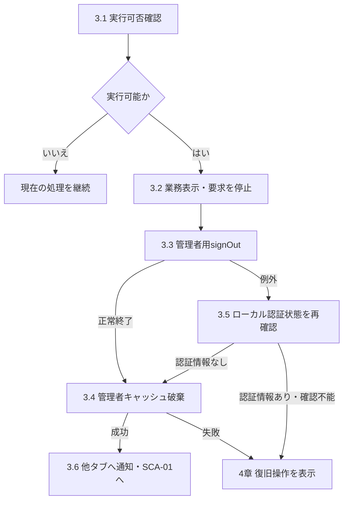

# APA001_03_管理者ログアウト

作成日：2026-11-17。フロント・Amplify Authの連携設計。

## 0. 処理フロー



## 1. 基本情報・実装範囲

| 項目 | 内容 |
| --- | --- |
| 機能ID／旧ID | APA001_03／API-A03 |
| 論理名／物理名 | 管理者ログアウト／logout-admin |
| 対応画面 | CMN-03、SCA-01〜SCA-07 |
| 実装先 | 管理者側JavaScriptの共通ログアウト処理 |
| 認証処理 | 管理者用Amplify Auth signOut() |
| 独自HTTPエンドポイント | なし。POST /admin/auth/logoutは作らない |
| ECS Controller／Business | 本機能では作成しない |
| DB検索・登録・更新・削除 | なし。admins・商品・注文・操作履歴を変更しない |
| 対象 | 現在のブラウザの管理者側認証。共有ストレージを使用する同一ブラウザの管理者タブも対象 |
| 対象外 | 全端末一括ログアウト、会員側のログアウト、ゲストカート解除、DBセッション削除 |

### 1.1 ログアウト完了の意味

本機能の完了は「現在のブラウザで管理者用認証情報を利用できず、管理画面の表示・復元データを破棄した状態」とする。

AmplifyのsignOut正常終了やトークンが見つからないことを、Cognito側の失効成功やコピー済みJWTの即時無効化の証明として扱わない。SDKが失効要求の失敗を内部で処理し、ローカルトークン除去を継続する場合もある。

API GatewayのJWT検証だけではCognitoの失効情報を都度照会しないため、コピー済みの未期限切れJWTの利用を本ログアウトだけで即時停止できるとは保証しない。今回、セッションDB・失効リスト・追加のログアウトAPIは設けない。管理者業務APIでadminsの有効状態・権限を確認する方針は継続する。

### 1.2 会員側との分離

- 管理者専用プール・アプリクライアント・認証ストアを使う。
- 管理者ページでは管理者用Amplify設定で初期化する。会員設定へ切り替えてsignOutしない。
- localStorage.clear()・sessionStorage.clear()・Cookie全削除は行わない。
- 会員トークン、会員カート表示・ゲスト識別情報、会員側の未解決操作情報は変更しない。
- 管理者専用のキャッシュキーを明示的に削除する。Amplifyの内部保存キーを推測して一括削除しない。

## 2. 入力・SDK呼出

### 2.1 呼出契機・入力

| 項目 | 内容 |
| --- | --- |
| 起動操作 | CMN-03のログアウト、またはSCA-07の「ログアウトして管理者ログイン画面へ」 |
| 確認ダイアログ | なし。ただし未保存変更の離脱確認は対象画面の仕様に従う |
| 入力項目 | なし。メールアドレス・パスワード・管理者IDを要求しない |
| リクエストJSON | なし。ECSへ送信しない |
| べき等キー | 不要。operation_historiesへ登録しない |

### 2.2 SDK呼出例

```javascript
import { signOut } from 'aws-amplify/auth';

// 管理者用Amplify設定で初期化した画面から呼び出す。
await signOut();
```

global:trueは指定しない。他端末の認証を終了させる設計にはしない。Cognitoへの通信・トークン除去はSDKに任せ、独自のRevokeToken呼出を重ねない。

## 3. フロントの処理

### 3.1 実行可否確認

| 状態 | 処理 |
| --- | --- |
| 保存・削除・画像アップロード・注文更新・キャンセル等の通信中 | ログアウト開始を抑止する |
| 未保存入力あり | 対象画面の離脱確認を実行。継続なら中止、破棄に同意した場合のみ進む |
| ログアウト実行中 | 二重呼出をしない |
| 権限不足だが管理者側認証あり | 実行可能 |
| 既に管理者側が未ログインと判明 | 3.4のキャッシュ破棄へ進む |
| 通常状態 | 3.2へ進む |

### 3.2 業務表示・要求を停止

1. ログアウト中フラグを立て、ログアウトボタン・業務ナビ・画面操作を抑止する。
2. 管理者名・注文者情報・業務一覧・入力値の画面表示を隠す。
3. 管理者用のポーリング・自動再試行を停止する。未完了の読取要求は可能ならAbortControllerで中止する。
4. 画面の要求世代番号を更新し、ログアウト開始前の応答は表示へ反映しない。

通信の中止は、送信済み更新処理のロールバックではない。更新要求の途中で本処理を意図的に開始しない。結果不明の操作はDB上の操作履歴を残し、次回ログイン時の復旧導線で確認する。

### 3.3 管理者用signOut

管理者用認証設定に対してsignOut()を1回実行する。正常終了時は3.4へ。例外時は例外本文やトークンを記録せず3.5へ進む。

Promise.race等で画面上のタイムアウトを表示しても、SDK処理が停止したとはみなさない。旧signOutが完了する前に新しいsignInや並列signOutを開始しない。表示は「完了確認中」とし、画面再読み込み後は認証状態を確認してから操作を再開する。

### 3.4 管理者用キャッシュを破棄

| 対象 | 処理 |
| --- | --- |
| メモリ上の管理者情報 | admin.id・displayName・権限判定済み状態を解除 |
| 管理画面の業務データ | 商品・注文一覧、詳細、検索条件、継続情報、スクロール復元情報を破棄 |
| 入力・画像プレビュー | 未保存入力、ファイル参照、プレビューURLを破棄。Object URLはrevokeする |
| 管理者用保存キャッシュ | 管理者専用キーだけを削除 |
| 未解決操作の画面保持情報 | 端末上の管理者用コピーを破棄。DBのoperation_histories・アップロード記録は削除しない |
| 管理者用HTTPクライアント | メモリ上のAuthorization値・要求キャッシュを解除 |

S3上の画像やRDSレコードは削除しない。破棄中の例外でも業務表示は隠したままとし、完了通知を出さず復旧操作へ進む。会員側のストレージは変更しない。

### 3.5 例外後の認証状態確認

管理者用fetchAuthSession()で認証状態を再確認する。APA001_01をログアウト確認専用として呼ばない。有効なJWTで権限確認できることと、ローカル認証情報の破棄完了は別の判定である。

| 結果 | 処理 |
| --- | --- |
| tokensなし・SDKが未ログインを確定 | 3.4へ。完了判定はブラウザ側のログアウトのみ |
| 管理者アクセストークンあり | AH02と「再度ログアウトを実行」。業務表示を復元しない |
| 通信・設定・ストレージ障害で確認不能 | AH03と「ログイン状態を再確認」「再度ログアウトを実行」 |

一般の通信例外を未ログインとみなさない。自動でsignOutを無制限再送しない。「再度ログアウトを実行」は前回のSDK処理終了を確認してから開始する。

### 3.6 タブ通知・画面遷移

1. 同一ブラウザの管理者タブへ、管理者専用BroadcastChannel等でログアウト完了を通知する。通知にトークン・メール・業務情報を含めない。
2. 受信側は管理者表示・キャッシュ・読取通信を破棄し、SCA-01へ移動する。相互に通知し直してループさせない。
3. 実行元は履歴置換でSCA-01へ移動し、AH01を約3秒表示する。戻り先情報は引き継がない。
4. タブ通知を受信できなかった場合も、タブ復帰・pageshow時に共通認証確認を行い、確認前に業務データを再表示しない。

通知だけを認証の根拠にしない。新しい管理者ログイン完了時にも表示キャッシュを初期化する。ブラウザの戻る操作・BFCache復帰では管理者データを認証確認前に復元しない。

## 4. 例外・復旧・文言

| ID | 状態 | 表示文言・操作 |
| --- | --- | --- |
| AH01 | ブラウザ側の管理者ログアウト完了 | 管理画面からログアウトしました。 |
| AH02 | ローカル認証情報の残存・キャッシュ破棄失敗等 | ログアウト処理に失敗しました。もう一度お試しください。／「再度ログアウトを実行」 |
| AH03 | 完了確認不能 | ログアウトが完了したか確認できませんでした。ログイン状態を再確認するか、もう一度ログアウトをお試しください。／「ログイン状態を再確認」「再度ログアウトを実行」 |

処理中は「ログアウト中…」、確認中は「確認中…」。AH02・AH03では業務データを隠したまま復旧操作を可能にする。SDK例外のmessageや内部保存キーを表示しない。

### 4.1 DB復旧

DB更新がないためトランザクション・ロールバック・補償更新は不要。未完了の業務操作をログアウト処理でFAILEDへ変更しない。次回ログイン後、同一管理者の未解決操作取得・個別結果照会で業務状態を確認する。

### 4.2 旧設計との対応

旧仕様の「ログアウトAPI」「ec_admin_session Cookie削除」「Spring SessionのDB削除」は実装しない。CMN-03・SCA-07のログアウト導線から本フロント処理を呼ぶ。AH01〜AH03はブラウザ側のログアウト・復旧状態に対応させ、サーバー失効の証明には使用しない。

## 5. 確認ケース

| ケース | 期待結果 |
| --- | --- |
| 通常ログアウト | 管理者トークンをSDKで除去、管理者キャッシュ破棄、SCA-01・AH01 |
| SCA-07から実行 | 同じ処理で終了。権限確認API成功を要求しない |
| 既に未ログイン | キャッシュ破棄後にSCA-01。業務DB変更なし |
| 会員・管理者の両方でログイン | 会員側認証・カートは維持 |
| 別端末の管理者ログイン | global:trueを使わず、一括終了を要求しない |
| 同一ブラウザの管理者別タブ | 通知または復帰時確認で表示破棄 |
| 遅れて届いた管理API応答 | 世代番号で破棄し、業務表示を復活させない |
| signOut例外・ローカルトークンなし | キャッシュ破棄後にブラウザ側完了とする |
| signOut例外・トークン残存／状態不明 | AH02／AH03。業務表示なし |
| キャッシュ削除例外 | 完了通知を出さず復旧操作へ |
| 戻る・BFCache復帰 | 認証確認前に業務情報を表示しない |
| ログアウト後にコピー済みJWTを直接使用 | 即時拒否を保証する試験項目にしない。認証方式の制約として扱う |

公式参照（2026-11-17確認）：
- https://docs.amplify.aws/javascript/frontend/auth/sign-out/
- https://docs.amplify.aws/javascript/frontend/auth/manage-user-sessions/
- https://docs.aws.amazon.com/cognito/latest/developerguide/token-revocation.html
- https://github.com/aws-amplify/amplify-js/blob/main/packages/auth/src/providers/cognito/apis/signOut.ts

## 6. 返却項目

### 6.1 本機能のHTTPレスポンス

なし。ECS用の正常・例外JSON、HTTPステータスを設けない。ECSの例外をHTTP 200で返す共通規約は本機能に適用しない。

### 6.2 SDKの戻り値・フロント利用情報

| 呼出 | 値 | 用途 |
| --- | --- | --- |
| signOut() | Promise<void> | 正常終了／例外を処理。独自JSONは返らない |
| fetchAuthSession() | tokensの有無、SDK例外 | 例外後のブラウザ側認証状態の確認 |
| フロント内部状態 | 処理中／完了／失敗／確認不能 | 操作抑止・AH01〜AH03表示 |

リクエストJSON・レスポンスJSONの例は存在しない。ブラウザ側の完了状態を外部APIの返却値として扱わない。
