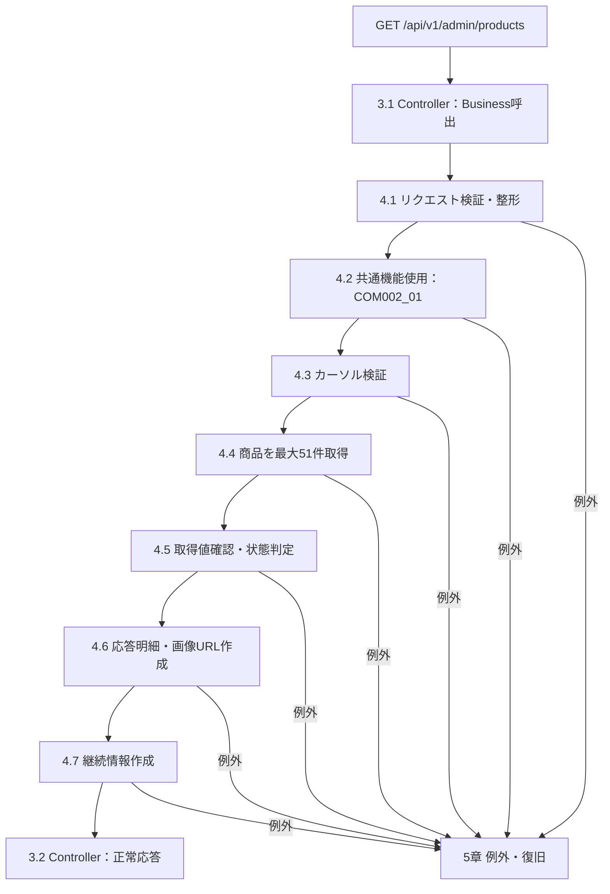

# APA002_01_管理用商品一覧・キーワード検索・追加取得

作成日：2026-11-17

## 0. 処理フロー



## 1. 基本情報

| 項目 | 内容 |
| --- | --- |
| 機能ID／旧ID | APA002_01／API-A04 |
| 論理名 | 管理用商品一覧・キーワード検索・追加取得 |
| 物理名 | list-admin-products |
| HTTP・URL | GET /api/v1/admin/products |
| 対応画面 | SCA-02（商品管理一覧） |
| Controller | AdminProductListController（親Controllerを継承） |
| Business | AdminProductListBusiness.execute(command, actor) |
| Mapper | ProductMapper.selectAdminProducts |
| 認証 | 管理者JWT必須。管理者プール・アプリクライアントを対象とする |
| DB操作 | admins・productsのSELECTのみ |
| 取得順／件数 | 商品ID降順。最大50件返却、次ページ判定のため51件取得 |
| 表示対象 | 未削除の商品。公開・非公開、販売停止、在庫0を含む |
| 対象外 | 商品更新・削除、税再計算、カート操作、並び替え、CSV出力 |

共通ヘッダー・認証受付は親Controller前段に任せる。本書ではその内部処理を記載しない。ログイン直後のAPA001_01の成功だけに依存せず、本APIでもDB上の管理者状態・権限を確認する。

## 2. リクエスト項目

### 2.1 外部入力

| 場所 | 項目 | 必須 | 条件・用途 |
| --- | --- | --- | --- |
| ヘッダー | Authorization | 必須 | 管理者アクセストークン。共通受付のチェック対象 |
| クエリ | keyword | 任意 | 前後空白除去後0〜50コードポイント。商品名・商品概要の部分一致 |
| クエリ | cursor | 任意 | 初回は省略。追加取得では直前のnextCursorをそのまま送る |
| ボディ | なし | — | 空ボディのみ。JSONの{}やnullも送信しない |

limit・page・sort・公開状態等の追加クエリは今回受け付けない。同じキーの複数指定も不可。Cookie・会員ID・管理者IDは本APIの識別入力に使用しない。

### 2.2 呼出例・リクエストJSON

```http
GET /api/v1/admin/products?keyword=coffee
Authorization: Bearer <管理者アクセストークン>
```

```http
GET /api/v1/admin/products?keyword=coffee&cursor=<前回のnextCursorをURLエンコードした値>
Authorization: Bearer <管理者アクセストークン>
```

**GETのためリクエストJSONはない。** 以下はJava内部の入力イメージであり、HTTPボディとして送信しない。

```json
{
  "keyword": "coffee",
  "cursor": null
}
```

### 2.3 Businessへ渡す内部入力

| 項目 | 型 | 取得元 |
| --- | --- | --- |
| command.query | Map<String, List<String>> | 共通受付済みの全クエリ。未知項目・重複も検出できる形で渡す |
| command.bodyPresent | boolean | 共通受付結果。ボディ有無 |
| actor.subject | String | 共通受付で確認した管理者プールのsub |

## 3. Controllerの処理

### 3.1 Business呼出

1. 共通受付結果からcommandを作成する。
2. 管理者用の認証済みactorとcommandをBusinessへ渡す。
3. 結果DTOを受け取り3.2へ進む。例外は共通例外処理へ伝播させる。

Controllerでは入力値の長さ検証、DB検索、権限判定、カーソル解析を行わない。Controllerの@Validによる先行検証も行わず、DTO検証を含めBusinessで実行する。

### 3.2 正常応答

結果DTOを親Controllerの正常応答メソッドへ渡す。

**共通機能使用：COM001_07 共通レスポンス生成（親Controller経由）。**

取得0件も正常。HTTP 200でitems=[]、hasNext=false、nextCursor=nullを返す。

## 4. Businessの処理

### 4.1 リクエスト検証・整形

| 順序 | 対象 | チェック・処理 | NG時 |
| --- | --- | --- | --- |
| 1 | bodyPresent | falseであること | INVALID_REQUEST |
| 2 | queryのキー | keyword・cursorのみ。指定されたキーの値は各1個 | INVALID_REQUEST |
| 3 | keyword | 未指定は空文字。String.strip()で前後空白除去 | — |
| 4 | keyword | 不正サロゲート・U+0000を含まない | VALIDATION_ERROR |
| 5 | keyword | Unicodeコードポイント数が50以下 | VALIDATION_ERROR |
| 6 | cursor | 未指定はnull。指定時は空文字不可、2048文字以内。トリムしない | CURSOR_INVALID |
| 7 | cursor | パディングなしBase64url文字列2個を「.」で連結した形式 | CURSOR_INVALID |

- URLデコードは共通受付済み。二重デコードしない。
- keyword内部の空白は保持し、単語分割しない。大小文字・全角半角等を同一視しない。
- 単項目チェックはDTOとJakarta ValidationをBusinessから使用可能。ただし文字数はcodePointCountで判定し、UTF-16単位の@Sizeで代替しない。
- 許可項目・重複値・ボディ有無はBusinessで明示判定する。COM001_03は使用しない。
- NG時は商品検索を行わず5章へ進む。

### 4.2 管理者の利用権限確認

**共通機能使用：COM002_01 管理者検索・利用権限確認。**

| 項目 | 内容 |
| --- | --- |
| 呼出 | AdminAccessService.requireActiveAdmin(actor) |
| 入力 | 共通認証受付済みの管理者actor |
| 成功 | AuthorizedAdminを受け取り4.3へ進む |
| 例外 | FORBIDDEN・DB例外等を共通例外処理へ伝播。商品処理を開始しない |

adminsのSQL・状態判定はCOM002_01へ集約し、本Businessに重複実装しない。

### 4.3 カーソル検証

未指定ならlastId=nullとして4.4へ進む。指定ありなら次の順で検証する。

| 順序 | 処理 | NG時 |
| --- | --- | --- |
| 1 | 2要素へ分割しBase64urlデコード | CURSOR_INVALID |
| 2 | 元のペイロード部分のASCIIバイト列へHMAC-SHA256を計算 | 設定・暗号処理異常はINTERNAL_ERROR |
| 3 | 署名32バイトと計算値を定数時間比較 | CURSOR_INVALID |
| 4 | 検証済みペイロードをUTF-8 JSONとして厳密解析。重複・未知項目を拒否 | CURSOR_INVALID |
| 5 | 下表を照合しlastIdをLongへ変換 | CURSOR_INVALID |

| ペイロード項目 | 型・チェック |
| --- | --- |
| v | 整数1 |
| scope | 文字列APA002_01。公開一覧のカーソルは使用不可 |
| lastId | 正の10進文字列、先頭0なし、Long範囲内 |
| queryHash | 正規化済みkeywordのUTF-8バイト列に対するSHA-256、小文字hex64桁。一致必須 |
| exp | UTC Unix秒の整数。現在時刻より未来、現在から1800秒以内 |

署名キーは32バイト以上のランダム値をサーバー設定から取得し、全ECSタスクで共有する。クライアントには渡さず、起動ごとに生成しない。カーソルは暗号化ではないため、認証情報・管理者識別情報・検索語原文を含めない。

検索語変更時はcursorを破棄する。lastIdの商品が論理削除済みでも、その行の存在確認は不要。本方式はAPU002_01に揃えるが、scopeは管理者用に分離する。

### 4.4 商品を最大51件取得

| 項目 | 条件 |
| --- | --- |
| テーブル | products |
| 必須条件 | is_deleted = FALSE |
| 検索対象 | nameまたはsummaryの部分一致（OR） |
| 追加取得条件 | id < lastId |
| 順序・件数 | id DESC、LIMIT 51 |
| 除外しない状態 | PRIVATE、SUSPENDED、stock_quantity=0 |
| 実行しない処理 | COUNT(*)、FOR UPDATE、S3への個別問合せ |

| 取得カラム | Java型 | 用途 |
| --- | --- | --- |
| id、version | Long | 識別・カーソル／編集削除時の競合確認 |
| name、summary | String | 一覧表示／検索（summaryはnull可） |
| price_including_tax | Integer | 税込価格 |
| stock_quantity | Integer | 管理者向け実在庫 |
| publish_status、sales_status | String | 公開状態・販売設定 |
| image_s3_key | String（null可） | 配信URL生成 |
| updated_at | OffsetDateTime | 最終更新日時 |

keywordありの場合、「!」→「!!」、「%」→「!%」、「_」→「!_」の順でエスケープし、前後に%を付けてlikePatternを作る。入力の%・_をワイルドカードにしない。

```xml
<select id="selectAdminProducts" resultMap="AdminProductListRowMap">
  SELECT id, name, summary, price_including_tax,
         stock_quantity, publish_status, sales_status,
         image_s3_key, version, updated_at
  FROM products
  WHERE is_deleted = FALSE
  <if test="keyword != ''">
    AND (
      name COLLATE "C" LIKE #{likePattern,jdbcType=VARCHAR} ESCAPE '!'
      OR summary COLLATE "C" LIKE #{likePattern,jdbcType=VARCHAR} ESCAPE '!'
    )
  </if>
  <if test="lastId != null">
    AND id &lt; #{lastId,jdbcType=BIGINT}
  </if>
  ORDER BY id DESC
  LIMIT 51
</select>
```

ResultMapで取得カラムを上表のJava型へ対応付ける。SQLへの文字列埋込はせずバインドする。idx_products_admin_listを利用可能な条件とする。部分一致検索の高速化までこのインデックスで保証しない。

Mapperタイムアウトは既存の商品一覧と同じ初期値5秒を設定化する。SQL失敗の自動再試行は行わない。

### 4.5 取得値確認・状態判定

全取得行のidが正のLong・重複なし・降順で、cursor指定時はlastId未満であることを確認する。応答対象の先頭50件について次を検証する。

| 使用項目 | 正常条件 | 不正時 |
| --- | --- | --- |
| name | nullでなく1〜100コードポイント | INTERNAL_ERROR |
| summary | nullまたは200コードポイント以内 | INTERNAL_ERROR |
| price_including_tax | 1以上のInteger | INTERNAL_ERROR |
| stock_quantity | 0〜99999のInteger | INTERNAL_ERROR |
| publish_status | PUBLICまたはPRIVATE | INTERNAL_ERROR |
| sales_status | ON_SALEまたはSUSPENDED | INTERNAL_ERROR |
| version | 1以上のLong | INTERNAL_ERROR |
| updated_at | nullでない | INTERNAL_ERROR |

不正な値を0・公開・現在日時で補完せず、商品を黙って除外しない。本APIでは全体エラーを返す。

公開状態・販売設定はDB値をそのまま返し、購入可否を表すavailabilityのみ以下で作成する。

| 優先順 | 使用項目・判定条件 | availability |
| --- | --- | --- |
| 1 | publish_status='PRIVATE' OR sales_status='SUSPENDED' | UNAVAILABLE |
| 2 | publish_status='PUBLIC' AND sales_status='ON_SALE' AND stock_quantity=0 | SOLD_OUT |
| 3 | publish_status='PUBLIC' AND sales_status='ON_SALE' AND stock_quantity>=1 | AVAILABLE |

stockQuantityは、状態にかかわらず実在庫数を返す。ユーザー側APIの「11以上はnull」という数量非公開制御は適用しない。canAddToCartは返さない。availabilityは取得時点の派生値でありDBカラムではない。

### 4.6 応答明細・画像URL作成

| 対象 | 処理 |
| --- | --- |
| productId・version | Longから10進文字列へ変換 |
| name | 全文を返す。画面の30文字省略はフロント担当 |
| summary | 検索用。今回の一覧レスポンスには含めない |
| priceIncludingTax | 保存済みprice_including_taxを返す。税抜価格から再計算しない |
| updatedAt | UTCのISO 8601文字列（例：2026-11-17T09:30:00.000Z）。JST整形はフロント担当 |
| image_s3_keyなし | imageUrl=null |
| image_s3_keyあり | サーバー設定のHTTPS画像配信ベースURLとキーからimageUrlを作る |

画像キーの先頭/、空パス要素、.・..、制御文字、不正Unicodeは許可せず、その画像だけimageUrl=nullとする。キーの各パス要素をUTF-8でパーセントエンコードして結合する。任意のホスト・URLをDB値から採用しない。

S3 HEAD／GETは実行しない。画像ファイルが存在しない場合は画面側のNo Image表示で扱う。非公開商品の画像配信範囲は画像配信設計に従い、本APIが非公開画像の保護を保証するものではない。配信ベースURLは環境設定で必須とする。

### 4.7 継続情報作成

| DB取得件数 | items | hasNext | nextCursor |
| --- | --- | --- | --- |
| 0 | [] | false | null |
| 1〜50 | 取得した全件 | false | null |
| 51 | 先頭50件 | true | 署名付きカーソル |

hasNext=trueの場合、4.3の形式で以下を設定する。

1. lastId＝**返却する50件目の商品ID**。51件目を境界にしない。
2. queryHash＝正規化済みkeywordのハッシュ、scope＝APA002_01、v＝1。
3. exp＝初回は現在UTC Unix秒+1800、追加取得は受信expを継承。延長しない。
4. JSONをUTF-8→Base64url（パディングなし）へ変換する。
5. そのBase64url文字列のASCIIバイト列にHMAC-SHA256を計算し、署名もBase64url化する。
6. 「ペイロード.署名」をnextCursorへ設定する。

受信カーソルの期限は応答作成完了時にも確認し、期限切れならCURSOR_INVALIDとする。

ページごとに最新のDB状態を読むため、初回時点の全件スナップショットは保証しない。閲覧中の新規登録は先頭再取得で反映する。商品名変更による検索一致・不一致や論理削除によって件数が変わり得る。フロントは成功した応答のカーソルだけを採用する。

## 5. Exception・データ復旧

**共通機能使用：COM001_08 共通例外変換。ログ出力はCOM001_09を使用。**

| 発生条件 | error.code | error.message | fieldErrors |
| --- | --- | --- | --- |
| ボディあり、未知・重複クエリ | INVALID_REQUEST | リクエストの内容が正しくありません。 | [] |
| keyword上限超過 | VALIDATION_ERROR | 入力内容をご確認ください。 | keyword：検索キーワードは50文字以内で入力してください。 |
| keyword文字不正 | VALIDATION_ERROR | 入力内容をご確認ください。 | keyword：検索キーワードを確認してください。 |
| 管理者未登録・無効・権限なし | FORBIDDEN | このアカウントには管理画面へのアクセス権限がありません。 | [] |
| カーソル不正・期限切れ・条件不一致 | CURSOR_INVALID | 続きの情報を取得できません。先頭から再読み込みしてください。 | [] |
| DB接続・タイムアウト等の一時障害 | SERVICE_UNAVAILABLE | 処理を完了できませんでした。時間をおいて再試行してください。 | [] |
| SQL定義不備、取得値不正、設定不備、その他の想定外例外 | INTERNAL_ERROR | 処理を完了できませんでした。 | [] |

ECSで捕捉して応答可能な例外はHTTP 200・data=null。認証前段での拒否、通信切断等は本Businessの200応答保証外とする。署名・期限等の内部エラー理由、SQL・トークン・検索語原文・カーソル原文を応答に出さない。

| 復旧対象 | 対応 |
| --- | --- |
| DB変更 | なし。登録・更新・削除・操作履歴記録を行わない |
| TX・排他 | 明示的な更新TX・行ロックなし。SELECTのみ |
| DB復旧 | 書込みがないため補償更新・削除・ロールバック処理は不要 |
| 一時取得失敗 | 同じ検索条件・cursorで手動再試行 |
| カーソル失効 | keywordを保持しcursorなしで先頭から再取得 |
| 追加取得失敗 | 既存一覧を維持し、継続位置を進めない |
| FORBIDDEN | 管理データを破棄しSCA-07へ。通常の一覧エラーとして再取得を繰り返さない |

## 6. 確認観点・参照資料

| ケース | 期待結果 |
| --- | --- |
| 無条件／空白だけのkeyword | 未削除の全商品をID降順で取得 |
| PRIVATE・SUSPENDED・在庫0 | 管理一覧に含む。実在庫数を返す |
| is_deleted=true | 一覧に含めない |
| keyword50／51文字 | 50は許可、51は入力エラー |
| %・_・!を含むkeyword | 文字として検索 |
| 50／51件取得 | 前者hasNext=false、後者50件返却＋true |
| 追加取得 | id < 返却済み最終ID。欠番・論理削除があっても取得可能 |
| 公開一覧のcursor／別keyword／期限切れ | CURSOR_INVALID |
| 管理者をDISABLEDへ変更済み | 有効JWTでもFORBIDDEN |
| DB障害 | 0件とせずエラー応答 |
| 画像未設定 | imageUrl=null、商品本体は返す |

参照確認日：2026-11-17。

- [機能一覧](https://docs.google.com/spreadsheets/d/1_3cp7E1CKQ3fda4SCl4G7kGrbhWOb3ZThdh4oUXIS2s/edit)：00A_全機能一覧のAPA002_01。
- [DB設計書](https://docs.google.com/spreadsheets/d/1Ka2DV7_iX2cCcRSIbu7-sHf4spx2TAV8p5SXogauFX8/edit)：02_admins、05_products。
- APU002_01_list-public-products.md：検索・カーソル方式の整合。
- SCA-02：画面の検索・一覧・追加取得仕様。

2026-11-17改訂：管理者認可をCOM002_01へ集約。DB定義・外部APIの入出力は変更なし。

## 7. 返却項目

### 7.1 共通項目

HTTP 200、Content-Type: application/json、Cache-Control: no-store。

| 項目 | JSON型 | null | 内容 |
| --- | --- | --- | --- |
| requestId | string | 不可 | 要求追跡ID |
| data | object | 可 | 成功結果。失敗時null |
| error | object | 可 | 成功時null |
| error.code | string | 不可 | 5章のコード |
| error.message | string | 不可 | 利用者向け文言 |
| error.fieldErrors | array | 不可 | field・messageの配列。対象なしは[] |

### 7.2 正常data

| 項目 | JSON型 | null | 元項目・内容 |
| --- | --- | --- | --- |
| items | array | 不可 | 最大50件、0件時[] |
| items[].productId | string | 不可 | products.idの10進文字列 |
| items[].name | string | 不可 | products.name全文 |
| items[].imageUrl | string | 可 | image_s3_keyから生成したHTTPS URL |
| items[].priceIncludingTax | number | 不可 | price_including_tax、円単位整数 |
| items[].stockQuantity | number | 不可 | stock_quantity、実在庫0〜99999 |
| items[].publishStatus | string | 不可 | publish_status、PUBLIC／PRIVATE |
| items[].salesStatus | string | 不可 | sales_status、ON_SALE／SUSPENDED |
| items[].availability | string | 不可 | 4.5で算出。AVAILABLE／SOLD_OUT／UNAVAILABLE |
| items[].version | string | 不可 | version、競合確認用の10進文字列 |
| items[].updatedAt | string | 不可 | updated_at、UTC ISO 8601 |
| hasNext | boolean | 不可 | 次の商品有無 |
| nextCursor | string | 可 | 続きありの場合のみ設定 |

### 7.3 正常JSON例

```json
{
  "requestId": "req-admin-products-001",
  "data": {
    "items": [
      {
        "productId": "101",
        "name": "サンプル商品",
        "imageUrl": null,
        "priceIncludingTax": 1980,
        "stockQuantity": 20,
        "publishStatus": "PRIVATE",
        "salesStatus": "ON_SALE",
        "availability": "UNAVAILABLE",
        "version": "3",
        "updatedAt": "2026-11-17T09:30:00.000Z"
      }
    ],
    "hasNext": false,
    "nextCursor": null
  },
  "error": null
}
```

### 7.4 0件JSON例

```json
{
  "requestId": "req-admin-products-002",
  "data": { "items": [], "hasNext": false, "nextCursor": null },
  "error": null
}
```

### 7.5 例外JSON例（HTTP 200）

```json
{
  "requestId": "req-admin-products-003",
  "data": null,
  "error": {
    "code": "CURSOR_INVALID",
    "message": "続きの情報を取得できません。先頭から再読み込みしてください。",
    "fieldErrors": []
  }
}
```
