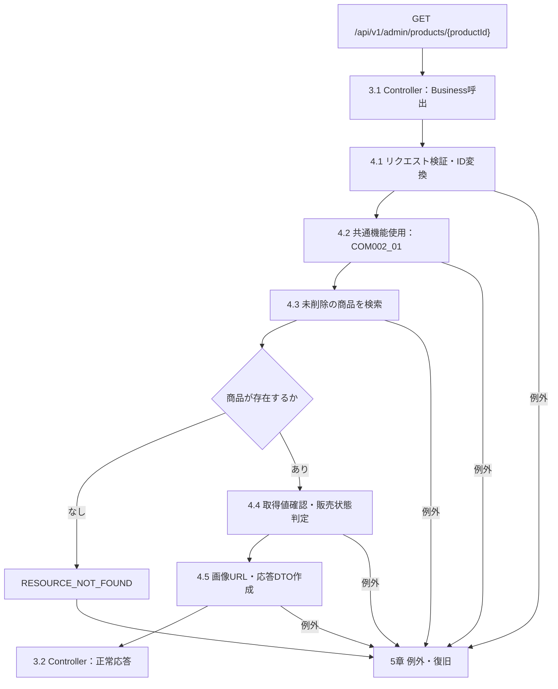

# APA002_02_管理用商品詳細取得

作成日：2026-11-17

## 0. 処理フロー



## 1. 基本情報

| 項目 | 内容 |
| --- | --- |
| 機能ID／旧ID | APA002_02／API-A05 |
| 論理名 | 管理用商品詳細取得 |
| 物理名 | get-admin-product |
| HTTP・URL | GET /api/v1/admin/products/{productId} |
| 対応画面 | SCA-03（編集モード）、SCA-02からの編集遷移 |
| 用途 | 編集フォームの初期値取得、競合発生後の最新情報確認 |
| Controller | AdminProductDetailController（親Controllerを継承） |
| Business | AdminProductDetailBusiness.execute(command, actor) |
| Mapper | ProductMapper.selectAdminProductById |
| 認証 | 管理者JWT必須。管理者用認証受付を使用 |
| DB操作 | admins・productsのSELECTのみ |
| 取得対象 | 指定IDの未削除商品。非公開・販売停止・在庫0も取得 |
| 対象外 | 商品更新、在庫確保、税計算によるDB補正、画像アップロード、操作結果の確定 |

共通ヘッダー・認証受付の詳細は本書に記載しない。Controllerは共通受付済みの入力を使用する。APA001_01での権限確認結果だけに依存せず、本APIでもadminsを確認する。

## 2. リクエスト項目

### 2.1 外部入力

| 場所 | 項目 | 必須 | 条件・用途 |
| --- | --- | --- | --- |
| ヘッダー | Authorization | 必須 | 管理者アクセストークン。チェックは共通受付で実施 |
| パス | productId | 必須 | 正の10進整数文字列。1〜19桁、先頭0なし、Long最大値以下 |
| クエリ | なし | — | 未定義クエリは受け付けない |
| ボディ | なし | — | {}・JSON nullを含め送信しない |

管理者ID・Cognito subをリクエスト項目として受け取らない。管理者は認証済みactor.subjectから特定する。ユーザー側の商品名入りURLとは別に、本APIは商品IDのパスだけを使用する。

### 2.2 呼出例・リクエストJSON

```http
GET /api/v1/admin/products/101
Authorization: Bearer <管理者アクセストークン>
```

**リクエストJSONはない。** 次は内部入力の説明用であり、HTTPボディとして送信しない。

```json
{
  "productId": "101"
}
```

### 2.3 Businessへの内部入力

| 項目 | 型 | 取得元 |
| --- | --- | --- |
| command.productId | String | パス変数。ControllerではLongへ変換しない |
| command.query | Map<String, List<String>> | 共通受付済みの全クエリ |
| command.bodyPresent | boolean | 共通受付で判定したボディ有無 |
| actor.subject | String | 信頼済み管理者認証コンテキストのsub |

## 3. Controllerの処理

### 3.1 Business呼出

1. パス変数・共通受付結果からGetAdminProductCommandを作成する。
2. commandと管理者用actorをAdminProductDetailBusiness.executeへ渡す。
3. 正常結果は3.2へ渡す。例外は共通例外処理へ伝播する。

単項目検証・項目間チェック・DB検索・権限判定・画像URL作成はControllerに実装しない。Controllerの@Validによる先行検証も行わない。

### 3.2 正常応答

Businessの結果DTOを親Controllerの正常応答メソッドへ渡す。

**共通機能使用：COM001_07 共通レスポンス生成（親Controller経由）。**

HTTP 200、dataに商品詳細、error=nullを返す。対象がない場合にdata=null・error=nullという正常応答を作らない。

## 4. Businessの処理

### 4.1 リクエスト検証・ID変換

| 順序 | 対象 | チェック・処理 | NG時 |
| --- | --- | --- | --- |
| 1 | bodyPresent | falseであること | INVALID_REQUEST |
| 2 | command.query | 空であること | INVALID_REQUEST |
| 3 | productId | null・空文字でないこと | VALIDATION_ERROR |
| 4 | productId | `[1-9][0-9]{0,18}`に一致すること | VALIDATION_ERROR |
| 5 | productId | Long.parseLongで変換可能、1〜9223372036854775807 | VALIDATION_ERROR |

- 前後空白のトリム、全角数字変換、符号除去は行わない。`001`・`+1`・`1.0`・`1e2`・空白付き値を拒否する。
- URLデコードは共通受付済み。Businessで二重デコードしない。
- DTOの@NotBlank・@Pattern等をBusinessからValidatorで実行してよい。Long範囲確認は変換時に行う。NumberFormatExceptionは入力例外へ変換する。
- 本APIには入力項目間の組合せ条件はない。ヘッダーチェックは繰り返さない。COM001_03は使用しない。
- NG時はDBを検索せず5章へ。入力したID・許可文字列などをエラーメッセージへ埋め込まない。

`/api/v1/admin/products`のようにパス自体がない要求は一覧APIのルートであり、本詳細Businessには到達しない。末尾スラッシュ等のルート不一致は共通HTTP受付の扱いに従う。

### 4.2 管理者の利用権限確認

**共通機能使用：COM002_01 管理者検索・利用権限確認。**

| 項目 | 内容 |
| --- | --- |
| 呼出 | AdminAccessService.requireActiveAdmin(actor) |
| 入力 | 共通認証受付済みの管理者actor |
| 成功 | AuthorizedAdminを受け取り4.3へ進む |
| 例外 | FORBIDDEN・DB例外等を共通例外処理へ伝播。商品処理を開始しない |

adminsのSQL・状態判定はCOM002_01へ集約し、本Businessに重複実装しない。

### 4.3 未削除の商品を検索

| 項目 | 内容 |
| --- | --- |
| テーブル | products |
| 主キー条件 | id = 4.1で変換したproductId |
| 削除条件 | is_deleted = FALSE |
| 公開・販売・在庫のWHERE条件 | 追加しない。PRIVATE・SUSPENDED・在庫0も編集対象 |
| 期待件数 | 0または1件 |
| 排他・更新 | FOR UPDATEなし。商品versionも更新しない |

| 取得カラム | Java型 | 用途 |
| --- | --- | --- |
| id | Long | 商品識別 |
| name | String | 商品名の編集初期値 |
| summary、description | String／null | 商品概要・詳細説明の編集初期値 |
| price_excluding_tax | Integer | 税抜価格の編集初期値 |
| tax_rate | Short | 税率（10は10%）の編集初期値 |
| price_including_tax | Integer | 保存済み税込価格の参照表示 |
| stock_quantity | Integer | 実在庫数の編集初期値 |
| publish_status、sales_status | String | 公開状態・販売設定の編集初期値 |
| image_s3_key | String／null | 現在画像のURL生成 |
| version | Long | 更新・削除APIに渡す版情報 |
| created_at、updated_at | OffsetDateTime | 登録・最終更新日時 |

```xml
<select id="selectAdminProductById" resultMap="AdminProductDetailRowMap">
  SELECT id, name, summary, description,
         price_excluding_tax, tax_rate, price_including_tax,
         stock_quantity, publish_status, sales_status,
         image_s3_key, version, created_at, updated_at
  FROM products
  WHERE id = #{productId,jdbcType=BIGINT}
    AND is_deleted = FALSE
</select>
```

ResultMapでは上表の物理カラムとJava型を対応付ける。値はバインドし、SQLへ文字列結合しない。Mapperタイムアウトは商品一覧と同じ初期値5秒を設定化する。自動再試行はしない。

| 取得結果 | 処理 |
| --- | --- |
| 1件 | 4.4へ |
| 0件 | RESOURCE_NOT_FOUND。不存在と論理削除済みを区別して返さない |
| 複数件 | INTERNAL_ERROR |
| DB障害 | 0件として扱わず5章へ |

**操作結果照会との区別：** このAPIは現在の商品状態の参照用。RESOURCE_NOT_FOUNDだけでは「特定の削除要求が成功した」と断定できない。登録・更新・削除要求の結果不明時はAPA002_08で対象operationIdの確定結果を確認する。

### 4.4 取得値確認・販売状態判定

| 使用するDB項目 | 正常条件 | 不正時 |
| --- | --- | --- |
| id | 正のLong、要求productIdと一致 | INTERNAL_ERROR |
| name | nullでなく1〜100コードポイント | INTERNAL_ERROR |
| summary | nullまたは200コードポイント以内 | INTERNAL_ERROR |
| description | nullまたは2000コードポイント以内 | INTERNAL_ERROR |
| price_excluding_tax | 1〜9999999のInteger | INTERNAL_ERROR |
| tax_rate | 0以上のShort（DB定義の範囲） | INTERNAL_ERROR |
| price_including_tax | 1以上のInteger | INTERNAL_ERROR |
| stock_quantity | 0〜99999のInteger | INTERNAL_ERROR |
| publish_status | PUBLICまたはPRIVATE | INTERNAL_ERROR |
| sales_status | ON_SALEまたはSUSPENDED | INTERNAL_ERROR |
| version | 1以上のLong | INTERNAL_ERROR |
| created_at、updated_at | nullでない | INTERNAL_ERROR |

商品の文字列はトリム・省略しない。欠損・不正な編集値を0・空文字・既定の公開状態で補完しない。不正な必須値がある場合は編集用DTOを返さず全体エラーにする。

税抜価格・税率・税込価格は同一行の保存済み値を返す。取得APIでは税込価格の再計算・書換えをしない。登録・更新時に税込価格をHALF_UPで算出し、3項目を同一TXで保存する責務はAPA002_05・APA002_06にある。

| 優先順 | 使用項目・条件 | availability |
| --- | --- | --- |
| 1 | publish_status='PRIVATE' OR sales_status='SUSPENDED' | UNAVAILABLE |
| 2 | publish_status='PUBLIC' AND sales_status='ON_SALE' AND stock_quantity=0 | SOLD_OUT |
| 3 | publish_status='PUBLIC' AND sales_status='ON_SALE' AND stock_quantity>=1 | AVAILABLE |

availabilityはDBカラムではなく応答用の派生値。編集対象はpublishStatus・salesStatus・stockQuantityであり、availability自体は編集しない。canAddToCartは返さない。

管理者向けstockQuantityには全件で実在庫を返す。ユーザー側の「11以上はnull」は適用しない。非公開・販売停止でも数量を返す。

### 4.5 画像URL・応答DTO作成

| 項目 | 処理 |
| --- | --- |
| productId、version | Longから10進文字列へ変換 |
| 商品名・概要・詳細説明 | DB値を全文返す。任意項目のnull・空文字を勝手に相互変換しない |
| 金額・在庫 | 数値として返す。￥・税込・カンマ等の装飾なし |
| taxRate | 整数のパーセント値。10は10%であり0.1ではない |
| createdAt、updatedAt | UTCのISO 8601文字列。表示側でJSTに整形 |
| image_s3_keyがnull・空文字 | imageUrl=null |
| image_s3_keyが正常 | 設定済みHTTPS画像配信ベースURLとキーからimageUrlを生成 |

画像キーの各パス要素をUTF-8パーセントエンコードし「/」で結合する。先頭/、空要素、.・..、制御文字、不正Unicodeを含むキーはimageUrl=nullとし、他の商品情報は返す。画像の問題を示す内部ログには生のキーを無制限に出力しない。

配信ホストはサーバー設定に限定し、DB値を任意のURLとして使用しない。S3 HEAD／GETは呼ばず、画像取得失敗は画面のNo Imageで扱う。配信設定不備は起動時に検出する。

**画像編集連携：** 生のimage_s3_keyは返却しない。既存画像を維持する場合は更新API側でDBの現在キーを維持する。新画像への変更はAPA002_03のアップロード結果に基づき更新APIが検証する。画面がimageUrlを編集して保存キーとして送り返す方式にはしない。画像URLがnullでも、保存時に既存画像を自動削除しない。更新リクエストの維持・変更・削除の具体的項目はAPA002_06で定義する。

## 5. Exception・データ復旧

**共通機能使用：COM001_08 共通例外変換。ログはCOM001_09を使用。**

| 発生条件 | error.code | error.message | fieldErrors |
| --- | --- | --- | --- |
| ボディあり、未知クエリ | INVALID_REQUEST | リクエストの内容が正しくありません。 | [] |
| 商品ID形式・範囲不正 | VALIDATION_ERROR | 入力内容をご確認ください。 | [] |
| 管理者未登録・無効・権限なし | FORBIDDEN | この操作を実行する権限がありません。 | [] |
| 商品不存在・論理削除済み | RESOURCE_NOT_FOUND | 指定された商品情報を表示できません。商品一覧からご確認ください。 | [] |
| DB接続・タイムアウト等の一時障害 | SERVICE_UNAVAILABLE | 処理を完了できませんでした。時間をおいて再試行してください。 | [] |
| SQL定義不備、取得値不正、設定不備、想定外例外 | INTERNAL_ERROR | 処理を完了できませんでした。 | [] |

ECSで捕捉して応答可能な場合はHTTP 200、data=nullとする。Gateway等の認証拒否・通信切断はこの応答形式の保証外。内部のロール名・判定条件・SQL・例外文字列は返さない。

| 対象 | 復旧・制御 |
| --- | --- |
| DB登録・更新・削除 | なし。operation_historiesも書き込まない |
| トランザクション・ロック | 明示的な更新TX・FOR UPDATEなし。参照だけを行う |
| データ復旧 | 書込みがないため補償更新・ロールバック処理は不要 |
| 一時障害・応答未受信 | 同じproductIdで再取得可能 |
| RESOURCE_NOT_FOUND | SCA-03内の対象商品参照不可案内（AE02）と一覧への導線。空の編集フォームで代替しない |
| VALIDATION_ERROR | 不正IDの場合はSCA-03の参照不可案内へ。内部形式の詳細を画面に表示しない |
| FORBIDDEN | 管理データを破棄しSCA-07へ |
| 編集中の再取得 | 未保存入力を無断で上書きしない。画面側の確認操作で最新値を採用する |

取得後の商品変更・在庫変動は本APIで防がない。更新時は取得したversionをAPA002_06へ送信し、更新APIで競合検証する。版が変わった場合に最新versionだけを取得して古い入力を自動再送してはならない。

## 6. 確認観点・参照資料

| ケース | 期待結果 |
| --- | --- |
| 未削除・公開商品 | 編集用の全項目を返す |
| 未削除・非公開／販売停止／在庫0 | 正常取得。設定・実在庫が分かる |
| 論理削除済み／不存在 | RESOURCE_NOT_FOUND |
| ID=0・負数・先頭0・小数・Long範囲外 | VALIDATION_ERROR、商品検索なし |
| 未定義クエリ・{}ボディ | INVALID_REQUEST |
| 管理者がDISABLED | 有効JWTでもFORBIDDEN |
| 商品概要・詳細説明がnull | nullで正常返却 |
| 画像未設定・不正キー | imageUrl=null、編集可能な他項目は返す |
| 金額・在庫・版の不正 | INTERNAL_ERROR、0補完しない |
| DB通信失敗 | SERVICE_UNAVAILABLE、対象なし扱いにしない |
| 取得後に別操作が在庫更新 | 取得済みversionは古くなる。後続更新APIで競合検出 |
| 同じIDを再取得 | その時点の状態を返す。DBの更新日時・版は変更しない |

参照資料：直前の設計時に確認した以下の現行定義を使用。

- [機能一覧](https://docs.google.com/spreadsheets/d/1_3cp7E1CKQ3fda4SCl4G7kGrbhWOb3ZThdh4oUXIS2s/edit)：00A_全機能一覧のAPA002_02。
- [DB設計書](https://docs.google.com/spreadsheets/d/1Ka2DV7_iX2cCcRSIbu7-sHf4spx2TAV8p5SXogauFX8/edit)：02_admins、05_products。
- SCA-03（商品登録・編集画面）の編集初期表示・競合時再取得。

2026-11-17改訂：管理者認可をCOM002_01へ集約。DB定義・外部APIの入出力は変更なし。

## 7. 返却項目

### 7.1 共通項目

HTTP 200、Content-Type: application/json、Cache-Control: no-store。

| 項目 | JSON型 | null | 内容 |
| --- | --- | --- | --- |
| requestId | string | 不可 | 要求追跡ID |
| data | object | 可 | 成功時の商品詳細。失敗時null |
| error | object | 可 | 成功時null |
| error.code | string | 不可 | 5章のコード |
| error.message | string | 不可 | 利用者向け文言 |
| error.fieldErrors | array | 不可 | 本APIは[] |

### 7.2 正常data

| 項目 | JSON型 | null | 元項目・内容 |
| --- | --- | --- | --- |
| productId | string | 不可 | products.idの10進文字列 |
| name | string | 不可 | name全文 |
| summary | string | 可 | summary全文 |
| description | string | 可 | description全文。改行保持 |
| priceExcludingTax | number | 不可 | price_excluding_tax、円単位整数 |
| taxRate | number | 不可 | tax_rate、整数パーセント |
| priceIncludingTax | number | 不可 | price_including_tax、保存済み税込価格 |
| stockQuantity | number | 不可 | stock_quantity、実在庫0〜99999 |
| publishStatus | string | 不可 | publish_status：PUBLIC／PRIVATE |
| salesStatus | string | 不可 | sales_status：ON_SALE／SUSPENDED |
| availability | string | 不可 | 4.4の派生値：AVAILABLE／SOLD_OUT／UNAVAILABLE |
| imageUrl | string | 可 | image_s3_keyから生成したHTTPS URL |
| version | string | 不可 | version、更新・削除時の競合確認用 |
| createdAt | string | 不可 | created_at、UTC ISO 8601 |
| updatedAt | string | 不可 | updated_at、UTC ISO 8601 |

### 7.3 正常JSON例

```json
{
  "requestId": "req-admin-product-001",
  "data": {
    "productId": "101",
    "name": "サンプル商品",
    "summary": "商品概要",
    "description": "商品の詳細説明です。\n改行を保持します。",
    "priceExcludingTax": 1800,
    "taxRate": 10,
    "priceIncludingTax": 1980,
    "stockQuantity": 20,
    "publishStatus": "PRIVATE",
    "salesStatus": "ON_SALE",
    "availability": "UNAVAILABLE",
    "imageUrl": null,
    "version": "3",
    "createdAt": "2026-11-01T03:00:00.000Z",
    "updatedAt": "2026-11-17T09:30:00.000Z"
  },
  "error": null
}
```

### 7.4 対象なしJSON例（HTTP 200）

```json
{
  "requestId": "req-admin-product-002",
  "data": null,
  "error": {
    "code": "RESOURCE_NOT_FOUND",
    "message": "指定された商品情報を表示できません。商品一覧からご確認ください。",
    "fieldErrors": []
  }
}
```

### 7.5 DB一時障害JSON例（HTTP 200）

```json
{
  "requestId": "req-admin-product-003",
  "data": null,
  "error": {
    "code": "SERVICE_UNAVAILABLE",
    "message": "処理を完了できませんでした。時間をおいて再試行してください。",
    "fieldErrors": []
  }
}
```
