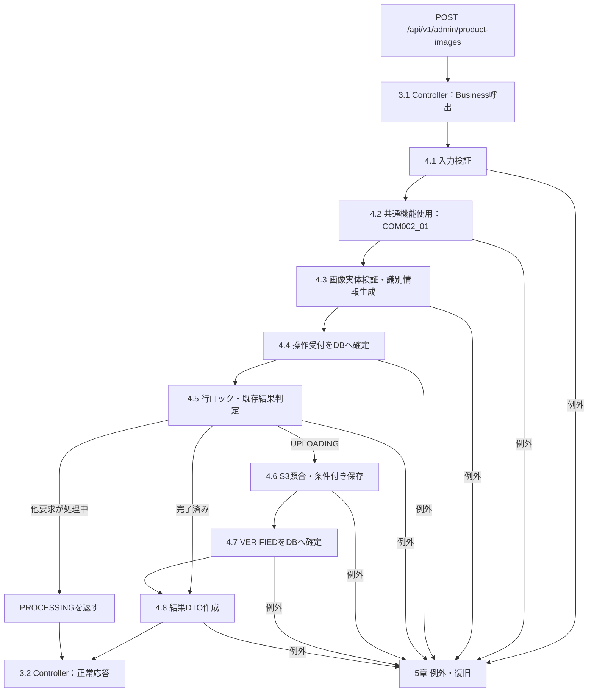

# APA002_03_商品画像アップロード（S3連携・実体検証）

## 0. 処理フロー



作成日：2026-11-17

## 1. 基本情報

| 項目 | 内容 |
| --- | --- |
| 機能ID／旧ID | APA002_03／API-A06 |
| 物理名 | upload-product-image |
| HTTP・URL | POST /api/v1/admin/product-images |
| 対応画面 | SCA-03 商品登録・編集 |
| Controller | AdminProductImageController（親Controllerを継承） |
| Business | ProductImageUploadBusiness.execute(command, actor) |
| 認証 | 管理者JWT必須。共通受付で確認済みactorを使用 |
| 受付方式 | multipart/form-dataでECSへファイルを送信。署名付きURL発行方式ではない |
| DB | admins参照、product_image_uploads登録・更新 |
| 外部処理 | S3 HeadObject／PutObject。ECSタスクロールで実行 |
| べき等識別 | uploadOperationId。同じ操作IDを再送しても別画像を作らない |
| 結果照会 | APA002_04：GET /api/v1/admin/product-images/operations/{uploadOperationId} |
| 変更しない情報 | products、operation_histories、既存商品の画像、在庫・価格 |

本APIは画像を使用可能な状態にする。商品への紐付けとATTACHEDへの変更はAPA002_05・06で行う。画像だけの成功を商品保存成功として扱わない。

本書で具体化する実装条件：単一ファイル・同期実体検証・条件付きS3保存・操作行による排他。追加のDB列は使用しない。画像の展開サイズ制限等は4.3の設定値を初期案とする。

## 2. リクエスト項目

### 2.1 HTTP入力

| 場所 | 項目 | 必須 | 条件 |
| --- | --- | --- | --- |
| Header | Authorization | ○ | 管理者アクセストークン。チェックは共通受付 |
| Header | Content-Type | ○ | multipart/form-data、boundaryあり |
| Form | uploadOperationId | ○ | UUID v4の小文字標準表記36文字。前後空白は許可しない |
| Form | file | ○ | 画像ファイル1個。1〜5,242,880バイト |
| Path／Query | なし | — | クエリ指定不可 |

未知・重複パート、複数ファイル、空ファイルは拒否。adminId、商品ID、S3キー、URL、状態、申告ファイルサイズ等は受け付けない。実際のサイズ・形式はECSが求める。

元ファイル名は1〜255 Unicodeコードポイント。パス区切り、制御文字、NUL、不正サロゲートを拒否する。名称をS3キーやローカル保存パスとして使わない。拡張子は大小文字を区別せずjpg/jpeg/png/webpのみ。

### 2.2 送信例

**実際のリクエストはJSONではない。** バイナリをBase64化してJSONに含めない。

```http
POST /api/v1/admin/product-images
Authorization: Bearer <管理者アクセストークン>
Content-Type: multipart/form-data; boundary=UploadBoundary

--UploadBoundary
Content-Disposition: form-data; name="uploadOperationId"

86f205bc-b7ed-47f7-bfc2-98fd0e68b17c
--UploadBoundary
Content-Disposition: form-data; name="file"; filename="product.png"
Content-Type: image/png

<PNGバイナリ>
--UploadBoundary--
```

内部入力の説明用JSON（HTTPボディとして送信しない）：

```json
{
  "uploadOperationId": "86f205bc-b7ed-47f7-bfc2-98fd0e68b17c",
  "file": {
    "originalFilename": "product.png",
    "contentType": "image/png",
    "actualSize": 124800
  }
}
```

### 2.3 受付上限

- Multipart解析はSpring MVCの標準受付を使用する。COM001_10のJSON変換を本ファイルに適用しない。
- ファイル上限5MiB、要求全体上限6MiB、パート数2を設定する。上限超過をECSで捕捉できた場合は共通例外変換へ渡す。
- Multipartの二重項目をDTO変換で黙って捨てない。Controllerへ渡す受付情報にパート名・件数・全クエリを残し、4.1で判定する。
- API Gateway／ALB等で先に拒否された応答はHTTP 200統一の対象外。

## 3. Controllerの処理

### 3.1 Business呼出

| 入力 | 渡す値 |
| --- | --- |
| command | uploadOperationId、MultipartFile、パート一覧、クエリ一覧 |
| actor | 共通受付済み管理者actor |

`business.execute(command, actor)`を呼ぶ。画像検証、DB操作、S3操作はControllerへ実装しない。

### 3.2 正常応答

Businessが返す結果DTOを親Controllerの正常応答処理へ渡す。
**共通機能使用：COM001_07 共通レスポンス生成。** HTTP 200、requestId/data/errorの形式で返す。

## 4. Businessの処理

### 4.1 入力検証

| チェック | 条件 | 不正時 |
| --- | --- | --- |
| パート・クエリ | 2.1に一致、未知・重複項目なし | INVALID_REQUEST |
| 操作ID | 必須、UUID v4形式、36文字 | VALIDATION_ERROR |
| ファイル名 | 2.1の長さ・禁止文字・拡張子 | VALIDATION_ERROR |
| ファイル | 1個、実測1〜5,242,880バイト | VALIDATION_ERROR |
| パートContent-Type | image/jpeg、image/png、image/webp | VALIDATION_ERROR |

単項目はDTO＋Jakarta Validationとファイル検証で行う。入力値の切り詰め・自動補完はしない。失敗した場合はDB操作・S3操作へ進まない。

### 4.2 管理者利用権限確認

**共通機能使用：COM002_01 管理者検索・利用権限確認。**

`adminAccessService.requireActiveAdmin(actor)`を呼び、`AuthorizedAdmin.adminId`を受け取る。成功時だけ4.3へ進む。例外は5章へ渡す。管理者IDをクライアントから採用しない。

### 4.3 画像実体検証・識別情報生成

| 順番 | 処理 | 判定・結果 |
| --- | --- | --- |
| 1 | 上限付きで入力を最後まで読み込む | 5MiB超過・空・読込不良は拒否。以降は同じ不変バイト列を使う |
| 2 | シグネチャと画像デコーダで形式を特定 | JPEG／PNG／WebP以外は拒否。拡張子・Content-Typeとの一致を確認 |
| 3 | デコード前に幅・高さ・フレーム数を確認 | 初期設定：各辺1〜4,096、幅×高さはlongで計算し16,000,000以下。静止画1フレームのみ |
| 4 | 画像全体をデコードする | 破損・打切り・読込エラーは拒否。警告で破損が判明するものも拒否。解像度ヘッダーだけで合格としない |
| 5 | 元バイト列のSHA-256を計算 | fileSha256（32バイト）。S3 checksum用Base64と内部比較用hexを作成 |
| 6 | 要求フィンガープリントを生成 | 下記のrequestFingerprintを作成 |
| 7 | S3キーを生成 | `product-images/{uploadOperationId}/{requestFingerprint}.{ext}` |

- MIMEと保存拡張子は実体から決定する。JPEGの保存拡張子はjpgへ統一。
- 画像デコーダはJPEG・PNG・WebPの実デコードに対応するものを導入する。WebP Readerの登録を起動時に検証し、未導入を「利用者の画像不正」にしない。採用ライブラリ・バージョンは依存関係管理で固定する。
- サイズ／フレーム上限は展開時のリソース保護条件。上限変更時は画面のファイル選択条件にも反映する。
- 元画像を保存するためメタデータ除去・リサイズは行わない。実体検証はマルウェア検査の代替ではない。
- Reader、ストリーム、一時ファイルはfinallyで解放する。画像検証はDBトランザクション開始前に完了させる。

**フィンガープリントの計算**

`SHA-256`へ、順に「v1」「adminIdの10進文字列」「元ファイル名」「検出MIME」「実測サイズの10進文字列」「fileSha256の小文字hex」を入力する。各文字列はUTF-8化し、直前にバイト長を4バイト符号なしビッグエンディアンで付ける。結果は小文字hex64文字。

既存DBの`s3_object_key`へこの値を含めることで、同一IDで異なるファイル内容・ファイル名を再送したことを判定する。S3キーはサーバーだけが生成し、ファイル名・メールアドレスは含めない。

### 4.4 操作受付の登録・確定（TX-A）

検証済み画像の受付記録を短いトランザクションで登録し、**コミット成功後にのみS3へ進む**。

| 登録先 | product_image_uploads |
| --- | --- |
| upload_operation_id | リクエストのuploadOperationId |
| admin_id | 4.2のadminId |
| s3_object_key | 4.3で生成したキー |
| original_filename | 検証済み元ファイル名 |
| mime_type／file_size | 実体MIME／実測バイト数 |
| status | UPLOADING |
| created_at／updated_at | DB時刻（TIMESTAMPTZ(3)） |

```sql
INSERT INTO product_image_uploads (
  upload_operation_id, admin_id, s3_object_key, original_filename,
  mime_type, file_size, status, created_at, updated_at
) VALUES (
  #{uploadOperationId,jdbcType=VARCHAR}, #{adminId,jdbcType=BIGINT},
  #{s3ObjectKey,jdbcType=VARCHAR}, #{originalFilename,jdbcType=VARCHAR},
  #{mimeType,jdbcType=VARCHAR}, #{fileSize,jdbcType=INTEGER},
  'UPLOADING', CURRENT_TIMESTAMP, CURRENT_TIMESTAMP
)
ON CONFLICT (upload_operation_id) DO NOTHING;
```

- 1件登録：コミット後4.5へ。0件：既存操作として4.5へ。
- 競合待ちのロックタイムアウト：ロールバック後、PROCESSINGを返す。既存成功結果とは断定しない。
- コミット応答不明：S3を実行せず、SERVICE_UNAVAILABLE。APA002_04で照会する。
- 他の制約違反を操作ID重複として握りつぶさない。

### 4.5 操作行ロック・既存結果判定（TX-B開始）

| 項目 | 内容 |
| --- | --- |
| 取得先 | product_image_uploads |
| 取得項目 | upload_operation_id、admin_id、s3_object_key、original_filename、mime_type、file_size、status |
| 条件 | upload_operation_id＝指定ID |
| 排他 | FOR UPDATE NOWAIT。結果照会・商品紐付けも同じ行の排他に従う |

```sql
SELECT upload_operation_id, admin_id, s3_object_key, original_filename,
       mime_type, file_size, status
FROM product_image_uploads
WHERE upload_operation_id = #{uploadOperationId,jdbcType=VARCHAR}
FOR UPDATE NOWAIT;
```

| 判定 | 次の処理 |
| --- | --- |
| 0件 | TX-A後に不整合。INTERNAL_ERROR |
| admin_id不一致 | RESOURCE_NOT_FOUND。別管理者の情報を返さない |
| キー・名称・MIME・サイズが今回の検証値と不一致 | IDEMPOTENCY_KEY_REUSED。S3へ送信しない |
| VERIFIED／ATTACHED | 更新せずTX終了。4.8で現在状態を返す |
| UPLOADING | 行ロックを保持して4.6へ |
| FAILED | 更新・再送せずBUSINESS_RULE_VIOLATION。修正／再操作は新しいID |
| 未定義状態・必須DB値不正 | INTERNAL_ERROR |
| 行ロック取得不可 | TXをロールバックしてPROCESSINGを返す |

この機能では重複送信と復旧処理を直列化するため、TX-B内にS3通信を含める。S3とDBが一緒にロールバックされるわけではない。S3全体の通信期限を設定し、DB接続を長時間占有しない（初期案：S3処理全体10秒、TX-B 15秒）。Business全体を1つの@Transactionalで囲まず、TX-AとTX-Bを別のTransactionTemplate等で実行する。

### 4.6 S3の既存実体照合・条件付き保存（TX-B内）

まず設定済みバケット・DBキーにHeadObjectを行う。

| 照合対象 | 一致条件 |
| --- | --- |
| ContentLength | DBのfile_size |
| ContentType | DBのmime_type |
| ユーザーメタデータ | upload-operation-id、request-fingerprintが今回の値と一致 |
| ChecksumSHA256 | 4.3のfileSha256のBase64と一致。ChecksumMode=ENABLEDで取得 |

| HeadObject結果 | 処理 |
| --- | --- |
| 実体あり・全項目一致 | 前回保存済みとしてPutせず4.7へ |
| 実体あり・不一致／checksum欠損 | INTERNAL_ERROR。上書き・削除せず調査対象 |
| 明確なNoSuchKey（404） | 以下のPutObjectを1回実行 |
| 403／5xx／タイムアウト | 不存在とみなさずSERVICE_UNAVAILABLE。5章へ |

| PutObject項目 | 設定値 |
| --- | --- |
| bucket／key | 設定済みバケット／DBのs3_object_key |
| body／contentLength | 4.3で検証した不変バイト列／実測サイズ |
| contentType | 実体から確定したMIME |
| ifNoneMatch | `*`（既存キーへ上書きしない） |
| checksumSHA256 | 元バイト列SHA-256のBase64 |
| metadata | upload-operation-id、request-fingerprint |
| 暗号化・ACL | バケットの暗号化設定を使用。public-read ACLを設定しない |

- Put成功：返却checksumが一致することを確認し4.7へ。
- 412（既存オブジェクトあり）：再度Headし、全項目一致なら4.7へ。不一致は停止。
- 409・通信切断・タイムアウト：結果不明。即座にFAILEDにせず5章へ。
- この要求内ではPutの自動再送を行わない。SDKの書込みリトライも無効化する。再操作は結果照会を先に行う。
- ETagをSHA-256として比較しない。バケット名・キー・S3例外本文を利用者向けエラーに出さない。

### 4.7 検証済み状態の更新・確定（TX-Bコミット）

```sql
UPDATE product_image_uploads
SET status = 'VERIFIED', updated_at = CURRENT_TIMESTAMP
WHERE upload_operation_id = #{uploadOperationId,jdbcType=VARCHAR}
  AND admin_id = #{adminId,jdbcType=BIGINT}
  AND s3_object_key = #{s3ObjectKey,jdbcType=VARCHAR}
  AND status = 'UPLOADING';
```

更新1件でコミット。0件は不整合としてロールバックし、成功扱いにしない。**DBコミット成功確認後にのみVERIFIEDを返す。** 更新失敗・コミット結果不明ではS3オブジェクトを補償削除しない。

### 4.8 結果DTO作成

| DB／処理状態 | 応答 |
| --- | --- |
| VERIFIED | uploadStatus=VERIFIED。商品保存APIへ渡せる |
| ATTACHED | uploadStatus=ATTACHED。既に紐付け済み。別商品へ再利用しない |
| ロック競合で未確定 | uploadStatus=PROCESSING。商品保存へ進めない |

`uploadOperationId`を画像識別子として返す。商品保存APIはこのIDを受け取り、DBからキーを取得する。任意のS3キーをフロントから受け付けない。

プレビューは選択済みファイルを使用するため、本APIでは画像URL・S3キーを返さない。**COM001_11は本APIでは使用しない。**

## 5. 例外・データ復旧

### 5.1 例外応答

**共通機能使用：COM001_08 共通例外変換。** TXを終了させて例外を伝播する。**共通機能使用：COM001_09 アプリケーションログ出力・秘匿。** requestId、操作ID、処理章番号、DB確定状況を記録し、画像本体・アクセストークン・元ファイル名は記録しない。

| 条件 | error.code | message | 復旧 |
| --- | --- | --- | --- |
| 未知・重複入力 | INVALID_REQUEST | リクエストの内容が正しくありません。 | 入力修正 |
| 必須・形式・サイズ・画像実体不正 | VALIDATION_ERROR | 入力内容をご確認ください。 | 画像／入力修正 |
| 管理者権限なし | FORBIDDEN | この操作を実行する権限がありません。 | 管理者再確認 |
| 他管理者の操作ID | RESOURCE_NOT_FOUND | 指定された情報を表示できません。 | 他者情報は返さない |
| 同じIDで異なる要求 | IDEMPOTENCY_KEY_REUSED | 操作を確認できませんでした。内容をご確認ください。 | 元の操作を照会 |
| FAILEDの再利用 | BUSINESS_RULE_VIOLATION | 現在の状態ではこの操作を実行できません。 | 新規操作IDで再操作 |
| DB／S3一時障害、確定不明 | SERVICE_UNAVAILABLE | 処理を完了できませんでした。時間をおいて再試行してください。 | 同じIDで結果照会 |
| 不整合・設定不備・想定外例外 | INTERNAL_ERROR | 処理を完了できませんでした。 | 状態照会・運用調査 |

ECSで捕捉できる例外はHTTP 200、data=null。fieldErrorsは原則空配列とし、内部状態名・キー構造・必須enumなどをメッセージへ含めない。画像不正の詳細はサーバーログに安全な分類コードで残す。

### 5.2 中断位置ごとの復旧

| 中断位置 | 残る可能性のある状態 | 復旧方法 |
| --- | --- | --- |
| TX-A以前／ロールバック確定 | DBなし、S3なし | 同じID・同じ画像で再送可能 |
| TX-Aコミット不明 | DBなし又はUPLOADING | APA002_04で照会。同じIDでの再送は一意制約で吸収 |
| TX-A成功後・S3前 | UPLOADING、S3なし | 同じ要求の再送が行ロックを取得して保存を再開可能 |
| Put成功後・TX-B更新前に停止 | UPLOADING、S3あり | APA002_04が実体一致を確認してVERIFIEDへ復旧 |
| TX-Bロールバック | UPLOADING、S3は存在する場合あり | S3は削除しない。結果照会で一致確認 |
| TX-Bコミット応答不明 | UPLOADING又はVERIFIED | 結果照会でDBとS3を確認 |
| 正常応答だけ未着 | VERIFIED又はATTACHED | 同じ操作IDの照会／同じ要求の再送で既存結果取得 |

**APA002_04へ引き継ぐ復旧契約：**

1. 認可・所有者確認後、同じ操作行をFOR UPDATE NOWAITで確認する。ロック競合はPROCESSING。
2. UPLOADINGかつS3あり：サイズ・MIME・操作ID・フィンガープリント・checksumを確認する。HEADのchecksumから4.3と同じフィンガープリントを再計算し、DBキーと一致した場合のみVERIFIEDへ更新する。
3. UPLOADINGかつS3なし：直ちに未実行確定としない。受付から15分以内はPROCESSING、15分経過後は行ロック下でFAILEDへ変更する。以後、元要求が再開しても4.5で拒否する。
4. S3／DBの確認失敗はFAILEDにしない。タイムアウトした古いPutが遅れて成功しても、FAILEDの操作を商品へ紐付けない。
5. 操作行なしは「確認できる記録なし」として返し、別IDの再送を促さない。同じID・同じ内容での再送のみ許可すれば一意制約と条件付きPutで重複を防げる。

### 5.3 未使用画像の回収・商品保存との連携

- 本APIの失敗ハンドラーではS3削除を行わない。
- 運用清掃は未添付で最終更新から24時間以上経過した行を対象とする（初期設定）。同じ行をロックし、products.image_s3_keyに参照がないことを確認する。VERIFIED／UPLOADINGはFAILEDへ確定してから、別処理でS3を削除する。
- 商品保存は同じ操作行をロックし、同一管理者・VERIFIEDを確認してから、商品へのキー設定とATTACHED更新を同一DBトランザクションで行う。清掃に先を越された場合は再アップロードを案内する。
- FAILEDの行は遅延Putによる孤立オブジェクトの再照合対象として残す。削除に失敗しても次回清掃で再試行する。操作行は今回自動削除しない。
- ATTACHEDは本清掃の対象外。商品画像差替え後の旧画像回収は別途扱う。
- キーのプレフィックスだけを条件にしたS3 Lifecycle削除は設定しない。添付済みも同じキーを使用するため。

## 6. 実装前提・関連設計への反映事項

| 対象 | 必要事項 |
| --- | --- |
| APA002_04 | 5.2のロック・S3照合・状態確定。照会による復旧更新を明記 |
| APA002_05・06 | uploadOperationIdで画像指定、所有者・VERIFIED確認、商品更新とATTACHED更新の原子性 |
| SCA-03 | 静止画・寸法制限、PROCESSING／ATTACHEDの扱い。商品保存にはキーでなく操作IDを送信 |
| IaC／設定 | 受付上限、S3通信期限、バケット・配信設定、対象プレフィックスへのPut/Get・存在判定権限、運用清掃権限 |
| DB | 現行product_image_uploadsの列・状態を使用。追加列なし |

上記関連設計書・設定ファイルは本書作成では変更していない。

技術参照：
- [Amazon S3 PutObject](https://docs.aws.amazon.com/AmazonS3/latest/API/API_PutObject.html)
- [S3条件付き書込み](https://docs.aws.amazon.com/AmazonS3/latest/userguide/conditional-writes.html)
- [Java 21 ImageReader](https://docs.oracle.com/javase/jp/21/docs/api/java.desktop/javax/imageio/ImageReader.html)

## 7. 返却項目

### 7.1 ヘッダー・共通項目

| 項目 | 値／型 | 内容 |
| --- | --- | --- |
| HTTP | 200 | ECSが生成する正常・例外応答 |
| Content-Type | application/json | JSON応答 |
| Cache-Control | no-store | 保存しない |
| requestId | string | 要求追跡ID |
| data | object／null | 正常・処理中は結果DTO。例外はnull |
| error | object／null | 正常・処理中はnull |
| error.code／message | string | 5.1のコード／利用者向け文言 |
| error.fieldErrors | array | 本APIでは原則[] |

### 7.2 data

| 項目 | 型 | null | 内容 |
| --- | --- | --- | --- |
| uploadOperationId | string | 不可 | 受付操作ID。結果照会・商品保存に使用 |
| uploadStatus | string | 不可 | VERIFIED／ATTACHED／PROCESSING |

VERIFIEDはアップロード・実体検証・DB確定の完了。ATTACHEDは既に商品に紐付け済み。PROCESSINGは今回結果を確定できず、照会が必要。HTTP 200だけで完了判定しない。

**正常完了**

```json
{
  "requestId": "req-image-001",
  "data": {
    "uploadOperationId": "86f205bc-b7ed-47f7-bfc2-98fd0e68b17c",
    "uploadStatus": "VERIFIED"
  },
  "error": null
}
```

**他要求が処理中**

```json
{
  "requestId": "req-image-002",
  "data": {
    "uploadOperationId": "86f205bc-b7ed-47f7-bfc2-98fd0e68b17c",
    "uploadStatus": "PROCESSING"
  },
  "error": null
}
```

**入力不正**

```json
{
  "requestId": "req-image-003",
  "data": null,
  "error": {
    "code": "VALIDATION_ERROR",
    "message": "入力内容をご確認ください。",
    "fieldErrors": []
  }
}
```

**DB／S3障害・結果未確定**

```json
{
  "requestId": "req-image-004",
  "data": null,
  "error": {
    "code": "SERVICE_UNAVAILABLE",
    "message": "処理を完了できませんでした。時間をおいて再試行してください。",
    "fieldErrors": []
  }
}
```
