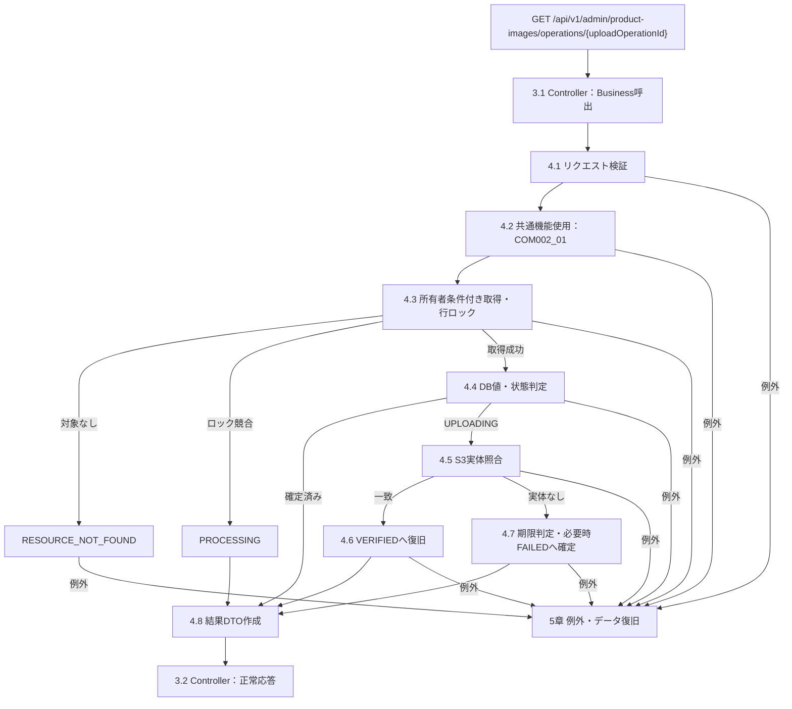

# APA002_04_商品画像アップロード結果照会

## 0. 処理フロー



作成日：2026-11-17

## 1. 基本情報

| 項目 | 内容 |
| --- | --- |
| 機能ID／旧ID | APA002_04／API-A07 |
| 物理名 | get-product-image-upload-result |
| HTTP・URL | GET /api/v1/admin/product-images/operations/{uploadOperationId} |
| 対応画面 | SCA-03：画像アップロード結果不明時・再読み込み後の結果確認 |
| Controller | AdminProductImageResultController（親Controllerを継承） |
| Business | ProductImageUploadResultBusiness.execute(command, actor) |
| 認証 | 管理者JWT必須。共通受付済みactorを使用 |
| DB操作 | admins参照、product_image_uploads参照・復旧更新 |
| S3操作 | HeadObjectのみ。アップロード・削除・画像本体取得なし |
| べき等キー | 新規発行不要。元のuploadOperationIdをパスで指定 |
| 変更しない情報 | products、operation_histories、既存商品画像 |

APA002_03の復旧契約に合わせ、**照会時にUPLOADINGの記録をVERIFIED／FAILEDへ確定する処理を含む**。純粋な読取専用GETではない。URL・メソッドは現行機能一覧を維持し、キャッシュ・プリフェッチを無効にする。将来GETを読取専用に統一する場合は、復旧を別の更新処理へ移す必要がある。

本APIは画像の処理結果を返す。商品登録・更新自体の成功判定は商品保存結果照会で行う。

## 2. リクエスト項目

### 2.1 外部入力

| 場所 | 項目 | 必須 | チェック・用途 |
| --- | --- | --- | --- |
| Header | Authorization | ○ | 管理者アクセストークン。チェックは共通受付 |
| Path | uploadOperationId | ○ | UUID v4、小文字標準表記36文字。元のアップロード操作ID |
| Query | なし | — | 未定義クエリを拒否 |
| Body | なし | — | 空オブジェクト・JSON nullを含め送信しない |

管理者ID、S3キー、画像ファイル、要求する状態を受け取らない。所有者は認証済みactorから取得する。

### 2.2 リクエスト例

```http
GET /api/v1/admin/product-images/operations/86f205bc-b7ed-47f7-bfc2-98fd0e68b17c
Authorization: Bearer <管理者アクセストークン>
```

リクエストJSONはない。以下は内部入力の説明用であり、送信ボディではない。

```json
{
  "uploadOperationId": "86f205bc-b7ed-47f7-bfc2-98fd0e68b17c"
}
```

## 3. Controllerの処理

### 3.1 Business呼出

| 引数 | 内容 |
| --- | --- |
| command.uploadOperationId | パスの文字列 |
| command.query | 全クエリ項目・値 |
| command.bodyPresent | 共通受付で判定したボディ有無 |
| actor | 共通受付済み管理者actor |

`business.execute(command, actor)`を呼び出す。Controller内でDB検索・状態判定・S3照合を行わない。

### 3.2 正常応答

結果DTOを親Controllerの正常応答処理へ渡す。
**共通機能使用：COM001_07 共通レスポンス生成。** HTTP 200、Cache-Control: no-storeで応答する。

## 4. Businessの処理

### 4.1 リクエスト検証

| チェック | 条件 | 不正時 |
| --- | --- | --- |
| uploadOperationId | 必須、36文字、UUID v4の小文字標準表記 | VALIDATION_ERROR |
| クエリ | 0項目 | INVALID_REQUEST |
| ボディ | 未送信 | INVALID_REQUEST |

操作IDはトリム・小文字化・補完しない。UUID文字列の単項目検証はDTO＋Jakarta Validation等で行い、Businessから実行する。項目間チェックはない。

### 4.2 管理者利用権限確認

**共通機能使用：COM002_01 管理者検索・利用権限確認。**

`adminAccessService.requireActiveAdmin(actor)`を要求ごとに1回呼ぶ。返却された`AuthorizedAdmin.adminId`を4.3の検索条件へ使用する。例外時はDB・S3の業務処理を開始しない。

### 4.3 操作記録の取得・行ロック

ここから単一の復旧トランザクションを開始する。読取専用トランザクションにはしない。

| 項目 | 内容 |
| --- | --- |
| テーブル | product_image_uploads |
| 取得項目 | upload_operation_id、admin_id、s3_object_key、original_filename、mime_type、file_size、status、created_at、updated_at |
| 取得条件 | upload_operation_id＝パスのID、admin_id＝4.2の管理者ID |
| 排他 | FOR UPDATE NOWAIT |
| 更新競合相手 | APA002_03、商品保存の画像紐付け、同じ結果照会、未使用画像清掃 |

```sql
SELECT upload_operation_id, admin_id, s3_object_key, original_filename,
       mime_type, file_size, status, created_at, updated_at
FROM product_image_uploads
WHERE upload_operation_id = #{uploadOperationId,jdbcType=VARCHAR}
  AND admin_id = #{adminId,jdbcType=BIGINT}
FOR UPDATE NOWAIT;
```

| 取得結果 | 次の処理 |
| --- | --- |
| 1件 | 4.4へ |
| 0件 | TX終了後RESOURCE_NOT_FOUND。不存在と他者の操作は同一応答 |
| 行ロック競合 | TX全体をロールバック後、uploadStatus=PROCESSINGとして4.8へ |
| DB通信障害・その他SQL例外 | ロールバック後5章へ |

NOWAITによる競合だけをPROCESSINGへ変換する。接続障害やSQL不備を処理中として握りつぶさない。PostgreSQLでSQL例外が起きたトランザクション内で後続SQLを実行しない。

0件でも、別要求の操作受付が未コミットである可能性がある。**未実行・失敗確定とは判定しない。** 新しいIDでの自動再アップロードは行わせない。

### 4.4 DB取得値・状態判定

| 項目 | 正常条件 |
| --- | --- |
| admin_id／upload_operation_id | 検索条件と一致 |
| s3_object_key | APA002_03のキー形式に完全一致。操作ID・64桁小文字hexのフィンガープリント・実体拡張子を保持 |
| original_filename | 1〜255コードポイント、APA002_03の禁止文字なし |
| mime_type | image/jpeg、image/png、image/webp |
| file_size | 1〜5,242,880 |
| created_at／updated_at | 有効な時点、updated_at≧created_at |
| status | UPLOADING／VERIFIED／ATTACHED／FAILED |

DB値不正はINTERNAL_ERROR。0・空文字・適当な状態で補完しない。任意のDBキーを無検証でS3へ渡さない。

| status | 次の処理 |
| --- | --- |
| VERIFIED | DBで確定した結果を返す。S3再照合・更新なし、TX終了→4.8 |
| ATTACHED | 紐付け済み結果を返す。再紐付け・S3再照合なし、TX終了→4.8 |
| FAILED | 利用不可の確定結果を返す。S3に実体があっても復活させない。TX終了→4.8 |
| UPLOADING | ロックを保持して4.5へ |

VERIFIEDは現在のS3可用性を保証する項目ではない。成功済み操作の照会ごとに画像の存在・配信可否を再検証しない。

### 4.5 S3実体・フィンガープリント照合

| HeadObjectリクエスト | 設定値 |
| --- | --- |
| bucket | サーバー設定済み画像バケット |
| key | 4.4で検証したDBのs3_object_key |
| checksumMode | ENABLED |
| 実行権限 | ECSタスクロール。クライアントのAWS認証情報は使用しない |

初期設定はS3通信全体10秒、復旧TX15秒。SDKリトライを含む合計期限を超えたら中止する。ロックを保持したまま無制限に待たない。

| S3結果 | 次の処理 |
| --- | --- |
| 正常取得 | 下記の一致検証 |
| 対象オブジェクト不存在の404 | 4.7へ |
| 403、5xx、通信切断・タイムアウト | SERVICE_UNAVAILABLE。FAILEDへ変更しない |
| その他の設定・要求異常 | INTERNAL_ERROR。FAILEDへ変更しない |

HeadObjectは詳細な例外本文を返さない場合があるため、`NoSuchKey`というSDK例外クラスだけに依存しない。404を不存在と判断できるよう、正しいバケット・所有者・権限を環境構築時に確認する。403を不存在扱いにしない。

**取得項目と一致条件**

| 項目 | 条件 |
| --- | --- |
| ContentLength | DBのfile_sizeと一致 |
| ContentType | DBのmime_typeと一致 |
| Metadata.upload-operation-id | DBのupload_operation_idと一致 |
| Metadata.request-fingerprint | DBキー内のフィンガープリントと一致 |
| ChecksumSHA256 | Base64として正常に解析でき、復号後32バイト |
| 再計算したフィンガープリント | DBキー内とMetadataの両方に一致 |

再計算はAPA002_03と同じ内部処理を使用する。COM番号を新設せず、画像アップロード関連の内部ヘルパーとして共有する。

1. HEADのChecksumSHA256を32バイトへ復号し、小文字hexへ変換する。
2. 「v1」「DBのadmin_idの10進文字列」「original_filename」「mime_type」「file_sizeの10進文字列」「1のhex」の順にUTF-8化する。
3. 各文字列の直前にバイト長を4バイト符号なしビッグエンディアンで付け、全体のSHA-256を計算して小文字hex64桁へ変換する。
4. DBキーの`product-images/{uploadOperationId}/{fingerprint}.{ext}`と照合する。extはJPEG=jpg、PNG=png、WebP=webp。

全項目一致→4.6。不一致・checksum欠損→INTERNAL_ERROR。画像を上書き・削除せず調査対象とする。

本APIでは画像のデコードをやり直さない。APA002_03が実体検証後に受付行を作成し、検証済みバイト列のchecksumを付けてPutしたこと、他経路による同一キー上書きを許可しないことが前提。ETagをSHA-256の代わりにしない。

### 4.6 VERIFIEDへの復旧更新

```sql
UPDATE product_image_uploads
SET status = 'VERIFIED', updated_at = CURRENT_TIMESTAMP
WHERE upload_operation_id = #{uploadOperationId,jdbcType=VARCHAR}
  AND admin_id = #{adminId,jdbcType=BIGINT}
  AND s3_object_key = #{s3ObjectKey,jdbcType=VARCHAR}
  AND status = 'UPLOADING';
```

| 判定 | 処理 |
| --- | --- |
| 更新1件 | コミット。成功確認後にVERIFIEDを4.8へ |
| 更新0件・複数件 | ロールバック、INTERNAL_ERROR |
| コミット結果不明 | 成功を返さずSERVICE_UNAVAILABLE。同じIDで再照会 |

S3実体が一致した場合は、受付から15分を過ぎていてもVERIFIEDへ復旧する。時間経過だけで、保存済み画像を失敗にしない。

### 4.7 実体不存在時の期限判定・FAILED確定

S3の不存在を確認した後、DB時刻を取得する。

```sql
SELECT clock_timestamp() AS checked_at;
```

`deadline = created_at + 15分`。APIを再照会しても期限を延長しない。

| 条件 | 処理 |
| --- | --- |
| checked_atがcreated_atより前 | 時刻不整合。INTERNAL_ERROR |
| checked_at＜deadline | 更新せずTX終了、PROCESSINGを返す |
| checked_at≧deadline | 下記更新を実行しコミット後FAILEDを返す |

```sql
UPDATE product_image_uploads
SET status = 'FAILED', updated_at = CURRENT_TIMESTAMP
WHERE upload_operation_id = #{uploadOperationId,jdbcType=VARCHAR}
  AND admin_id = #{adminId,jdbcType=BIGINT}
  AND status = 'UPLOADING'
  AND created_at <= #{checkedAt,jdbcType=TIMESTAMP_WITH_TIMEZONE}
                    - INTERVAL '15 minutes';
```

更新1件が必要。0件は不整合としてロールバックしINTERNAL_ERROR。コミット不明はSERVICE_UNAVAILABLE。

FAILEDは「この操作の画像を以後商品へ紐付けない」と確定した状態。S3への書込みが一度もなかったという意味ではない。古いPutが遅れて成功しても、APA002_03・商品保存側はFAILEDを確認して利用を拒否する。孤立オブジェクトは未使用画像清掃で回収する。

### 4.8 結果DTO作成

| 判定結果 | data.uploadStatus | 呼出元が行う操作 |
| --- | --- | --- |
| 検証済み | VERIFIED | 元のuploadOperationIdで商品保存へ進む。保存側で再度状態確認 |
| 紐付け済み | ATTACHED | 商品保存結果を確認する。別商品への使い回し・自動再保存はしない |
| 処理継続・ロック競合 | PROCESSING | 同じIDで時間をおいて再照会。新規IDで再送しない |
| 利用不可確定 | FAILED | 同じIDは再利用しない。必要なら画像を選択し直して新規IDでアップロード |

S3キー・バケット・画像URL・checksum・元ファイル名は返却しない。商品保存側が操作IDからDBキーを取得する。**COM001_11は使用しない。**

## 5. 例外・データ復旧

### 5.1 例外の変換

**共通機能使用：COM001_08 共通例外変換。**
**共通機能使用：COM001_09 アプリケーションログ出力・秘匿。**

TX終了後に例外を伝播する。ログはrequestId、操作ID、処理章番号、例外分類、DB確定状況を記録する。アクセストークン、画像本体、元ファイル名、S3の詳細レスポンスをそのまま記録しない。

| 条件 | error.code | message |
| --- | --- | --- |
| 操作ID形式不正 | VALIDATION_ERROR | 入力内容をご確認ください。 |
| 未定義クエリ・ボディ送信 | INVALID_REQUEST | リクエストの内容が正しくありません。 |
| 管理者権限なし | FORBIDDEN | この操作を実行する権限がありません。 |
| 記録なし・別管理者の記録 | RESOURCE_NOT_FOUND | 指定された情報を表示できません。 |
| DB／S3の一時障害・コミット不明 | SERVICE_UNAVAILABLE | 処理を完了できませんでした。時間をおいて再試行してください。 |
| DB不整合・checksum不整合・設定不備・想定外 | INTERNAL_ERROR | 処理を完了できませんでした。 |

ECSで捕捉可能な例外はHTTP 200、data=null、fieldErrors=[]。内部の状態名・チェック条件・S3キーをメッセージに含めない。共通認証受付の例外は共通仕様どおり。API Gateway等のECS到達前エラーは200統一の対象外。

**FAILEDは照会に成功した業務結果のためerror=null。** 照会失敗をFAILEDへ変換しない。

### 5.2 復旧・再照会

| 事象 | DB・S3への影響 | 再開方法 |
| --- | --- | --- |
| 入力・認可エラー | 更新なし | 入力・認証確認 |
| ロック競合 | この要求の更新なし | TXを戻しPROCESSING。再照会 |
| HEAD失敗・不一致 | 復旧更新なし | 同じIDで再照会。不一致は運用調査 |
| UPDATE後・コミット前の例外 | TXをロールバック。通常UPLOADINGへ戻る | 再照会して実体から再判定 |
| コミット応答不明 | UPLOADING／VERIFIED／FAILEDのいずれか | 同じIDで再照会。無条件で状態を戻さない |
| 応答未着 | 確定済みの可能性あり | 再照会。確定済み状態をそのまま返す |
| RESOURCE_NOT_FOUND | 記録の未コミット・不存在・参照不可の可能性 | 未実行と断定しない。同じID・同じ画像が残る場合のみAPA002_03の安全な再送を使用可能 |

本APIは新しい操作行を登録せず、S3のPut／Deleteも行わない。S3復旧のための補償削除はしない。REQUEST NOT FOUNDの状態で別IDを自動発行して再送すると二重受付になり得るため禁止する。

## 6. 関連実装への引き継ぎ

- APA002_03の「検証→受付コミット→行ロック→条件付きPut→VERIFIED」と排他・キー計算を統一する。
- 商品保存・未使用画像清掃も同じ操作行をロックする。照会応答後に状態が変化する可能性があるため、VERIFIED応答だけで商品紐付けを無条件に許可しない。
- GETで復旧更新する現行設計のため、このルートを読取専用DBへルーティングしない。API Gateway／CloudFront／ブラウザの応答キャッシュと画面リンクの先読み対象から除外する。
- 15分は未完了操作の判定期限。クライアントの待機時間やJWT有効期限ではない。
- DBの追加列は不要。既存API・画面・機能一覧は今回変更していない。

技術参照：[Amazon S3 HeadObject](https://docs.aws.amazon.com/AmazonS3/latest/API/API_HeadObject.html)。HeadObjectの取得項目、checksum取得指定、403と404の違いを確認した。

## 7. 返却項目

### 7.1 ヘッダー・共通項目

| 項目 | 型・値 | 内容 |
| --- | --- | --- |
| HTTP | 200 | ECSが生成する正常・例外応答 |
| Content-Type | application/json | JSON応答 |
| Cache-Control | no-store | 応答を保存しない |
| requestId | string | 要求追跡ID |
| data | object／null | 照会成功時は結果。例外時はnull |
| error | object／null | 照会成功時はnull |
| error.code／message | string | 5.1のコード・文言 |
| error.fieldErrors | array | [] |

### 7.2 data

| 項目 | 型 | null | 内容 |
| --- | --- | --- | --- |
| uploadOperationId | string | 不可 | 照会した操作ID |
| uploadStatus | string | 不可 | VERIFIED／ATTACHED／PROCESSING／FAILED |

UPLOADINGはDB内の状態名であり、APIではPROCESSINGへ対応させる。HTTP 200だけで商品保存へ進まない。

**検証済み：通常完了・復旧完了共通**

```json
{
  "requestId": "req-image-result-001",
  "data": {
    "uploadOperationId": "86f205bc-b7ed-47f7-bfc2-98fd0e68b17c",
    "uploadStatus": "VERIFIED"
  },
  "error": null
}
```

**処理中・未確定**

```json
{
  "requestId": "req-image-result-002",
  "data": {
    "uploadOperationId": "86f205bc-b7ed-47f7-bfc2-98fd0e68b17c",
    "uploadStatus": "PROCESSING"
  },
  "error": null
}
```

**利用不可確定（照会自体は成功）**

```json
{
  "requestId": "req-image-result-003",
  "data": {
    "uploadOperationId": "86f205bc-b7ed-47f7-bfc2-98fd0e68b17c",
    "uploadStatus": "FAILED"
  },
  "error": null
}
```

**商品へ紐付け済み**

```json
{
  "requestId": "req-image-result-004",
  "data": {
    "uploadOperationId": "86f205bc-b7ed-47f7-bfc2-98fd0e68b17c",
    "uploadStatus": "ATTACHED"
  },
  "error": null
}
```

**照会失敗・結果不明**

```json
{
  "requestId": "req-image-result-005",
  "data": null,
  "error": {
    "code": "SERVICE_UNAVAILABLE",
    "message": "処理を完了できませんでした。時間をおいて再試行してください。",
    "fieldErrors": []
  }
}
```

**対象記録を参照できない場合（未実行確定ではない）**

```json
{
  "requestId": "req-image-result-006",
  "data": null,
  "error": {
    "code": "RESOURCE_NOT_FOUND",
    "message": "指定された情報を表示できません。",
    "fieldErrors": []
  }
}
```
