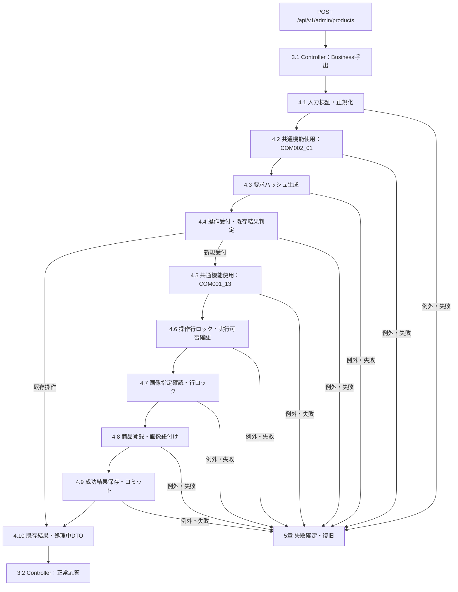

# APA002_05_商品新規登録

## 0. 処理フロー



作成日：2026-11-17

## 1. 基本情報

| 項目 | 内容 |
| --- | --- |
| 機能ID／旧ID | APA002_05／API-A08 |
| 物理名 | create-product |
| HTTP・URL | POST /api/v1/admin/products |
| 対応画面 | SCA-03 新規登録モード |
| Controller | AdminProductCreateController（親Controllerを継承） |
| Business | ProductCreateBusiness.execute(command, actor) |
| 認証 | 管理者JWT必須。共通受付済みactorを使用 |
| DB | admins参照、operation_histories登録・更新、products登録、product_image_uploads参照・更新 |
| 外部通信 | なし。画像アップロードはAPA002_03で実施済み |
| 結果照会 | APA002_08：GET /api/v1/admin/products/operations/{operationId} |
| 二重登録防止 | operationIdを主キーとして使用。要求内容と実行管理者も照合 |

税込価格はCOM001_13で算出する。画像指定はアップロード操作IDのみ受け取り、S3キーはDBから取得する。本APIで画像をアップロード・削除しない。

## 2. リクエスト項目

### 2.1 ヘッダー・パス・クエリ

| 場所 | 項目 | 必須 | 内容 |
| --- | --- | --- | --- |
| Header | Authorization | ○ | 管理者アクセストークン。チェックは共通受付 |
| Header | Content-Type | ○ | application/json |
| Path／Query | なし | — | クエリ指定不可 |

### 2.2 JSONボディ

| 項目 | JSON型 | 必須 | Businessでの検証・正規化 |
| --- | --- | --- | --- |
| operationId | string | ○ | UUID v4、小文字標準表記36文字。トリムしない |
| name | string | ○ | 前後空白除去後1〜100コードポイント |
| summary | string／null | — | 前後空白除去後200コードポイント以内。省略・null・空文字はnullへ統一 |
| description | string／null | — | 前後空白除去後2,000コードポイント以内。内部改行を保持。省略・null・空文字はnullへ統一 |
| priceExcludingTax | number | ○ | 整数、1〜9,999,999 |
| taxRate | number | ○ | 整数、0〜32767。10は10%。税込計算結果のINTEGER範囲も確認 |
| stockQuantity | number | ○ | 整数、0〜99,999 |
| publishStatus | string | ○ | PUBLIC／PRIVATE。大小文字変換・空白除去しない |
| salesStatus | string | ○ | ON_SALE／SUSPENDED。売り切れは指定しない |
| imageUploadOperationId | string／null | — | 指定時はUUID v4、小文字標準表記36文字。省略・nullは画像なし、空文字は不正 |

税率上限は現行DBとCOM001_13の保存可能範囲に合わせたもの。32767%を画面の推奨値とする意味ではない。業務上の税率選択肢を限定する場合は画面・登録・更新APIを同時に変更する。未送信時に税率10を黙って補完しない。

`productId`、`adminId`、`priceIncludingTax`、`imageS3Key`、`imageUrl`、`version`、削除フラグ、日時など、上表にない項目は受け付けない。

### 2.3 JSON例

```json
{
  "operationId": "e916bdad-7abe-4f99-b2d3-bdc9cf6a8ba5",
  "name": "サンプル商品",
  "summary": "商品の概要です。",
  "description": "商品の詳細説明です。\n改行を保持します。",
  "priceExcludingTax": 1800,
  "taxRate": 10,
  "stockQuantity": 20,
  "publishStatus": "PRIVATE",
  "salesStatus": "ON_SALE",
  "imageUploadOperationId": "86f205bc-b7ed-47f7-bfc2-98fd0e68b17c"
}
```

画像なしの場合は`imageUploadOperationId`を省略またはnullとする。商品保存のoperationIdと画像アップロードの操作IDは別々に発行する。

## 3. Controllerの処理

### 3.1 Business呼出

共通受付から受け取ったDTO、全クエリ、ボディ有無、管理者actorをBusinessへ渡す。Controllerでは商品の検証・税計算・DB更新を行わない。

JSON構文・未知項目・DTO変換の受付はCOM001_10に従う。機能固有の必須・範囲・組合せチェックは4.1で実施する。

### 3.2 正常応答

Businessの結果DTOを親Controllerへ渡す。
**共通機能使用：COM001_07 共通レスポンス生成。** HTTP 200、requestId/data/error、Cache-Control: no-storeで返す。

## 4. Businessの処理

### 4.1 入力検証・正規化

1. ボディがJSONオブジェクトであること、クエリがないことを確認する。ボディ未送信・JSON nullはINVALID_REQUEST。
2. 文字列の不正サロゲート・NULを拒否する。文字数はUnicodeコードポイント数で判定する。
3. name／summary／descriptionの前後の空白を除去する。除去対象は`Character.isWhitespace`または`Character.isSpaceChar`に該当するコードポイント。description内部のCRLF・CRはLFへ統一する。
4. 2.2の単項目条件をDTO＋Jakarta Validationと必要な固有チェックで検証する。正規化後の値を保存とハッシュの両方に使う。
5. 数値は整数JSONトークンだけを受け付ける。文字列の数値、1.5、1.0、指数表現、booleanを数値へ自動変換しない。DTO変換時の型強制は無効化する。

| 項目間チェック | 方針 |
| --- | --- |
| 公開状態と販売設定 | 独立。PRIVATE＋ON_SALE、PUBLIC＋SUSPENDEDも登録可能 |
| 在庫0 | 登録可能。salesStatusに売り切れを格納しない |
| 税抜価格と税率 | 組合せによる税込価格の範囲は4.5で判定 |
| 画像指定 | 指定がある場合のみ4.7のDB検証 |
| 商品名重複 | 現行DBに一意制約なし。同名商品を独自に拒否しない |

検証失敗時はDB登録を開始しない。外部向けVALIDATION_ERRORは「入力内容をご確認ください。」、fieldErrors=[]とする。文字数・内部enum一覧等を動的に返さない。

### 4.2 管理者利用権限確認

**共通機能使用：COM002_01 管理者検索・利用権限確認。**

`adminAccessService.requireActiveAdmin(actor)`を1回呼び、`AuthorizedAdmin.adminId`を使用する。以前の管理者ログインAPIの結果を権限確認の代わりにしない。失敗時は以降を実行しない。

### 4.3 要求ハッシュ生成

`operation_type='PRODUCT_CREATE'`、`actor_type='ADMIN'`、`actor_id=adminIdの10進文字列`とする。

request_hashは、次の固定順フィールドを持つ正規化JSONのUTF-8バイト列にSHA-256を適用した小文字hex64文字。

```json
{
  "schemaVersion": 1,
  "operationType": "PRODUCT_CREATE",
  "actorType": "ADMIN",
  "actorId": "1",
  "name": "サンプル商品",
  "summary": "商品の概要です。",
  "description": "商品の詳細説明です。\n改行を保持します。",
  "priceExcludingTax": 1800,
  "taxRate": 10,
  "stockQuantity": 20,
  "publishStatus": "PRIVATE",
  "salesStatus": "ON_SALE",
  "imageUploadOperationId": "86f205bc-b7ed-47f7-bfc2-98fd0e68b17c"
}
```

実際の直列化は改行・空白なし。フィールド順は上記固定、任意項目もnullとして出力する。整数は10進表記、文字列は引用符・バックスラッシュをエスケープし、U+0000〜001Fは小文字hexの`\u00xx`、その他はUTF-8の文字を保持する。スラッシュを不要にエスケープしない。operationId・税込計算結果・現在日時はハッシュへ含めない。JSONライブラリの既定の順序へ依存しない。

正規化方法・schemaVersionは再送判定の契約として固定する。同じIDで内容を変更した要求は再実行しない。

### 4.4 操作受付・既存結果判定（TX-A）

| 登録先 | operation_histories |
| --- | --- |
| operation_id | operationId |
| operation_type／actor_type／actor_id | PRODUCT_CREATE／ADMIN／4.2の管理者ID文字列 |
| request_hash | 4.3のハッシュ |
| target_resource_id | null（商品未採番） |
| operation_status／is_retryable | PROCESSING／false |
| result_code／result_summary_json | null／null |
| expires_at | null。今回、商品作成操作の記録は自動削除しない |
| created_at／updated_at | DB時刻 |

```sql
INSERT INTO operation_histories (
  operation_id, operation_type, actor_type, actor_id, request_hash,
  target_resource_id, operation_status, is_retryable,
  result_code, result_summary_json, expires_at, created_at, updated_at
) VALUES (
  #{operationId,jdbcType=VARCHAR}, 'PRODUCT_CREATE', 'ADMIN',
  #{actorId,jdbcType=VARCHAR}, #{requestHash,jdbcType=CHAR},
  NULL, 'PROCESSING', FALSE, NULL, NULL, NULL,
  CURRENT_TIMESTAMP, CURRENT_TIMESTAMP
)
ON CONFLICT (operation_id) DO NOTHING
RETURNING operation_id;
```

- 1件返却：新規受付。TX-Aをコミットし、成功確認後だけ4.5へ。
- 0件：既存操作。別SQLで以下を取得し判定する（READ COMMITTED）。既存PROCESSINGを再実行しない。
- 一意制約の待機がタイムアウト：TXを戻してSERVICE_UNAVAILABLE。別操作の結果を推測して返さない。
- TX-Aコミット不明：商品登録を開始しない。5章へ。

```sql
SELECT operation_type, actor_type, actor_id, request_hash,
       target_resource_id, operation_status, is_retryable,
       result_code, result_summary_json
FROM operation_histories
WHERE operation_id = #{operationId,jdbcType=VARCHAR};
```

| 既存行の判定（上から順） | 処理 |
| --- | --- |
| 取得0件・必須項目異常 | INTERNAL_ERROR |
| actor_type／actor_id不一致 | RESOURCE_NOT_FOUND。他者の結果を開示しない |
| operation_type／request_hash不一致 | IDEMPOTENCY_KEY_REUSED |
| SUCCEEDED | 保存済み成功DTOを4.10へ。現在の商品状態で作り直さない |
| FAILED | 保存済みresult_codeの業務例外を返す。同じIDで再実行しない |
| PROCESSING | 処理中DTOを4.10へ。登録は行わない |
| 未定義状態 | INTERNAL_ERROR |

既存結果の再送にも現在の管理者権限確認が必要。requestIdだけは今回の要求の値を返す。

### 4.5 税込価格計算

**共通機能使用：COM001_13 税込価格計算。**

```java
int priceIncludingTax = taxInclusivePriceCalculator.calculate(
    command.priceExcludingTax(), command.taxRate());
```

入力は検証済み税抜単価・整数税率。返却intを商品登録へ使用する。税計算式や丸め処理を本Businessへ重複実装しない。

計算失敗の場合は商品未登録のため5.2の失敗確定処理へ。既存SUCCEEDEDの再送ではここを実行せず、保存済み結果を返す。

### 4.6 操作行ロック・実行可否確認（TX-B開始）

```sql
SELECT operation_type, actor_type, actor_id, request_hash,
       operation_status, result_code, result_summary_json
FROM operation_histories
WHERE operation_id = #{operationId,jdbcType=VARCHAR}
FOR UPDATE;
```

- 今回の新規受付要求だけがこの処理へ進む。
- 所有者・種別・ハッシュを再確認する。PROCESSINGなら4.7へ。
- 復旧処理が先にFAILEDへ確定していた場合は実行しない。保存済み失敗を返す。
- SUCCEEDEDなら保存済み結果を返す。不整合はINTERNAL_ERROR。
- ロック順は**操作行→画像アップロード行→新規商品登録**。結果照会・画像清掃との排他を守る。

TX-BはREAD COMMITTED、初期設定はロック待機3秒・SQL5秒・トランザクション15秒。業務ロジックの期限確認も行い、未完了のまま成功を返さない。DBのタイムアウトだけをアプリケーション処理全体の強制停止とみなさない。

### 4.7 画像指定確認・行ロック

画像指定なし：`imageS3Key=null`として4.8へ。

| 画像指定ありの取得 | 内容 |
| --- | --- |
| テーブル | product_image_uploads |
| 項目 | upload_operation_id、admin_id、s3_object_key、mime_type、status |
| 条件 | upload_operation_id＝imageUploadOperationId、admin_id＝実行管理者ID |
| 排他 | FOR UPDATE |

```sql
SELECT upload_operation_id, admin_id, s3_object_key, mime_type, status
FROM product_image_uploads
WHERE upload_operation_id = #{imageUploadOperationId,jdbcType=VARCHAR}
  AND admin_id = #{adminId,jdbcType=BIGINT}
FOR UPDATE;
```

| 判定 | 処理 |
| --- | --- |
| 0件 | RESOURCE_NOT_FOUND。不存在と他者の画像を区別しない |
| VERIFIED | DBキーを検証してimageS3Keyへ採用 |
| UPLOADING／FAILED／ATTACHED | BUSINESS_RULE_VIOLATION。商品を作成しない |
| 未定義状態・キー不正 | INTERNAL_ERROR |

キーはAPA002_03の`product-images/{uploadOperationId}/{64桁小文字hex}.{jpg/png/webp}`に一致し、操作ID・MIMEと拡張子が対応すること。クライアントのキー指定は使用しない。画像URLを返さないためCOM001_11は使用しない。

VERIFIEDは画像実体検証・S3保存が確定した状態として扱い、S3 HEADを繰り返さない。商品保存と清掃が同じ画像行をロックすることで、紐付け直前の清掃との競合を防ぐ。

### 4.8 商品登録・画像紐付け（TX-B内）

| productsの項目 | 登録値 |
| --- | --- |
| id | IDENTITY採番 |
| name／summary／description | 正規化済み入力 |
| price_excluding_tax／tax_rate | 検証済み入力 |
| price_including_tax | COM001_13の計算結果 |
| stock_quantity | stockQuantity |
| publish_status／sales_status | 入力の公開状態・販売設定 |
| image_s3_key | 4.7のキー。画像なしはnull |
| is_deleted／deleted_at | false／null |
| version | 1 |
| created_at／updated_at | 同一のDB時刻 |

```sql
INSERT INTO products (
  name, summary, description, price_excluding_tax, tax_rate,
  price_including_tax, stock_quantity, publish_status, sales_status,
  image_s3_key, is_deleted, deleted_at, version, created_at, updated_at
) VALUES (
  #{name,jdbcType=VARCHAR}, #{summary,jdbcType=VARCHAR},
  #{description,jdbcType=VARCHAR}, #{priceExcludingTax,jdbcType=INTEGER},
  #{taxRate,jdbcType=SMALLINT}, #{priceIncludingTax,jdbcType=INTEGER},
  #{stockQuantity,jdbcType=INTEGER}, #{publishStatus,jdbcType=VARCHAR},
  #{salesStatus,jdbcType=VARCHAR}, #{imageS3Key,jdbcType=VARCHAR},
  FALSE, NULL, 1, CURRENT_TIMESTAMP, CURRENT_TIMESTAMP
)
RETURNING id, version, price_including_tax, created_at, updated_at;
```

返却1件が必要。ID・版はJavaのLong、価格はInteger、日時はOffsetDateTimeで取得する。MyBatisはRETURNINGを結果付き更新として扱い、更新がcommit対象になるようMapperの設定を行う。

画像指定ありの場合だけ、同じTXで状態を変更する。

```sql
UPDATE product_image_uploads
SET status = 'ATTACHED', updated_at = CURRENT_TIMESTAMP
WHERE upload_operation_id = #{imageUploadOperationId,jdbcType=VARCHAR}
  AND admin_id = #{adminId,jdbcType=BIGINT}
  AND s3_object_key = #{imageS3Key,jdbcType=VARCHAR}
  AND status = 'VERIFIED';
```

画像更新1件が必要。0件・複数件は例外として商品登録を含めTX-B全体をロールバックする。別商品への画像使い回しは許可しない。

### 4.9 成功結果保存・コミット（TX-B内）

7章の成功dataを作成し、requestId・errorを含めず`result_summary_json`へ保存する。

```sql
UPDATE operation_histories
SET target_resource_id = #{productId,jdbcType=BIGINT},
    operation_status = 'SUCCEEDED', is_retryable = FALSE,
    result_code = 'SUCCESS',
    result_summary_json = CAST(#{resultSummaryJson,jdbcType=VARCHAR} AS jsonb),
    updated_at = CURRENT_TIMESTAMP
WHERE operation_id = #{operationId,jdbcType=VARCHAR}
  AND operation_type = 'PRODUCT_CREATE'
  AND actor_type = 'ADMIN' AND actor_id = #{actorId,jdbcType=VARCHAR}
  AND request_hash = #{requestHash,jdbcType=CHAR}
  AND operation_status = 'PROCESSING';
```

更新1件を確認してコミットする。**products登録、画像ATTACHED、操作SUCCEEDEDの3つを同時に確定する。** 成功応答はコミット成功確認後だけ返す。

コミット結果不明は失敗確定にせずSERVICE_UNAVAILABLE。別TXで商品を削除したり操作をFAILEDへ上書きしたりしない。

### 4.10 結果DTO作成

| 場合 | 返却 |
| --- | --- |
| 今回登録成功 | 4.9で保存した成功data |
| 同じ操作の成功済み再送 | 保存済みdata。現在のproductsを再検索して作り直さない |
| 同じ操作がPROCESSING | operationId、operationStatus=PROCESSING、product=null |

後から商品が編集・論理削除されても、元の新規登録成功は変わらない。応答のversion・価格は登録時点の値。現在値が必要な場合は管理用商品詳細取得を使用する。

## 5. 例外・データ復旧

### 5.1 エラー変換

**共通機能使用：COM001_08 共通例外変換。**
**共通機能使用：COM001_09 アプリケーションログ出力・秘匿。**

| 条件 | error.code | message |
| --- | --- | --- |
| 不正なボディ・クエリ | INVALID_REQUEST | リクエストの内容が正しくありません。 |
| 必須・型・範囲・税込価格上限 | VALIDATION_ERROR | 入力内容をご確認ください。 |
| 管理者権限不足 | FORBIDDEN | この操作を実行する権限がありません。 |
| 他管理者の操作・参照不可画像 | RESOURCE_NOT_FOUND | 指定された情報を表示できません。 |
| 同じ操作IDで異なる要求 | IDEMPOTENCY_KEY_REUSED | 操作を確認できませんでした。内容をご確認ください。 |
| 画像が使用可能状態ではない | BUSINESS_RULE_VIOLATION | 現在の状態ではこの操作を実行できません。 |
| DB一時障害・ロックタイムアウト・コミット不明 | SERVICE_UNAVAILABLE | 処理を完了できませんでした。時間をおいて再試行してください。 |
| DB不整合・想定外例外 | INTERNAL_ERROR | 処理を完了できませんでした。 |

ECSが捕捉できる例外はHTTP 200、data=null、fieldErrors=[]。JSON構文・認証等の共通例外は共通仕様どおり。内部の状態名・SQL・ハッシュをエラーメッセージへ含めない。

ログはrequestId、operationId、処理章番号、DB確定状況を記録する。アクセストークン、要求全文、商品説明全文は記録しない。

### 5.2 失敗確定の記録

対象は**今回新規に受付した操作で、商品未登録を確実に確認できる業務エラー**。例：税込計算範囲外、画像不存在、画像状態不適合。既存操作の主体・ハッシュ不一致を理由に既存行を書き換えない。

1. TX-B開始済みならロールバック完了を確認する。SQL例外後の同じTXで失敗記録を更新しない。
2. 別の短いTXで対象操作行をFOR UPDATE取得し、主体・種別・ハッシュ・PROCESSINGを再確認する。
3. 下記UPDATEを実行しコミットする。既にSUCCEEDEDなら上書きせず成功結果を採用、FAILEDなら既存結果を採用する。
4. 失敗記録のcommitに成功したら元の業務エラーを返す。commit不明・接続失敗ならSERVICE_UNAVAILABLEとし、結果照会へ進ませる。

```sql
UPDATE operation_histories
SET operation_status = 'FAILED', is_retryable = TRUE,
    target_resource_id = NULL,
    result_code = #{errorCode,jdbcType=VARCHAR},
    result_summary_json = NULL, updated_at = CURRENT_TIMESTAMP
WHERE operation_id = #{operationId,jdbcType=VARCHAR}
  AND operation_type = 'PRODUCT_CREATE'
  AND actor_type = 'ADMIN' AND actor_id = #{actorId,jdbcType=VARCHAR}
  AND request_hash = #{requestHash,jdbcType=CHAR}
  AND operation_status = 'PROCESSING';
```

is_retryable=trueは「内容・画像状態を確認して**新しい操作ID**で再操作できる」の意味。同じIDでFAILEDの処理を再実行しない。

DB障害・コミット不明・想定外例外は、未反映と断定できないため無理にFAILEDを記録しない。PROCESSINGを維持して5.3の照会・復旧に委ねる。

### 5.3 中断位置ごとの復旧

| 中断位置 | 残る状態 | 復旧方法 |
| --- | --- | --- |
| TX-A前の入力エラー | 操作記録なし、商品なし | 修正して送信 |
| TX-Aのcommit不明 | 操作なし又はPROCESSING | 同じoperationIdでAPA002_08照会。別IDを自動発行しない |
| TX-A成功後、TX-B開始前の停止 | PROCESSING、商品なし | 結果照会で復旧判定。既存PROCESSINGのPOST再送は実行しない |
| TX-B途中の例外・停止 | 商品登録と画像変更はロールバック。操作はPROCESSING | 5.2で失敗確定できる場合のみFAILED。それ以外は照会で復旧 |
| TX-Bのcommit不明 | 全て成功、又は全て未反映 | APA002_08で操作行を確認。結果不明のまま商品削除・画像解除をしない |
| commit後に応答だけ未着 | SUCCEEDED、商品あり、指定画像ATTACHED | 同じIDの照会・POST再送で保存済み成功結果を返す |

**APA002_08へ引き継ぐ復旧契約**

- 所有者・PRODUCT_CREATEを確認して操作行をFOR UPDATE NOWAITで取得する。ロック競合はPROCESSING。
- SUCCEEDED／FAILEDは確定結果を返す。
- PROCESSINGで受付から15分未満は待機。15分以上経過し操作行ロックを取得できた場合、PRODUCT_CREATEでは商品とSUCCEEDEDが同一TXで確定するため、登録未完了としてFAILED・is_retryable=true・result_code=SERVICE_UNAVAILABLEへ確定できる。
- 遅れて元要求がTX-Bへ進んでも4.6でFAILEDを確認して商品登録を止める。この順序を省略しない。
- 操作行なしは未実行確定としない。同じID・同じ内容のPOST再送は受付の一意制約で吸収できる。新しいIDでの自動再送はしない。
- タイムアウト復旧規則はPRODUCT_CREATE専用。外部処理を含む注文等へ一律適用しない。

### 5.4 ロールバック対象

- TX-B失敗時は新規商品、ATTACHEDへの変更、SUCCEEDEDへの変更をすべて戻す。
- 採番済み商品IDの欠番は許容する。シーケンスを巻き戻さない。
- アップロード済みS3画像は削除しない。画像状態はVERIFIEDへ戻り、失敗確定後の新しい商品保存操作で利用できる（清掃済みの場合は再アップロード）。
- 成功した商品を後から補償削除して帳尻を合わせない。

## 6. 実装・関連設計への引き継ぎ

| 対象 | 条件 |
| --- | --- |
| TXの実装 | TX-AとTX-Bを分離。Business全体を単一@Transactionalで囲まない。TransactionTemplate等でcommit確認後に結果を返す |
| Mapper | RETURNING対応、JSONBのバインド、Long・OffsetDateTime・整数型の対応を設定。SQL文字列へ入力値を連結しない |
| 画像清掃 | 画像行のロックと状態確認を必須とし、ATTACHEDを未使用扱いしない |
| APA002_08 | 5.3のPRODUCT_CREATE固有の復旧と保存済み成功dataの返却 |
| SCA-03 | 二重送信時は同じoperationIdと確定した入力を保持。FAILED確定後の再操作だけ新ID。PROCESSINGでは完了通知を出さない |
| DB | 現行3テーブルを使用。追加カラムなし。商品作成操作のexpires_atはnull |

機能一覧・DB設計書を確認して作成した。今回、関連API設計書やスプレッドシート自体は変更していない。

技術参照：[PostgreSQL INSERT](https://www.postgresql.org/docs/current/sql-insert.html)、[トランザクション分離](https://www.postgresql.org/docs/current/transaction-iso.html)。競合時はINSERTと既存行取得を別SQLにする。

## 7. 返却項目

### 7.1 共通項目

HTTP 200、Content-Type: application/json、Cache-Control: no-store。

| 項目 | JSON型 | null | 内容 |
| --- | --- | --- | --- |
| requestId | string | 不可 | 今回の要求追跡ID |
| data | object | 可 | 成功・処理中は結果DTO。例外はnull |
| error | object | 可 | 成功・処理中はnull |
| error.code／message | string | 不可 | 5.1のコード・文言 |
| error.fieldErrors | array | 不可 | [] |

### 7.2 結果data

| 項目 | JSON型 | null | 内容 |
| --- | --- | --- | --- |
| operationId | string | 不可 | 商品保存操作ID |
| operationStatus | string | 不可 | SUCCEEDED／PROCESSING |
| product | object | 可 | SUCCEEDED時のみ登録時点の情報。PROCESSINGはnull |
| product.productId | string | 不可 | products.idの10進文字列 |
| product.version | string | 不可 | 登録時のversion。「1」 |
| product.priceIncludingTax | number | 不可 | 登録した税込単価（整数円） |
| product.createdAt | string | 不可 | UTC ISO 8601、ミリ秒3桁 |
| product.updatedAt | string | 不可 | 登録時点ではcreatedAtと同じ |

成功dataをそのままoperation_histories.result_summary_jsonへ保存する。FAILEDは本POSTでは保存済みエラーを返し、is_retryable等の復旧情報はAPA002_08で確認する。

**登録成功／成功済みの再送**

```json
{
  "requestId": "req-create-product-001",
  "data": {
    "operationId": "e916bdad-7abe-4f99-b2d3-bdc9cf6a8ba5",
    "operationStatus": "SUCCEEDED",
    "product": {
      "productId": "101",
      "version": "1",
      "priceIncludingTax": 1980,
      "createdAt": "2026-11-17T12:00:00.000Z",
      "updatedAt": "2026-11-17T12:00:00.000Z"
    }
  },
  "error": null
}
```

**同じ操作が処理中**

```json
{
  "requestId": "req-create-product-002",
  "data": {
    "operationId": "e916bdad-7abe-4f99-b2d3-bdc9cf6a8ba5",
    "operationStatus": "PROCESSING",
    "product": null
  },
  "error": null
}
```

**入力不正**

```json
{
  "requestId": "req-create-product-003",
  "data": null,
  "error": {
    "code": "VALIDATION_ERROR",
    "message": "入力内容をご確認ください。",
    "fieldErrors": []
  }
}
```

**DB障害・登録結果不明**

```json
{
  "requestId": "req-create-product-004",
  "data": null,
  "error": {
    "code": "SERVICE_UNAVAILABLE",
    "message": "処理を完了できませんでした。時間をおいて再試行してください。",
    "fieldErrors": []
  }
}
```
