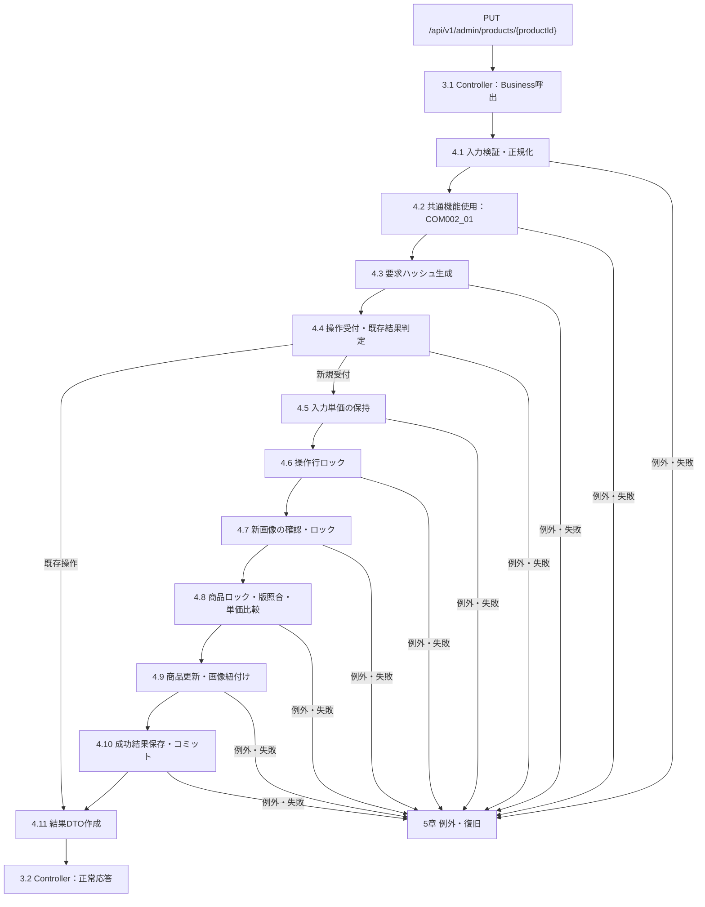

# APA002_06_商品情報編集更新

## 0. 処理フロー



作成日：2026-11-17

## 1. 基本情報

| 項目 | 内容 |
| --- | --- |
| ID／旧ID | APA002_06／API-A09 |
| 物理名 | update-product |
| HTTP・URL | PUT /api/v1/admin/products/{productId} |
| 対応画面 | SCA-03 商品編集 |
| Controller | AdminProductUpdateController（親Controllerを継承） |
| Business | ProductUpdateBusiness.execute(command, actor) |
| 認証 | 管理者JWT必須。共通受付済みactorを使用 |
| DB | admins参照、operation_histories登録・更新、products更新、product_image_uploads参照・更新 |
| 外部通信 | なし。S3アップロード・削除・HEADは行わない |
| 排他 | リクエストversionとDB版の一致確認＋行ロック |
| 二重更新防止 | operationId。主体・対象商品・要求内容も照合 |
| 結果照会 | APA002_08：GET /api/v1/admin/products/operations/{operationId} |

未削除の商品を更新する。非公開・販売停止・在庫0の商品も対象。部分更新ではなく、編集可能な商品項目をまとめて受け取る。

## 2. リクエスト項目

### 2.1 ヘッダー・パス

| 場所 | 項目 | 必須 | 条件 |
| --- | --- | --- | --- |
| Header | Authorization | ○ | 管理者アクセストークン。チェックは共通受付 |
| Header | Content-Type | ○ | application/json |
| Path | productId | ○ | 正の10進整数文字列、先頭0なし、1〜19桁、Long最大値以下 |
| Query | なし | — | 未定義クエリを拒否 |

### 2.2 JSONボディ

| 項目 | JSON型 | 必須 | 条件・正規化 |
| --- | --- | --- | --- |
| operationId | string | ○ | UUID v4、小文字標準表記36文字。トリムしない |
| version | string | ○ | 取得時の版。正の10進整数文字列、先頭0なし、Long最大値以下 |
| name | string | ○ | 前後空白除去後1〜100コードポイント |
| summary | string／null | — | 前後空白除去後200コードポイント以内。省略・null・空文字はnull |
| description | string／null | — | 前後空白除去後2,000コードポイント以内。内部改行を保持。省略・null・空文字はnull |
| priceExcludingTax | number | ○ | 整数、1〜9,999,999 |
| stockQuantity | number | ○ | 整数、0〜99,999。更新後の絶対数量 |
| publishStatus | string | ○ | PUBLIC／PRIVATE |
| salesStatus | string | ○ | ON_SALE／SUSPENDED |
| imageAction | string | ○ | KEEP／REPLACE／REMOVE |
| imageUploadOperationId | string／null | 条件付 | REPLACE時だけ必須。UUID v4、小文字標準表記36文字 |

summary・descriptionの省略は既存値維持ではなくクリアとなる。フロントは維持する値も送信する。画像はimageActionで明示し、省略による解除はしない。

税率範囲はDB・COM001_13の保存可能範囲。画面の選択肢として上限値を推奨する意味ではない。taxRateをクライアントから受け付けない。

| imageAction | imageUploadOperationId | 更新後画像 |
| --- | --- | --- |
| KEEP | 省略またはnullのみ | ロック取得時のproducts.image_s3_keyを保持 |
| REPLACE | 有効な操作IDが必須 | 自分がアップロードしたVERIFIED画像のキー |
| REMOVE | 省略またはnullのみ | null |

未知項目、ボディ内productId、管理者ID、税込価格、S3キー・画像URL、削除フラグ、日時は受け付けない。

### 2.3 リクエストJSON例

```http
PUT /api/v1/admin/products/101
Authorization: Bearer <管理者アクセストークン>
Content-Type: application/json
```

```json
{
  "operationId": "55d461a6-90de-4743-bb2a-ebba679f6816",
  "version": "3",
  "name": "サンプル商品（更新）",
  "summary": "更新後の概要です。",
  "description": "更新後の詳細説明です。\n改行を保持します。",
  "priceExcludingTax": 2000,
  "stockQuantity": 15,
  "publishStatus": "PUBLIC",
  "salesStatus": "ON_SALE",
  "imageAction": "REPLACE",
  "imageUploadOperationId": "86f205bc-b7ed-47f7-bfc2-98fd0e68b17c"
}
```

画像維持はimageAction=KEEP、解除はREMOVEとし、いずれもimageUploadOperationIdは省略またはnullとする。

## 3. Controllerの処理

### 3.1 Business呼出

パスproductId、JSON DTO、全クエリ、ボディ有無、共通受付済みactorをBusinessへ渡す。ControllerではIDのLong変換・入力条件チェック・DB更新・税計算を行わない。

共通のJSON構文・未知項目・DTO変換はCOM001_10の受付に従い、個別項目の必須・範囲・組合せはBusinessで確認する。

### 3.2 正常応答

Businessの結果DTOを親Controllerへ渡す。
**共通機能使用：COM001_07 共通レスポンス生成。** HTTP 200、requestId/data/error、Cache-Control: no-storeで返す。

## 4. Businessの処理

### 4.1 入力検証・正規化

1. ボディ未送信・JSON null・オブジェクト以外、クエリありはINVALID_REQUEST。
2. productId・versionを2章の形式で検証し、Longへ変換する。範囲外を丸めたり0へ置き換えたりしない。
3. name／summary／descriptionの前後から、Character.isWhitespaceまたはCharacter.isSpaceCharに該当するコードポイントを除く。description内部のCRLF・CRはLFへ統一する。
4. 不正サロゲート・NULを拒否。文字数はコードポイント数。正規化済み値に対してDTO＋Jakarta Validationと固有チェックを実行する。
5. 数値は整数JSONトークンのみ。数値文字列、小数、1.0、指数表現、booleanからの自動変換は行わない。
6. imageActionとimageUploadOperationIdの組合せを2.2に従って検証する。

公開状態・販売設定は独立。在庫0でも登録可能。同名商品を独自に拒否しない。stockQuantityは差分加減算ではなく更新後の在庫数。

検証失敗はVALIDATION_ERROR（要求構造不正はINVALID_REQUEST）。この段階ではDBを書き換えない。外部文言は汎用文言とし、内部enum候補を列挙しない。

### 4.2 管理者利用権限確認

**共通機能使用：COM002_01 管理者検索・利用権限確認。**

`adminAccessService.requireActiveAdmin(actor)`を1回呼ぶ。返却adminIdを操作所有者・画像所有者の照合へ使用する。失敗時は以降を実行しない。

### 4.3 要求ハッシュ生成

操作種別PRODUCT_UPDATE、主体ADMIN、actorIdは管理者DB IDの10進文字列とする。

以下の固定順の正規化JSONをUTF-8化し、SHA-256の小文字hex64文字をrequest_hashへ使用する。

```json
{
  "schemaVersion": 1,
  "operationType": "PRODUCT_UPDATE",
  "actorType": "ADMIN",
  "actorId": "1",
  "productId": "101",
  "version": "3",
  "name": "サンプル商品（更新）",
  "summary": "更新後の概要です。",
  "description": "更新後の詳細説明です。\n改行を保持します。",
  "priceExcludingTax": 2000,
  "stockQuantity": 15,
  "publishStatus": "PUBLIC",
  "salesStatus": "ON_SALE",
  "imageAction": "REPLACE",
  "imageUploadOperationId": "86f205bc-b7ed-47f7-bfc2-98fd0e68b17c"
}
```

直列化は空白・改行なし、上記順序固定。任意項目もnullで出力。整数は10進表記、文字列中の引用符・バックスラッシュはエスケープ、U+0000〜001Fは小文字hexの`\u00xx`、その他はUTF-8文字を保持する。スラッシュは不要にエスケープしない。operationId、税込計算結果、現在日時は含めない。

同じoperationIdでproductId・version・画像指定等を変えた要求を拒否できるよう、全更新項目を含める。

### 4.4 操作受付・既存結果判定（TX-A）

| operation_histories項目 | 登録値 |
| --- | --- |
| operation_id／operation_type | operationId／PRODUCT_UPDATE |
| actor_type／actor_id | ADMIN／adminId文字列 |
| target_resource_id | パスproductIdのLong値 |
| request_hash | 4.3のハッシュ |
| operation_status／is_retryable | PROCESSING／false |
| result_code／result_summary_json | null／null |
| expires_at | null。今回自動削除しない |
| created_at／updated_at | DB時刻 |

```sql
INSERT INTO operation_histories (
  operation_id, operation_type, actor_type, actor_id, target_resource_id,
  request_hash, operation_status, is_retryable, result_code,
  result_summary_json, expires_at, created_at, updated_at
) VALUES (
  #{operationId,jdbcType=VARCHAR}, 'PRODUCT_UPDATE', 'ADMIN',
  #{actorId,jdbcType=VARCHAR}, #{productId,jdbcType=BIGINT},
  #{requestHash,jdbcType=CHAR}, 'PROCESSING', FALSE, NULL,
  NULL, NULL, CURRENT_TIMESTAMP, CURRENT_TIMESTAMP
)
ON CONFLICT (operation_id) DO NOTHING
RETURNING operation_id;
```

1件返却なら新規受付。TX-Aのコミット成功確認後だけ4.5へ進む。0件ならREAD COMMITTEDの別SQLで既存行を取得する。

```sql
SELECT operation_type, actor_type, actor_id, target_resource_id,
       request_hash, operation_status, is_retryable,
       result_code, result_summary_json
FROM operation_histories
WHERE operation_id = #{operationId,jdbcType=VARCHAR};
```

| 既存行の判定（上から順） | 処理 |
| --- | --- |
| 0件・DB必須値異常 | INTERNAL_ERROR |
| 主体区分・actor_id不一致 | RESOURCE_NOT_FOUND。他者の結果を開示しない |
| 種別・対象商品ID・request_hash不一致 | IDEMPOTENCY_KEY_REUSED |
| SUCCEEDED | 保存済み成功dataを4.11へ |
| FAILED | 保存済みresult_codeの業務例外。再実行しない |
| PROCESSING | 処理中dataを4.11へ。再実行しない |
| 未定義状態 | INTERNAL_ERROR |

**既存成功の判定は、現在の商品の存在・version・画像状態を確認する前に行う。** 成功後の再送をVERSION_CONFLICTや画像ATTACHEDエラーへ変換しない。

TX-Aのコミット不明・待機タイムアウトでは商品更新を開始しない。SERVICE_UNAVAILABLEとして同じIDで結果照会する。

### 4.5 税込価格計算

**共通機能使用：COM001_13。** ここでは入力税抜単価を保持する。TX-Bで対象商品をロックし版を照合した後、既存税抜単価と比較する。価格不変なら既存税率・税込単価を維持。価格変更時のみサーバーの共通税率をeffectiveTaxRateとして再計算する。 設定欠落はINTERNAL_ERROR。税率・税込単価を要求ハッシュに含めず、適用値は商品と同じTXで保存する。

### 4.6 操作行ロック（TX-B開始）

```sql
SELECT operation_type, actor_type, actor_id, target_resource_id,
       request_hash, operation_status, result_code, result_summary_json
FROM operation_histories
WHERE operation_id = #{operationId,jdbcType=VARCHAR}
FOR UPDATE;
```

今回新規受付した要求だけが進む。主体・種別・対象ID・ハッシュを再確認し、PROCESSINGなら続行。復旧処理によりFAILEDになっていれば実行しない。SUCCEEDEDなら保存済み結果を返す。

ロック順は**操作行→新画像行（REPLACE時）→商品行**。旧画像行は更新・ロックしない。TX-BはREAD COMMITTED、初期設定はロック待機3秒・SQL5秒・TX15秒。タイムアウト時に別順序で取得し直すなどの自動再試行はしない。

### 4.7 新画像の確認・行ロック

KEEP／REMOVEは検索せず4.8へ。REPLACEの場合だけ次を実行する。

| 対象 | 内容 |
| --- | --- |
| テーブル | product_image_uploads |
| 取得項目 | upload_operation_id、admin_id、s3_object_key、mime_type、status |
| 条件 | 指定画像操作ID、admin_id＝4.2の管理者ID |
| 排他 | FOR UPDATE |

```sql
SELECT upload_operation_id, admin_id, s3_object_key, mime_type, status
FROM product_image_uploads
WHERE upload_operation_id = #{imageUploadOperationId,jdbcType=VARCHAR}
  AND admin_id = #{adminId,jdbcType=BIGINT}
FOR UPDATE;
```

| 結果 | 処理 |
| --- | --- |
| 0件 | RESOURCE_NOT_FOUND |
| VERIFIED | キーを検証して保持 |
| UPLOADING／FAILED／ATTACHED | BUSINESS_RULE_VIOLATION |
| 未定義状態・不正キー | INTERNAL_ERROR |

キーはAPA002_03の`product-images/{uploadOperationId}/{64桁小文字hex}.{jpg/png/webp}`に一致し、ID・MIMEと拡張子が対応すること。任意キーを入力から採用しない。同じ画像を保持したい場合はKEEPを使用し、既存ATTACHED画像をREPLACEで再指定しない。

S3再照合は行わない。VERIFIEDを使用可能状態として扱い、画像清掃も同じ画像行をロックすることで競合を防ぐ。

### 4.8 商品取得・版照合

```sql
SELECT id, version, image_s3_key, created_at, price_excluding_tax, tax_rate, price_including_tax
FROM products
WHERE id = #{productId,jdbcType=BIGINT}
  AND is_deleted = FALSE
FOR UPDATE;
```

| 判定 | 次の処理 |
| --- | --- |
| 0件 | RESOURCE_NOT_FOUND。不存在と論理削除済みを区別しない |
| versionがnull・1未満、ID・created_at不正 | INTERNAL_ERROR |
| DB version≠要求version | VERSION_CONFLICT。画像・商品を更新しない |
| version＝Long最大値 | INTERNAL_ERROR。加算による桁あふれを防ぐ |
| version一致 | 画像キーを決定して4.9へ |

| imageAction | 保存するimageS3Key |
| --- | --- |
| KEEP | ロック取得したproducts.image_s3_keyをそのまま保持（nullを含む） |
| REMOVE | null |
| REPLACE | 4.7で検証した新画像キー |

注文の在庫引当・キャンセルによる在庫戻しもproducts.versionを増加させる前提。編集画面表示後に在庫が変わっていれば更新を拒否し、古いstockQuantityによる上書きを防ぐ。

価格比較・適用税率：4.5に従い、ロックした価格と入力を比較。変更時のみCOM001_13を呼び、Mapperへ計算済み値を渡す。

### 4.9 商品更新・新画像紐付け（TX-B内）

| 更新項目 | 値 |
| --- | --- |
| name／summary／description | 正規化済み入力 |
| price_excluding_tax／tax_rate | 入力税抜単価／サーバー決定税率 |
| price_including_tax | COM001_13の結果 |
| stock_quantity | 入力された絶対数量 |
| publish_status／sales_status | 入力 |
| image_s3_key | 4.8で決定したキー |
| version | DBの現在版＋1 |
| updated_at | DB時刻 |
| 更新しない項目 | id、created_at、is_deleted、deleted_at |

```sql
UPDATE products
SET name = #{name,jdbcType=VARCHAR},
    summary = #{summary,jdbcType=VARCHAR},
    description = #{description,jdbcType=VARCHAR},
    price_excluding_tax = #{priceExcludingTax,jdbcType=INTEGER},
    tax_rate = #{taxRate,jdbcType=SMALLINT},
    price_including_tax = #{priceIncludingTax,jdbcType=INTEGER},
    stock_quantity = #{stockQuantity,jdbcType=INTEGER},
    publish_status = #{publishStatus,jdbcType=VARCHAR},
    sales_status = #{salesStatus,jdbcType=VARCHAR},
    image_s3_key = #{imageS3Key,jdbcType=VARCHAR},
    version = version + 1, updated_at = CURRENT_TIMESTAMP
WHERE id = #{productId,jdbcType=BIGINT}
  AND is_deleted = FALSE
  AND version = #{expectedVersion,jdbcType=BIGINT}
RETURNING id, version, price_including_tax, created_at, updated_at;
```

ロック下で既に版照合済みのため、返却0件は想定外の不整合としてINTERNAL_ERROR、TX-B全体をロールバックする。通常の競合は4.8でVERSION_CONFLICTとなる。

REPLACE時だけ、新画像を同じTXで紐付け済みにする。

```sql
UPDATE product_image_uploads
SET status = 'ATTACHED', updated_at = CURRENT_TIMESTAMP
WHERE upload_operation_id = #{imageUploadOperationId,jdbcType=VARCHAR}
  AND admin_id = #{adminId,jdbcType=BIGINT}
  AND s3_object_key = #{imageS3Key,jdbcType=VARCHAR}
  AND status = 'VERIFIED';
```

画像更新1件が必要。0件・複数件は商品更新を含めロールバックする。

- KEEP／REMOVEは画像管理行を書き換えない。
- 差替え・解除後も旧画像の管理行はATTACHEDのまま保持し、本APIでS3削除やVERIFIEDへの戻しを行わない。旧画像の回収は別途設計する。
- 注文明細・注文金額のスナップショットを変更しない。注文詳細の画像は既定方針どおり現在の商品画像を参照するため、画像差替え・解除が表示へ反映される。
- 同じ値で新しいoperationIdの更新要求が来た場合も、受理した更新としてversionを1増加する。同じ操作IDの再送では増加しない。

### 4.10 成功結果保存・コミット

7章の成功dataを作成して、requestId・errorを含めず保存する。

```sql
UPDATE operation_histories
SET operation_status = 'SUCCEEDED', is_retryable = FALSE,
    result_code = 'SUCCESS',
    result_summary_json = CAST(#{resultSummaryJson,jdbcType=VARCHAR} AS jsonb),
    updated_at = CURRENT_TIMESTAMP
WHERE operation_id = #{operationId,jdbcType=VARCHAR}
  AND operation_type = 'PRODUCT_UPDATE'
  AND actor_type = 'ADMIN' AND actor_id = #{actorId,jdbcType=VARCHAR}
  AND target_resource_id = #{productId,jdbcType=BIGINT}
  AND request_hash = #{requestHash,jdbcType=CHAR}
  AND operation_status = 'PROCESSING';
```

更新1件を確認してTX-Bをコミット。商品更新、新画像ATTACHED、操作SUCCEEDEDを同時に確定する。コミット成功確認後にのみ成功応答を返す。

### 4.11 結果DTO作成

| 状態 | 返却 |
| --- | --- |
| 今回成功 | 保存した成功data |
| 既存SUCCEEDED | 保存済みdata。現在の商品情報・版を再取得して置換しない |
| 既存PROCESSING | operationId、operationStatus=PROCESSING、product=null |

後から商品が編集・削除されても元の更新結果は成功のまま。同じ操作の再送応答には、元の更新直後のversion・価格・日時を返す。

## 5. 例外・復旧

### 5.1 例外応答

**共通機能使用：COM001_08 共通例外変換。**
**共通機能使用：COM001_09 アプリケーションログ出力・秘匿。**

| 条件 | error.code | message |
| --- | --- | --- |
| 不正ボディ・クエリ | INVALID_REQUEST | リクエストの内容が正しくありません。 |
| ID・版・項目・組合せ・税込範囲不正 | VALIDATION_ERROR | 入力内容をご確認ください。 |
| 管理者権限なし | FORBIDDEN | この操作を実行する権限がありません。 |
| 商品・画像参照不可、他者の操作 | RESOURCE_NOT_FOUND | 指定された情報を表示できません。 |
| DB版と要求版の不一致 | VERSION_CONFLICT | 情報が更新されています。最新の内容をご確認ください。 |
| 画像状態が利用不可 | BUSINESS_RULE_VIOLATION | 現在の状態ではこの操作を実行できません。 |
| 同じIDで異なる要求 | IDEMPOTENCY_KEY_REUSED | 操作を確認できませんでした。内容をご確認ください。 |
| DB一時障害・ロック待機超過・コミット不明 | SERVICE_UNAVAILABLE | 処理を完了できませんでした。時間をおいて再試行してください。 |
| 不整合・想定外 | INTERNAL_ERROR | 処理を完了できませんでした。 |

ECSで捕捉可能な例外はHTTP 200、data=null、fieldErrors=[]。共通受付のエラーは共通仕様どおり。基盤側の拒否・障害は200統一対象外。内部の状態候補・SQL・ハッシュをメッセージに含めない。

ログはrequestId、operationId、処理章番号、DB確定状況を記録し、トークン・リクエスト全文を出力しない。

### 5.2 業務失敗を確定する処理

今回新規受付した操作について、税込計算不正・商品不存在・版競合・画像不適合などで**この操作の更新が未反映と確認できる場合**に実施する。

1. TX-Bを開始していた場合は全体のロールバック完了を確認する。
2. 別の短いTXで操作行をFOR UPDATE取得。所有者・種別・対象ID・ハッシュを確認する。
3. PROCESSINGなら以下の値へ更新しコミットする。既存FAILEDはその結果、既存SUCCEEDEDはその成功を採用し、上書きしない。
4. 失敗確定のcommit成功後に元の業務例外を返す。commit不明ならSERVICE_UNAVAILABLE。

| 更新項目 | 値・条件 |
| --- | --- |
| operation_status | FAILED |
| result_code | 5.1の該当業務エラーコード |
| result_summary_json | null |
| is_retryable | VERSION_CONFLICT／VALIDATION_ERROR／画像状態不適合はtrue。対象参照不可はfalse |
| updated_at | DB時刻 |
| target_resource_id | 元の商品IDを維持 |
| WHERE | operation_id・PRODUCT_UPDATE・ADMIN・actor_id・商品ID・request_hashが一致しPROCESSING |

is_retryable=trueでも同じIDの再実行はしない。最新状態・入力を確認して、新しいoperationIdで再操作する。参照不可は対象を確認するまで再操作を許可しない。

DB例外後の同じTXで失敗記録を書かない。コミット結果不明・想定外エラーは無理にFAILEDへ確定せず、PROCESSINGのまま結果照会へ委ねる。

### 5.3 中断位置と復旧方法

| 状態 | 復旧 |
| --- | --- |
| 入力検証失敗 | 書込みなし。入力を修正 |
| TX-Aコミット不明 | 商品を更新せず、同じIDでAPA002_08照会 |
| TX-A後、TX-B前に停止 | PROCESSINGのまま。結果照会で復旧。POST／PUTの同じID再送では再実行しない |
| TX-B途中失敗 | この操作の商品変更・新画像ATTACHED・成功記録を全てロールバック |
| TX-Bコミット不明 | 全て成功又は全て未反映。APA002_08で確認し、旧値への補償更新はしない |
| 成功応答未着 | 同じIDで再送／照会し、保存済み成功を取得 |
| 版競合 | 入力を保持し最新商品を再取得。最新versionだけ差し替えて古い在庫・価格を自動送信しない |

ロールバックは他の注文等による正当な更新を取り消さない。S3画像も削除しない。REPLACEの失敗時、新画像は元のVERIFIEDへ戻り、清掃されていなければ再操作で利用できる。

**APA002_08への引き継ぎ：** PRODUCT_UPDATEのPROCESSINGは、対象処理の終了と未更新を確認し、受付から15分以上経過して操作行をFOR UPDATE NOWAITで取得できた場合に、未完了としてFAILED・is_retryable=true・result_code=SERVICE_UNAVAILABLEへ確定可能。商品更新とSUCCEEDEDが同一TXであることが前提。遅れて元要求が再開しても4.6でFAILEDを検出し中止する。復旧時に現在の商品versionやupdated_atだけから元操作の成否を推測しない。

記録なしは未実行確定ではない。同じID・同じ内容の再送は受付の一意制約で吸収する。別IDでの自動再送は禁止。

## 6. 実装・関連設計への引き継ぎ

- TX-AとTX-Bを分離し、Business全体を単一@Transactionalで囲まない。コミット結果を確認してから応答する。
- MapperはRETURNINGを結果付き更新として扱い、commit対象にする。ID・版はLong、価格・数量は整数、日時はOffsetDateTime。JSONBはバインドし、入力値をSQLへ連結しない。
- 商品更新、在庫引当、在庫戻し、論理削除のすべてでversionを増加させる。注文との競合はVERSION_CONFLICTで解消する。
- 画像清掃は画像行ロックと状態確認を行う。未使用画像の検索は他TXが保有する商品行を逆順にロックしない。旧ATTACHED画像の回収は本APIへ追加しない。
- DBカラム追加は不要。今回、既存API設計書・スプレッドシートは変更していない。

## 7. 返却項目

### 7.1 共通項目

HTTP 200、Content-Type: application/json、Cache-Control: no-store。

| 項目 | JSON型 | null | 内容 |
| --- | --- | --- | --- |
| requestId | string | 不可 | 今回の要求追跡ID |
| data | object | 可 | 成功・処理中DTO。例外はnull |
| error | object | 可 | 成功・処理中はnull |
| error.code／message | string | 不可 | 5.1のコード・文言 |
| error.fieldErrors | array | 不可 | [] |

### 7.2 data

| 項目 | JSON型 | null | 内容 |
| --- | --- | --- | --- |
| operationId | string | 不可 | 商品更新の操作ID |
| operationStatus | string | 不可 | SUCCEEDED／PROCESSING |
| product | object | 可 | SUCCEEDED時のみ。PROCESSINGはnull |
| product.productId | string | 不可 | 対象IDの10進文字列 |
| product.version | string | 不可 | この更新後の版 |
| product.priceIncludingTax | number | 不可 | 保存した税込単価、整数円 |
| product.createdAt | string | 不可 | 変更しない元の商品登録日時、UTC ISO 8601ミリ秒3桁 |
| product.updatedAt | string | 不可 | この更新のDB日時、UTC ISO 8601ミリ秒3桁 |

成功dataをoperation_historiesへ保存する。FAILEDの同じID再送は保存済みエラーコードの応答を返す。再操作可否はAPA002_08で確認する。

**更新成功／成功済み再送**

```json
{
  "requestId": "req-update-product-001",
  "data": {
    "operationId": "55d461a6-90de-4743-bb2a-ebba679f6816",
    "operationStatus": "SUCCEEDED",
    "product": {
      "productId": "101",
      "version": "4",
      "priceIncludingTax": 2200,
      "createdAt": "2026-11-01T03:00:00.000Z",
      "updatedAt": "2026-11-17T12:30:00.000Z"
    }
  },
  "error": null
}
```

**処理中**

```json
{
  "requestId": "req-update-product-002",
  "data": {
    "operationId": "55d461a6-90de-4743-bb2a-ebba679f6816",
    "operationStatus": "PROCESSING",
    "product": null
  },
  "error": null
}
```

**版競合（この操作は未反映）**

```json
{
  "requestId": "req-update-product-003",
  "data": null,
  "error": {
    "code": "VERSION_CONFLICT",
    "message": "情報が更新されています。最新の内容をご確認ください。",
    "fieldErrors": []
  }
}
```

**DB障害・更新結果不明**

```json
{
  "requestId": "req-update-product-004",
  "data": null,
  "error": {
    "code": "SERVICE_UNAVAILABLE",
    "message": "処理を完了できませんでした。時間をおいて再試行してください。",
    "fieldErrors": []
  }
}
```
