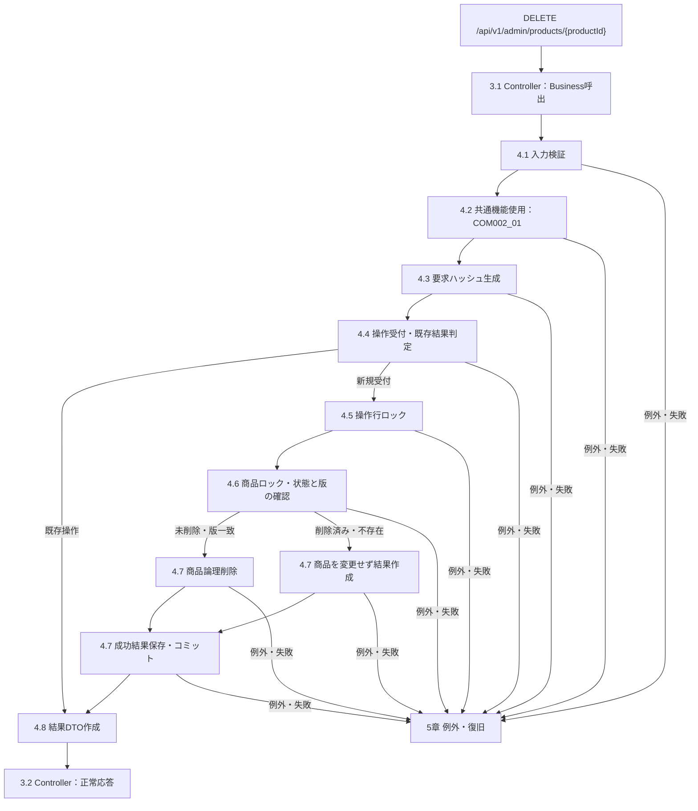

# APA002_07_商品論理削除

## 0. 処理フロー



作成日：2026-11-20

## 1. 基本情報

| 項目 | 内容 |
| --- | --- |
| ID／旧ID | APA002_07／API-A10 |
| 物理名 | soft-delete-product |
| HTTP・URL | DELETE /api/v1/admin/products/{productId} |
| 対応画面 | SCA-02 商品管理一覧 |
| Controller | AdminProductDeleteController（親Controllerを継承） |
| Business | ProductDeleteBusiness.execute(command, actor) |
| 認証 | 管理者JWT必須。共通受付済みactorを使用 |
| DB | admins参照、products参照・更新、operation_histories登録・更新 |
| 排他 | 商品行ロック＋要求versionの照合 |
| 二重実行防止 | operationIdと主体・対象・要求ハッシュの照合 |
| 結果照会 | APA002_08：GET /api/v1/admin/products/operations/{operationId} |
| 外部通信 | なし。S3操作・SNS通知は行わない |

商品1件を論理削除する。公開・非公開、販売可能・停止、在庫数にかかわらず対象とする。商品行の物理削除、カート明細の削除、注文記録の変更、画像の削除は行わない。

## 2. リクエスト項目

### 2.1 ヘッダー・パス・JSONボディ

| 場所 | 項目 | JSON型 | 必須 | 条件 |
| --- | --- | --- | --- | --- |
| Header | Authorization | — | ○ | 管理者アクセストークン。チェックは共通受付 |
| Header | Content-Type | — | ○ | application/json |
| Path | productId | string | ○ | 正の10進整数文字列。先頭0なし、1〜19桁、Long最大値以下 |
| Body | operationId | string | ○ | UUID v4、小文字標準表記36文字。トリムしない |
| Body | version | string | ○ | 一覧で取得した版。正の10進整数文字列、先頭0なし、Long最大値以下 |
| Query | なし | — | — | 未定義クエリを拒否 |

本APIはDELETEのJSONボディで操作ID・版を受け取る契約とする。フロント・API Gateway・ECS間でボディを保持することを結合確認する。URL・メソッドは機能一覧どおりとし、削除フラグや削除日時は入力させない。

管理者ID、ボディ内productId、isDeleted、deletedAt等の未知項目は受け付けない。

### 2.2 リクエスト例

```http
DELETE /api/v1/admin/products/101
Authorization: Bearer <管理者アクセストークン>
Content-Type: application/json
```

```json
{
  "operationId": "77d461a6-90de-4743-bb2a-ebba679f6816",
  "version": "4"
}
```

## 3. Controllerの処理

### 3.1 Business呼出

パスproductId、JSON DTO、クエリ有無、ボディ有無、共通受付済みactorをBusinessへ渡す。

Controller内でID変換・版照合・DB処理は実施しない。共通受付の詳細は記載せず、個別項目の検証は4.1で行う。

### 3.2 正常応答

Businessの結果DTOを親Controllerへ渡す。

**共通機能使用：COM001_07 共通レスポンス生成。**

HTTP 200、共通JSON形式、Cache-Control: no-storeで返す。SUCCEEDED／PROCESSINGを区別する。

## 4. Businessの処理

### 4.1 入力検証

| チェック | 不正時 |
| --- | --- |
| ボディなし・JSON null・オブジェクト以外、クエリあり | INVALID_REQUEST |
| productId・versionが未設定、空文字、形式不正、Long範囲外 | VALIDATION_ERROR |
| operationIdが未設定、UUID v4の小文字標準表記以外 | VALIDATION_ERROR |
| 未知項目・JSON型不正 | 共通受付のエラー。Businessを開始しない |

1. DTOの単項目制約と固有チェックで検証する。
2. productId・versionを検証後にLongへ変換する。文字列をトリムしたり、数値を丸めたりしない。
3. 本APIには項目間の相関チェックはない。DBの版との照合は4.6で行う。

検証失敗時はDBへ登録・更新しない。外部メッセージには許可値一覧や内部条件を列挙しない。

### 4.2 管理者利用権限確認

**共通機能使用：COM002_01 管理者検索・利用権限確認。**

`adminAccessService.requireActiveAdmin(actor)`を1回呼び出す。返却adminIdを操作履歴の所有者照合に使用する。失敗時は以降を実行しない。

### 4.3 要求ハッシュ生成

以下の固定順のJSONを改行・空白なしでUTF-8化し、SHA-256の小文字hex64文字を生成する。ID・versionは検証済みの10進文字列。

```json
{
  "schemaVersion": 1,
  "operationType": "PRODUCT_DELETE",
  "actorType": "ADMIN",
  "actorId": "1",
  "productId": "101",
  "version": "4"
}
```

operationId・現在日時は含めない。同じoperationIdで対象商品や要求版を変更した再送を検出する。

### 4.4 操作受付・既存結果判定（TX-A）

| operation_histories項目 | 登録値 |
| --- | --- |
| operation_id／operation_type | operationId／PRODUCT_DELETE |
| actor_type／actor_id | ADMIN／adminIdの10進文字列 |
| target_resource_id | productIdのLong値 |
| request_hash | 4.3のハッシュ |
| operation_status／is_retryable | PROCESSING／false |
| result_code／result_summary_json | null／null |
| expires_at | null（本APIでは自動削除しない） |
| created_at／updated_at | DB時刻 |

```sql
INSERT INTO operation_histories (
  operation_id, operation_type, actor_type, actor_id, target_resource_id,
  request_hash, operation_status, is_retryable, result_code,
  result_summary_json, expires_at, created_at, updated_at
) VALUES (
  #{operationId,jdbcType=VARCHAR}, 'PRODUCT_DELETE', 'ADMIN',
  #{actorId,jdbcType=VARCHAR}, #{productId,jdbcType=BIGINT},
  #{requestHash,jdbcType=CHAR}, 'PROCESSING', FALSE, NULL,
  NULL, NULL, CURRENT_TIMESTAMP, CURRENT_TIMESTAMP
)
ON CONFLICT (operation_id) DO NOTHING
RETURNING operation_id;
```

- 1件返却：TX-Aのコミット成功確認後に4.5へ進む。
- 0件：READ COMMITTEDの別SQLで次の既存操作を取得する。

```sql
SELECT operation_type, actor_type, actor_id, target_resource_id,
       request_hash, operation_status, result_code, result_summary_json
FROM operation_histories
WHERE operation_id = #{operationId,jdbcType=VARCHAR};
```

| 判定（上から順） | 処理 |
| --- | --- |
| 0件、必須データ不正 | INTERNAL_ERROR |
| actor_type・actor_id不一致 | RESOURCE_NOT_FOUND。他者の結果を開示しない |
| operation_type・target_resource_id・request_hash不一致 | IDEMPOTENCY_KEY_REUSED |
| SUCCEEDED | 保存済みdataを4.8へ。商品を再更新しない |
| FAILED | 保存済みresult_codeの例外応答。再実行しない |
| PROCESSING | 処理中dataを4.8へ。再実行しない |
| 状態未定義 | INTERNAL_ERROR |

既存成功の判定は現在の商品・versionの確認より先に行う。削除成功後の同一要求を版競合にしない。

TX-Aのコミット結果不明では商品削除を開始しない。SERVICE_UNAVAILABLEを返し、同じ操作IDで結果照会する。

### 4.5 操作行ロック（TX-B開始）

```sql
SELECT operation_type, actor_type, actor_id, target_resource_id,
       request_hash, operation_status, result_code, result_summary_json
FROM operation_histories
WHERE operation_id = #{operationId,jdbcType=VARCHAR}
FOR UPDATE;
```

4.4で新規受付した要求だけが進む。主体・種別・対象ID・ハッシュを再確認する。

| 状態 | 処理 |
| --- | --- |
| PROCESSING | 4.6へ |
| SUCCEEDED | 保存済みdataを返す |
| FAILED | 保存済みエラーを返す。復旧処理で終了した操作を再開しない |
| 行なし・不整合 | INTERNAL_ERROR |

ロック順は**操作行→商品行**。TX-BはREAD COMMITTED。待機時間の初期設定はロック3秒・SQL5秒・TX15秒とする。タイムアウト後の自動更新再試行はしない。

### 4.6 商品取得・状態と版の確認

| 項目 | 内容 |
| --- | --- |
| テーブル | products |
| 取得項目 | id、is_deleted、deleted_at、version |
| 検索条件 | id＝対象商品ID |
| 排他 | FOR UPDATE |
| 削除フラグ条件 | 付けない。削除済みを判定するため |
| 公開・販売・在庫条件 | 付けない |

```sql
SELECT id, is_deleted, deleted_at, version
FROM products
WHERE id = #{productId,jdbcType=BIGINT}
FOR UPDATE;
```

| 判定（上から順） | 処理・結果 |
| --- | --- |
| 0件 | 商品更新なし。deleteResult=NOT_FOUNDとして4.7の成功結果保存へ |
| is_deleted・version不正、削除フラグとdeleted_atの整合性不正 | INTERNAL_ERROR |
| is_deleted=true | 商品更新なし。deleteResult=ALREADY_DELETEDとして4.7の成功結果保存へ |
| is_deleted=false、DB version≠要求version | VERSION_CONFLICT。削除しない |
| is_deleted=false、version＝Long最大値 | INTERNAL_ERROR |
| is_deleted=false、版一致 | 4.7で論理削除。deleteResult=DELETED |

削除済みは版不一致でも再更新せず正常終了する。入力versionの形式検証は省略しない。

不存在・削除済みは「対象を一覧から除外できる状態」として操作をSUCCEEDEDにするが、**今回の操作で削除したとは返さない**。初回から不存在の場合にも「既に削除した」と断定しない。

商品は物理削除・ID再利用を行わない前提。在庫引当・在庫戻し・編集もversionを増加させるため、画面表示後に変更された未削除商品は削除を拒否する。

### 4.7 論理削除・成功結果保存（TX-B内）

**A. 未削除かつ版一致の場合のみ商品を更新する。**

| 更新項目 | 値 |
| --- | --- |
| is_deleted | true |
| deleted_at／updated_at | DB時刻 |
| version | 現在版＋1 |
| 更新しない項目 | 商品名、価格、在庫、公開・販売設定、画像キー、created_at等 |

```sql
UPDATE products
SET is_deleted = TRUE,
    deleted_at = CURRENT_TIMESTAMP,
    version = version + 1,
    updated_at = CURRENT_TIMESTAMP
WHERE id = #{productId,jdbcType=BIGINT}
  AND is_deleted = FALSE
  AND version = #{expectedVersion,jdbcType=BIGINT}
RETURNING id, version, deleted_at;
```

返却1件が必要。ロック下の照合後に0件となった場合はINTERNAL_ERRORとしてTX-Bをロールバックする。通常の版競合は4.6で判定する。

**B. 全ての正常分岐で、7章の成功dataを操作履歴へ保存する。**

| deleteResult | product.version | product.deletedAt |
| --- | --- | --- |
| DELETED | UPDATEで返った更新後の版 | UPDATEで返った削除日時 |
| ALREADY_DELETED | 4.6で取得した現在版 | 4.6で取得した既存の削除日時 |
| NOT_FOUND | null | null |

```sql
UPDATE operation_histories
SET operation_status = 'SUCCEEDED', is_retryable = FALSE,
    result_code = 'SUCCESS',
    result_summary_json = CAST(#{resultSummaryJson,jdbcType=VARCHAR} AS jsonb),
    updated_at = CURRENT_TIMESTAMP
WHERE operation_id = #{operationId,jdbcType=VARCHAR}
  AND operation_type = 'PRODUCT_DELETE'
  AND actor_type = 'ADMIN'
  AND actor_id = #{actorId,jdbcType=VARCHAR}
  AND target_resource_id = #{productId,jdbcType=BIGINT}
  AND request_hash = #{requestHash,jdbcType=CHAR}
  AND operation_status = 'PROCESSING';
```

履歴更新1件を確認しTX-Bをコミットする。商品論理削除と操作SUCCEEDEDを同時に確定する。コミット成功確認後だけ成功応答を返す。保存JSONはdataのみで、requestId・errorを含めない。

**更新しない関連データ**

| 対象 | 扱い |
| --- | --- |
| 注文・注文明細 | 注文時点の記録を維持 |
| カート・カート明細 | 保持。次の取得・注文検証で購入不可として扱う |
| 商品在庫 | 本APIでは増減しない。既存注文のキャンセルによる在庫戻しは注文機能の担当 |
| product_image_uploads・S3画像 | 状態変更・削除をしない |
| 公開・販売設定 | 元の値を保持。ユーザー向け取得はis_deleted=falseで除外 |

### 4.8 結果DTO作成

| 状態 | data |
| --- | --- |
| 今回SUCCEEDED | 4.7で保存した成功data |
| 既存SUCCEEDED | 保存済み成功dataをそのまま使用 |
| 既存PROCESSING | operationId、operationStatus=PROCESSING、deleteResult=null、product=null |

同じ操作IDの再送でdeleted_atやversionを更新しない。成功済み再送には元の処理結果を返す。

## 5. 例外・復旧

### 5.1 例外応答

**共通機能使用：COM001_08 共通例外変換。**  
**共通機能使用：COM001_09 アプリケーションログ出力・秘匿。**

| 条件 | error.code | error.message |
| --- | --- | --- |
| ボディ・クエリ構造不正 | INVALID_REQUEST | リクエストの内容が正しくありません。 |
| ID・版・操作IDの入力不正 | VALIDATION_ERROR | 入力内容をご確認ください。 |
| 管理者権限なし | FORBIDDEN | この操作を実行する権限がありません。 |
| 他者の操作ID | RESOURCE_NOT_FOUND | 指定された情報を表示できません。 |
| 未削除商品の版不一致 | VERSION_CONFLICT | 情報が更新されています。最新の内容をご確認ください。 |
| 同じ操作IDで異なる要求 | IDEMPOTENCY_KEY_REUSED | 操作を確認できませんでした。内容をご確認ください。 |
| DB一時障害・ロック待機超過・コミット結果不明 | SERVICE_UNAVAILABLE | 処理を完了できませんでした。時間をおいて再試行してください。 |
| DB整合性不正・想定外例外 | INTERNAL_ERROR | 処理を完了できませんでした。 |

ECSで捕捉可能な例外はHTTP 200、data=null、fieldErrors=[]。基盤側で拒否・障害となる応答は200統一の対象外。内部SQL・状態候補・要求ハッシュは外部へ返さない。

ログにはrequestId、operationId、対象商品ID、処理章番号、TXの確定状況を記録する。トークン・要求全文は記録しない。

### 5.2 版競合をFAILEDへ確定する処理

今回新規受付した操作が4.6でVERSION_CONFLICTとなった場合のみ、以下を行う。

1. TX-Bのロールバック完了を確認する。
2. 別の短いTXで操作行をFOR UPDATE取得し、主体・種別・対象商品・ハッシュを再確認する。
3. PROCESSINGなら次のSQLでFAILEDを保存し、コミットする。
4. 既存SUCCEEDEDはその成功結果、既存FAILEDは保存済み結果を採用し、上書きしない。

```sql
UPDATE operation_histories
SET operation_status = 'FAILED',
    is_retryable = TRUE,
    result_code = 'VERSION_CONFLICT',
    result_summary_json = NULL,
    updated_at = CURRENT_TIMESTAMP
WHERE operation_id = #{operationId,jdbcType=VARCHAR}
  AND operation_type = 'PRODUCT_DELETE'
  AND actor_type = 'ADMIN'
  AND actor_id = #{actorId,jdbcType=VARCHAR}
  AND target_resource_id = #{productId,jdbcType=BIGINT}
  AND request_hash = #{requestHash,jdbcType=CHAR}
  AND operation_status = 'PROCESSING';
```

1件更新・コミット成功を確認してVERSION_CONFLICTを返す。失敗記録の確定も不明ならSERVICE_UNAVAILABLEとし、結果照会へ委ねる。

is_retryable=trueは、最新商品を確認し**新しい操作IDで再操作できる**意味。同じ操作IDの再実行ではない。最新versionだけ差し替えて無確認で削除しない。

### 5.3 DB更新の復旧

| 中断箇所 | データ状態・復旧 |
| --- | --- |
| 入力検証・権限確認失敗 | 書込みなし |
| TX-Aコミット不明 | 商品更新は開始しない。同じ操作IDでAPA002_08を照会 |
| TX-A成功後、TX-B前に停止 | 操作はPROCESSING。結果照会で確認・復旧 |
| TX-B途中に例外 | 商品変更・成功記録を同時にロールバック |
| TX-Bコミット結果不明 | 全て反映又は全て未反映。操作履歴で結果確認 |
| 成功応答が未着 | 同じ操作IDで照会／同じ内容を再送し、保存済み結果を取得 |
| 版競合 | 最新の商品を再取得し、内容を確認してから新しい操作IDで再操作 |
| DB復旧まで確認不可 | 結果不明を維持。別IDでの自動削除を行わない |

削除フラグをfalseへ戻す、deleted_atを消す、versionを減らす等の補償更新は行わない。コミット済みの削除は本APIで復元しない。

**APA002_08へ引き継ぐ復旧条件**

- PRODUCT_DELETEのPROCESSINGが受付から15分以上経過している。
- 操作行をFOR UPDATE NOWAITで取得でき、ロック取得後もPROCESSING。
- この条件を満たす場合、FAILED・is_retryable=true・result_code=SERVICE_UNAVAILABLEへ確定できる。商品更新とSUCCEEDEDが同一TXであるため、当該操作の削除は未反映と判断できる。
- 遅れて元要求が再開しても4.5でFAILEDを検出し、商品を更新しない。
- 商品が現在削除済みというだけでは、元操作の成功と判定しない。他の操作が削除した可能性がある。
- 操作記録なしだけで未実行と断定しない。同じ操作ID・同じ内容の再送は一意制約で吸収する。

DB例外・コミット不明時に無理にFAILEDへ変更しない。エラー発生中のTXを使って失敗記録を書かない。

## 6. 実装・画面連携

| 項目 | 方針 |
| --- | --- |
| TXの単位 | TX-A受付、TX-B商品＋成功記録、版競合の失敗記録を分離。Business全体を単一@Transactionalにしない |
| SQLバインド | ID・versionはLong。入力値のSQL文字列連結は禁止。RETURNINGは結果付き更新としてcommit対象にする |
| DELETED | SCA-02で行を除去しAP08「商品を削除しました。」 |
| ALREADY_DELETED | 行を除去しAP09「指定された商品は既に削除されています。一覧を更新しました。」 |
| NOT_FOUND | 行を除去し「指定された商品が見つかりません。一覧を更新しました。」。削除済みと断定しない |
| PROCESSING・結果不明 | 操作IDを保持してAPA002_08で確認。新しいIDで自動再送しない |
| 既存注文 | 明細・金額を維持。注文画像は現在の画像を参照する既定方針。本APIでは画像を消さない |

NOT_FOUNDの文言は画面・メッセージ一覧への追記対象。DBカラム追加は不要。今回の成果物は本設計書であり、スプレッドシート・既存設計書は変更していない。

## 7. 返却項目

### 7.1 共通項目

HTTP 200、Content-Type: application/json、Cache-Control: no-store。

| 項目 | JSON型 | null | 内容 |
| --- | --- | --- | --- |
| requestId | string | 不可 | 今回の要求追跡ID |
| data | object | 可 | 正常・処理中結果。例外時null |
| error | object | 可 | 正常・処理中はnull |
| error.code／error.message | string | 不可 | 5.1のコード・文言 |
| error.fieldErrors | array | 不可 | [] |

### 7.2 data

| 項目 | JSON型 | null | 内容 |
| --- | --- | --- | --- |
| operationId | string | 不可 | 削除操作ID |
| operationStatus | string | 不可 | SUCCEEDED／PROCESSING |
| deleteResult | string | 可 | DELETED／ALREADY_DELETED／NOT_FOUND。PROCESSING時null |
| product | object | 可 | SUCCEEDED時は対象情報。PROCESSING時null |
| product.productId | string | 不可 | 対象商品ID |
| product.version | string | 可 | DELETEDは削除直後、ALREADY_DELETEDは確認時の版。NOT_FOUNDはnull |
| product.deletedAt | string | 可 | DBの削除日時。UTC ISO 8601ミリ秒3桁。NOT_FOUNDはnull |

### 7.3 応答JSON例

**今回削除成功／同じ成功操作の再送**

```json
{
  "requestId": "req-delete-product-001",
  "data": {
    "operationId": "77d461a6-90de-4743-bb2a-ebba679f6816",
    "operationStatus": "SUCCEEDED",
    "deleteResult": "DELETED",
    "product": {
      "productId": "101",
      "version": "5",
      "deletedAt": "2026-11-20T03:00:00.000Z"
    }
  },
  "error": null
}
```

**別の操作で既に削除済み**

```json
{
  "requestId": "req-delete-product-002",
  "data": {
    "operationId": "88d461a6-90de-4743-bb2a-ebba679f6816",
    "operationStatus": "SUCCEEDED",
    "deleteResult": "ALREADY_DELETED",
    "product": {
      "productId": "101",
      "version": "5",
      "deletedAt": "2026-11-20T03:00:00.000Z"
    }
  },
  "error": null
}
```

**対象不存在**

```json
{
  "requestId": "req-delete-product-003",
  "data": {
    "operationId": "99d461a6-90de-4743-bb2a-ebba679f6816",
    "operationStatus": "SUCCEEDED",
    "deleteResult": "NOT_FOUND",
    "product": {
      "productId": "999",
      "version": null,
      "deletedAt": null
    }
  },
  "error": null
}
```

**処理中**

```json
{
  "requestId": "req-delete-product-004",
  "data": {
    "operationId": "77d461a6-90de-4743-bb2a-ebba679f6816",
    "operationStatus": "PROCESSING",
    "deleteResult": null,
    "product": null
  },
  "error": null
}
```

**版競合**

```json
{
  "requestId": "req-delete-product-005",
  "data": null,
  "error": {
    "code": "VERSION_CONFLICT",
    "message": "情報が更新されています。最新の内容をご確認ください。",
    "fieldErrors": []
  }
}
```

**DB障害・結果不明**

```json
{
  "requestId": "req-delete-product-006",
  "data": null,
  "error": {
    "code": "SERVICE_UNAVAILABLE",
    "message": "処理を完了できませんでした。時間をおいて再試行してください。",
    "fieldErrors": []
  }
}
```

