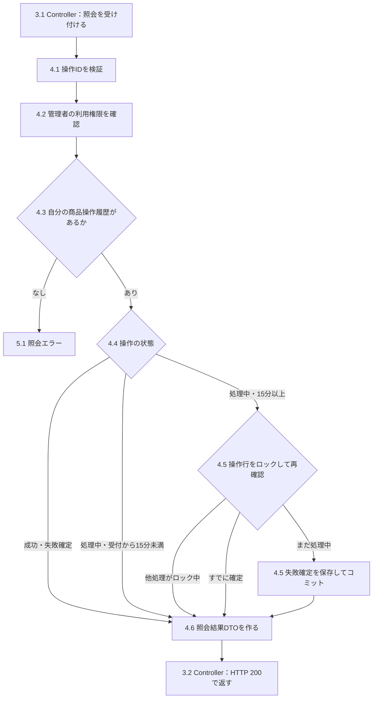

# APA002_08_商品操作（登録・更新・削除）結果照会

## 0. 処理フロー



## 1. 機能概要

| 項目 | 内容 |
| --- | --- |
| 機能ID／物理名 | APA002_08（旧API-A11）／get-product-operation-result |
| エンドポイント | GET /api/v1/admin/products/operations/{operationId} |
| 利用画面 | SCA-02 商品管理一覧（AP11）、SCA-03 商品登録・編集（AE19） |
| 呼び出すタイミング | 登録・編集・削除の応答が届かない、または元APIがPROCESSINGを返したとき。元の要求のoperationIdで照会する |
| 対象操作 | APA002_05＝PRODUCT_CREATE、APA002_06＝PRODUCT_UPDATE、APA002_07＝PRODUCT_DELETE |
| DB | admins（共通機能）、operation_histories。productsは参照・更新しない |

判定に使うのは**その操作IDの確定記録**。例えば商品が現在削除済みでも、それだけでは今回の削除が成功したかは分からない。商品の再登録・再更新・再削除は行わない。画像アップロードの結果照会はAPA002_04が担当する。

## 2. リクエスト

| 場所 | 項目 | 必須 | 内容 |
| --- | --- | --- | --- |
| Header | Authorization | ○ | 管理者アクセストークン。共通受付で確認済みの主体を使用 |
| Path | operationId | ○ | 元の操作のUUID v4。小文字、ハイフン付き36文字。新しいIDを発行しない |
| Query／Body | なし | — | クエリ・ボディは受け付けない。管理者ID・商品ID・操作種別も送らない |

```http
GET /api/v1/admin/products/operations/77d461a6-90de-4743-bb2a-ebba679f6816
Authorization: Bearer <管理者アクセストークン>
```

リクエストJSONはない。空のオブジェクト `{}` も送らない。

## 3. Controller

### 3.1 照会を受け付ける

親Controllerを継承する `AdminProductOperationResultController` が、パスの操作ID、クエリ・ボディの有無、共通受付済みactorを `ProductOperationResultBusiness.execute` に渡す。

### 3.2 応答を返す

**共通機能使用：COM001_07 共通レスポンス生成。** BusinessのDTOをHTTP 200で返す。応答は `Cache-Control: no-store`。確定結果を再取得した場合もrequestIdは今回の照会の値とする。

## 4. Business

### 4.1 入力チェック

| 条件 | 処理 |
| --- | --- |
| クエリあり・ボディあり | INVALID_REQUEST |
| operationIdが正規形に一致しない | VALIDATION_ERROR |
| 上記以外 | 4.2へ。項目間チェックはない |

文字列全体を `[0-9a-f]{8}-[0-9a-f]{4}-4[0-9a-f]{3}-[89ab][0-9a-f]{3}-[0-9a-f]{12}` で照合する。前後の空白除去・大文字小文字の変換はしない。パス自体がルートに一致しない場合はControllerの対象外。

### 4.2 管理者の利用権限を確認

**共通機能使用：COM002_01 管理者検索・利用権限確認。** `requireActiveAdmin(actor)` の返却adminIdを10進文字列にして履歴の所有者条件に使用する。失敗時は履歴を照会しない。

### 4.3 自分の商品操作履歴を取得

| テーブル | 取得条件 | 取得項目 |
| --- | --- | --- |
| operation_histories | operation_id一致、actor_type＝ADMIN、actor_id＝確認済み管理者ID、operation_typeが対象3種のいずれか | 操作ID・種別・状態、対象ID、結果コード、結果JSON、再操作可否、受付から15分経過したか |

```sql
SELECT operation_id, operation_type, operation_status, target_resource_id,
       result_code, result_summary_json, is_retryable,
       (created_at <= CURRENT_TIMESTAMP - INTERVAL '15 minutes') AS stale
FROM operation_histories
WHERE operation_id = #{operationId,jdbcType=VARCHAR}
  AND actor_type = 'ADMIN' AND actor_id = #{actorId,jdbcType=VARCHAR}
  AND operation_type IN ('PRODUCT_CREATE','PRODUCT_UPDATE','PRODUCT_DELETE');
```

0件はRESOURCE_NOT_FOUND。他者の操作・対象外種別・未登録を同じ応答にする。初回受付トランザクションが未コミットの可能性もあるため、0件から「実行されていない」とは断定しない。1件なら4.4へ。

### 4.4 操作の状態を判定

| operation_status | 条件 | 処理 |
| --- | --- | --- |
| SUCCEEDED | result_code＝SUCCESS、保存済み成功dataあり | 4.6へ。元APIの成功時の値を返す |
| FAILED | 確定した失敗コードあり | 4.6へ。元操作の失敗を正常な照会結果として返す |
| PROCESSING | stale＝false | 4.6へ。再操作不可で返す |
| PROCESSING | stale＝true | 4.5へ。経過時間だけで失敗としない |
| 未定義・必須項目の不整合 | — | INTERNAL_ERROR。結果を補完せず、DBも書き換えない |

### 4.5 長時間処理中の操作だけを確定する

**前提：** 元の3つのAPIは操作行をロックしてPROCESSINGを確認してから商品を書き換え、商品変更とSUCCEEDEDを同じトランザクションでコミットする。このため、下記の再確認でPROCESSINGなら、元操作の商品変更は確定していない。

1. 短いREAD COMMITTEDトランザクションを開始。4.3と**同じSELECT・同じ所有者条件**に `FOR UPDATE NOWAIT` を付けて実行する。
2. このロック試行で行ロックを取れない場合（SQLSTATE 55P03）はトランザクションをロールバックし、直前に観測したPROCESSINGを返す。他のDB例外は5.1へ。
3. 取得した行で4.4の判定をやり直す。SUCCEEDED／FAILEDならその結果を返す。0件はRESOURCE_NOT_FOUND。PROCESSINGかつ15分以上の場合だけ下記を実行する。他の分岐は書込みなしでトランザクションを終了する。

```sql
UPDATE operation_histories
SET operation_status = 'FAILED', is_retryable = TRUE,
    result_code = 'SERVICE_UNAVAILABLE', result_summary_json = NULL,
    updated_at = CURRENT_TIMESTAMP
WHERE operation_id = #{operationId,jdbcType=VARCHAR}
  AND actor_type = 'ADMIN' AND actor_id = #{actorId,jdbcType=VARCHAR}
  AND operation_type IN ('PRODUCT_CREATE','PRODUCT_UPDATE','PRODUCT_DELETE')
  AND operation_status = 'PROCESSING'
  AND created_at <= CURRENT_TIMESTAMP - INTERVAL '15 minutes';
```

4. 更新1件を確認してコミット後、FAILEDを返す。ロック下で0件ならロールバックしINTERNAL_ERROR。操作ID・対象商品ID・要求ハッシュ・受付日時は変更しない。後から元の処理が再開しても、操作行がFAILEDなので商品変更には進めない。

このGETが書き換えるのは、上記条件をすべて満たした未完了の履歴1件だけ。定期的な一括更新や画像操作の復旧は行わない。

### 4.6 照会結果DTOを作る

| 状態 | resultCode | isRetryable | result |
| --- | --- | --- | --- |
| SUCCEEDED | SUCCESS | false | 元APIの成功data |
| FAILED | 履歴に保存した外部向け失敗コード | 履歴のis_retryable | null |
| PROCESSING | null | false | null |

成功JSONは種別ごとの元APIの成功DTOに読み戻す。格納された操作ID・状態と履歴が一致し、商品IDがtarget_resource_idと一致することを確認する。形式不正・未知の失敗コードはINTERNAL_ERROR。DBの内部情報や任意のJSONキーをそのまま公開しない。

`isRetryable=true` は**最新の商品・入力を確認し、新しい操作IDでやり直せる**という意味。版競合後に古い入力を自動再送しない。PROCESSINGなら元操作を再実行せず、同じIDで本APIを再照会する。

## 5. 例外・データ復旧

### 5.1 照会自体が失敗した場合

**共通機能使用：COM001_08 共通例外変換、COM001_09 アプリケーションログ出力・秘匿。**

| 条件 | error.code | error.message |
| --- | --- | --- |
| 不要なクエリ・ボディ | INVALID_REQUEST | リクエストの内容が正しくありません。 |
| 操作IDの形式不正 | VALIDATION_ERROR | 入力内容をご確認ください。 |
| 管理権限なし | FORBIDDEN | この操作を実行する権限がありません。 |
| 照会対象なし | RESOURCE_NOT_FOUND | 指定された情報を表示できません。 |
| DB接続障害・復旧コミット結果不明 | SERVICE_UNAVAILABLE | 処理を完了できませんでした。時間をおいて再試行してください。 |
| 履歴不整合・想定外例外 | INTERNAL_ERROR | 処理を完了できませんでした。 |

ECSで捕捉した例外は原則HTTP 200、data=null、error.fieldErrors=[]。API Gatewayの拒否等は対象外。照会失敗は元操作の失敗を意味しない。

### 5.2 復旧時の判断

| 事象 | 次の処理 |
| --- | --- |
| 通常照会の失敗・応答未着 | 同じ操作IDで再照会 |
| 4.5の更新がロールバックされた | 履歴は更新前の状態。次の照会で条件を再評価 |
| 4.5のコミット結果不明 | FAILEDと断定せず再照会。すでに確定済みならその状態を返す |
| 履歴なしが続く | 新しいIDで自動実行しない。元要求を再送する必要があれば、同じ操作ID・同じ要求内容を用いる |

いずれの場合も、商品・在庫・画像を元の値に戻す補償更新は不要。

## 6. 返却項目

| 項目 | 型／null | 内容 |
| --- | --- | --- |
| requestId | string | 今回の照会の追跡ID |
| data／error | object／null | 照会成功はdata、照会失敗はerrorに値を設定 |
| data.operationId／operationType | string | 元操作ID、対象3種の操作種別 |
| data.operationStatus | string | SUCCEEDED／FAILED／PROCESSING |
| data.resultCode | string／null | 4.6の結果コード |
| data.isRetryable | boolean | 元操作を新しいIDで再操作できるか |
| data.result | object／null | 成功時のみ。元APIの成功data（requestId・errorは含まない） |
| data.result.product | object | 登録・編集は商品ID、版、税込単価、登録・更新日時。削除は商品ID、版、削除日時 |
| data.result.deleteResult | string | 削除成功時のみ。DELETED／ALREADY_DELETED／NOT_FOUND。NOT_FOUNDでは版・削除日時はnull |
| error.code／message／fieldErrors | string／string／array | 5.1のコードと文言、空配列 |

**削除成功を確認できた場合**
```json
{
  "requestId": "req-product-inquiry-001",
  "data": {
    "operationId": "77d461a6-90de-4743-bb2a-ebba679f6816",
    "operationType": "PRODUCT_DELETE",
    "operationStatus": "SUCCEEDED",
    "resultCode": "SUCCESS",
    "isRetryable": false,
    "result": {
      "operationId": "77d461a6-90de-4743-bb2a-ebba679f6816",
      "operationStatus": "SUCCEEDED",
      "deleteResult": "DELETED",
      "product": {"productId":"101","version":"5","deletedAt":"2026-11-20T03:00:00.000Z"}
    }
  },
  "error": null
}
```

**照会は成功し、元の削除が版競合で失敗していた場合**
```json
{
  "requestId": "req-product-inquiry-002",
  "data": {
    "operationId": "1c942df4-7d11-498b-8db7-ca51411df865",
    "operationType": "PRODUCT_DELETE",
    "operationStatus": "FAILED",
    "resultCode": "VERSION_CONFLICT",
    "isRetryable": true,
    "result": null
  },
  "error": null
}
```

**照会自体が失敗し、削除結果を確認できなかった場合**
```json
{
  "requestId": "req-product-inquiry-003",
  "data": null,
  "error": {
    "code": "SERVICE_UNAVAILABLE",
    "message": "処理を完了できませんでした。時間をおいて再試行してください。",
    "fieldErrors": []
  }
}
```
