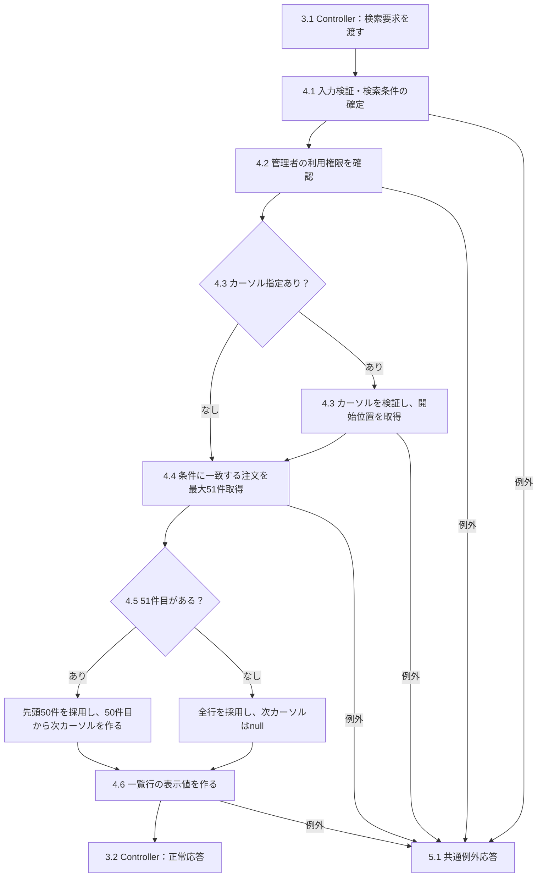

# APA004_01_管理用注文履歴一覧・検索・状態絞り込み

## 0. 処理フロー



## 1. 基本情報

| 項目 | 設計 |
| --- | --- |
| 機能ID／旧ID／物理名 | APA004_01／API-A12／search-admin-orders |
| エンドポイント | POST /api/v1/admin/orders/search |
| 呼出元 | SCA-04 注文履歴一覧。初回、検索、条件クリア、追加取得、先頭再取得で使用 |
| 対象 | 全会員の成立済み注文。キャンセル済みを含む。成立前の操作は対象外 |
| 認証 | API Gateway：管理者JWT必須。ECSでは管理者の利用権限を毎回確認 |
| DB | admins（共通機能）、orders、order_itemsを参照。書込みなし |
| ページ | 1回最大50件。注文確定日時降順、同一日時は注文ID降順 |

氏名・メールアドレスを検索できるため、検索条件はURLに載せずPOSTのJSONボディで受け取る。POSTでも参照専用であり、操作ID・べき等キー・更新用の版情報は不要。

## 2. リクエスト

| 場所 | 項目 | 必須 | 型・条件 |
| --- | --- | --- | --- |
| Header | Authorization | ○ | Bearer 管理者アクセストークン。ヘッダー検証は共通受付 |
| Header | Content-Type | ○ | application/json |
| Body | JSONオブジェクト | ○ | 初回・条件クリアは空オブジェクトでよい |
| Body | keyword | 任意 | string／null。前後空白除去後100文字以内 |
| Body | status | 任意 | string／null。注文状況コードを1件。省略・null・空文字は「すべて」 |
| Body | cursor | 任意 | string／null。前回のnextCursor。省略・nullは先頭 |
| Query | なし | — | URLクエリ、件数・任意ソートの指定は受け付けない |

**初回・条件クリア**
```json
{}
```

**検索**
```json
{"keyword":"山田","status":"PREPARING"}
```

**同じ検索の追加取得**（cursorの値は説明用。実際には前回の値をそのまま渡す）
```json
{"keyword":"山田","status":"PREPARING","cursor":"<前回のnextCursor>"}
```

## 3. Controller

### 3.1 Business呼出

親Controllerを継承した `AdminOrderSearchController` が、検索DTO・クエリ有無・共通受付済みactorを `AdminOrderSearchBusiness.execute` に渡す。JSON構造・未知項目・型の共通受付は **共通機能使用：COM001_10**。管理者IDはボディから受け取らない。

### 3.2 正常応答

**共通機能使用：COM001_07 共通レスポンス生成。** Businessの結果をHTTP 200、JSON、Cache-Control: no-storeで返す。条件に一致する注文が0件でも正常応答とする。

## 4. Business

### 4.1 入力検証・正規化

| 対象 | 処理 | 不正時 |
| --- | --- | --- |
| リクエスト | クエリなし、JSONオブジェクト必須。欠落・JSON nullを空オブジェクト扱いしない | INVALID_REQUEST |
| keyword | 省略・null→空文字。前後の空白（全角を含む）を除去し、Unicodeコードポイント数で最大100。内部の空白は保持。不正サロゲート・NULは拒否 | VALIDATION_ERROR |
| status | 未指定扱いは空文字に統一。それ以外は ORDER_RECEIVED、PREPARING、SHIPPED、CANCELLED のいずれかに完全一致 | VALIDATION_ERROR |
| cursor | トリムしない。指定時の形式・期限・検索条件との組合せは4.3で判定 | CURSOR_INVALID |

正規化したkeyword・statusをSQL検索とカーソル照合の両方に使用する。「すべて」の表示文字列はAPIに送らない。

### 4.2 管理者検索・利用権限確認

**共通機能使用：COM002_01。** `requireActiveAdmin(actor)` で有効な管理者を取得する。失敗時は注文を検索しない。返却されたDB管理者IDを4.3に使用する。全会員を検索する機能なので、orders.user_idにこの管理者IDを指定しない。

### 4.3 追加取得の開始位置を決める

**共通機能使用：COM001_12 カーソル生成・検証。**

| CursorContextの項目 | 渡す値 |
| --- | --- |
| scope／キー型 | APA004_01／CONFIRMED_AT_ID_DESC |
| 条件 | 4.1で確定したkeyword・status |
| 主体 | ADMIN、4.2で取得した管理者IDの10進文字列 |

`cursorCodec.decode(cursor, context)` の結果がemptyなら先頭。検証済みならlastConfirmedAtをorders.ordered_atの境界、lastIdをorders.idの境界に使用する。条件変更・他の管理者・期限切れ等はCURSOR_INVALID。注文検索SQLは実行しない。

### 4.4 DB検索

| 取得元 | 用途・条件 |
| --- | --- |
| orders o | 注文番号・確定日時・注文者の氏名とメール・確定総額・確定数量・現在の注文／決済／返金状態を取得。成立済み注文だけが入るテーブルなので、キャンセル除外条件は付けない |
| order_items i | 同一注文IDかつline_number＝1をLEFT JOIN。代表商品の注文時名称を取得。明細が欠損しても注文の行は落とさない |
| キーワード | 注文番号、注文時の注文者氏名・メール、受取人氏名のいずれかに部分一致。受取人氏名は検索のみで返却しない |
| 注文状況 | 指定時のみ完全一致。キーワードのOR条件全体とANDで結合 |
| ページ境界 | 前回末尾の（確定日時、注文ID）より小さい行のみ。初回は境界条件なし |

**Mapper SQL**（コメントで囲んだ条件をMyBatisのifで追加。値はすべてバインドする）

```sql
SELECT o.id, o.order_number, o.ordered_at, o.purchaser_name, o.purchaser_email,
       o.order_status, o.mock_payment_status, o.mock_refund_status,
       o.total_item_quantity, o.total_amount_including_tax, i.product_name_snapshot
FROM orders o
LEFT JOIN order_items i ON i.order_id = o.id AND i.line_number = 1
WHERE TRUE
  /* keywordが空でない場合のみ */
  AND (o.order_number    ILIKE #{pattern} ESCAPE '!'
    OR o.purchaser_name  ILIKE #{pattern} ESCAPE '!'
    OR o.purchaser_email ILIKE #{pattern} ESCAPE '!'
    OR o.recipient_name  ILIKE #{pattern} ESCAPE '!')
  /* statusが空でない場合のみ */
  AND o.order_status = #{status}
  /* 検証済みカーソルがある場合のみ */
  AND (o.ordered_at, o.id) < (#{lastConfirmedAt}, #{lastId,jdbcType=BIGINT})
ORDER BY o.ordered_at DESC, o.id DESC
LIMIT 51;
```

patternは正規化済みkeywordの `!` → `!!`、`%` → `!%`、`_` → `!_` の順に置換し、前後に `%` を付ける。英字の大小は区別せず、入力されたワイルドカードは文字そのものとして照合する。現在のusers・productsや全明細は取得しない。数量・総額は成立時の保存値を使い、SUM・再計算・総件数COUNTは行わない。

### 4.5 返す行と次カーソルを決める

| SQL取得件数 | 返却行 | hasNext／nextCursor |
| --- | --- | --- |
| 0件 | 空配列 | false／null |
| 1〜50件 | 全件 | false／null |
| 51件 | 先頭50件 | true／**50件目**のordered_at・idから発行 |

**共通機能使用：COM001_12。** 次があれば `encode(lastReturnedKey, context, previous)` を呼ぶ。追加取得では返却前に `assertNotExpired(previous)` を実行する。51件目を境界にすると次ページの先頭を飛ばしてしまうため使用しない。

ページをまたいでDBの状態を固定しない。次の要求では最新の注文状況で絞り込む。SCA-05で状態変更・キャンセルした後の一覧は、実行済み条件を保ち、cursorなしで検索し直す。

### 4.6 一覧行を組み立てる

| 項目 | 変換・欠損時の扱い |
| --- | --- |
| ID／確定日時 | BIGINTのIDは10進文字列、ordered_atはUTC・ミリ秒3桁（画面でJST化）。DB必須の並び順キーが不正ならINTERNAL_ERROR。不正な境界で次ページを作らない |
| 氏名・メール・注文番号・代表商品 | 注文時点の全文を返す。表示幅による省略はSCA-04の担当。欠損・空文字はnull |
| 税込総額・商品数量合計 | BIGINTを10進文字列にする。欠損・不正はnull。キャンセル後も注文時総額を返す |
| 注文状況 | ORDER_RECEIVED＝注文受付、PREPARING＝手配中、SHIPPED＝発送済み、CANCELLED＝キャンセル。未知・欠損はUNKNOWN／「状況を確認できません」 |
| モック決済状態 | PAID＝テスト決済完了、VOIDED＝テスト決済取消済み |
| モック返金状態 | NOT_APPLICABLE＝返金・取消対象外、REFUNDED＝テスト返金完了 |

決済・返金は個別に判定し、未知・欠損の項目だけUNKNOWN／「決済・返金状態を確認できません」とする。状態から金額を推定せず、カード情報も取得・返却しない。

## 5. 例外・復旧

### 5.1 例外の返却

**共通機能使用：COM001_08 共通例外変換、COM001_09 ログ出力・秘匿。** リクエスト本文、検索語、氏名、メール、カーソル、Bearerトークン、SQLバインド値はログに出さない。要求追跡にはrequestIdを使う。

| 発生条件 | error.code | error.message |
| --- | --- | --- |
| 要求構造不正・不要なクエリ | INVALID_REQUEST | リクエストの内容が正しくありません。 |
| 検索文字数超過・状態選択値不正等 | VALIDATION_ERROR | 入力内容をご確認ください。 |
| 管理者利用権限なし | FORBIDDEN | この操作を実行する権限がありません。 |
| 続きから取得不可 | CURSOR_INVALID | 続きの情報を取得できません。先頭から再読み込みしてください。 |
| DB一時障害・タイムアウト | SERVICE_UNAVAILABLE | 処理を完了できませんでした。時間をおいて再試行してください。 |
| 並び順キー不正・想定外例外 | INTERNAL_ERROR | 処理を完了できませんでした。 |

ECSで捕捉した例外は原則HTTP 200、data=null、fieldErrors=[]。API Gatewayによる認証拒否など、ECSに届かなかった要求は対象外。取得失敗を0件の成功に置き換えない。

### 5.2 データ復旧・再試行

書込み・更新用ロック・操作履歴はないため、復旧SQLや受付／更新トランザクションの分割は不要。通信失敗時は同じ条件・同じcursorで照会できる。追加取得に失敗した場合は既存行を保持し、カーソルを進めない。CURSOR_INVALIDの場合だけ、同じ条件からcursorを外して先頭を取得する。

## 6. 返却項目

| JSON項目 | 型・null | 内容 |
| --- | --- | --- |
| requestId | string | 今回の要求追跡ID |
| data／error | objectまたはnull | 成功時data、失敗時error。反対側はnull |
| data.orders | array | 0〜50件 |
| orders[].orderId／orderedAt | string | 注文ID／UTC確定日時 |
| orders[].orderNumber／purchaserName／purchaserEmail | stringまたはnull | 注文番号／注文時の注文者氏名・メール |
| orders[].representativeProductName | stringまたはnull | 明細番号1の注文時商品名 |
| orders[].totalQuantity／totalIncludingTax | stringまたはnull | 合計点数／税込合計請求金額（整数円） |
| orders[].currency | string | JPY |
| orders[].orderStatus／paymentStatus／refundStatus | object | それぞれcode・label（string）。対応は4.6 |
| data.pageSize／hasNext／nextCursor | integer／boolean／stringまたはnull | 50固定／次の有無／続きの取得用文字列 |
| error.code／message／fieldErrors | string／string／array | 5.1のコード・文言・空配列 |

**成功：最終ページ**
```json
{
  "requestId": "req-admin-orders-001",
  "data": {
    "orders": [{
      "orderId": "201", "orderNumber": "ORD-201", "orderedAt": "2026-11-15T01:30:00.000Z",
      "purchaserName": "山田 太郎", "purchaserEmail": "buyer@example.com",
      "representativeProductName": "サンプル商品", "totalQuantity": "3",
      "totalIncludingTax": "6440", "currency": "JPY",
      "orderStatus": {"code":"PREPARING","label":"手配中"},
      "paymentStatus": {"code":"PAID","label":"テスト決済完了"},
      "refundStatus": {"code":"NOT_APPLICABLE","label":"返金・取消対象外"}
    }],
    "pageSize": 50, "hasNext": false, "nextCursor": null
  },
  "error": null
}
```

**成功：該当なし**
```json
{"requestId":"req-admin-orders-002","data":{"orders":[],"pageSize":50,"hasNext":false,"nextCursor":null},"error":null}
```

**例外：続きから取得不可**
```json
{"requestId":"req-admin-orders-003","data":null,"error":{"code":"CURSOR_INVALID","message":"続きの情報を取得できません。先頭から再読み込みしてください。","fieldErrors":[]}}
```
