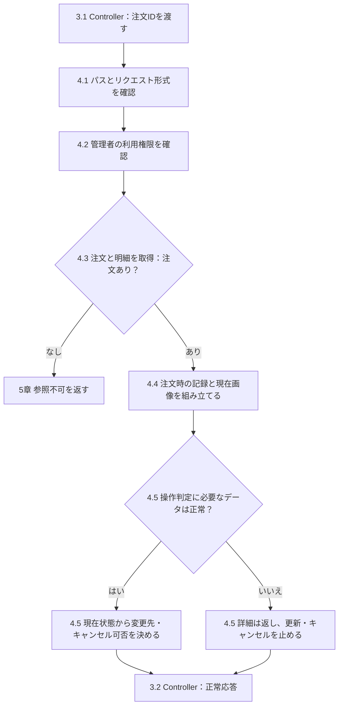

# APA003_02_管理用注文詳細取得

## 0. 処理フロー



## 1. 基本情報

| 項目 | 内容 |
| --- | --- |
| 機能ID／旧ID／物理名 | APA003_02／API-A13／get-admin-order-detail |
| エンドポイント | GET /api/v1/admin/orders/{orderId} |
| 呼出元 | SCA-05の初期表示・再読み込み。SCA-04で詳細から戻った際の対象行の再確認にも使用可能 |
| 対象 | 管理者権限確認済みの利用者。全会員の成立済み注文を1件取得。キャンセル済みも対象 |
| DB | admins（共通機能）、orders、order_items、productsを参照。書込み・行ロック・外部通信なし |

本APIは、**取得時点の注文内容と、その時点で選べる操作**を返す。更新・キャンセルを実行した結果が不明なときは、注文の現在状態から成功を推測せず、APA003_05で元の操作IDを照会する。

## 2. リクエスト

| 場所 | 項目 | 必須 | 条件 |
| --- | --- | --- | --- |
| Header | Authorization | ○ | 管理者アクセストークン。JWT確認は共通受付 |
| Path | orderId | ○ | 注文番号ではなくDBの注文ID。1〜19桁の半角数字、先頭0なし、1〜9223372036854775807 |
| Query／Body | なし | — | 会員ID・管理者ID・version・操作IDは受け取らない |

```http
GET /api/v1/admin/orders/201
Authorization: Bearer <管理者アクセストークン>
```

リクエストJSONはない。空オブジェクトも送信しない。

## 3. Controller

### 3.1 Business呼出

親Controllerを継承する `AdminOrderDetailController` から、パスのorderId文字列、クエリ・ボディの有無、共通受付済みactorを `AdminOrderDetailBusiness.execute` に渡す。

### 3.2 正常応答

**共通機能使用：COM001_07 共通レスポンス生成。** 結果DTOをHTTP 200、application/json、Cache-Control: no-storeで返す。注文が存在し、一部の表示値のみ欠ける場合は取得済みの情報を返す。

## 4. Business

### 4.1 入力確認

1. クエリまたはボディあり → INVALID_REQUEST。DB検索はしない。
2. orderIdが2章の条件に合わなければVALIDATION_ERROR。空白除去・丸めはしない。形式が正しいときだけLongへ変換する。
3. 入力は1項目のため相関チェックはない。パス自体が未指定で当該ルートに一致しない場合は、本Businessは呼ばれない。

### 4.2 管理者の利用権限確認

**共通機能使用：COM002_01 管理者検索・利用権限確認。** `requireActiveAdmin(actor)` を呼ぶ。権限不足なら終了し、個人情報を取得しない。管理用APIのため、取得時にorders.user_idを管理者IDで絞り込まない。

### 4.3 注文・明細・現在の商品を取得

| テーブル | 条件 | 取得目的 |
| --- | --- | --- |
| orders o | o.id＝orderId。注文状況で除外しない | 注文時の数量・金額・配送先・注文者、現在の状態・版・キャンセル情報 |
| order_items i | i.order_id＝o.id、明細番号昇順 | 注文時の商品名・税込単価・購入数量・税込小計 |
| products p | p.id＝i.product_id かつ p.is_deleted＝false | 現在画像と管理画面の編集リンク判定。非公開・販売停止でも管理者は参照可 |

1回のSELECTで取得し、状態・版・明細を同じ読取時点で返す。商品や明細の欠損と、注文自体の不存在を区別するためLEFT JOINを使用する。

```sql
SELECT o.id AS order_id, o.order_number, o.ordered_at, o.updated_at, o.version,
       o.order_status, o.cancelled_at, o.cancel_reason,
       o.purchaser_name, o.purchaser_email, o.recipient_name,
       o.recipient_postal_code, o.recipient_prefecture, o.recipient_city_street,
       o.recipient_building, o.recipient_phone_number,
       o.total_item_quantity, o.subtotal_including_tax, o.shipping_fee_including_tax,
       o.payment_fee_including_tax, o.total_amount_including_tax, o.payment_method_name,
       o.mock_payment_status, o.mock_refund_status, o.mock_refund_amount,
       i.id AS item_id, i.line_number, i.product_id, i.product_name_snapshot,
       i.unit_price_including_tax_snapshot, i.quantity, i.subtotal_including_tax_snapshot,
       p.id AS current_product_id, p.image_s3_key
FROM orders o
LEFT JOIN order_items i ON i.order_id = o.id
LEFT JOIN products p ON p.id = i.product_id AND p.is_deleted = FALSE
WHERE o.id = #{orderId,jdbcType=BIGINT}
ORDER BY i.line_number ASC;
```

| SQL結果 | 次の処理 |
| --- | --- |
| 0行 | RESOURCE_NOT_FOUND。未成立の操作は注文に含めず、操作履歴も検索しない |
| 注文あり、item_idがnullの1行 | 注文は表示し、items=[]。架空の明細は作らない。4.5で操作不可 |
| 明細あり | 注文ヘッダーを1回だけ作成し、1行につき1明細を追加。ページ分割なし |
| 明細あり、current_product_idがnull | 商品削除・不存在でも明細を残す。画像・編集リンクのみ無効 |

### 4.4 表示情報を作成

| 情報 | 処理 |
| --- | --- |
| 商品名・金額・配送先・注文者 | 4.3の注文時点の保存値を使用。現在の会員情報や商品価格で上書きしない。キャンセル後も総額を減額せず、返金額を別に返す |
| 商品画像 | **共通機能使用：COM001_11 画像URL生成。** 現行商品があれば ProductImageUrlBuilder.build(imageS3Key) の戻り値を使用。商品なし・キーなし・不正キーはimageUrl=null。S3への存在確認は行わない |
| 編集リンク可否 | current_product_idが非nullならcanEditProduct=true。画像の有無とは独立。遷移先は明細のproductIdに対応するSCA-03 |
| 注文状況 | ORDER_RECEIVED＝注文受付、PREPARING＝手配中、SHIPPED＝発送済み、CANCELLED＝キャンセル。未知・欠損は UNKNOWN／「状況を確認できません」 |
| 決済／返金状態 | PAID＝テスト決済完了、VOIDED＝テスト決済取消済み。NOT_APPLICABLE＝返金・取消対象外、REFUNDED＝テスト返金完了。未知・欠損は該当項目のみ UNKNOWN／「決済・返金状態を確認できません」 |
| キャンセル | CANCELLEDのときのみ日時・登録済み理由を返す。理由が未登録ならreason=null。refundAmountはDB値。対象外のnullは0円にしない |
| 表示値の欠損 | 必須表示文字列の空欄、不正な金額・日時は該当項目をnullとする。郵便番号・電話番号はDB所定の数字列のまま返し、先頭0を保持する。欠損時に現在時刻や0で補完しない |

支払い方法は注文時の表示名のみ。カード番号・下4桁・カード保存情報は取得しない。

### 4.5 変更先・キャンセル可否を決定

まず、注文番号・確定日時・更新日時・正のversion、既知の注文／決済／返金状態、1件以上の明細、正の購入数量・明細価格・小計、正の合計点数・商品合計・総額、0以上の送料・手数料が取得できていることを確認する。欠ける場合は参照できる項目を残し、変更先は空配列、canCancel=false、両方の不可理由は「注文情報を確認できません。再読み込みしてください。」とする。画像・任意の建物名・キャンセル理由の欠損だけでは止めない。

必要情報が揃っている場合は次表を適用する。変更先に現在状態・キャンセルは含めない。

| 現在のorder_status | allowedNextStatuses | canCancel | 不可理由（該当操作のみ） |
| --- | --- | --- | --- |
| ORDER_RECEIVED | PREPARING | true | なし |
| PREPARING | SHIPPED | true | なし |
| SHIPPED | 空配列 | false | 「発送済みのため変更できません。」「発送済みのためキャンセルできません。」 |
| CANCELLED | 空配列 | false | 「キャンセル済みのため変更できません。」「すでにキャンセルされています。」 |

**「注文受付 → 手配中」も管理者操作**とする。取得後に他の操作で状態が変わり得るため、本APIが返す可否は表示用。APA003_03（状態更新）・APA003_04（キャンセル）は受け取ったversionと最新状態を注文行ロック下で再確認する。

## 5. 例外・再取得

**共通機能使用：COM001_08 共通例外変換、COM001_09 ログ出力・秘匿。** 氏名・住所・電話・メール・アクセストークン・注文詳細JSONはログに出さない。

| 条件 | error.code | error.message |
| --- | --- | --- |
| 不要なクエリ・ボディ | INVALID_REQUEST | リクエストの内容が正しくありません。 |
| パスIDの形式・範囲不正 | VALIDATION_ERROR | 入力内容をご確認ください。 |
| 管理者権限なし | FORBIDDEN | この操作を実行する権限がありません。 |
| 注文なし | RESOURCE_NOT_FOUND | 指定された注文情報を表示できません。 |
| DB一時障害・タイムアウト | SERVICE_UNAVAILABLE | 処理を完了できませんでした。時間をおいて再試行してください。 |
| 予期しない例外・共通部品の設定異常 | INTERNAL_ERROR | 処理を完了できませんでした。 |

ECSで応答できる例外は原則HTTP 200、data=null、error.fieldErrors=[]。API Gatewayでの認証拒否などは対象外。DB失敗を不存在に置き換えない。参照のみなのでデータ復旧は不要。同じ注文IDで再取得できる。

## 6. 返却項目

| 項目（data配下） | 型／内容 |
| --- | --- |
| orderId、orderNumber、version | ID・版は正の10進文字列。注文番号は表示用文字列。不正な版はnullとして操作不可 |
| orderedAt、updatedAt | UTCのISO 8601日時（ミリ秒3桁）。画面でJST化 |
| orderStatus | {code, label}。以下のステータス項目も同形式 |
| actions | allowedNextStatusesは変更先の状態オブジェクト配列。canCancelはboolean。updateDisabledReason・cancelDisabledReasonは許可時null、不可時は理由の文字列 |
| cancellation | キャンセル済みのみ {cancelledAt, reason}。その他はnull |
| purchaser | {name, email}。注文時の注文者 |
| recipient | {name, postalCode, prefecture, cityStreet, building, phoneNumber}。各値は文字列。任意・欠損はnull |
| items[] | itemId、productIdは10進文字列。lineNumber、quantityは整数。productName、unitPriceIncludingTax（JSON整数）、subtotalIncludingTax（10進文字列）は注文時の値。imageUrlは現在のURLまたはnull、canEditProductはboolean |
| amounts | totalQuantityは購入点数の10進文字列。subtotalIncludingTax、shippingFeeIncludingTax、paymentFeeIncludingTax、totalIncludingTaxは注文時の整数円の10進文字列。currencyはJPY |
| payment | methodLabel、status、refundStatus、refundAmount。金額は整数円の10進文字列、該当なしはnull。金額項目はAPI内で合算し直さない |

外枠はrequestId（string）、data、error。成功時はerror=null、失敗時はdata=null。表示項目の不正・欠損は4.4のとおりnullまたはUNKNOWNで表す。以下は、画像未設定の現行商品を含む注文の例。

```json
{
  "requestId": "req-admin-order-detail-001",
  "data": {
    "orderId": "201", "orderNumber": "ORD-201", "version": "1",
    "orderedAt": "2026-11-15T01:30:00.000Z", "updatedAt": "2026-11-15T01:30:00.000Z",
    "orderStatus": {"code":"ORDER_RECEIVED","label":"注文受付"},
    "actions": {
      "allowedNextStatuses": [{"code":"PREPARING","label":"手配中"}],
      "canCancel": true, "updateDisabledReason": null, "cancelDisabledReason": null
    },
    "cancellation": null,
    "purchaser": {"name":"山田 太郎","email":"buyer@example.com"},
    "recipient": {"name":"山田 太郎","postalCode":"1234567","prefecture":"東京都","cityStreet":"サンプル区一丁目1番","building":null,"phoneNumber":"0312345678"},
    "items": [{
      "itemId":"301","lineNumber":1,"productId":"101","productName":"サンプル商品",
      "unitPriceIncludingTax":1980,"quantity":3,"subtotalIncludingTax":"5940",
      "imageUrl":null,"canEditProduct":true
    }],
    "amounts": {"totalQuantity":"3","subtotalIncludingTax":"5940","shippingFeeIncludingTax":"500","paymentFeeIncludingTax":"0","totalIncludingTax":"6440","currency":"JPY"},
    "payment": {"methodLabel":"クレジットカード（モック）","status":{"code":"PAID","label":"テスト決済完了"},"refundStatus":{"code":"NOT_APPLICABLE","label":"返金・取消対象外"},"refundAmount":null}
  },
  "error": null
}
```

**注文が見つからない場合**
```json
{"requestId":"req-admin-order-detail-002","data":null,"error":{"code":"RESOURCE_NOT_FOUND","message":"指定された注文情報を表示できません。","fieldErrors":[]}}
```
