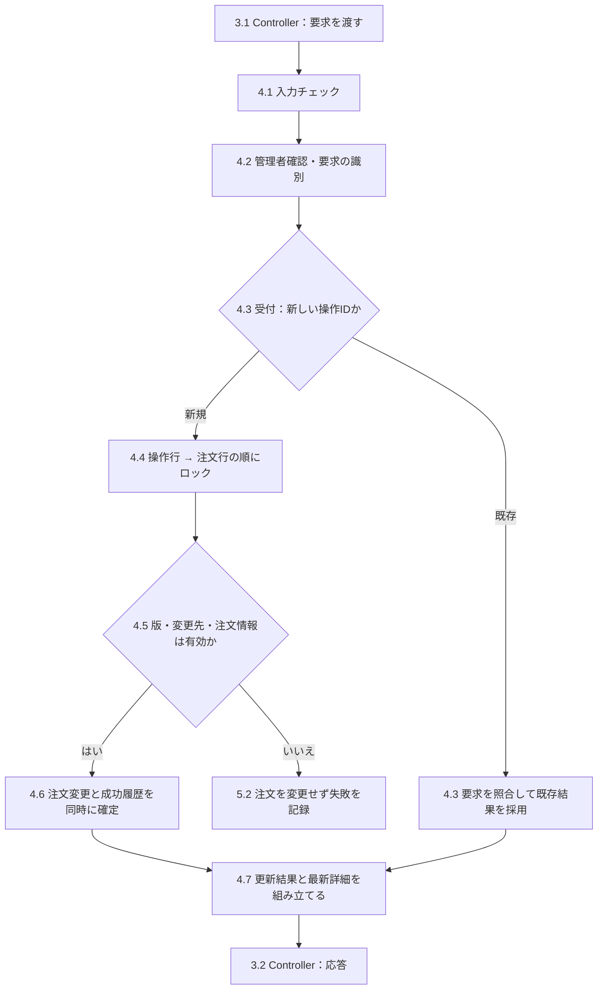

# APA003_03_注文状況更新（許可遷移のみ）

## 0. 処理フロー



## 1. 基本情報

| 項目 | 内容 |
| --- | --- |
| 機能ID／旧ID／物理名 | APA003_03／API-A14／update-order-status |
| エンドポイント | PUT /api/v1/admin/orders/{orderId}/status |
| 呼出元 | SCA-05 管理者が「注文状況を更新する」を実行したとき |
| 対象 | 成立済みの注文1件。管理者JWT必須 |
| 更新先 | orders、operation_histories |
| 参照先 | admins（権限確認）、注文詳細の取得元（orders、order_items、products） |
| 関連API | 最新詳細：APA003_02、キャンセル：APA003_04、更新結果照会：APA003_05 |

通常の状態変更のみを扱う。在庫、金額、モック決済、返金、キャンセル情報は変更しない。発送済みへの変更は模擬発送を表し、配送依頼やメール送信、SNS・SQSへの発行は行わない。

## 2. リクエスト

| 場所 | 項目 | 必須 | 条件 |
| --- | --- | --- | --- |
| Header | Authorization／Content-Type | ○ | 管理者Bearerアクセストークン／application/json。ヘッダー確認は共通受付 |
| Path | orderId | ○ | 注文番号ではなく注文ID。正の10進整数文字列 |
| Body | operationId | ○ | 今回の更新操作を識別するUUID v4、小文字標準表記36文字 |
| Body | version | ○ | APA003_02で取得した注文の版。正の10進整数**文字列** |
| Body | nextStatus | ○ | 変更後の注文状況コード。PREPARING または SHIPPED |
| Query | なし | — | 管理者ID・現在状態・更新日時は送らない |

```http
PUT /api/v1/admin/orders/201/status
Authorization: Bearer <管理者アクセストークン>
Content-Type: application/json
```

```json
{"operationId":"a65b4fb3-b6ef-4bc3-b781-7ce7d5deea12","version":"1","nextStatus":"PREPARING"}
```

## 3. Controller

### 3.1 Business呼出

親Controllerを継承した AdminOrderStatusController が、orderId文字列・リクエストDTO・クエリ有無・共通受付済みactorを OrderStatusUpdateBusiness.execute に渡す。**共通機能使用：COM001_10**（JSON構造・未知項目・型の共通受付）。

### 3.2 結果の返却

**共通機能使用：COM001_07 共通レスポンス生成。** 正常・処理中はHTTP 200、application/json、Cache-Control: no-store。Business例外は5.1へ。

## 4. Business

### 4.1 入力チェック

| 判定 | 不正時 |
| --- | --- |
| クエリあり、ボディなし、JSONオブジェクトでない | INVALID_REQUEST |
| orderId・versionが半角数字1〜19桁でない、先頭0あり、またはLong最大値超過 | VALIDATION_ERROR |
| operationIdが小文字のUUID v4標準形でない、nextStatusが許可値と完全一致しない、必須値がnull | VALIDATION_ERROR |

トリム・大文字変換や、数値JSONから文字列への補正はしない。検証後にorderIdとversionをLongへ変換する。DBの現在状態とnextStatusの組合せは4.5で確認する。

### 4.2 管理者確認・要求の識別

**共通機能使用：COM002_01 管理者検索・利用権限確認。** requireActiveAdmin(actor)が返した管理者IDを使用する。失敗時は書込みなし。

同一操作IDで内容の異なる更新を区別するため、次の固定順・空白なしのUTF-8 JSONからSHA-256の小文字hexを作る。actorId・orderId・versionは正規の10進文字列。operationIdと現在日時は含めない。

```json
{"schemaVersion":1,"operationType":"ORDER_STATUS_UPDATE","actorType":"ADMIN","actorId":"1","orderId":"201","version":"1","nextStatus":"PREPARING"}
```

### 4.3 操作を受け付ける（受付トランザクション：TX-A）

```sql
INSERT INTO operation_histories (
  operation_id, operation_type, actor_type, actor_id, target_resource_id,
  request_hash, operation_status, is_retryable, result_code,
  result_summary_json, expires_at, created_at, updated_at
) VALUES (
  #{operationId}, 'ORDER_STATUS_UPDATE', 'ADMIN', #{actorId}, #{orderId},
  #{requestHash}, 'PROCESSING', FALSE, NULL, NULL, NULL,
  CURRENT_TIMESTAMP, CURRENT_TIMESTAMP
)
ON CONFLICT (operation_id) DO NOTHING RETURNING operation_id;
```

1件なら受付のみコミットし、成功を確認してから4.4へ進む。0件ならREAD COMMITTEDの別SELECTでoperation_idに一致する履歴を取得する。判定は次の順で行う。

| 既存履歴で確認する値 | 処理 |
| --- | --- |
| actor_type／actor_idが不一致 | RESOURCE_NOT_FOUND。他者の結果を開示しない |
| operation_type／target_resource_id／request_hashのいずれかが不一致 | IDEMPOTENCY_KEY_REUSED |
| SUCCEEDED | 保存した成功要約を使って4.7へ。現在の版は再送の可否判定に使わない |
| FAILED | 保存したresult_codeの例外を返す。同じIDで再実行しない |
| PROCESSING | 処理中DTOを返す。注文は更新しない |
| 行がない・不正な状態 | INTERNAL_ERROR |

### 4.4 操作行と注文行をロックする（注文更新トランザクション：TX-B）

新規受付した要求だけが開始する。**操作行 → 注文行**の順に取得し、4.6まで同じトランザクションを使用する。

| 順序 | 取得元・条件 | 取得項目と判定 |
| --- | --- | --- |
| 1 | operation_histories、operation_id一致、FOR UPDATE | 4.3の主体・種別・対象・ハッシュ・状態を再照合。PROCESSINGのみ続行。復旧等ですでに確定していればその結果を返す |
| 2 | orders、id＝orderId、FOR UPDATE | id、version、order_status。0件ならRESOURCE_NOT_FOUND。CANCELLEDやSHIPPEDも取得して4.5で判定 |
| 3 | APA003_02の詳細取得Mapper、同じorderId・同じDB接続 | 注文基本情報・金額・決済状態・明細を取得し、詳細画面と同じ操作可否を判定。ECSから別のHTTPリクエストは送らない |

```sql
SELECT id, version, order_status FROM orders
WHERE id = #{orderId,jdbcType=BIGINT} FOR UPDATE;
```

APA003_04も同じ注文行で排他する前提。並行する更新・キャンセルは、後からロックを取得した側が最新行で版・状態を判定する。

### 4.5 版・許可遷移を確認する

1. DB版が正のLongでない、または加算できない場合はINTERNAL_ERROR。DB版と要求版が違う場合はVERSION_CONFLICT。先に版を比較する。
2. APA003_02の4.5と同じ必須情報・明細の健全性を確認する。操作可否が判定できない注文は更新しない（BUSINESS_RULE_VIOLATION）。
3. 次表で変更先を確認する。画面で選べた値でも、現在のDB状態から許可されない場合はBUSINESS_RULE_VIOLATION。

| DBのorder_status | 受け付けるnextStatus | 更新後 |
| --- | --- | --- |
| ORDER_RECEIVED（注文受付） | PREPARINGのみ | 手配中 |
| PREPARING（手配中） | SHIPPEDのみ | 発送済み |
| SHIPPED／CANCELLED／不明 | なし | 更新しない |

同じ状態への変更、段階の飛び越し、差し戻しは不可。同一操作IDの成功済み再送だけは4.3で元の成功を返す。

### 4.6 注文変更と成功履歴を一緒に確定する

```sql
UPDATE orders
SET order_status = #{nextStatus}, version = version + 1, updated_at = CURRENT_TIMESTAMP
WHERE id = #{orderId} AND version = #{expectedVersion}
  AND order_status = #{lockedStatus}
RETURNING id, order_status, version, updated_at;
```

返却は1件が必要。ロック下で照合済みのため、0件なら不整合としてロールバックする。返った値から成功要約を作る。

```sql
UPDATE operation_histories
SET operation_status = 'SUCCEEDED', result_code = 'SUCCESS', is_retryable = FALSE,
    result_summary_json = CAST(#{resultJson} AS jsonb), updated_at = CURRENT_TIMESTAMP
WHERE operation_id = #{operationId} AND actor_type = 'ADMIN' AND actor_id = #{actorId}
  AND operation_type = 'ORDER_STATUS_UPDATE' AND target_resource_id = #{orderId}
  AND request_hash = #{requestHash} AND operation_status = 'PROCESSING';
```

成功要約には **orderId、previousStatus、appliedStatus、appliedVersion、appliedAt** だけを保存する。氏名・メール・配送先・詳細JSONを複製しない。履歴の更新が1件であることを確認し、注文変更と成功記録を同時にコミットする。

### 4.7 確定結果と最新詳細を返す

| 操作状態 | 返却内容 |
| --- | --- |
| SUCCEEDED | 4.6の成功要約と、APA003_02の詳細取得・組立処理で再取得した最新のorderを返す。同じ操作IDの再送も同様 |
| SUCCEEDEDだがコミット後の最新詳細だけ取得できない | 成功要約はそのまま、order=null、detailStatus=UNAVAILABLE。更新を再送せずAPA003_02で詳細だけを再取得する |
| PROCESSING | result=null、order=null、detailStatus=NOT_REQUESTED。元の操作IDでAPA003_05を照会 |

詳細を組み立てる際の画像URLは **共通機能使用：COM001_11**（APA003_02の組立処理内）。成功要約は「この操作が確定した時点」、orderは「照会できた最新時点」。後続操作が先に完了した場合は両者の版が異なってよい。権限失効と判明した場合は個人情報を返さず共通の認証・認可エラーを優先する。

## 5. 例外・データ復旧

### 5.1 例外応答

**共通機能使用：COM001_08 共通例外変換、COM001_09 ログ出力・秘匿。** ECSで応答できる例外は原則HTTP 200、data=null、error.fieldErrors=[]。基盤による認証拒否・通信断等はこの形式の対象外。ログはrequestId・operationId・処理段階・確定状況とし、トークン・注文詳細は出力しない。

| 条件 | error.code | error.message |
| --- | --- | --- |
| 構造・クエリ不正 | INVALID_REQUEST | リクエストの内容が正しくありません。 |
| ID・版・変更先の入力不正 | VALIDATION_ERROR | 入力内容をご確認ください。 |
| 権限なし | FORBIDDEN | この操作を実行する権限がありません。 |
| 注文なし・他者の操作 | RESOURCE_NOT_FOUND | 指定された情報を表示できません。 |
| 版不一致 | VERSION_CONFLICT | 注文情報が更新されています。最新の内容をご確認ください。 |
| 遷移不可・必要情報欠損 | BUSINESS_RULE_VIOLATION | 現在の状態ではこの操作を実行できません。 |
| 同じIDで異なる要求 | IDEMPOTENCY_KEY_REUSED | 操作を確認できませんでした。内容をご確認ください。 |
| DB一時障害・ロック待機超過・コミット結果不明 | SERVICE_UNAVAILABLE | 処理を完了できませんでした。時間をおいて再試行してください。 |
| 不整合・想定外例外 | INTERNAL_ERROR | 処理を完了できませんでした。 |

### 5.2 注文が未更新と確定した場合

新規受付後の注文不存在・版不一致・遷移不可は、注文変更を取り消したことを確認してから、**失敗記録用の別トランザクション**で操作行をロックする。4.6の履歴UPDATEと同じWHERE条件で、PROCESSING行1件のみに下表を保存する。

| 更新項目 | 値 |
| --- | --- |
| operation_status／result_code | FAILED／元の業務例外コード |
| is_retryable | VERSION_CONFLICTだけtrue。それ以外はfalse |
| result_summary_json／updated_at | null／DB時刻 |

確定済み履歴は上書きしない。失敗記録のコミットも不明ならSERVICE_UNAVAILABLE。版競合での再操作は、最新詳細を取得し、管理者が変更先を選び直した後に**新しい操作ID**で行う。

### 5.3 中断時の復旧

| 中断位置・症状 | 処理 |
| --- | --- |
| 入力・権限エラー | 書込みなし |
| 受付コミットの成否が不明 | 注文更新を開始しない。元の操作IDでAPA003_05を照会 |
| 注文更新中のDB例外 | 注文変更と成功記録をまとめてロールバック。未確定の履歴を成功／失敗と決めつけない |
| 注文更新のコミット不明・応答未着 | 同じ操作IDでAPA003_05を照会。注文状態・版だけでは元操作の成功判定をしない。旧版・旧状態への補償更新も行わない |
| 受付済みのまま処理が中断 | APA003_05側で、受付から15分以上経過した本人の対象操作をFOR UPDATE NOWAITでロックし、再確認してなおPROCESSINGならFAILED／SERVICE_UNAVAILABLE／is_retryable=trueに確定可能。ロック中は処理中を維持 |
| 受付記録が照会できない | 未実行と断定しない。別の操作IDで自動再送しない |

15分経過だけで失敗確定しない。操作行をロックして復旧できるのは、注文変更と成功記録が同時にコミットされ、遅れて再開する元処理も4.4で確定済みの操作を停止するため。

## 6. 返却項目

| 項目 | 型・条件 | 内容 |
| --- | --- | --- |
| requestId | string | 今回の通信の追跡ID |
| data／error | objectまたはnull | 成功・処理中はdata、例外はerror |
| data.operationId／operationStatus | string | 元の操作ID／SUCCEEDED または PROCESSING |
| data.result | objectまたはnull | 成功要約。処理中はnull |
| result.orderId／previousStatus／appliedStatus | string | 注文ID／更新前と更新後の状態コード |
| result.appliedVersion／appliedAt | string | 更新後の版（10進文字列）／更新日時（UTC、ミリ秒3桁） |
| data.detailStatus | string | AVAILABLE／UNAVAILABLE／NOT_REQUESTED |
| data.order | objectまたはnull | AVAILABLE時はAPA003_02のdataと同じ全項目。取得不可・処理中はnull |
| error.code／message／fieldErrors | string／string／array | 5.1のコード・文言・空配列 |

**更新成功・最新詳細あり**

```json
{
  "requestId": "req-admin-order-status-001",
  "data": {
    "operationId": "a65b4fb3-b6ef-4bc3-b781-7ce7d5deea12",
    "operationStatus": "SUCCEEDED",
    "result": {
      "orderId": "201",
      "previousStatus": "ORDER_RECEIVED",
      "appliedStatus": "PREPARING",
      "appliedVersion": "2",
      "appliedAt": "2026-11-20T03:00:00.000Z"
    },
    "detailStatus": "AVAILABLE",
    "order": {
      "orderId": "201",
      "orderNumber": "ORD-201",
      "version": "2",
      "orderedAt": "2026-11-15T01:30:00.000Z",
      "updatedAt": "2026-11-20T03:00:00.000Z",
      "orderStatus": {
        "code": "PREPARING",
        "label": "手配中"
      },
      "actions": {
        "allowedNextStatuses": [
          {
            "code": "SHIPPED",
            "label": "発送済み"
          }
        ],
        "canCancel": true,
        "updateDisabledReason": null,
        "cancelDisabledReason": null
      },
      "cancellation": null,
      "purchaser": {
        "name": "山田 太郎",
        "email": "buyer@example.com"
      },
      "recipient": {
        "name": "山田 太郎",
        "postalCode": "1234567",
        "prefecture": "東京都",
        "cityStreet": "サンプル区一丁目1番",
        "building": null,
        "phoneNumber": "0312345678"
      },
      "items": [
        {
          "itemId": "301",
          "lineNumber": 1,
          "productId": "101",
          "productName": "サンプル商品",
          "unitIncludingTax": "1980",
          "quantity": 3,
          "subtotalIncludingTax": "5940",
          "imageUrl": null,
          "canEditProduct": true
        }
      ],
      "amounts": {
        "totalQuantity": "3",
        "subtotalIncludingTax": "5940",
        "shippingIncludingTax": "500",
        "feeIncludingTax": "0",
        "totalIncludingTax": "6440",
        "currency": "JPY"
      },
      "payment": {
        "methodLabel": "クレジットカード（モック）",
        "status": {
          "code": "PAID",
          "label": "テスト決済完了"
        },
        "refundStatus": {
          "code": "NOT_APPLICABLE",
          "label": "返金・取消対象外"
        },
        "refundAmount": null
      }
    }
  },
  "error": null
}
```

**処理中**

```json
{
  "requestId": "req-admin-order-status-002",
  "data": {
    "operationId": "a65b4fb3-b6ef-4bc3-b781-7ce7d5deea12",
    "operationStatus": "PROCESSING",
    "result": null,
    "detailStatus": "NOT_REQUESTED",
    "order": null
  },
  "error": null
}
```

**版競合（注文は未更新）**

```json
{
  "requestId": "req-admin-order-status-003",
  "data": null,
  "error": {
    "code": "VERSION_CONFLICT",
    "message": "注文情報が更新されています。最新の内容をご確認ください。",
    "fieldErrors": []
  }
}
```
