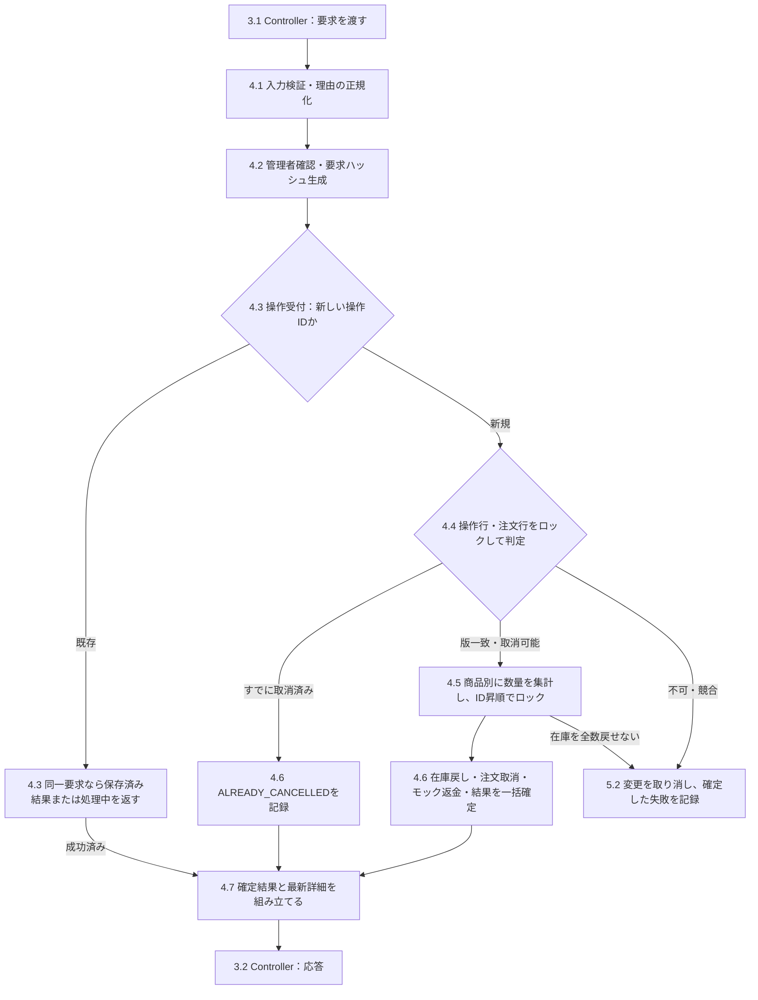

# APA003_04_注文キャンセル（在庫戻し・モック返金記録）

## 0. 処理フロー



## 1. 基本情報

| 項目 | 設計 |
| --- | --- |
| 機能ID／旧ID／物理名 | APA003_04／API-A15／cancel-order |
| エンドポイント | POST /api/v1/admin/orders/{orderId}/cancel |
| 呼出元 | SCA-05 管理者がキャンセル確認ダイアログで実行を確定したとき |
| 対象 | 注文受付（ORDER_RECEIVED）または手配中（PREPARING）の成立済み注文1件。注文全体を取消 |
| 参照・更新 | admins（権限確認）、orders、order_items、products、operation_histories |
| 認証／結果照会 | 管理者JWT必須。結果不明時はAPA003_05に元のoperationIdを指定 |

キャンセル成功とは、**全商品の在庫が戻り、注文がキャンセル済みになり、送料・手数料込みの確定総額をモック返金額として記録できた状態**を指す。一部だけ成功させない。実カード情報、外部決済、メール送信、非同期の在庫処理は使用しない。

## 2. リクエスト

| 場所 | 項目 | 必須 | 条件 |
| --- | --- | --- | --- |
| Header | Authorization／Content-Type | ○ | 管理者Bearerアクセストークン／application/json |
| Path | orderId | ○ | 正の10進整数文字列、先頭0なし、1〜19桁、Long最大値以下 |
| Body | operationId | ○ | 操作ごとのUUID v4、小文字標準表記36文字。同じ操作を照会するときもこの値を使う |
| Body | version | ○ | APA003_02の注文版。orderIdと同じ形式のJSON文字列 |
| Body | cancelReason | 任意 | stringまたはnull。前後空白除去後200コードポイント以内。省略・null・空欄は理由なし |
| Query | なし | — | 数量、対象明細、返金額、管理者ID、現在状態は受け取らない |

```http
POST /api/v1/admin/orders/201/cancel
Authorization: Bearer <管理者アクセストークン>
Content-Type: application/json
```

```json
{"operationId":"6b49036e-2150-4eea-91eb-27f165d5e8a1","version":"2","cancelReason":"お客様からのご依頼"}
```

## 3. Controller

### 3.1 Business呼出

親Controllerを継承した AdminOrderCancelController が、orderId文字列・DTO・クエリ有無・共通受付済みactorを OrderCancelBusiness.execute に渡す。**共通機能使用：COM001_10**（共通受付・JSON解析）。項目の必須・長さ・業務条件はBusinessで判定する。

### 3.2 応答

**共通機能使用：COM001_07 共通レスポンス生成。** HTTP 200、application/json、Cache-Control: no-store。処理中は成功確定と区別する。例外は5章に従う。

## 4. Business

### 4.1 入力検証

1. クエリあり、ボディなし・オブジェクト以外はINVALID_REQUEST。未知項目や型違いは共通受付で拒否する。
2. orderId・version・operationIdを2章の形式で検証する。IDはトリムしない。orderId・versionを検証後にLongへ変換する。
3. 理由の前後からUnicode空白（Character.isWhitespaceまたはisSpaceChar）を除き、空ならnullにする。NUL・不正サロゲート・200文字超過は拒否する。それ以外の本文は保存用の値として保持する。
4. 個別入力不正はVALIDATION_ERROR。入力項目間の相関チェックはない。返金額・在庫戻し数はDBの注文記録から決める。

### 4.2 管理者確認・同一要求の識別

**共通機能使用：COM002_01 管理者検索・利用権限確認。** requireActiveAdmin(actor)の返却adminIdを所有者とする。失敗時は書込みなし。

次の順の正規化JSON（余分な空白・改行なし）をUTF-8化し、SHA-256の小文字hex64文字をrequest_hashにする。actorId・orderId・versionは正規の10進文字列。理由なしもcancelReason:nullを含める。文字列の引用符・バックスラッシュはエスケープし、制御文字は小文字hexのUnicodeエスケープとする。operationId・時刻・JWTは含めない。

```json
{"schemaVersion":1,"operationType":"ORDER_CANCEL","actorType":"ADMIN","actorId":"1","orderId":"201","version":"2","cancelReason":"お客様からのご依頼"}
```

### 4.3 操作IDを受け付ける（受付トランザクション：TX-A）

```sql
INSERT INTO operation_histories (
  operation_id, operation_type, actor_type, actor_id, target_resource_id,
  request_hash, operation_status, is_retryable, result_code,
  result_summary_json, expires_at, created_at, updated_at
) VALUES (
  #{operationId}, 'ORDER_CANCEL', 'ADMIN', #{actorId}, #{orderId},
  #{requestHash}, 'PROCESSING', FALSE, NULL, NULL, NULL,
  CURRENT_TIMESTAMP, CURRENT_TIMESTAMP
)
ON CONFLICT (operation_id) DO NOTHING RETURNING operation_id;
```

1件なら受付のみコミットする。コミット成功確認後に4.4へ進む。0件ならREAD COMMITTEDの別SELECTで、同じoperation_idの主体・種別・対象・ハッシュ・状態・結果コード・結果要約を読む。

| 条件（上から判定） | 処理 |
| --- | --- |
| 所有者が別 | RESOURCE_NOT_FOUND。結果を開示しない |
| 種別・注文ID・要求ハッシュが不一致 | IDEMPOTENCY_KEY_REUSED。理由だけが異なる場合も拒否 |
| SUCCEEDED | 保存済み要約で4.7へ。商品・注文は再更新しない |
| FAILED | 保存済み結果コードの例外を返す |
| PROCESSING | 処理中DTOを返す。別要求が処理を引き継がない |
| レコードなし・不整合 | INTERNAL_ERROR |

### 4.4 注文の状態・版・取消可否を確認（取消トランザクション：TX-B）

新規受付した要求のみ実施する。**操作行 → 注文行 → 商品行（商品ID昇順）**を同じDB接続でロックし、4.6のコミットまで保持する。

| 順 | 取得元・条件 | 取得項目・判定 |
| --- | --- | --- |
| 1 | operation_histories、operation_id一致、FOR UPDATE | 主体・種別・対象・ハッシュを再照合。PROCESSING以外は4.3の確定結果に従い中止 |
| 2 | orders、id＝orderId、FOR UPDATE | version、order_status、cancelled_at、mock_payment_status、mock_refund_status、mock_refund_amount、total_amount_including_tax。0件はRESOURCE_NOT_FOUND |
| 3 | 同じ注文の基本情報・明細 | APA003_02の4.5と同じ判定に必要な注文時の必須値・金額・数量を参照。外部HTTP呼出はしない |

| ロック取得後の状態（上から判定） | 処理 |
| --- | --- |
| CANCELLEDで取消日時あり、VOIDED／REFUNDED、正の確定総額と返金額が一致、版が有効 | **別操作で既に取消済み**。入力版が古くても更新なし。元の理由・日時・返金額を保持し、4.6でALREADY_CANCELLEDを記録 |
| CANCELLEDなのに取消記録が不整合 | INTERNAL_ERROR。返金・在庫を推定して補完しない |
| DB版が不正 | INTERNAL_ERROR |
| 要求版とDB版が不一致 | VERSION_CONFLICT。取消せず最新詳細の確認へ |
| SHIPPED、またはORDER_RECEIVED／PREPARING以外 | BUSINESS_RULE_VIOLATION。発送済みは取消不可 |
| 未取消だが取消日時あり、PAID／NOT_APPLICABLE／返金額nullでない、または明細・金額などの操作必須情報が欠損 | BUSINESS_RULE_VIOLATION。部分的に取り消さない |
| 取消可能で版一致 | 4.5へ。新しい注文版がLong範囲外ならINTERNAL_ERROR |

**同じ操作が成功済みかどうか**は4.3の履歴で判断する。ここで注文がCANCELLEDだったことだけを根拠に、今回の要求で在庫を戻したとは返さない。

### 4.5 戻す数量を決め、商品をロックする

購入時に在庫を引き当てた不変の注文明細を使用する。商品ごとに明細数量を合計するため、同じ商品が複数行でも更新は1回。例：商品101の明細数量2点と1点 → 商品101に3点を戻し、商品版は1だけ加算する。

```sql
SELECT product_id, quantity
FROM order_items WHERE order_id = #{orderId}
ORDER BY product_id, line_number;
```

1. 明細0件・商品ID不正・数量が正でない場合は停止する。Longの加算あふれを検出し、商品別合計の総和とorders.total_item_quantityが一致することを確認する。不一致はデータ不整合としてINTERNAL_ERROR。
2. 集約した**全商品IDを数値の昇順**にして次のSQLを実行する。INリストはMyBatisのforeachでプレースホルダーを生成する。下記の「…」はバインド変数の反復を示す。

```sql
SELECT id, stock_quantity, version FROM products
WHERE id IN (#{id1}, …, #{idN})
ORDER BY id FOR UPDATE;
```

3. 各IDが1行ずつ揃っていることを確認する。**論理削除済み・非公開・販売停止の商品も在庫を戻す**。is_deletedや公開・販売フラグを条件にせず、これらの値も変更しない。商品行が物理的に存在しなければINTERNAL_ERROR。商品再作成はしない。
4. 各商品の現在在庫が0〜99,999、版が1以上かつ加算可能であることを確認する。**現在在庫＋戻す数量が99,999を超える商品が1件でもあれば、全件未更新でBUSINESS_RULE_VIOLATION**。上限での切り捨てや、戻せる商品のみの更新は禁止。

### 4.6 在庫・注文・操作結果をまとめて確定する

**新規に取り消す場合**、検証済みの各商品を1回ずつ更新し、次に注文行を更新する。SQLごとに1件更新が必要。想定外の0件はINTERNAL_ERRORとして全体をロールバックする。

```sql
UPDATE products
SET stock_quantity = stock_quantity + #{restoreQuantity},
    version = version + 1, updated_at = CURRENT_TIMESTAMP
WHERE id = #{productId} AND version = #{lockedProductVersion}
  AND stock_quantity <= 99999 - #{restoreQuantity};

UPDATE orders
SET order_status = 'CANCELLED', cancelled_at = CURRENT_TIMESTAMP,
    cancel_reason = #{cancelReason}, mock_payment_status = 'VOIDED',
    mock_refund_status = 'REFUNDED', mock_refund_amount = total_amount_including_tax,
    version = version + 1, updated_at = CURRENT_TIMESTAMP
WHERE id = #{orderId} AND version = #{expectedVersion}
  AND order_status IN ('ORDER_RECEIVED','PREPARING')
  AND cancelled_at IS NULL AND mock_payment_status = 'PAID'
  AND mock_refund_status = 'NOT_APPLICABLE' AND mock_refund_amount IS NULL
RETURNING id, version, cancelled_at, mock_refund_amount;
```

商品名・注文明細・請求総額・カートを変更しない。記録するモック返金額は**成立時の税込総額そのもの**。現在価格や現在税率から再計算しない。

**既に取消済みの場合**、上記2つのUPDATEをどちらも実行しない。以降は両分岐とも、6章のresultだけを保存する。実行結果は新規取消ならCANCELLED、既取消ならALREADY_CANCELLED。後者のSUCCEEDEDは「既取消を確認して要求を正常終了した」という意味。

```sql
UPDATE operation_histories
SET operation_status = 'SUCCEEDED', result_code = 'SUCCESS', is_retryable = FALSE,
    result_summary_json = CAST(#{resultJson} AS jsonb), updated_at = CURRENT_TIMESTAMP
WHERE operation_id = #{operationId} AND operation_type = 'ORDER_CANCEL'
  AND actor_type = 'ADMIN' AND actor_id = #{actorId}
  AND target_resource_id = #{orderId} AND request_hash = #{requestHash}
  AND operation_status = 'PROCESSING';
```

履歴更新が1件であることを確認してコミットする。履歴にはキャンセル理由・配送先・注文者情報・注文詳細JSONを複製しない。

### 4.7 成功要約と最新詳細を返す

成功確定後、APA003_02の詳細取得・組立処理で最新のorderを取得する（画像URL組立では**共通機能使用：COM001_11**）。同じ操作の再送でもresultは保存済みの値。初回がCANCELLEDなら再送もCANCELLEDであり、ALREADY_CANCELLEDに書き換えない。

| 結果 | 返却／SCA-05連携 |
| --- | --- |
| 今回の取消成功 | CANCELLEDと最新詳細。AD20 |
| 別操作で取消済み | ALREADY_CANCELLEDと最新詳細。AD22。今回の入力理由を過去の記録に上書きしない |
| 成功確定後の詳細取得だけが通信・DB障害 | 成功要約を残しdetailStatus=UNAVAILABLE、order=null。詳細だけをAPA003_02で再取得 |
| 処理中 | operationStatus=PROCESSING。元のoperationIdでAPA003_05を照会。取消を再実行しない |

認可失効が判明した場合は認証・認可エラーを優先し、個人情報は返さない。

## 5. 例外とデータ復旧

### 5.1 例外応答

**共通機能使用：COM001_08 共通例外変換、COM001_09 ログ出力・秘匿。** ECSで応答可能な例外は原則HTTP 200、data=null、error.fieldErrors=[]。Gatewayの認証拒否・通信断はこの形式の対象外。トークン・取消理由・個人情報・要求本文をログに出さない。

| 発生条件 | error.code | error.message |
| --- | --- | --- |
| ボディ・クエリ構造不正 | INVALID_REQUEST | リクエストの内容が正しくありません。 |
| 操作ID・注文ID・版・理由の入力不正 | VALIDATION_ERROR | 入力内容をご確認ください。 |
| 権限不足 | FORBIDDEN | この操作を実行する権限がありません。 |
| 注文なし・他者の操作 | RESOURCE_NOT_FOUND | 指定された情報を表示できません。 |
| 版不一致 | VERSION_CONFLICT | 注文情報が更新されています。最新の内容をご確認ください。 |
| 取消不可・在庫上限超過等 | BUSINESS_RULE_VIOLATION | 現在の状態ではこの操作を実行できません。 |
| 同じ操作IDで異なる要求 | IDEMPOTENCY_KEY_REUSED | 操作を確認できませんでした。内容をご確認ください。 |
| DB一時障害・ロック待機超過・コミット不明 | SERVICE_UNAVAILABLE | 処理を完了できませんでした。時間をおいて再試行してください。 |
| 記録不整合・想定外 | INTERNAL_ERROR | 処理を完了できませんでした。 |

### 5.2 失敗確定と結果不明を分ける

| 中断位置 | DBの扱い・復旧 |
| --- | --- |
| 受付前の入力・権限エラー | 書込みなし |
| 受付コミット不明 | 在庫・注文を更新せず同じ操作IDでAPA003_05を照会 |
| 取消トランザクション中の例外 | 在庫・商品版・注文状態・返金額・注文版・成功記録をすべてロールバック。他操作による在庫変更は取り消さない |
| 取消未反映が確定した業務エラー | ロールバック完了後、失敗記録用の別トランザクションで操作行をロック。4.6の履歴UPDATEと同じ条件でPROCESSINGの1件だけをFAILEDにし、result_codeに元のコード、result_summary_jsonにnull、updated_atにDB時刻を保存。既存の確定履歴は上書きしない |
| 失敗確定後の再操作 | is_retryableは版競合・在庫上限超過の場合のみtrue。在庫を調整するなど原因を解消し、最新詳細を確認後、新しい操作IDで実行。同じ操作IDの再送は常に保存済み結果 |
| コミット成否不明・応答未着 | 成功とも失敗とも断定せず、元の操作IDでAPA003_05を照会。補償として在庫を引き直したり、返金額や版を戻したりしない |

APA003_05は、受付から15分以上経過した本人のORDER_CANCEL操作について、操作行をFOR UPDATE NOWAITでロックし、なおPROCESSINGならFAILED／SERVICE_UNAVAILABLE／is_retryable=trueへ確定可能。ロック中は処理中を維持する。これは注文・在庫・成功履歴が同じトランザクションで確定し、遅れて再開する元処理も4.4で確定済み履歴を検出して中止するため。記録未検出・現在の注文状態だけから当該操作の成否を推測しない。

## 6. 返却項目

| 項目 | 型・条件 | 内容 |
| --- | --- | --- |
| requestId | string | 今回の通信の追跡ID |
| data／error | objectまたはnull | 成功・処理中はdata、例外はerror |
| data.operationId／operationStatus | string | 操作ID／SUCCEEDEDまたはPROCESSING |
| data.result | objectまたはnull | 確定した操作の要約。処理中はnull |
| result.cancelResult／orderId | string | CANCELLEDまたはALREADY_CANCELLED／注文ID |
| result.version／cancelledAt | string | 新規取消直後または既取消確認時の版／記録済み取消日時（UTC・ミリ秒3桁） |
| result.refundAmount | string | 記録済みのモック返金額（整数円）。今回新たに返金したことを表すフラグではない |
| data.detailStatus／order | string／objectまたはnull | AVAILABLEならAPA003_02のdataと同じ最新詳細。UNAVAILABLE・NOT_REQUESTEDならnull |
| error.code／message／fieldErrors | string／string／array | 5.1のコード・文言・空配列 |

**取消成功・最新詳細あり**

```json
{
  "requestId": "req-cancel-001",
  "data": {
    "operationId": "6b49036e-2150-4eea-91eb-27f165d5e8a1",
    "operationStatus": "SUCCEEDED",
    "result": {
      "cancelResult": "CANCELLED",
      "orderId": "201",
      "version": "3",
      "cancelledAt": "2026-11-20T03:30:00.000Z",
      "refundAmount": "6440"
    },
    "detailStatus": "AVAILABLE",
    "order": {
      "orderId": "201",
      "orderNumber": "ORD-201",
      "version": "3",
      "orderedAt": "2026-11-15T01:30:00.000Z",
      "updatedAt": "2026-11-20T03:30:00.000Z",
      "orderStatus": {
        "code": "CANCELLED",
        "label": "キャンセル"
      },
      "actions": {
        "allowedNextStatuses": [],
        "canCancel": false,
        "updateDisabledReason": "キャンセル済みのため変更できません。",
        "cancelDisabledReason": "すでにキャンセルされています。"
      },
      "cancellation": {
        "cancelledAt": "2026-11-20T03:30:00.000Z",
        "reason": "お客様からのご依頼"
      },
      "purchaser": {
        "name": "山田 太郎",
        "email": "buyer@example.com"
      },
      "recipient": {
        "name": "山田 太郎",
        "postalCode": "1234567",
        "prefecture": "東京都",
        "cityStreet": "サンプル区一丁目1番",
        "building": null,
        "phoneNumber": "0312345678"
      },
      "items": [
        {
          "itemId": "301",
          "lineNumber": 1,
          "productId": "101",
          "productName": "サンプル商品",
          "unitPriceIncludingTax": 1980,
          "quantity": 3,
          "subtotalIncludingTax": "5940",
          "imageUrl": null,
          "canEditProduct": true
        }
      ],
      "amounts": {
        "totalQuantity": "3",
        "subtotalIncludingTax": "5940",
        "shippingFeeIncludingTax": "500",
        "paymentFeeIncludingTax": "0",
        "totalIncludingTax": "6440",
        "currency": "JPY"
      },
      "payment": {
        "methodLabel": "クレジットカード（モック）",
        "status": {
          "code": "VOIDED",
          "label": "テスト決済取消済み"
        },
        "refundStatus": {
          "code": "REFUNDED",
          "label": "テスト返金完了"
        },
        "refundAmount": "6440"
      }
    }
  },
  "error": null
}
```

**既に別操作で取消済み・最新詳細のみ取得失敗**

```json
{
  "requestId": "req-cancel-002",
  "data": {
    "operationId": "821f587a-b089-44f0-adc5-352190fda8b6",
    "operationStatus": "SUCCEEDED",
    "result": {
      "cancelResult": "ALREADY_CANCELLED",
      "orderId": "201",
      "version": "3",
      "cancelledAt": "2026-11-20T03:30:00.000Z",
      "refundAmount": "6440"
    },
    "detailStatus": "UNAVAILABLE",
    "order": null
  },
  "error": null
}
```

**処理中**

```json
{
  "requestId": "req-cancel-003",
  "data": {
    "operationId": "6b49036e-2150-4eea-91eb-27f165d5e8a1",
    "operationStatus": "PROCESSING",
    "result": null,
    "detailStatus": "NOT_REQUESTED",
    "order": null
  },
  "error": null
}
```

**版競合：今回の取消は未反映**

```json
{
  "requestId": "req-cancel-004",
  "data": null,
  "error": {
    "code": "VERSION_CONFLICT",
    "message": "注文情報が更新されています。最新の内容をご確認ください。",
    "fieldErrors": []
  }
}
```
