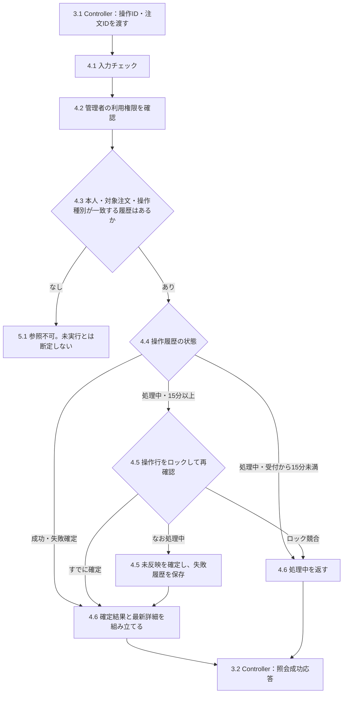

# APA003_05_注文更新・キャンセル結果照会

## 0. 処理フロー



## 1. 基本情報

| 項目 | 内容 |
| --- | --- |
| 機能ID／旧ID／物理名 | APA003_05／API-A16／get-admin-order-operation-result |
| エンドポイント | GET /api/v1/admin/orders/operations/{operationId} |
| 呼出元 | SCA-05の「処理結果を確認」。SCA-04へ戻る際の未解決操作の確認にも使用 |
| 対象 | APA003_03（ORDER_STATUS_UPDATE）、APA003_04（ORDER_CANCEL）を実行した管理者本人 |
| 入力の出所 | 更新・キャンセルの**送信前に発行した操作ID**と、その操作の注文ID。照会のために新しい操作IDは発行しない |
| DB | 操作履歴を参照。復旧時のみoperation_historiesを更新。認可・最新詳細の取得には既存の管理者確認・注文詳細取得処理を利用 |

注文の現在状態と、元の操作の成否は別の情報である。例えば注文がすでにキャンセル済みでも、今回の操作がキャンセルした証拠にはならない。本APIでは操作履歴を根拠に結果を返し、注文更新・在庫戻し・モック返金を実行しない。

## 2. リクエスト

| 場所 | 項目 | 必須 | 条件 |
| --- | --- | --- | --- |
| Header | Authorization | ○ | 管理者Bearerアクセストークン。共通受付済みactorを使用 |
| Path | operationId | ○ | UUID v4の小文字標準表記36文字 |
| Query | orderId | ○ | 対象の注文ID。正の10進整数文字列。1つだけ指定 |
| Body | なし | — | 空のJSONオブジェクトも送信しない |

```http
GET /api/v1/admin/orders/operations/6b49036e-2150-4eea-91eb-27f165d5e8a1?orderId=201
Authorization: Bearer <管理者アクセストークン>
```

リクエストJSONはない。orderIdはSCA-05の対象注文との取り違えを防ぐ照合用。版・変更先・取消理由・管理者IDの再送は不要。

## 3. Controller

### 3.1 Business呼出

親Controllerを継承した AdminOrderOperationResultController が、パス文字列・クエリ（重複を保持）・ボディ有無・actorを AdminOrderOperationResultBusiness.execute に渡す。

### 3.2 照会結果を返す

**共通機能使用：COM001_07 共通レスポンス生成。** 照会できたときはHTTP 200、error=null。元操作がFAILEDでも照会自体は成功。Content-Typeはapplication/json、Cache-Controlはno-store。

## 4. Business

### 4.1 入力チェック

| 条件 | 判定 |
| --- | --- |
| ボディあり・未知クエリあり・orderIdが複数 | INVALID_REQUEST |
| orderIdなし・空・先頭0・半角数字以外・19桁超過・Long最大値超過 | VALIDATION_ERROR。正の値のみLongへ変換 |
| operationIdがUUID v4の小文字標準表記以外 | VALIDATION_ERROR。前後空白を除去して通さない |
| 通過 | DB照合へ。操作IDと注文IDの組合せは4.3で確認する |

### 4.2 管理者の利用権限確認

**共通機能使用：COM002_01 管理者検索・利用権限確認。** requireActiveAdmin(actor)の返却adminIdを10進文字列にする。権限不足なら履歴・注文詳細とも取得しない。

### 4.3 照会対象の操作履歴を1件取得

| テーブル | 検索条件 | 取得項目 |
| --- | --- | --- |
| operation_histories | 操作ID、ADMIN、認可済み管理者ID、対象注文IDのすべてが一致し、種別が対象2種のいずれか | 操作ID・種別・対象ID・処理状態・結果コード・成功要約・再操作可否・受付から15分経過したか |

```sql
SELECT operation_id, operation_type, target_resource_id, operation_status,
       result_code, result_summary_json, is_retryable,
       (created_at <= CURRENT_TIMESTAMP - INTERVAL '15 minutes') AS stale
FROM operation_histories
WHERE operation_id = #{operationId,jdbcType=VARCHAR}
  AND actor_type = 'ADMIN' AND actor_id = #{actorId,jdbcType=VARCHAR}
  AND target_resource_id = #{orderId,jdbcType=BIGINT}
  AND operation_type IN ('ORDER_STATUS_UPDATE','ORDER_CANCEL');
```

0件はRESOURCE_NOT_FOUND。未登録・他者の操作・別注文・対象外種別を区別して開示しない。注文IDだけで最新の履歴を代用しない。受付のコミット前にも0件になり得るため、未実行や新規操作可とは判定しない。

### 4.4 操作状態の判定

| 履歴 | 判定と次の処理 |
| --- | --- |
| SUCCEEDED | result_code＝SUCCESS、is_retryable=falseであることを確認。保存要約を元APIの型で読み、注文IDが一致することを確認して4.6へ |
| FAILED | 元APIまたは復旧処理が記録した外部向け失敗コード・is_retryableを取得。成功要約はnull。4.6へ |
| PROCESSING、15分未満 | 成功要約・結果コードはnull、is_retryable=false。4.6の処理中応答 |
| PROCESSING、15分以上 | 4.5へ。基準はupdated_atでなくDBのcreated_at |
| 未知状態・上記と矛盾する記録 | INTERNAL_ERROR。DB内部値をそのまま返さず、成功にも失敗にも補正しない |

15分の経過だけでは失敗を確定しない。対象行をロックして再読込し、旧処理の書込みが残らないことと、対象の業務変更または画像実体の有無を照合する。整合を証明できない場合は更新せず現状態を返し、運用調査へ引き継ぐ。

### 4.5 長時間処理中の履歴を復旧

元APIは**同一の操作行を先にロック**し、注文変更（キャンセル時は在庫・返金記録も）と操作成功を同時にコミットする。この条件が成立する対象2種だけを復旧する。

1. **復旧用の短いトランザクション**を開始し、4.3と同じSELECT・同じ条件に `FOR UPDATE NOWAIT` を付けて再取得する。READ COMMITTEDを使用する。
2. この行ロック試行で競合（SQLSTATE 55P03）なら、トランザクションをロールバックしてPROCESSINGを返す。接続障害等を処理中に置き換えない。
3. 取得行を4.4の条件で再判定する。確定済みなら上書きせず終了し、保存済み結果へ。0件はRESOURCE_NOT_FOUND。受付からまだ15分未満なら書込みなし。なおPROCESSINGかつ15分以上かつ元処理の終了・対象未更新が確認できた場合のみ以下を実行する。

```sql
UPDATE operation_histories
SET operation_status = 'FAILED', result_code = 'SERVICE_UNAVAILABLE',
    is_retryable = TRUE, result_summary_json = NULL, updated_at = CURRENT_TIMESTAMP
WHERE operation_id = #{operationId} AND actor_type = 'ADMIN'
  AND actor_id = #{actorId} AND target_resource_id = #{orderId}
  AND operation_type IN ('ORDER_STATUS_UPDATE','ORDER_CANCEL')
  AND operation_status = 'PROCESSING'
  AND created_at <= CURRENT_TIMESTAMP - INTERVAL '15 minutes';
```

4. 1件更新し**コミット成功後**にFAILEDを返す。ロック取得後に想定外の0件ならロールバックしINTERNAL_ERROR。最新詳細の取得はロックを解放してから行う。

この判定で確定できるのは「**当該操作**による注文変更が未反映」ということ。別の操作が同じ注文を変更した可能性は残る。遅れて元処理が再開しても、元APIは操作行をロックしてFAILEDを検出し、更新を開始しない。

### 4.6 確定結果と最新詳細を組み立てる

| 元操作の結果 | result／最新詳細 | SCA-05での扱い |
| --- | --- | --- |
| 状態更新成功 | result＝APA003_03の保存済み成功要約。最新詳細を別に取得 | AD16。適用版と現在版が違っても元操作は成功 |
| 取消成功：CANCELLED | result＝APA003_04の保存済み取消要約。最新詳細を取得 | AD20。今回の操作でキャンセル成立 |
| 取消成功：ALREADY_CANCELLED | 同じく保存要約。既取消確認時の版・日時・額をそのまま使用 | AD22。別操作ですでに取消済み。今回の在庫戻し・返金はない |
| FAILED | result=null。保存済みの失敗コード・再操作可否を返し、最新詳細を取得 | 版競合はAD17、それ以外は更新AD18／取消AD23。再操作可能でも自動再送しない |
| PROCESSING | result=null、isRetryable=false。詳細取得は行わない | AD24。元の操作IDを保持して再照会 |

最新詳細は照合済みtarget_resource_idで、APA003_02の取得・組立処理を内部から使用する。別のHTTP呼出は不要。**共通機能使用：COM001_11 画像URL生成**（詳細の組立処理内）。取得成功はdetailStatus=AVAILABLE。注文が見つからない、または詳細の読取りだけが失敗した場合は、確定結果を保持しdetailStatus=UNAVAILABLE、order=nullを返す。権限失効が判明した場合は認証・認可エラーを優先する。

isRetryable=trueは「状況を確認したうえで**新しい操作IDで**再操作できる」という履歴上の判定。現在もその遷移が許可されるという意味ではない。最新詳細を取得できず、現在の状態や版が不明なまま再操作しない。

## 5. 例外・データ復旧

### 5.1 照会自体が失敗した場合

**共通機能使用：COM001_08 共通例外変換、COM001_09 ログ出力・秘匿。** ECSで応答可能な例外は原則HTTP 200、data=null、fieldErrors=[]。Gatewayの拒否・通信断は対象外。注文詳細・取消理由・認証トークンはログに出さない。

| 条件 | error.code | error.message |
| --- | --- | --- |
| 余分なボディ・クエリ等 | INVALID_REQUEST | リクエストの内容が正しくありません。 |
| 操作ID・注文IDの入力不正 | VALIDATION_ERROR | 入力内容をご確認ください。 |
| 管理者権限なし | FORBIDDEN | この操作を実行する権限がありません。 |
| 条件に合う操作履歴なし | RESOURCE_NOT_FOUND | 指定された情報を表示できません。 |
| 履歴DB一時障害・復旧コミット結果不明 | SERVICE_UNAVAILABLE | 処理を完了できませんでした。時間をおいて再試行してください。 |
| 履歴の状態・要約の不整合、想定外例外 | INTERNAL_ERROR | 処理を完了できませんでした。 |

### 5.2 再試行と復旧方法

- 照会失敗・応答未着：同じ操作ID・注文IDで**照会だけ**を再実行する。新しい操作IDで更新・キャンセルを自動実行しない。
- 復旧UPDATEがロールバックされた場合は元の履歴のまま。コミット結果が不明ならFAILEDを返さず、次回の読み取りで確認する。履歴をPROCESSINGに戻す補償は不要。
- 確定結果を取得でき、最新詳細だけ取得できない場合はAPA003_02で詳細だけを再取得する。
- 本APIは注文・商品・返金額を更新しない。在庫を戻す／引き直すなどの補償更新は不要。

## 6. 返却項目

| 項目 | 型／null | 内容 |
| --- | --- | --- |
| requestId | string | **照会**要求の追跡ID |
| data／error | objectまたはnull | 照会成功はdata、照会失敗はerror |
| data.operationId／orderId | string | 照合済みの元操作ID・対象注文ID |
| data.operationType | string | ORDER_STATUS_UPDATE／ORDER_CANCEL |
| data.operationStatus | string | SUCCEEDED／FAILED／PROCESSING |
| data.resultCode | stringまたはnull | 成功はSUCCESS、失敗は履歴の結果コード、処理中はnull |
| data.isRetryable | boolean | 4.6の履歴上の再操作可否。成功・処理中はfalse |
| data.result | objectまたはnull | 成功要約のみ。更新：orderId・previousStatus・appliedStatus・appliedVersion・appliedAt。取消：orderId・cancelResult・version・cancelledAt・refundAmount。すべて元APIの文字列型を維持 |
| data.detailStatus／order | string／objectまたはnull | AVAILABLE＝APA003_02のdataと同形式の最新詳細。UNAVAILABLE＝未取得、NOT_REQUESTED＝処理中のため取得対象外。後二者はorder=null |
| error.code／message／fieldErrors | string／string／array | 5.1のコード・文言・空配列 |

**状態更新は成功、最新詳細だけ再取得できない場合**
```json
{
  "requestId": "req-order-inquiry-001",
  "data": {
    "operationId": "a65b4fb3-b6ef-4bc3-b781-7ce7d5deea12", "orderId": "201",
    "operationType": "ORDER_STATUS_UPDATE", "operationStatus": "SUCCEEDED",
    "resultCode": "SUCCESS", "isRetryable": false,
    "result": {"orderId":"201","previousStatus":"ORDER_RECEIVED","appliedStatus":"PREPARING","appliedVersion":"2","appliedAt":"2026-11-20T03:00:00.000Z"},
    "detailStatus": "UNAVAILABLE", "order": null
  },
  "error": null
}
```

**キャンセル結果の照会は成功、元操作は処理中**
```json
{
  "requestId": "req-order-inquiry-002",
  "data": {
    "operationId":"6b49036e-2150-4eea-91eb-27f165d5e8a1","orderId":"201",
    "operationType":"ORDER_CANCEL","operationStatus":"PROCESSING","resultCode":null,
    "isRetryable":false,"result":null,"detailStatus":"NOT_REQUESTED","order":null
  },
  "error": null
}
```

**履歴の読取りに失敗し、元の操作結果をまだ確認できない場合**
```json
{"requestId":"req-order-inquiry-003","data":null,"error":{"code":"SERVICE_UNAVAILABLE","message":"処理を完了できませんでした。時間をおいて再試行してください。","fieldErrors":[]}}
```

**キャンセル成功・最新詳細あり**

```json
{
  "requestId": "req-order-inquiry-004",
  "data": {
    "operationId": "6b49036e-2150-4eea-91eb-27f165d5e8a1",
    "operationStatus": "SUCCEEDED",
    "result": {
      "cancelResult": "CANCELLED",
      "orderId": "201",
      "version": "3",
      "cancelledAt": "2026-11-20T03:30:00.000Z",
      "refundAmount": "6440"
    },
    "detailStatus": "AVAILABLE",
    "order": {
      "orderId": "201",
      "orderNumber": "ORD-201",
      "version": "3",
      "orderedAt": "2026-11-15T01:30:00.000Z",
      "updatedAt": "2026-11-20T03:30:00.000Z",
      "orderStatus": {
        "code": "CANCELLED",
        "label": "キャンセル"
      },
      "actions": {
        "allowedNextStatuses": [],
        "canCancel": false,
        "updateDisabledReason": "キャンセル済みのため変更できません。",
        "cancelDisabledReason": "すでにキャンセルされています。"
      },
      "cancellation": {
        "cancelledAt": "2026-11-20T03:30:00.000Z",
        "reason": "お客様からのご依頼"
      },
      "purchaser": {
        "name": "山田 太郎",
        "email": "buyer@example.com"
      },
      "recipient": {
        "name": "山田 太郎",
        "postalCode": "1234567",
        "prefecture": "東京都",
        "cityStreet": "サンプル区一丁目1番",
        "building": null,
        "phoneNumber": "0312345678"
      },
      "items": [
        {
          "itemId": "301",
          "lineNumber": 1,
          "productId": "101",
          "productName": "サンプル商品",
          "unitIncludingTax": "1980",
          "quantity": 3,
          "subtotalIncludingTax": "5940",
          "imageUrl": null,
          "canEditProduct": true
        }
      ],
      "amounts": {
        "totalQuantity": "3",
        "subtotalIncludingTax": "5940",
        "shippingIncludingTax": "500",
        "feeIncludingTax": "0",
        "totalIncludingTax": "6440",
        "currency": "JPY"
      },
      "payment": {
        "methodLabel": "クレジットカード（モック）",
        "status": {
          "code": "VOIDED",
          "label": "テスト決済取消済み"
        },
        "refundStatus": {
          "code": "REFUNDED",
          "label": "テスト返金完了"
        },
        "refundAmount": "6440"
      }
    },
    "orderId": "201",
    "operationType": "ORDER_CANCEL",
    "resultCode": "SUCCESS",
    "isRetryable": false
  },
  "error": null
}
```

**元操作が失敗確定し、最新詳細が取得できない場合（照会自体は成功）**

```json
{
  "requestId": "req-order-inquiry-005",
  "data": {
    "operationId": "0f9b8aa1-3882-4e35-abc7-e94b0281b3ec",
    "orderId": "201",
    "operationType": "ORDER_CANCEL",
    "operationStatus": "FAILED",
    "resultCode": "VERSION_CONFLICT",
    "isRetryable": true,
    "result": null,
    "detailStatus": "UNAVAILABLE",
    "order": null
  },
  "error": null
}
```
