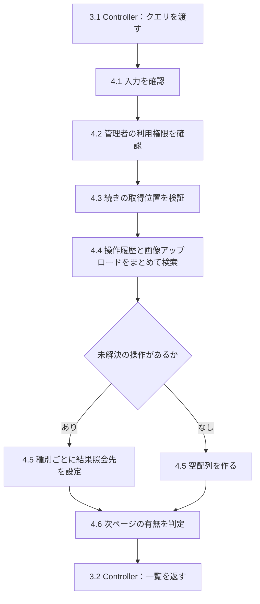

# APA004_01_管理者の未解決操作再開情報取得

## 0. 処理フロー



## 1. 機能概要

| 項目 | 内容 |
| --- | --- |
| 機能ID／旧ID／物理名 | APA004_01／API-A17／list-admin-pending-operations |
| エンドポイント | GET /api/v1/admin/operations |
| 利用画面 | SCA-02 商品管理一覧、SCA-03 商品登録・編集、SCA-05 注文詳細 |
| 対象 | 管理者JWTと有効な管理者権限を確認できた本人の操作 |
| DB | admins（共通機能）、operation_histories、product_image_uploadsを参照。書込み・行ロックなし |
| 用途 | 再読み込み・管理画面への復帰等で、元の操作IDを画面から失ったとき、結果確認を再開するために使う |

**「再開」は結果確認の再開を指す。** 元の操作IDと照会先が分かっている場合は個別の結果照会APIを直接呼べる。本APIは更新やアップロードを再実行せず、処理開始から15分以上経過していても履歴をFAILEDにしない。

## 2. リクエスト

| 場所 | 項目 | 必須 | 条件 |
| --- | --- | --- | --- |
| Header | Authorization | ○ | 管理者アクセストークン。ヘッダー検証は共通受付 |
| Query | status | 受付不可 | 状態はサーバー固定。指定時は未知項目として扱う |
| Query | cursor | 任意 | 前回のnextCursor。先頭取得では省略 |
| Body | なし | — | リクエストJSONなし。空オブジェクトも送信しない |

```http
GET /api/v1/admin/operations
Authorization: Bearer <管理者アクセストークン>
```

追加取得はcursorに前回のnextCursorだけを指定する。管理者ID・操作種別・取得件数・並び順は指定しない。

## 3. Controller

### 3.1 Business呼出

親Controllerを継承した AdminPendingOperationController が、重複を保持したクエリ、ボディ有無、共通受付済みactorを AdminPendingOperationBusiness.execute に渡す。

### 3.2 正常応答

**共通機能使用：COM001_07 共通レスポンス生成。** HTTP 200、application/json、Cache-Control: no-store。0件でも正常。片方のテーブルだけ取得できた結果を全件として返さない。

## 4. Business

### 4.1 入力チェック

| 判定 | エラー |
| --- | --- |
| ボディあり、未知のクエリ、同じ項目の重複 | INVALID_REQUEST |
| status指定あり | INVALID_REQUEST。固定値や状態名をエラー本文に含めない |
| cursor指定ありで空文字・形式不正・用途や主体の不一致・期限切れ | CURSOR_INVALID |
| 正常 | 4.2へ。値のトリム・大文字変換はしない |

cursorの単項目形式は共通部品に渡し、管理者との照合は4.2で主体が確定してから行う。エラーメッセージには許可値・内部状態名を列挙しない。

### 4.2 管理者検索・利用権限確認

**共通機能使用：COM002_01。** requireActiveAdmin(actor)で得たadminIdを検索条件にする。operation_histories.actor_idには10進文字列、product_image_uploads.admin_idにはLongとしてバインドする。権限不足時はどちらも検索しない。

### 4.3 続きの取得位置

**共通機能使用：COM001_12 カーソル生成・検証。** 既存の注文一覧用キーは日時＋数値IDなので流用できない。本APIでは異なる2テーブルの文字列IDを扱う。以下の登録済みプロファイルを使用する。署名・有効期限の実装を本Businessに複製しない。

| 設定 | 本APIでの値 |
| --- | --- |
| scope／条件／主体 | APA004_01／サーバー固定status=PROCESSING／ADMIN＋認可済みadminId |
| 境界キー | created_at（UTC・ミリ秒）、source_rank（業務履歴＝1、画像＝0）、operation_id（小文字UUID v4）の3項目。すべて降順 |
| ペイロード | v、scope、lastCreatedAt、lastSourceRank、lastOperationId、queryHash、actorHash、exp。rankは整数0または1。それ以外のキーを拒否 |
| 共通仕様の適用 | 注文一覧と同じ条件・主体への署名付き照合、最大2048文字、初回から30分の期限を引き継ぐ |

cursor未指定なら境界条件なし。指定時はdecode成功時の値だけをSQLに渡す。DBの所有者条件はカーソルではなく4.2のadminIdから設定する。

### 4.4 未解決の操作を取得

| データ元 | 対象条件 | 除外するもの |
| --- | --- | --- |
| operation_histories | actor_type=ADMIN、actor_idが一致、operation_status=PROCESSING、下記5操作のいずれか | SUCCEEDED、FAILED、他主体、対象外種別 |
| product_image_uploads | admin_idが一致、status=UPLOADING | VERIFIED、ATTACHED、FAILED。未添付であるだけのVERIFIED画像はアップロード結果不明ではない |

両方を1回のSELECTで取得する。画像は一覧上のみ共通状態PROCESSINGとして返す。受付日時の古さで除外せず、復旧が必要な古い記録も後続ページで取得できるようにする。

```sql
WITH pending AS (
  SELECT operation_id COLLATE "C" AS op_id, operation_type AS op_type,
         target_resource_id AS target_id, created_at, updated_at, 1 AS source_rank
    FROM operation_histories
   WHERE actor_type = 'ADMIN' AND actor_id = #{actorIdText}
     AND operation_status = 'PROCESSING'
     AND operation_type IN ('PRODUCT_CREATE','PRODUCT_UPDATE','PRODUCT_DELETE',
                            'ORDER_STATUS_UPDATE','ORDER_CANCEL')
  UNION ALL
  SELECT upload_operation_id COLLATE "C", 'PRODUCT_IMAGE_UPLOAD',
         NULL::bigint, created_at, updated_at, 0
    FROM product_image_uploads
   WHERE admin_id = #{adminId} AND status = 'UPLOADING'
)
SELECT op_id, op_type, target_id, created_at, updated_at, source_rank
FROM pending
/* 次のWHEREはカーソル指定時だけMyBatisのifで追加 */
WHERE (created_at, source_rank, op_id) <
      (#{lastCreatedAt}, #{lastSourceRank}, #{lastOperationId})
ORDER BY created_at DESC, source_rank DESC, op_id DESC
LIMIT 51;
```

2テーブルの操作IDにまたがる一意制約はない。同一時刻・同一UUIDでもsource_rankで区別し、どちらかを重複として捨てない。ロック中の行をSKIP LOCKEDで省く処理や、S3の存在確認は行わない。

### 4.5 操作ごとの照会先を決める

| operationType | targetResourceId | resultApiId | 個別照会への引き渡し |
| --- | --- | --- | --- |
| PRODUCT_CREATE | null（商品ID未確定） | APA002_08 | operationId |
| PRODUCT_UPDATE／PRODUCT_DELETE | 商品ID | APA002_08 | operationId。商品IDは対象行の識別用 |
| PRODUCT_IMAGE_UPLOAD | null | APA002_04 | operationIdをuploadOperationIdとしてパスへ |
| ORDER_STATUS_UPDATE／ORDER_CANCEL | 注文ID | APA003_05 | operationIdをパス、targetResourceIdを必須クエリorderIdへ |

返す行すべてについて、操作ID・種別・日時・必要な対象IDを検証する。商品更新／削除・注文操作の対象IDが欠損・不正ならINTERNAL_ERROR。別注文のIDを補完しない。

- 全行でnextAction=CHECK_RESULT、isRetryable=false。再操作可否の確定は上表の個別照会が担当する。
- 注文者・配送先、取消理由、操作の要求ハッシュ・結果要約、画像ファイル名・S3キー・画像URLは取得・返却しない。
- 一覧取得後、個別照会までに元操作が完了することがある。個別照会で返った確定結果を採用する。

### 4.6 件数・追加取得

| SQL結果 | 応答 |
| --- | --- |
| 0件 | operations=[]、hasNext=false、nextCursor=null |
| 1〜50件 | 全行を返す。hasNext=false、nextCursor=null |
| 51件 | 先頭50件だけ返す。hasNext=true。**返した50件目**の3項目からnextCursorを生成 |

**共通機能使用：COM001_12。** 次があるときだけencodeし、追加取得では応答前に受信カーソルの期限を再確認する。全ページの状態を固定しない。取得中に完了した行は次回から消え、新しい操作は先頭の再取得で確認できる。

## 5. 例外と復旧

**共通機能使用：COM001_08 共通例外変換、COM001_09 ログ出力・秘匿。** ECSで応答可能な例外は原則HTTP 200、data=null、fieldErrors=[]。API Gatewayでの拒否等は対象外。認証トークン・カーソル・操作一覧の本文をログに出さない。

| 条件 | error.code | error.message |
| --- | --- | --- |
| クエリ構造不正・不要なボディ | INVALID_REQUEST | リクエストの内容が正しくありません。 |
| 入力条件違反 | VALIDATION_ERROR | 入力内容をご確認ください。 |
| 管理者権限なし | FORBIDDEN | この操作を実行する権限がありません。 |
| 継続位置が無効 | CURSOR_INVALID | 続きの情報を取得できません。先頭から再読み込みしてください。 |
| DB一時障害 | SERVICE_UNAVAILABLE | 処理を完了できませんでした。時間をおいて再試行してください。 |
| 取得値・設定の不整合、予期しない例外 | INTERNAL_ERROR | 処理を完了できませんでした。 |

書込みがないため復旧SQLは不要。通信失敗時は同じ一覧条件で再取得し、カーソル無効時だけ先頭から取り直す。**0件は「今回の読取り時点で、条件に合う未解決記録が見つからなかった」という意味**。元操作が受付未コミットの場合や、すでに確定して対象外になった場合もある。保持している操作IDがあれば個別照会し、一覧から消えた事実だけで再送・再取消を許可しない。

## 6. 返却項目

| 項目 | 型・内容 |
| --- | --- |
| requestId、data、error | 今回の要求追跡ID。成功時はdata、失敗時はerror。反対側はnull |
| data.operations | 配列。最大50件。以下は配列の各要素 |
| operationId、operationType | string。照会する元の操作識別子と種別。行の識別には両方を使用 |
| operationStatus | string。PROCESSING固定 |
| targetResourceId | stringまたはnull。商品・注文IDを10進文字列で返す。適用条件は4.5 |
| createdAt、updatedAt | UTCのISO 8601日時文字列（ミリ秒3桁） |
| resultApiId、nextAction、isRetryable | 個別照会の機能ID、CHECK_RESULT、false |
| data.pageSize、hasNext、nextCursor | 50（整数）、次ページ有無（boolean）、継続情報（stringまたはnull） |
| error.code、message、fieldErrors | 5章のコード・文言・空配列 |

**注文キャンセルと画像アップロードの結果確認が必要な場合**
```json
{
  "requestId": "req-admin-pending-001",
  "data": {
    "operations": [
      {
        "operationId":"6b49036e-2150-4eea-91eb-27f165d5e8a1", "operationType":"ORDER_CANCEL",
        "operationStatus":"PROCESSING", "targetResourceId":"201",
        "createdAt":"2026-11-20T03:30:00.000Z", "updatedAt":"2026-11-20T03:30:00.000Z",
        "resultApiId":"APA003_05", "nextAction":"CHECK_RESULT", "isRetryable":false
      },
      {
        "operationId":"86f205bc-b7ed-47f7-bfc2-98fd0e68b17c", "operationType":"PRODUCT_IMAGE_UPLOAD",
        "operationStatus":"PROCESSING", "targetResourceId":null,
        "createdAt":"2026-11-20T03:10:00.000Z", "updatedAt":"2026-11-20T03:10:00.000Z",
        "resultApiId":"APA002_04", "nextAction":"CHECK_RESULT", "isRetryable":false
      }
    ],
    "pageSize":50, "hasNext":false, "nextCursor":null
  },
  "error":null
}
```

**該当なし**
```json
{"requestId":"req-admin-pending-002","data":{"operations":[],"pageSize":50,"hasNext":false,"nextCursor":null},"error":null}
```

**入力エラー**
```json
{"requestId":"req-admin-pending-003","data":null,"error":{"code":"VALIDATION_ERROR","message":"入力内容をご確認ください。","fieldErrors":[]}}
```
