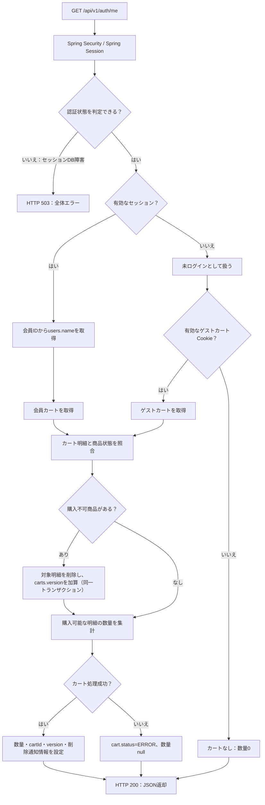

# API-U01 会員認証状態・共通ヘッダー情報取得（改訂版）

## 0. 処理フロー



## 1. 基本情報

| 項目 | 内容 |
| --- | --- |
| 機能ID | API-U01 |
| 論理名 | 会員認証状態・共通ヘッダー情報取得 |
| 物理名 | get-user-session-summary |
| HTTPメソッド | GET |
| URL | `/api/v1/auth/me` |
| 利用者 | 会員・未ログイン利用者・ゲスト |
| 対応画面 | CMN-01、SCU-01〜SCU-10 |
| 認証要否 | 任意。未ログインでも呼び出せる |
| 主な参照先 | Spring Session（PostgreSQL）、`users`、`carts`、`cart_items`、`products` |
| 更新処理 | **あり**。購入不可商品がある場合に `cart_items` から対象明細を削除し、`carts.version` を更新。Spring Sessionの最終アクセス時刻更新は標準機能に委譲 |
| べき等キー | 不要。再実行時は既に削除した明細を重複削除しない。ただしGETで副作用が発生する点はAPI設計上の例外とする |

> **設計上の注意：** GETメソッドでデータを削除する方式はHTTPの「安全なメソッド」の原則と一致しない。要求仕様に従い本APIで削除するが、CDN・ブラウザ・監視・プリフェッチ等による自動GETで削除が実行され得る。`Cache-Control: no-store` とAPI経路のキャッシュ無効化を必須とし、将来的にはPOSTのカート整合性確認APIへの分離を検討する。

## 2. コントローラー層（AuthController）

1. Spring Securityが復元した認証情報を受け取る。未認証の場合はゲストとして処理する。
2. 未認証時はCookie `ec_guest_cart_token` を取得してビジネス層へ渡す。
3. 無効な `ec_user_session` の削除はSpring Security側のセッション管理／Cookie制御で実装する（標準機能だけで必ず削除されるとはみなさない）。
4. ビジネス層から認証・会員・カート・削除通知情報を受け取りJSON化する。
5. 認証状態が判定できる場合、カート取得／整合性確認の失敗はカート部分の `ERROR` としてHTTP 200を返す。
6. Spring Session障害などで認証状態を判定できない場合はHTTP 503を返し、`data: null` と全体`error`を設定する。

## 3. ビジネス層（UserSessionBusiness）

### 3.1 認証状態と会員情報

- 有効なセッションがあれば `AUTHENTICATED`、それ以外は `UNAUTHENTICATED`。
- セッション属性には会員IDを保持し、会員名はそのIDを使って `users.name` から取得する。
- 会員セッションは**無操作12時間**、管理者セッションは**無操作4時間**で失効する。アクセス時に無操作期限が延長される方式を採用する。
- 認証DB障害などで判定できない場合はゲスト扱いにせず、全体エラーとする。

### 3.2 カート特定

- 会員は会員IDから会員カートを特定する。ログアウト・セッション失効で会員カートは削除しない。
- ゲストは `ec_guest_cart_token` からゲストカートを特定する。**最終更新から7日**を超えたカートは空カートとして扱う。
- カート未作成、無効なゲストトークン、期限切れゲストカートは `totalQuantity: 0`、`cartId: null`、`version: null` とする。

### 3.3 商品状態の検証と自動削除

カート取得時に `cart_items` と `products` を照合し、以下のいずれかに該当する商品を**購入不可**と判定する。

| 理由コード | 判定内容 |
| --- | --- |
| `OUT_OF_STOCK` | 在庫数が0以下 |
| `SALES_SUSPENDED` | 販売停止 |
| `PRIVATE` | 非公開 |
| `DELETED` | 論理削除済み、または商品レコードが存在しない |

- 購入不可の商品が見つかった場合、該当するカート明細を削除する。
- 削除と `carts.version` の加算を**同一DBトランザクション**で行う。複数明細を一度の整合性確認で削除した場合、`version` は一括処理につき1回加算する。
- 並行するカート更新との競合を避けるため、親カート行のロック、または楽観ロックの再試行を利用する。失敗時はトランザクションをロールバックする。
- 削除後に残った購入可能な `cart_items.quantity` の合計を計算する。空カートは `0`。
- 削除対象の情報はレスポンスの `data.cart.adjustments` に格納する。削除がない場合は空配列 `[]`。
- **GETの再実行では、前回削除した商品の通知は再送されない。** 削除通知を画面遷移後も保持する必要がある場合は、別途イベント保存・既読管理を設計する。
- DB障害等で処理が失敗した場合は `cart.status = ERROR`、`totalQuantity = null` とし、フロントは件数の代わりに「×」を表示する。削除途中で失敗した場合もロールバックする。

### 3.4 削除通知

- 削除が1件以上ある場合は `adjustmentMessageCode = "CART_UNAVAILABLE_ITEMS_REMOVED"` を返す。
- フロントエンドで次の文言を表示する：**「購入できない商品が含まれていたため、カートから削除しました。」**
- `adjustments` に商品ID・商品名・削除理由コードを含め、必要に応じて明細表示や詳細メッセージに利用する。
- 商品名は削除前に取得してレスポンスへ設定する。取得不能の場合は `null` を許容する。

## 4. レスポンス仕様

### 4.1 ヘッダー

| 項目 | 値・条件 |
| --- | --- |
| Content-Type | `application/json; charset=UTF-8` |
| Cache-Control | `no-store` |
| Set-Cookie | 無効セッションCookieの削除が必要な場合、`Max-Age=0` 等を指定。実際のCookie名・Path・Domainを一致させる |

### 4.2 共通項目

| 項目 | 型 | null | 内容 |
| --- | --- | --- | --- |
| `requestId` | string | 不可 | 要求追跡ID |
| `data` | object | 可 | 全体処理不能時のみnull |
| `error` | object | 可 | HTTP 200ではnull。全体エラー時に設定 |

### 4.3 認証・会員情報

| 項目 | 型 | null | 内容 |
| --- | --- | --- | --- |
| `data.auth.status` | string | 不可 | `AUTHENTICATED` / `UNAUTHENTICATED` |
| `data.user` | object | 可 | 未認証時はnull |
| `data.user.userId` | string | 不可※ | 会員ID（文字列） |
| `data.user.name` | string | 可 | `users.name` |

※ `data.user` が存在する場合。

### 4.4 カート情報

| 項目 | 型 | null | 内容 |
| --- | --- | --- | --- |
| `data.cart.status` | string | 不可 | `SUCCESS` / `ERROR` |
| `data.cart.totalQuantity` | integer | 可 | 削除後の購入可能明細の数量合計。空は0、失敗はnull |
| `data.cart.cartId` | string | 可 | カートID。未作成・取得失敗はnull |
| `data.cart.version` | string | 可 | 削除・更新反映後の版情報。未作成・取得失敗はnull |
| `data.cart.adjustments` | array | 不可 | 今回の取得処理で削除した商品。失敗時は空配列 |
| `data.cart.adjustments[].productId` | string | 不可 | 削除商品ID |
| `data.cart.adjustments[].productName` | string | 可 | 削除商品名 |
| `data.cart.adjustments[].reason` | string | 不可 | 上記の理由コード |
| `data.cart.adjustmentMessageCode` | string | 可 | 削除時 `CART_UNAVAILABLE_ITEMS_REMOVED`、それ以外null |
| `data.cart.error` | object | 可 | カート処理失敗時のエラー |
| `data.cart.error.code` | string | — | `SERVICE_UNAVAILABLE` / `INTERNAL_ERROR` 等 |
| `data.cart.error.message` | string | — | 「カート情報の取得に失敗しました。」 |

### 4.5 HTTPステータス

| 状況 | HTTP | 応答 |
| --- | --- | --- |
| ログイン済み | 200 | `AUTHENTICATED` |
| 未ログイン・セッション期限切れ | 200 | `UNAUTHENTICATED` |
| カート整合性確認・削除成功 | 200 | `cart.status = SUCCESS`、削除結果を設定 |
| 認証確認成功・カート処理失敗 | 200 | `cart.status = ERROR` |
| Spring Session障害で認証判定不能 | 503 | `data = null`、全体エラー |

## 5. 応答JSONサンプル

### 5.1 ログイン済み：購入不可商品を削除した場合

```json
{
  "requestId": "req-example-001",
  "data": {
    "auth": { "status": "AUTHENTICATED" },
    "user": { "userId": "101", "name": "山田太郎" },
    "cart": {
      "status": "SUCCESS",
      "totalQuantity": 2,
      "cartId": "501",
      "version": "8",
      "adjustments": [
        {
          "productId": "3005",
          "productName": "サンプル商品A",
          "reason": "OUT_OF_STOCK"
        }
      ],
      "adjustmentMessageCode": "CART_UNAVAILABLE_ITEMS_REMOVED",
      "error": null
    }
  },
  "error": null
}
```

### 5.2 ゲスト：削除なし

```json
{
  "requestId": "req-example-002",
  "data": {
    "auth": { "status": "UNAUTHENTICATED" },
    "user": null,
    "cart": {
      "status": "SUCCESS",
      "totalQuantity": 1,
      "cartId": "802",
      "version": "2",
      "adjustments": [],
      "adjustmentMessageCode": null,
      "error": null
    }
  },
  "error": null
}
```

### 5.3 認証は成功・カート処理失敗

```json
{
  "requestId": "req-example-003",
  "data": {
    "auth": { "status": "AUTHENTICATED" },
    "user": { "userId": "101", "name": "山田太郎" },
    "cart": {
      "status": "ERROR",
      "totalQuantity": null,
      "cartId": null,
      "version": null,
      "adjustments": [],
      "adjustmentMessageCode": null,
      "error": {
        "code": "SERVICE_UNAVAILABLE",
        "message": "カート情報の取得に失敗しました。"
      }
    }
  },
  "error": null
}
```

### 5.4 認証判定不能：HTTP 503

```json
{
  "requestId": "req-example-004",
  "data": null,
  "error": {
    "code": "SERVICE_UNAVAILABLE",
    "message": "認証状態を確認できませんでした。"
  }
}
```

## 6. 実装上の確認事項

1. `products` の販売ステータス・公開状態・在庫数・論理削除を判定する実カラム名と値は、DB設計書の定義に合わせる。
2. 商品が削除された後、別リクエストで同じ通知を表示したい場合は通知イベントの永続化を別途設計する。
3. 読み取り専用だったAPI-U01が更新処理を持つため、操作履歴への登録要否を再検討する。
4. GETで削除する設計上のリスクを許容するか、POSTによる整合性確認APIへ分離するかを実装前に最終確認する。
