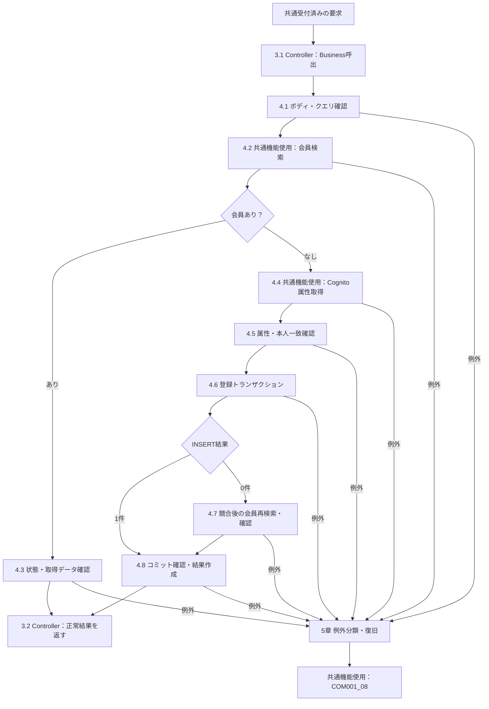

# APU001_01_会員初期化・会員情報取得

## 0. 処理フロー



## 1. 基本情報

| 項目 | 内容 |
| --- | --- |
| 機能ID | APU001_01（旧API-U02） |
| 論理名 | 会員初期化・会員情報取得 |
| 物理名 | initialize-user |
| HTTP・URL | POST `/api/v1/users/initialize` |
| Controller | UserInitializeController |
| Business | UserInitializeBusiness.initialize(command) |
| 目的 | 本人の会員情報を返す。users未登録の場合だけCognito属性から作成する |
| 認証 | 会員アクセストークン必須。共通受付で確認済みの会員主体を使用 |
| DB操作 | usersの検索・登録。既存行の更新・削除は行わない |
| 対象外 | ログイン処理、トークン更新、認証セッション作成、カート作成・統合・数量取得 |
| べき等性 | cognito_subの一意制約で同一会員の二重作成を防止。Idempotency-Key・操作履歴登録は不要 |
| 応答 | 正常・ECSで捕捉し応答可能な例外ともHTTP 200。errorの有無で成否を区別 |
| 改訂日 | 2026/11/14 |

既存会員はDB値を返し、Cognito属性で氏名・メールを上書きしない。Cognitoへの参照は未登録の場合だけ行う。

## 2. リクエスト・内部入力

### 2.1 HTTPリクエスト

| 項目 | 型・必須 | 許容内容 | チェック担当 |
| --- | --- | --- | --- |
| Authorization | string・必須 | 会員用Bearerアクセストークン | 共通受付 COM001_02 |
| Content-Type | ボディあり時必須 | application/json。文字コードは共通受付仕様 | 共通受付 COM001_10 |
| ボディ | JSON・任意 | 未送信、または空オブジェクト`{}`のみ | Business 4.1 |
| クエリ | 指定不可 | 0項目 | Business 4.1 |
| パス変数 | なし | — | — |

JSONの`null`・配列・空文字は受け付けない。氏名・メール・sub・userIdをリクエストボディで受け取らない。Cookieは本処理の会員識別に使用せず、変更もしない。

### 2.2 Controllerが受け取る内部値

共通受付の設定は **COM001_01・COM001_02・COM001_10を使用**。内部手順は各共通設計書に記載する。本APIはCOM001_10の**JSONツリー方式**を指定する。

| 項目 | 型 | 取得元・用途 |
| --- | --- | --- |
| requestId | String | 共通受付。応答・処理追跡用 |
| sub | String | 検証済み会員主体。会員検索・登録用 |
| accessToken | String | 共通受付。未登録時のCognito属性取得用 |
| bodyPresent | boolean | 共通受付。未送信とJSON nullの区別 |
| body | JsonNode／null | 解析済みボディ。未送信の場合はJavaのnull |
| query | Map&lt;String, List&lt;String&gt;&gt; | 解析済みクエリ |

### 2.3 リクエスト例

**正常例：空オブジェクトを送信する場合**

リクエストボディのJSON：

```json
{}
```

ヘッダーを含むHTTPリクエスト例：

```http
POST /api/v1/users/initialize HTTP/1.1
Authorization: Bearer <会員アクセストークン>
Content-Type: application/json

{}
```

`<会員アクセストークン>`は実際のアクセストークンへ置き換える。トークンはJSONに含めずAuthorizationヘッダーで送信する。初回作成・登録済み会員の取得とも同じリクエストを使用する。

**正常例：ボディを送信しない場合**

```http
POST /api/v1/users/initialize HTTP/1.1
Authorization: Bearer <会員アクセストークン>
Content-Length: 0

```

この場合はJSON自体を送信しない。ボディなしを表すために`null`や`""`を送信しない。ボディ未送信時のContent-Typeは不要。

**不正例：会員情報をボディに含める場合**

```json
{
  "name": "テスト会員",
  "email": "user@example.com"
}
```

本APIは上記の項目を受け付けないため、HTTP 200・`error.code=INVALID_REQUEST`を返す。新規登録用の氏名・メールはECSがCognitoから取得する。

| 送信するボディ | 判定 |
| --- | --- |
| 未送信 | 許可 |
| `{}` | 許可 |
| `null` | INVALID_REQUEST |
| `[]` | INVALID_REQUEST |
| `""` | INVALID_REQUEST |
| `{"userId":"101"}` | INVALID_REQUEST |

## 3. Controllerの処理

### 3.1 Business呼出

| 順序 | 処理 |
| --- | --- |
| 1 | 共通受付済みの主体と入力を受け取る |
| 2 | sub・accessToken・bodyPresent・body・queryをUserInitializeCommandへ設定する |
| 3 | `UserInitializeBusiness.initialize(command)`を1回呼ぶ |
| 4 | 正常結果は3.2へ。例外は握りつぶさずCOM001_08へ伝播させる |

Controller内では入力検証・DB処理・Cognito呼出を行わない。BusinessへHttpServletRequest／Responseは渡さない。アクセストークンを含むCommandのtoStringをログ出力しない。

### 3.2 正常結果を返す

Businessの結果DTOを親Controllerの正常応答メソッドへ渡す。親Controllerが使用するCOM001_07の処理は本書に重複記載しない。

新規登録の場合は、**4.8でコミット完了を確認した後**に正常応答する。返却項目は7章に記載する。

## 4. Businessの処理

### 4.1 ボディ・クエリ確認

DB検索前に次の順で判定する。

| 順序 | 対象 | 正常条件 | 不正時 |
| --- | --- | --- | --- |
| 1 | query | 空Map | INVALID_REQUEST |
| 2 | bodyPresent=false | ボディ未送信 | 4.2へ |
| 3 | bodyPresent=true | bodyがObjectNodeかつ項目数0 | 4.2へ。それ以外はINVALID_REQUEST |

本APIには利用者が指定する業務入力項目がないため、リクエストDTOの@NotNull・@Size等による検証は不要。共通受付済みのsubやトークンをControllerで再検証しない。内部Command自体がnull等の場合は実装不備としてINTERNAL_ERRORとする。

### 4.2 会員検索

**共通機能使用：COM001_04 subによる会員情報検索**

| 呼出 | 入力 | 戻り値 |
| --- | --- | --- |
| UserQueryService.findBySub | command.sub | Optional&lt;UserRecord&gt; |

| 結果 | 分岐 |
| --- | --- |
| 会員あり | 4.3へ |
| 会員なし | 4.4へ |
| 例外 | 5章へ。検索失敗を「未登録」と扱わない |

取得契約：`users.cognito_sub = command.sub`の会員情報（id・cognito_sub・name・email・status）を使用する。検索SQLやキャッシュ制御の詳細はCOM001_04に委ねる。

### 4.3 会員状態・取得データ確認

**共通機能使用：COM001_05 会員利用状態判定**

| 呼出 | 入力 | 正常時 |
| --- | --- | --- |
| MemberStatusPolicy.checkUsable | 取得済みUserRecord | 次の整合性チェックへ |

| 整合性チェック | 条件 | 不正時 |
| --- | --- | --- |
| id | nullでなく1以上 | INTERNAL_ERROR |
| cognito_sub | command.subと完全一致 | INTERNAL_ERROR |
| name | nullでなく、前後空白除去後1〜50コードポイント | INTERNAL_ERROR |
| email | nullでなく、前後空白除去後1〜254コードポイント、メール形式 | INTERNAL_ERROR |

氏名・メールの判定は4.5と同じ入力条件を使用する。ただし既存DBデータの不正はMEMBER_PROFILE_INVALIDではなくINTERNAL_ERRORとする。確認のために作った整形済み値でDBや返却値を上書きしない。

通常の既存取得では、通過後にDB値から結果DTOを作成し3.2へ戻る。4.7から呼ぶ場合はトランザクション内の確認として実行し、4.8へ進む。DISABLED・PENDINGの自動有効化は行わない。

### 4.4 Cognito属性取得

**共通機能使用：COM001_06 Cognitoユーザー属性取得**

| 呼出 | 入力 | 戻り値・次処理 |
| --- | --- | --- |
| CognitoUserClient.getUser | command.accessToken | CognitoUserAttributesを受け取り4.5へ |

取得対象はsub・name・email・email_verified。共通部品の例外コードは保持して5章へ伝播する。ここではDB登録用トランザクションを開始しない。

### 4.5 属性・本人一致確認

次の順に確認し、NGになった時点で終了する。同名属性が複数ある場合はMap化して上書きせず、重複として検出する。

| 順序 | 対象 | チェック・整形 | 不正時 |
| --- | --- | --- | --- |
| 1 | 対象4属性 | 各属性がちょうど1件。valueがnullではない | MEMBER_PROFILE_INVALID |
| 2 | sub | 加工せず1〜128コードポイント | MEMBER_PROFILE_INVALID |
| 3 | subの本人一致 | command.subと完全一致 | IDENTITY_MISMATCH |
| 4 | name | String.strip()で前後空白除去。1〜50コードポイント | MEMBER_PROFILE_INVALID |
| 5 | email | String.strip()で前後空白除去。1〜254コードポイント、メール形式 | MEMBER_PROFILE_INVALID |
| 6 | email_verified | 文字列の完全一致で判定 | `false`はEMAIL_CONFIRMATION_REQUIRED。`true`以外の値はMEMBER_PROFILE_INVALID |

文字数は`value.codePointCount(0, value.length())`で数える。DB仕様がコードポイント単位のため、UTF-16単位の`@Size`で置き換えない。

メール形式は、整形済み属性DTOのemailに`@NotBlank`と`@Email`を定義し、注入済みの`jakarta.validation.Validator`で検証する。氏名も@NotBlankを適用する。違反があれば本BusinessがMEMBER_PROFILE_INVALIDを送出する。Cognito属性はリクエストDTOではないため、ConstraintViolationExceptionをそのままVALIDATION_ERRORへ流さない。COM001_03は使用しない。

`email_verified`の欠損・重複・nullは順序1で属性不正とする。`TRUE`・空文字・空白付き値をtrueへ補正しない。過長値の切り詰め、氏名の自動補完は行わない。

**メールの大小文字：** 現行DBでは統一ルールが未確定のため、本APIでは小文字化せずCognitoの取得値を前後空白除去して使用する。一意性は現在のDB制約に従う。大小文字を無視した一意性が必要なら、Cognito設定・既存データ・DB制約を合わせて変更する。メール一致だけで別subへ紐付けない。

### 4.6 会員登録トランザクション

本BusinessでTransactionTemplateを使用する。`initialize`全体を@Transactionalで囲まず、Cognito呼出後の以下の範囲だけを実行する。

| 項目 | 内容 |
| --- | --- |
| 開始位置 | 4.5の確認成功後、INSERT直前 |
| 分離レベル | READ COMMITTED |
| 範囲 | INSERT → 必要時の4.7 → コミット |
| 終了 | TransactionTemplate.executeの正常復帰でコミット完了を確認 |
| ロック | 明示的なSELECT FOR UPDATEなし。重複登録は一意制約とON CONFLICTで制御 |
| 待機上限 | 初期実装値：lock_timeout=3秒、statement_timeout=5秒、トランザクションタイムアウト10秒。環境設定として管理 |

トランザクション内で`SET LOCAL`によりDB側の待機上限を適用する。未登録行はSELECT FOR UPDATEではロックできないため、事前検索だけで二重登録を防止しようとしない。

| 登録先 | カラム | 設定値 |
| --- | --- | --- |
| users | id | IDENTITY採番。アプリで指定しない |
| users | cognito_sub | command.sub |
| users | name | 4.5の整形・検証済み氏名 |
| users | email | 4.5の整形・検証済みメール |
| users | status | `ACTIVE`固定 |
| users | created_at | CURRENT_TIMESTAMP |
| users | updated_at | CURRENT_TIMESTAMP |

```sql
INSERT INTO users
    (cognito_sub, name, email, status, created_at, updated_at)
VALUES
    (#{sub}, #{name}, #{email}, 'ACTIVE',
     CURRENT_TIMESTAMP, CURRENT_TIMESTAMP)
ON CONFLICT (cognito_sub) DO NOTHING
RETURNING id, cognito_sub, name, email, status;
```

| RETURNING結果 | 次処理 |
| --- | --- |
| 1件 | 登録結果を保持し4.8へ |
| 0件 | 同一subとの競合として4.7へ |
| 複数件・不正な戻り値 | INTERNAL_ERRORを送出しロールバック |

MapperはRETURNINGの行を取得する方式にする。MyBatisのSELECT記法で更新SQLを扱う場合は採用バージョンの更新SQL返却設定・キャッシュフラッシュを適用し、通常の読取りSQLとして扱わない。SQLはバインド変数を使用する。

### 4.7 競合後の会員再検索・確認

**共通機能使用：COM001_04 subによる会員情報検索**

同じトランザクション内でcommand.subを使って再検索する。INSERTとは別のSELECT文として実行し、以前の「未登録」の検索結果をキャッシュから返さない。

| 再検索結果 | 処理 |
| --- | --- |
| 1件 | 4.3の状態・整合性チェックを実行。正常なら4.8へ |
| 0件 | SERVICE_UNAVAILABLEを送出。ロールバックし、今回の処理内で登録を繰り返さない |
| 共通処理の例外 | 例外を伝播しロールバック |

既存行のname・email・status・updated_atは変更しない。別要求が先に作成した会員を、そのまま今回の結果として使用する。

### 4.8 コミット確認・結果作成

| 順序 | 処理 |
| --- | --- |
| 1 | トランザクションのコールバックからUserRecordを返す |
| 2 | TransactionTemplate.executeが正常復帰したことを確認する |
| 3 | initializationStatus=READY、userId=idの10進文字列、name・email=UserRecordの値として結果DTOを作成する |
| 4 | Controllerへ返す |

コミット例外はexecuteの外側で捕捉する。コールバック内でINSERTが成功しただけではREADYにしない。応答作成・送信失敗時も、確定済み会員を削除しない。

**共通機能使用：COM001_09 アプリケーションログ出力・秘匿**  
トランザクション名`USER_INITIALIZE`、処理位置`4.8`、DB確定状況を記録する。コミット完了確認後のみCOMMITTEDを指定する。失敗時は確認できたROLLBACK結果、またはUNKNOWNをCOM001_08へ引き継ぐ。トークン・氏名・メール・Command全体は記録しない。

## 5. Exception・データ復旧

### 5.1 例外の分類

個別判定からコード付きRuntimeExceptionを送出する。**共通機能使用：COM001_08 例外・エラーレスポンス変換**。Controller・BusinessでエラーJSONを組み立てない。

| 発生条件 | error.code | DB処理 |
| --- | --- | --- |
| 4.1のボディ・クエリ不正 | INVALID_REQUEST | 開始しない |
| 4.3のDISABLED／PENDING | ACCOUNT_DISABLED／MEMBER_NOT_READY | 既存値を変更しない。登録TX中ならロールバック |
| 4.3のデータ不整合 | INTERNAL_ERROR | 同上 |
| 4.5の本人不一致 | IDENTITY_MISMATCH | 開始しない |
| 4.5のメール未確認 | EMAIL_CONFIRMATION_REQUIRED | 開始しない |
| 4.5の属性欠損・重複・形式不正 | MEMBER_PROFILE_INVALID | 開始しない |
| Cognito共通部品の例外 | COM001_06のコードを保持 | 開始しない |
| emailの一意制約違反 | 下記の競合確認後にMEMBER_CONFLICT | 登録TXをロールバック |
| DB接続障害・ロック待ち／SQLタイムアウト・デッドロック | SERVICE_UNAVAILABLE | 未確定TXをロールバック |
| コミット・ロールバック結果不明 | SERVICE_UNAVAILABLE | 確定状態をUNKNOWNとして扱う |
| SQL不備・想定外の制約違反・その他の例外 | INTERNAL_ERROR | 未確定TXをロールバック。確定済みは保持 |

emailの一意制約違反はSQLSTATE 23505と対象制約を確認して判定する。すべてのDataIntegrityViolationExceptionをメール重複にしない。DB設計書に制約名の明記がないため、実装時はマイグレーションで確定したemail一意制約名と照合する。

同時登録のタイミングによってemail制約違反となった場合は、**ロールバック完了後に一度だけCOM001_04で同じsubを再検索**する。取得できれば4.3を通して既存会員を返す。0件ならMEMBER_CONFLICT、再検索障害ならSERVICE_UNAVAILABLEとする。エラーとなったトランザクションの中で再検索しない。emailを使って他会員を検索・紐付けしない。

### 5.2 復旧方法

| 状態 | 復旧方法 |
| --- | --- |
| 登録前の入力・属性エラー | 不正な要求・属性を修正後に再実行。DB補償不要 |
| 登録中の失敗・ロールバック確認済み | 今回のINSERTは未反映。同じsubで再実行可能 |
| コミット結果不明・プロセス停止 | 同じsubで本APIを再実行。書込み先DBの会員検索からやり直す |
| 再実行で会員あり | 状態確認後に返す。二重INSERTや既存行の更新を行わない |
| 再実行で会員なし | 通常の登録経路へ。以前のTXが未解決なら一意制約の待機に従い、タイムアウト時は成功と断定しない |
| コミット済み・応答喪失 | 会員は保持する。再実行で取得できるため補償DELETEは不要 |
| email重複・別sub | 運用担当が本人情報・既存紐付けを確認。自動結合しない |
| DISABLED・PENDING | 運用の解除・移行手順で対応。本APIでACTIVEへ変更しない |

採番済みIDの欠番は許容し、IDENTITYの採番値を戻さない。Cognitoは参照のみなので外部データの補償更新は不要。

## 6. 確認ケース・参照資料

| ケース | 期待結果 |
| --- | --- |
| ボディ未送信／{}、クエリなし | 処理継続 |
| JSON null・配列・未知項目・クエリあり | INVALID_REQUEST、DB処理なし |
| ACTIVEの既存会員 | DB値を返す。Cognito呼出・UPDATEなし |
| 既存DISABLED／PENDING | 利用不可コード。自動有効化なし |
| 未登録・属性正常 | ACTIVEを1件作成し、コミット後にREADY |
| 属性重複・欠損・上限超過 | MEMBER_PROFILE_INVALID、INSERTなし |
| email_verified=false／不正値 | 前者はEMAIL_CONFIRMATION_REQUIRED、後者はMEMBER_PROFILE_INVALID |
| sub不一致 | IDENTITY_MISMATCH、INSERTなし |
| 同じsubで同時実行 | usersは1件。成功した要求は同じuserIdを返す |
| 別sub・同一email | MEMBER_CONFLICT。既存会員を流用しない |
| コミット後に応答喪失して再実行 | 既存会員を返す。件数・updated_atは変わらない |
| DB検索失敗 | 未登録としてINSERTしない |

参照：

- [機能一覧・エラーコード](https://docs.google.com/spreadsheets/d/1_3cp7E1CKQ3fda4SCl4G7kGrbhWOb3ZThdh4oUXIS2s/edit)
- [DB設計書：01_users](https://docs.google.com/spreadsheets/d/1Ka2DV7_iX2cCcRSIbu7-sHf4spx2TAV8p5SXogauFX8/edit#gid=1151925833)
- [共通ガイドライン](https://docs.google.com/document/d/1LuoyyuKzh0KIR_dEdwXQnCaOrPDbcEwuzmZdcOvAmhc/edit)
- COM001_01・02・04・05・06・07・08・09・10の各設計書
- [PostgreSQL INSERT](https://www.postgresql.org/docs/current/sql-insert.html)、[トランザクション分離](https://www.postgresql.org/docs/current/transaction-iso.html)

DB設計書の備考に残る409／403表記より、最新の共通応答方針を優先する。本書ではECSが応答可能な場合HTTP 200とする。DB設計書自体は今回変更しない。

## 7. 返却項目

### 7.1 正常応答

HTTP 200、Content-Type: application/json、Cache-Control: no-store。

| 項目 | 型 | null | 設定内容 |
| --- | --- | --- | --- |
| requestId | string | 不可 | 共通受付の追跡ID |
| data.initializationStatus | string | 不可 | READY固定 |
| data.user.userId | string | 不可 | users.idの10進文字列 |
| data.user.name | string | 不可 | users.name |
| data.user.email | string | 不可 | users.email |
| error | null | — | null固定 |

```json
{
  "requestId": "req-initialize-001",
  "data": {
    "initializationStatus": "READY",
    "user": {
      "userId": "101",
      "name": "テスト会員",
      "email": "user@example.com"
    }
  },
  "error": null
}
```

新規作成・既存取得で同じ形を返す。JWT・sub・会員状態の内部値・カート数量は返さない。

### 7.2 エラー応答

ECSで捕捉し応答できる場合はHTTP 200。Gateway等の拒否、アプリ停止、通信切断はこの保証の対象外。

| 項目 | 型 | 設定内容 |
| --- | --- | --- |
| requestId | string | 共通受付の追跡ID |
| data | null | null固定 |
| error.code | string | 下表のコード |
| error.message | string | 下表の文言 |
| error.fieldErrors | array | []。Cognito属性値や内部例外は返さない |

| error.code | error.message |
| --- | --- |
| INVALID_REQUEST | リクエストの内容が正しくありません。 |
| UNAUTHENTICATED | ログイン状態を確認できませんでした。再度ログインしてください。 |
| METHOD_NOT_ALLOWED | この操作は指定された方法では実行できません。 |
| UNSUPPORTED_MEDIA_TYPE | リクエストの形式が正しくありません。 |
| ACCOUNT_DISABLED | このアカウントでは会員機能を利用できません。 |
| MEMBER_NOT_READY | 会員情報の確認が必要です。 |
| IDENTITY_MISMATCH | 会員情報を確認できませんでした。 |
| EMAIL_CONFIRMATION_REQUIRED | メールアドレスの確認を完了してください。 |
| MEMBER_PROFILE_INVALID | 会員情報に不足または不正な項目があります。 |
| MEMBER_CONFLICT | 会員情報を登録できませんでした。 |
| RATE_LIMIT_EXCEEDED | 時間をおいて再度お試しください。 |
| COGNITO_UNAVAILABLE | 会員情報を確認できませんでした。時間をおいて再試行してください。 |
| SERVICE_UNAVAILABLE | 会員情報を取得・準備できませんでした。再試行してください。 |
| INTERNAL_ERROR | 処理を完了できませんでした。 |

```json
{
  "requestId": "req-initialize-002",
  "data": null,
  "error": {
    "code": "SERVICE_UNAVAILABLE",
    "message": "会員情報を取得・準備できませんでした。再試行してください。",
    "fieldErrors": []
  }
}
```
