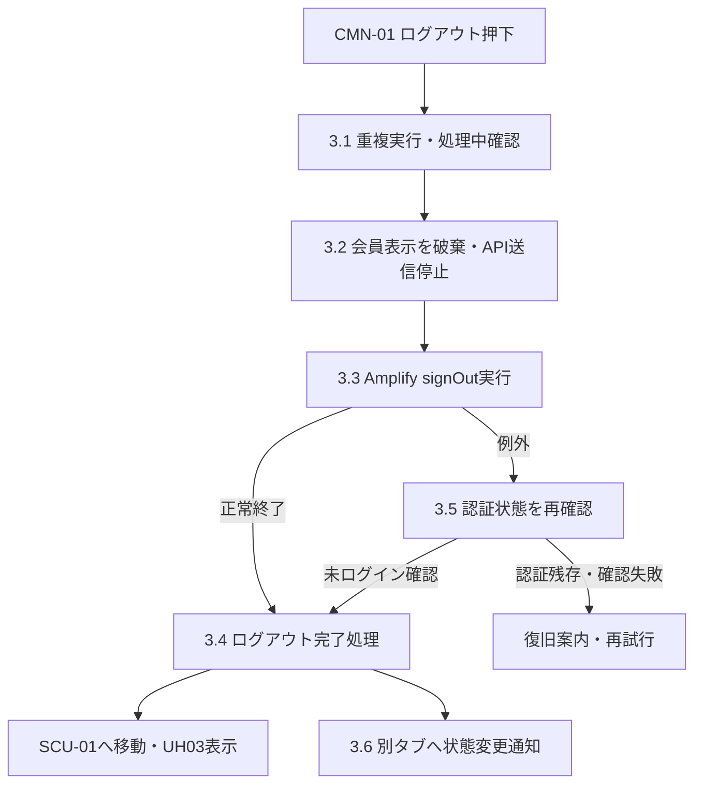

# APU001_02_会員ログアウト

## 0. 処理フロー



## 1. 基本情報

| 項目 | 内容 |
| --- | --- |
| 機能ID | APU001_02（旧API-U03） |
| 論理名 | 会員ログアウト |
| 物理名 | logout-user |
| 実装区分 | フロントエンド JavaScript／Amplify Auth |
| 呼出元 | CMN-01のログアウトボタン |
| SDK | `signOut`（aws-amplify/auth） |
| ECSのURL・HTTPメソッド | なし。旧POST /api/v1/auth/logoutは使用しない |
| API Gateway認証 | 対象外。Cognito SDKを使用 |
| ログアウト範囲 | 現在の会員側認証情報。全端末ログアウトは実施しない |
| DB操作 | なし |
| 改訂日 | 2026/11/14 |

本機能にはJavaのController・Businessを作成しない。ECS共通機能COM001系も呼び出さない。本書ではフロントエンドの操作受付とログアウト処理を定義する。

管理者用Cognitoプール・アプリクライアントと会員用を分離する。呼出時に会員用Amplify設定が有効であることを前提とし、同一JavaScript実行環境で管理者用設定へ切り替わる構成にしない。ユーザー側／管理者側のエントリーポイントとアプリ所有の保存領域を分ける。

## 2. 入力・呼出例

### 2.1 入力項目

| 項目 | 必須 | 内容 |
| --- | --- | --- |
| 利用者入力 | なし | 氏名・メール・パスワード・userIdを入力しない |
| SDK引数 | なし | `signOut()`を使用。`global: true`を指定しない |
| 会員用認証情報 | SDK管理 | アプリがトークンをJSONに詰めてECSへ送信しない |
| 重要処理中フラグ | 内部 | 注文確定・カート更新等の通信中は開始しない |
| ログアウト処理中フラグ | 内部 | 重複クリックを防止 |

利用者が指定する項目がないため、必須・文字数・項目間チェックはない。

### 2.2 リクエスト例

本機能は独自HTTP APIではないため、**リクエストJSONはない**。ECSへ`{}`をPOSTしない。

```javascript
import { signOut } from 'aws-amplify/auth';

// 会員側Amplify設定を使用する画面で実行
await signOut();
```

Cognitoとの通信内容・認証情報の参照はSDKへ任せる。SDKをHTMLから使う場合もJavaScriptのビルド・配信設定に組み込み、TypeScriptの採用は必須としない。

## 3. フロントエンド処理

### 3.1 重複実行・処理中確認

| 条件 | 処理 |
| --- | --- |
| 重要な更新処理の通信中 | ログアウトを開始しない。現在の処理の完了・復旧操作を優先 |
| 既にログアウト実行中 | 同じ実行Promiseを共有し、新たなsignOutを開始しない |
| 通常状態 | 確認ダイアログを挟まず3.2へ |

処理中はボタンを「ログアウト中…」とし、ヘッダー・フッターの通常遷移と新規ログイン操作を抑止する。公開画面の読取り通信中だけを理由にログアウトを禁止しない。

### 3.2 会員表示を破棄・API送信停止

1. アプリの会員状態を`SIGNING_OUT`へ変更し、会員APIの新規送信を止める。
2. 認証状態の世代番号を更新する。以前の世代で開始したAPIの応答は、到着しても表示・キャッシュへ反映しない。
3. 会員情報・注文情報等を即座に非表示にし、以下のアプリ所有データを破棄する。
4. 中止可能な読取り通信はAbortControllerで中止する。送信済みのサーバー処理が取り消されたとは扱わない。

| データ | 処理 |
| --- | --- |
| 会員氏名・メール・userId、会員用画面ストア | 破棄 |
| 注文履歴・注文詳細・保存済み配送先・テストカードの表示キャッシュ | 破棄 |
| 配送先等の入力途中値、会員画面の復元用データ | 破棄 |
| 会員カート表示・数量バッジ | 破棄。ゲスト数量を取得するまでは未確認扱い |
| アプリが独自に保持したアクセストークンのコピー | 破棄 |
| Amplify管理の認証データ | 3.3のSDKに処理を任せる |
| 管理者の認証・表示キャッシュ | 変更しない |

`localStorage.clear()`や`sessionStorage.clear()`を使用しない。会員アプリが所有するキーを指定して削除する。SDKの内部キーを推測して削除しない。

### 3.3 Amplify signOut実行

| 順序 | 処理 |
| --- | --- |
| 1 | 会員側の`signOut()`を呼び、完了をawaitする |
| 2 | 正常終了した場合は3.4へ |
| 3 | 例外が発生した場合は3.5へ |

通常のsignOutを使用し、全端末のGlobalSignOutへ切り替えない。同じブラウザで認証保存領域を共有する会員側タブは、同じ認証状態の変更対象となる。

**成功の意味：** この画面で会員用認証情報の利用を終了したこと。Cognito側の失効処理や、既に発行されたJWTのAPI Gatewayでの即時拒否を保証する意味ではない。Amplifyには失効処理のエラー後もローカル情報の削除を進める実装があるため、SDK正常終了とサーバー側失効の完了を同一視しない。

ログアウト後に保持済みJWTが有効期限まで検証を通る可能性は、JWT認証方式の制約として扱う。本機能でDBセッションや失効リストを追加しない。

### 3.4 ログアウト完了処理

| 順序 | 処理 |
| --- | --- |
| 1 | 会員状態を`UNAUTHENTICATED`へ変更する |
| 2 | 3.2のキャッシュ破棄を再確認する。古いAPI応答を反映しない |
| 3 | 未ログイン用ヘッダーメニューへ更新する |
| 4 | 履歴置換でSCU-01へ遷移する |
| 5 | UH03「ログアウトしました。」を約3秒表示する |

既にログアウト済みの状態から正常終了した場合も同じ扱いとする。APU001_01をログアウト確認に呼び出さない。会員カートのDBデータは削除しない。

ゲストカート数量を本機能で`0`と決めつけない。ゲスト識別解除の結果またはAPU003_01のゲスト経路で確定するまでは、バッジは数量未確認として扱う。

### 3.5 例外時の認証状態確認・復旧

会員表示を隠したまま、会員側Amplifyの`fetchAuthSession()`を使用して状態を確認する。HTTPステータスやECSのerror.codeへ変換しない。

| 確認結果 | 処理 |
| --- | --- |
| 正常終了し会員用トークンなし | ローカル未ログインを確認できたため3.4へ |
| 会員用トークンあり | 未完了としてUH04と「再度ログアウトを実行」を表示 |
| 認証状態の確認も失敗 | 未ログインと断定せずUH05と「ログイン状態を再確認」「再度ログアウトを実行」を表示 |

再確認で認証情報が得られても、会員用画面を自動復元しない。ログアウトの意思を維持し、再試行へ案内する。SDK例外メッセージ・トークンをそのまま画面やログへ出力しない。

処理が長時間完了しない場合は結果未確認の案内を表示する。ただし表示用タイムアウトでSDK実行が中止されたとは扱わない。元のPromiseが未完了の間は二重signOut・新規signInを開始せず、遅延完了を処理する。無期限に画面を操作不能にせず、再読み込みの案内を用意する。

### 3.6 別タブ・戻る操作への対応

| 契機 | 処理 |
| --- | --- |
| 当該タブでログアウト完了 | 会員アプリ専用のBroadcastChannel等で状態変更を通知 |
| 別タブで通知受信 | 会員表示を隠し、保有するトークンのコピー・復元キャッシュを破棄。Amplify状態を再確認 |
| タブ復帰・pageshow | 会員専用表示を再表示する前にAmplify状態を確認 |
| 未ログイン確定 | 公開画面では未ログイン表示、保護画面では各画面のログイン導線へ |

通知に氏名・メール・JWTを含めない。管理者側は会員用通知でログアウトしない。ブラウザ履歴の全件削除を試みず、復帰時の認証確認と古い応答の破棄で再表示を防ぐ。

## 4. DB・Cookie・データ復旧

### 4.1 DB処理

| 対象 | 本機能の操作 |
| --- | --- |
| users | 検索・更新・削除なし |
| carts・cart_items | 削除なし。会員カート、未統合ゲストカートを保持 |
| orders・operation_histories | 変更なし。成立済み注文・未解決操作は保持 |
| Spring Session | 使用しないため削除処理なし |
| トランザクション・ロック | なし |

DB更新がないためロールバック・補償更新は不要。キャッシュを消した後でログアウトに失敗しても、破棄前の個人情報をバックアップから戻さない。後日の正常ログイン後、必要な情報をAPIで再取得する。

### 4.2 ゲストカートCookie解除：別機能との連携事項

Amplify signOut完了または状態再確認で未ログイン確定後、APU003_07（POST /api/v1/guest/cart/clear-token）を呼ぶ。Cookieがない場合も成功。解除前はゲスト内容を表示しない。失敗・結果不明ならサインイン済みに戻さず解除だけを再試行。準備TX済みの未統合カートはDBの会員紐付けで再開する。

## 5. 状態・確認ケース

| 状態 | 文言・操作 |
| --- | --- |
| 処理中 | ログアウト中… |
| 完了・UH03 | ログアウトしました。 |
| 未完了・UH04 | ログアウト処理に失敗しました。もう一度お試しください。／再度ログアウトを実行 |
| 結果未確認・UH05 | ログアウトが完了したか確認できませんでした。ログイン状態を再確認するか、もう一度ログアウトをお試しください。 |

| 確認ケース | 期待結果 |
| --- | --- |
| 正常ログアウト | 会員表示破棄、SCU-01へ履歴置換、UH03 |
| 連打 | 同時実行は1回 |
| 既に未ログイン | 正常終了可能。ログイン画面への強制誘導不要 |
| SDK例外・認証残存 | 個人情報を隠しUH04 |
| 状態確認失敗 | 未ログインと断定せずUH05 |
| ログアウト後に以前のAPI応答到着 | 会員表示・バッジを復元しない |
| ブラウザ戻る・別タブ復帰 | 認証確認前に会員データを再表示しない |
| 管理者もログイン済み | 管理者認証は保持 |
| 旧ゲストCookieが残存 | 空カートと断定しない。4.2の連携対象 |
| ログアウト前の注文結果不明 | DBの操作履歴を保持。ログアウトを注文取消と扱わない |

## 6. 参照資料

- [機能一覧：APU001_02](https://docs.google.com/spreadsheets/d/1_3cp7E1CKQ3fda4SCl4G7kGrbhWOb3ZThdh4oUXIS2s/edit)
- [Amplify JavaScript Sign-out](https://docs.amplify.aws/javascript/frontend/auth/sign-out/)
- [Amplify signOut実装](https://github.com/aws-amplify/amplify-js/blob/main/packages/auth/src/providers/cognito/apis/signOut.ts)：失効処理とローカル終了の区別。実装時は採用バージョンで確認する。
- [API Gateway JWT authorizer](https://docs.aws.amazon.com/apigateway/latest/developerguide/http-api-jwt-authorizer.html)：署名・有効期限等の検証方式。

## 7. 返却項目

### 7.1 SDKの戻り値

| 結果 | 返却内容 |
| --- | --- |
| 正常終了 | Promiseがresolve。戻り値なし（void） |
| 例外 | Promiseがreject。3.5で分類・状態再確認 |

### 7.2 アプリ内で保持する処理結果

画面制御用の内部状態として以下を使用する。HTTPレスポンスではない。

| 項目 | 値 |
| --- | --- |
| logoutStatus | PROCESSING／COMPLETED／INCOMPLETE／UNKNOWN |
| authStatus | SIGNING_OUT／UNAUTHENTICATED／UNKNOWN |
| messageId | UH03／UH04／UH05。処理中は未設定 |

正常終了時の内部状態のJSON表現例：

```json
{
  "logoutStatus": "COMPLETED",
  "authStatus": "UNAUTHENTICATED",
  "messageId": "UH03"
}
```

結果未確認時の内部状態のJSON表現例：

```json
{
  "logoutStatus": "UNKNOWN",
  "authStatus": "UNKNOWN",
  "messageId": "UH05"
}
```

ECSのHTTP 200・requestId／data／errorラッパーは本機能に適用しない。ゲストCookie解除の成否は上記の会員ログアウト結果と別に保持する。
