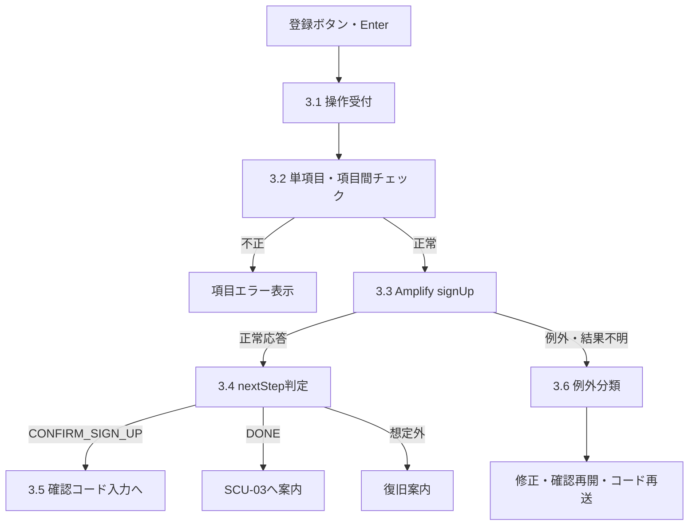

# APU001_03_新規会員登録・確認コード送信

## 0. 処理フロー



## 1. 基本情報

| 項目 | 内容 |
| --- | --- |
| 機能ID | APU001_03（旧API-U04） |
| 論理名 | 新規会員登録・確認コード送信 |
| 物理名 | sign-up-user |
| 実装区分 | フロントエンド JavaScript／Amplify Auth |
| 対応画面 | SCU-04 新規会員登録 |
| 呼出SDK | `signUp`（aws-amplify/auth） |
| ECSのController・Business・URL | なし |
| API Gateway認証 | 対象外。CognitoへSDKで直接要求 |
| 作成先 | 会員用Cognitoユーザープール |
| 確認メール | Cognito標準の確認コードメール |
| RDS登録 | 本機能では行わない。ログイン後のAPU001_01で実施 |
| 対象外 | 確認コード検証、再送、自動ログイン、カート統合 |
| 改訂日 | 2026/11/14 |

確認コード検証はAPU001_04、再送はAPU001_05、ログインはAPU001_06へ分離する。ECS共通機能COM001系は呼び出さない。

前提：会員側Amplify設定、クライアントシークレットなしのアプリクライアント、メールをログインIDとして使用、メール確認必須。管理者用プールは使用しない。自動確認・自動ログインを有効化しない。

## 2. 入力・リクエスト例

### 2.1 画面入力

| 項目 | JavaScript型 | 必須 | 条件 |
| --- | --- | --- | --- |
| name | string | 必須 | 前後空白除去後1〜50コードポイント |
| email | string | 必須 | 前後空白除去後1〜128コードポイント、メール形式 |
| password | string | 必須 | 16〜30文字。半角英大文字・英小文字・数字を各1文字以上。記号任意、空白不可 |
| passwordConfirmation | string | 必須 | passwordと完全一致。SDKへ送信しない |
| returnTo | string／未指定 | 任意・画面保持 | 許可された同一サイト内の戻り先のみ。SDKへ送信しない |

パスワードはASCIIの`!`〜`~`（U+0021〜U+007E）の範囲を許可する。全角文字・制御文字・空白は拒否。トリムやUnicode正規化を行わない。名前・メールの過長値は切り詰めない。

### 2.2 SDK引数の対応

| SDK項目 | 値 |
| --- | --- |
| username | 整形・検証済みemail |
| password | 入力されたpassword |
| options.userAttributes.name | 整形・検証済みname |
| options.userAttributes.email | usernameと同一のemail |

autoSignInは指定しない。email_verified・sub・管理者権限・ユーザーIDを画面から指定しない。CognitoのClientId等はAmplify設定により使用される。

### 2.3 リクエストJSON相当の例

以下は**Amplifyへ渡すJavaScriptオブジェクトをJSONで表現した例**。独自ECSエンドポイントにPOSTするJSONではない。パスワードは説明用の架空値。

```json
{
  "username": "user@example.com",
  "password": "SamplePassword123!",
  "options": {
    "userAttributes": {
      "name": "テスト会員",
      "email": "user@example.com"
    }
  }
}
```

```javascript
import { signUp } from 'aws-amplify/auth';

// 3.2の検証を通過した値を使用する
const result = await signUp({
  username: email,
  password,
  options: {
    userAttributes: { name, email }
  }
});
```

## 3. フロントエンド処理

### 3.1 操作受付

| 条件 | 処理 |
| --- | --- |
| IME変換確定中のEnter | 送信しない |
| 登録処理中の再操作 | 新たなsignUpを開始しない |
| 会員ログイン済み | 登録フォームを実行せず、有効な戻り先またはSCU-01へ |
| 認証確認失敗 | 未ログインと断定せず再確認を案内 |
| 未ログイン・通常操作 | 3.2へ |

submitイベントに処理を集約し、ボタンクリックとEnterで二重実行しない。

### 3.2 単項目・項目間チェック

name・emailの前後空白を除去し、同じ整形済み値を検証とSDK送信に使用する。コードポイント数は`Array.from(value).length`で確認する。メールの大小文字は勝手に変換せず、Cognito設定に従う。

| 判定順 | 対象・NG条件 | 表示文言 |
| --- | --- | --- |
| 1 | nameが空欄 | 氏名を入力してください。 |
| 2 | nameが50文字超過 | 氏名は50文字以内で入力してください。 |
| 3 | emailが空欄 | メールアドレスを入力してください。 |
| 4 | emailが128文字超過・メール形式不正 | 有効なメールアドレスを入力してください。 |
| 5 | passwordが未入力 | パスワードを入力してください。 |
| 6 | passwordの文字数・文字種不正 | パスワードは16〜30文字で、半角の英大文字・英小文字・数字を各1文字以上含めて入力してください。記号は使用できますが、空白は使用できません。 |
| 7 | passwordConfirmationが未入力 | 確認用パスワードを入力してください。 |
| 8 | passwordと確認用が不一致 | パスワードが一致しません。 |

メール形式の画面チェックには`type="email"`のtypeMismatchを利用し、必須・長さは別途判定する。最終的な受付可否はCognitoの応答に従う。

パスワード判定例：

```javascript
const validPassword =
  /^[\x21-\x7E]{16,30}$/.test(password) &&
  /[A-Z]/.test(password) &&
  /[a-z]/.test(password) &&
  /[0-9]/.test(password);
```

複数項目が不正なら項目ごとに表示し、最初のエラー項目へフォーカスを移す。NG時はSDKを呼び出さない。項目間チェックはパスワード一致と、送信username・emailを同じ値から設定すること。

### 3.3 Amplify signUp

1. 入力欄・表示切替・登録ボタン・通常の画面遷移を一時抑止する。
2. 「登録処理中…」を表示し、2.2の値でsignUpを1回実行する。
3. 正常応答は3.4、例外は3.6へ進む。
4. SDK処理が終了したら、パスワードと確認用の入力・保持変数を解放し、伏字状態へ戻す。

パスワードをlocalStorage・sessionStorage・URL・ログ・分析イベントへ保存しない。JavaScriptの文字列をメモリから完全消去できるとは保証せず、参照を残さない実装とする。確認処理へパスワードを引き継がない。

### 3.4 nextStep判定

HTTP通信の成功だけでは登録完了と判定しない。

| nextStep.signUpStep | 処理 |
| --- | --- |
| CONFIRM_SIGN_UP | 確認待ち。3.5へ |
| DONEかつisSignUpComplete=true | 確認済みとしてSCU-03への導線を表示。自動ログイン・RDS登録は行わない |
| COMPLETE_AUTO_SIGN_IN | 現行構成では想定外。autoSignInを呼ばずSCU-03への案内と設定確認を行う |
| 未定義・欠損・矛盾した結果 | 完了を断定せず、結果確認・ログイン導線を表示。自動再登録しない |

通常はCONFIRM_SIGN_UPとなる設定で運用する。DONEが返った場合も登録が未確認であると決めつけず、設定との差異を確認する。

### 3.5 確認コード入力へ

| 引き継ぐ値 | 用途 |
| --- | --- |
| username（今回送信したemail） | APU001_04・APU001_05の対象指定 |
| codeDeliveryDetails.destination | Cognitoが返したマスク済み送信先の表示 |
| codeDeliveryDetails.deliveryMedium | EMAILであることの確認 |
| returnTo | 許可済み戻り先をログイン後まで保持 |

SCU-04の確認コード入力状態へ切り替え、「確認コードを送信しました。メールをご確認ください。」と表示する。送信先欠損時はメールアドレスの全文を補って表示せず、汎用文言にする。実際の受信・到達まで保証する表示は行わない。

保持するのは確認用メールと許可済み戻り先だけ。再読み込み後も再開させる場合は会員登録用sessionStorageの専用キーに保持し、確認完了・中止時に削除する。URLにメール・確認コードを含めない。保持値が失われた場合は確認用メールの再入力へ案内する。

APU001_04で確認成功後にSCU-03へ移動する。ログイン成功後のAPU001_01でRDSへ会員登録する。本機能からカート統合を開始しない。

### 3.6 例外分類・復旧導線

SDKの例外名を分類し、固定文言へ対応付ける。例外のmessageをそのまま画面へ出さない。アプリ側でsignUpを自動再送しない。

| 例外・状態 | 表示・処理 |
| --- | --- |
| UsernameExistsException | 「このメールアドレスでは登録を進められません。入力内容をご確認いただくか、ログイン画面をご利用ください。」 |
| InvalidPasswordException | 3.2のパスワード条件を表示。Cognitoポリシーとの不一致も確認 |
| InvalidParameterException | 「入力内容をご確認ください。」。原因不明のまま特定項目のエラーと断定しない |
| TooManyRequestsException | 「時間をおいて再度お試しください。」。連続再送を止める |
| LimitExceededException | 未確認アカウントが作成されている場合がある。新規登録の再送ではなく確認再開・APU001_05へ案内 |
| CodeDeliveryFailureException | 確認メール送信失敗を案内。登録がなかったと断定せず、確認コード再送を利用可能にする |
| 通信断・タイムアウト・サーバー側一時障害 | 登録結果不明として確認再開・ログインへの導線を表示 |
| 設定不備・未分類の例外 | 「登録処理を完了できませんでした。時間をおいて再度お試しください。」。内部情報を出さず設定・原因確認 |

結果不明時の文言：

「登録結果を確認できませんでした。確認メールが届いている場合は確認手続きを続けてください。届いていない場合は確認コードの再送、またはログイン画面をご利用ください。」

氏名・メールは修正用に保持し、パスワードは消去する。送信制限・失敗時の再送ボタンはAPU001_05を呼び、本機能のsignUpを代わりに再実行しない。アカウント存在の確認用にECSや管理者APIを呼び出さない。

## 4. データ保存・復旧・設定上の境界

### 4.1 保存先と復旧

| 対象 | 処理・復旧 |
| --- | --- |
| Cognito | signUpで登録・確認コード送信。確認前は通常UNCONFIRMED |
| RDS users | 操作なし。仮会員を作成しない |
| carts・orders・operation_histories | 操作なし |
| DBトランザクション・ロック | なし |
| メール送信のみ失敗 | Cognitoユーザーを補償削除しない。APU001_05で再送 |
| 結果不明 | メール確認・再送・ログインで手続きを再開。自動再登録や自動削除はしない |
| アプリ停止・画面離脱 | Cognito上の登録は巻き戻さない。パスワードは復元しない |

### 4.2 Cognito設定との整合

| 要件 | 設定・実装 |
| --- | --- |
| 16文字以上 | Cognito MinimumLength=16 |
| 大文字・小文字・数字各1文字以上 | Cognitoの対応するRequire設定をtrue |
| 記号任意 | RequireSymbols=false |
| メール確認 | 会員プールのメール自動検証・コード方式。標準送信を使用 |
| 自動ログインなし | signUpにautoSignInを指定しない |

**制約：** Cognito標準パスワードポリシーには「最大30文字」「ASCIIのみ」を指定する項目がない。今回の画面ではこれらを検証するが、直接Cognito APIを呼ぶ利用者まで同条件で制限できる設計ではない。厳密なサーバー強制を要件にする場合は別の方式検討が必要であり、本書でECSのパスワード受付APIを追加しない。

氏名・メールのフロントチェックもサーバー側の最終保証にはしない。RDS登録時はAPU001_01が取得属性を再検証する。メール大小文字とDB一意制約の統一ルールはAPU001_01と同じ確認事項を引き継ぐ。

## 5. 確認ケース

| ケース | 期待結果 |
| --- | --- |
| 正常入力 | Cognito登録・確認コード入力へ。RDS登録なし |
| 氏名50／51コードポイント | 50は許可、51は拒否 |
| パスワード15／16／30／31文字 | 16・30を許可、15・31を画面で拒否 |
| 大文字・小文字・数字のいずれか不足 | SDK呼出なし |
| パスワードに空白・全角・改行 | SDK呼出なし |
| 確認用不一致 | SDK呼出なし。確認用は送信しない |
| IME変換確定Enter・連打 | 重複登録要求を開始しない |
| 既存メール | 指定済みの汎用文言を表示 |
| CONFIRM_SIGN_UP | 登録完了・ログイン済みと表示しない |
| メール送信制限・通信切断 | 未登録と断定せず、確認再開・再送を案内 |
| 戻り先に外部URL | 破棄し、既定のSCU-01を使用 |
| ログ・ストレージ | パスワード・確認用・確認コードが記録されない |

## 6. 参照資料

- [機能一覧：APU001_03〜05](https://docs.google.com/spreadsheets/d/1_3cp7E1CKQ3fda4SCl4G7kGrbhWOb3ZThdh4oUXIS2s/edit)
- [Amplify JavaScript Sign-up](https://docs.amplify.aws/javascript/frontend/auth/sign-up/)
- [Cognito SignUp](https://docs.aws.amazon.com/cognito-user-identity-pools/latest/APIReference/API_SignUp.html)
- [Cognito PasswordPolicyType](https://docs.aws.amazon.com/cognito-user-identity-pools/latest/APIReference/API_PasswordPolicyType.html)
- APU001_01 会員初期化・会員情報取得

## 7. 返却項目

### 7.1 SDK正常戻り値

| 項目 | 型・有無 | 用途 |
| --- | --- | --- |
| isSignUpComplete | boolean | Cognitoの登録手続きが完了したか。ログイン状態ではない |
| userId | string・任意 | Cognito側の識別子。RDSのusers.idとして扱わない |
| nextStep.signUpStep | string | CONFIRM_SIGN_UP／DONE／COMPLETE_AUTO_SIGN_IN等の分岐 |
| nextStep.codeDeliveryDetails.destination | string・該当時 | マスク済み送信先 |
| nextStep.codeDeliveryDetails.deliveryMedium | string・該当時 | EMAIL等の送信経路 |
| nextStep.codeDeliveryDetails.attributeName | string・該当時 | email等の確認対象属性 |

確認待ちのSDK戻り値のJSON表現例：

```json
{
  "isSignUpComplete": false,
  "userId": "00000000-0000-4000-8000-000000000001",
  "nextStep": {
    "signUpStep": "CONFIRM_SIGN_UP",
    "codeDeliveryDetails": {
      "destination": "u***@e***.com",
      "deliveryMedium": "EMAIL",
      "attributeName": "email"
    }
  }
}
```

### 7.2 例外時の扱い

SDKのPromiseがrejectした場合は3.6へ進む。ECSのHTTP 200、requestId・data・errorラッパーは適用しない。

画面内で管理する結果の例（独自HTTPレスポンスではない）：

```json
{
  "registrationStatus": "UNKNOWN",
  "message": "登録結果を確認できませんでした。確認メールが届いている場合は確認手続きを続けてください。届いていない場合は確認コードの再送、またはログイン画面をご利用ください。",
  "availableActions": ["RESUME_CONFIRMATION", "RESEND_CODE", "GO_TO_LOGIN"]
}
```

registrationStatusは画面内の状態としてINPUT／PROCESSING／CONFIRMATION_REQUIRED／CONFIRMED／ERROR／UNKNOWNを使用する。確認済みでも自動ログインやRDS登録を開始しない。
