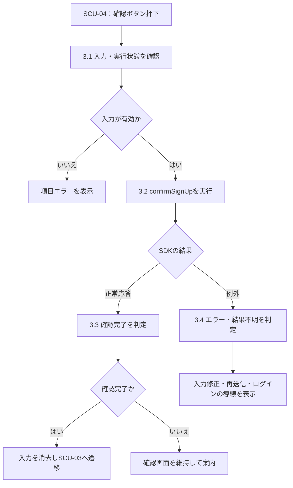

# APU001_04_会員登録確認コード検証

## 0. 処理フロー



## 1. 基本情報

| 項目 | 内容 |
| --- | --- |
| 機能ID | APU001_04 |
| 論理名 | 会員登録確認コード検証 |
| 物理名 | confirm-user-registration |
| 呼出元 | SCU-04のメール確認フォーム |
| 実装箇所 | フロントエンドJavaScript |
| 使用SDK | aws-amplify/auth の confirmSignUp |
| ECSのURL・Controller・Business | なし |
| API GatewayのJWT認証 | 対象外。CognitoへのSDK呼び出し |
| 前提 | 会員用Cognitoプール、クライアントシークレットなしのアプリクライアント。確認コード方式の標準メールを使用 |
| 完了後 | 自動ログインせずSCU-03へ遷移 |
| DB参照・登録・更新 | なし。Cognito側の登録確認を行う |
| 後続 | ログイン成功後にAPU001_01でRDSの会員初期化を行う。本機能からは呼び出さない |

## 2. 入力項目

### 2.1 画面から受け取る値

| 項目 | 型 | 必須 | 取得元・用途 |
| --- | --- | --- | --- |
| email | string | 必須 | APU001_03から保持した登録メールアドレス。保持できない場合は再入力 |
| confirmationCode | string | 必須 | メールに記載された確認コード |
| returnTo | string | 任意 | 登録前の有効な戻り先。SDKには送信せずSCU-03へ引き継ぐ |

- マスク済みの送信先表示をemailとして使わない。
- パスワード、会員ID、Cognitoのsub、アクセストークンは受け取らない。
- 確認コードを数値に変換しない。先頭の0を保持する。

### 2.2 SDKリクエストJSON例

ECSへのHTTPリクエストではなく、JavaScriptからSDKへ渡すオブジェクト。

```json
{
  "username": "user@example.com",
  "confirmationCode": "012345"
}
```

```javascript
import { confirmSignUp } from "aws-amplify/auth";

const result = await confirmSignUp({
  username: email,
  confirmationCode
});
```

## 3. 処理詳細 — フロントエンドJavaScript

### 3.1 入力・実行状態を確認

| 順序 | 対象 | チェック・処理 | NG時 |
| --- | --- | --- | --- |
| 1 | 実行状態 | 確認・コード再送信処理の実行中でないこと | 重複実行しない |
| 2 | Enter操作 | 日本語変換確定中でないこと | 送信しない |
| 3 | email | 前後空白を除去。空文字でないこと | 「メールアドレスを入力してください。」 |
| 4 | email | 128文字以内、メール形式。登録画面と同じ検証を使用。大文字小文字は変更しない | 「有効なメールアドレスを入力してください。」 |
| 5 | confirmationCode | 前後空白を除去。空文字でないこと | 「確認コードを入力してください。」 |
| 6 | confirmationCode | 1〜2048文字、空白文字を含まないこと | 「確認コードの形式を確認してください。」 |
| 7 | returnTo | 同一サイト内の許可された戻り先であること | 不正値を破棄しSCU-01を戻り先にする |

- コードの入力条件はCognitoのConfirmationCode受付条件に合わせる。6桁の例を使用するが、本設計では未確定の6桁固定チェックを追加しない。
- 確認コード入力欄はテキスト型、autocomplete="one-time-code"とする。
- メールアドレスとコードの対応、有効期限、確認済みかどうかはCognitoで判定する。画面で推測しない。
- エラー時はSDKを呼ばず、最初のエラー項目へフォーカスする。

### 3.2 confirmSignUpを実行

| 順序 | 処理 |
| --- | --- |
| 1 | email・confirmationCodeを今回の送信値として確定する |
| 2 | 確認ボタン、入力欄、再送信ボタン、通常の画面遷移を一時抑止。「確認中…」を表示 |
| 3 | 2.2の引数でconfirmSignUpを1回呼び出す |
| 4 | 正常応答は3.3、例外は3.4へ進む |
| 5 | 遷移しない場合はfinallyで処理中状態を解除する |

- アプリケーション独自の自動再送は行わない。
- 別アカウントのメールアドレスを強制的に引き継ぐ設定は使用しない。
- 確認コード・パスワード・SDK例外の生データをログ、URL、ブラウザの永続ストレージへ保存しない。
- 画面離脱や登録対象変更後に届いた古い応答は、現在のフォーム・遷移先に反映しない。

### 3.3 確認完了を判定

| SDK結果 | 判定・画面処理 |
| --- | --- |
| isSignUpComplete=true、nextStep.signUpStep=DONE | 確認完了。下記の完了処理を実行 |
| nextStep.signUpStep=COMPLETE_AUTO_SIGN_IN | 自動ログイン設定が残っている想定外の分岐。autoSignInは呼ばずSCU-03へ案内し、設定を確認する |
| CONFIRM_SIGN_UP、その他の値、結果項目欠損 | 完了と断定せず確認画面を維持。「登録の確認が完了していません。確認コードを再確認するか、ログイン画面をご利用ください。」を表示 |

完了処理：

1. 確認コードと登録用の一時データを消去する。
2. 有効なreturnToと完了通知のみSCU-03へ引き継ぐ。
3. 履歴置換でSCU-03へ遷移し、「メールアドレスの確認が完了しました。ログインしてください。」を表示する。
4. ログイン状態・カート数量を本機能で変更しない。

### 3.4 エラー・結果不明を判定

SDK例外のname等の構造化された識別情報で分類する。例外messageの部分一致で「確認済み」と断定しない。

| 条件 | 画面用コード（本書定義） | 表示文言 | 復旧操作 |
| --- | --- | --- | --- |
| CodeMismatchException | CONFIRM_CODE_MISMATCH | 確認コードが正しくありません。メールに記載されたコードを入力してください。 | コード再入力 |
| ExpiredCodeException | CONFIRM_CODE_EXPIRED | 確認コードの有効期限が切れています。コードを再送信してください。 | APU001_05の再送信 |
| TooManyFailedAttemptsException / TooManyRequestsException / LimitExceededException | CONFIRM_RATE_LIMITED | 試行回数の上限に達しました。時間をおいて再度お試しください。 | 時間をおいて手動再試行 |
| AliasExistsException | REGISTRATION_UNAVAILABLE | このメールアドレスでは登録を進められません。入力内容をご確認いただくか、ログイン画面をご利用ください。 | 入力確認・SCU-03 |
| UserNotFoundException / NotAuthorizedException / InvalidParameterException | CONFIRMATION_UNAVAILABLE | 登録の確認を進められません。入力内容をご確認いただくか、ログイン画面をご利用ください。 | 入力確認・SCU-03 |
| 通信切断・タイムアウト | CONFIRMATION_RESULT_UNKNOWN | 確認結果を取得できませんでした。確認が完了している可能性があります。ログイン画面からログインをお試しいただくか、確認コードを再入力してください。 | SCU-03・手動再試行 |
| その他のSDK例外・内部障害 | CONFIRMATION_FAILED | 登録の確認に失敗しました。時間をおいて再度お試しください。 | 手動再試行・SCU-03 |

- エラー時はメールアドレス・returnToを保持し、確認コードは空欄へ戻す。エラー表示は次回の入力・実行まで残す。
- ユーザーの存在や確認済み状態を推測して表示しない。
- ネットワーク例外か判別できない場合も、登録確認が未実施だったとは断定しない。
- 画面用コードはJavaScript内の分類用。既存のエラー一覧と統合する際に名称を合わせる。ECS共通例外処理・HTTP 200ラッパーは使用しない。

## 4. データ更新・復旧

| 対象 | 本機能での扱い | 復旧方法 |
| --- | --- | --- |
| Cognitoの登録確認状態 | 有効なコードをCognitoが検証して更新 | 応答不明時は手動再試行またはSCU-03でログイン。アカウント削除や再登録で巻き戻さない |
| RDS users・カート・注文 | 参照・登録・更新しない | 復旧処理なし |
| 確認成功後の画面遷移失敗 | Cognitoの確認結果を取り消さない | 「ログイン画面へ」を表示しSCU-03へ移動 |
| ブラウザ再読み込み | 確認コードを復元しない | 登録メールアドレスを復元できなければ再入力して確認を再開 |
| コード再送信 | APU001_05に委譲 | 再送信成功後は入力中コードを消去し、新しく届いたコードを入力 |
| 既に確認済みの可能性がある例外 | エラーだけで完了と断定しない | SCU-03へ案内。ログイン成功後の会員初期化でRDS登録を行う |

DBトランザクション、排他ロック、操作履歴、べき等キーは使用しない。

## 5. 参照資料

- 機能一覧：00A_全機能一覧／APU001_04。
- APU001_03_sign-up-user.md、APU001_01_initialize-user.md。
- [Amplify Auth：Sign-up / Confirm sign-up](https://docs.amplify.aws/javascript/frontend/auth/sign-up/)
- [Amazon Cognito：ConfirmSignUp](https://docs.aws.amazon.com/cognito-user-identity-pools/latest/APIReference/API_ConfirmSignUp.html)
- 公式仕様確認日：2026-11-14。Cognitoの応答仕様と本プロジェクトの画面用コードは区別する。

## 6. 返却項目

### 6.1 SDKから受け取る項目

| 項目 | 型 | 用途 |
| --- | --- | --- |
| isSignUpComplete | boolean | 登録確認完了の判定 |
| nextStep.signUpStep | string | DONE等の後続処理判定 |
| 例外のname等 | string | 3.4のエラー分類。画面へそのまま表示しない |

正常時のSDK応答例：

```json
{
  "isSignUpComplete": true,
  "nextStep": {
    "signUpStep": "DONE"
  }
}
```

### 6.2 画面処理へ返す結果

JavaScript内の結果オブジェクト。HTTPレスポンスではない。

| 項目 | 型 | 内容 |
| --- | --- | --- |
| status | string | CONFIRMED / LOGIN_REQUIRED / ERROR / UNKNOWN |
| errorCode | stringまたはnull | 入力不正はVALIDATION_ERROR、SDK例外は3.4のコード。正常時null |
| message | string | 完了案内または利用者向けエラー |
| fieldErrors | array | 入力エラー時のみfield・messageを設定。それ以外は空配列 |
| nextScreen | stringまたはnull | 正常時SCU-03。それ以外は原則null |
| returnTo | string | 検証済み戻り先。未指定・不正時SCU-01 |

- COMPLETE_AUTO_SIGN_INの想定外分岐はLOGIN_REQUIREDとし、「ログイン画面からログインしてください。」を設定する。
- 通信結果不明はUNKNOWN、その他の入力・SDKエラーはERROR。
- リクエストIDや認証トークンを独自生成して返さない。

確認完了時：

```json
{
  "status": "CONFIRMED",
  "errorCode": null,
  "message": "メールアドレスの確認が完了しました。ログインしてください。",
  "fieldErrors": [],
  "nextScreen": "SCU-03",
  "returnTo": "SCU-06"
}
```

コード不一致時：

```json
{
  "status": "ERROR",
  "errorCode": "CONFIRM_CODE_MISMATCH",
  "message": "確認コードが正しくありません。メールに記載されたコードを入力してください。",
  "fieldErrors": [],
  "nextScreen": null,
  "returnTo": "SCU-06"
}
```

結果不明時：

```json
{
  "status": "UNKNOWN",
  "errorCode": "CONFIRMATION_RESULT_UNKNOWN",
  "message": "確認結果を取得できませんでした。確認が完了している可能性があります。ログイン画面からログインをお試しいただくか、確認コードを再入力してください。",
  "fieldErrors": [],
  "nextScreen": null,
  "returnTo": "SCU-06"
}
```

