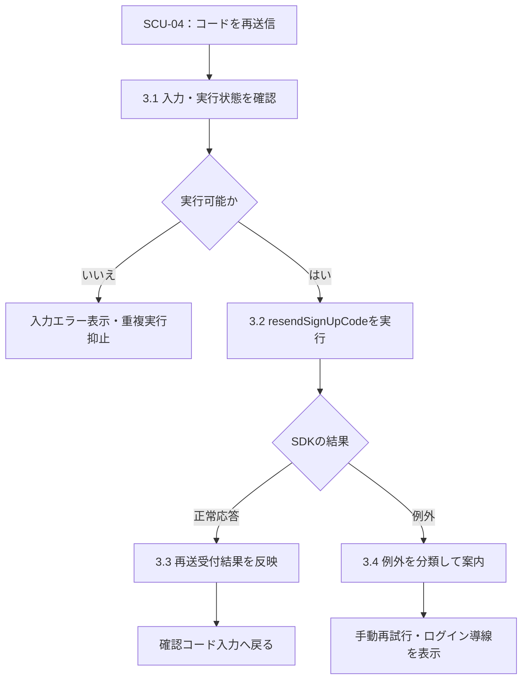

# APU001_05_会員登録確認コード再送

## 0. 処理フロー



## 1. 基本情報

| 項目 | 内容 |
| --- | --- |
| 機能ID | APU001_05 |
| 論理名 | 会員登録確認コード再送 |
| 物理名 | resend-user-confirmation-code |
| 呼出元 | SCU-04の確認コード入力エリア |
| 実装箇所 | フロントエンドJavaScript |
| 使用SDK | aws-amplify/auth の resendSignUpCode |
| ECSのURL・Controller・Business | なし |
| API GatewayのJWT認証 | 対象外。SDKからCognitoへ直接要求 |
| Cognito設定 | 会員用プール・標準確認メール・コード方式。クライアントシークレットなし |
| DB処理 | なし |
| 後続 | APU001_04でコード検証。確認後はSCU-03でログイン |
| 自動実行 | 画面表示・リロードでは実行しない。利用者の再送操作時のみ実行 |

本機能はフロントエンド処理の設計書。ECS用共通機能、HTTP 200の共通レスポンス形式は使用しない。

## 2. 入力項目・リクエスト例

| 項目 | 型 | 必須 | 用途 |
| --- | --- | --- | --- |
| email | string | 必須 | 登録したメールアドレス。SDKのusernameに設定 |
| returnTo | string | 任意 | 後続のログインに引き継ぐ戻り先。SDKには送信しない |

- emailは登録時の値を保持する。失われた場合は再入力する。
- マスク済み送信先表示をusernameに使用しない。
- パスワード、確認コード、会員ID、アクセストークンは不要。
- メールアドレス変更処理ではない。別のメールアドレスを入力しても、登録済みアカウントの配送先メールは変更されない。

SDKへ渡すJSON例：

```json
{
  "username": "user@example.com"
}
```

呼び出し例：

```javascript
import { resendSignUpCode } from "aws-amplify/auth";

const result = await resendSignUpCode({
  username: email
});
```

## 3. 処理詳細 — フロントエンドJavaScript

### 3.1 入力・実行状態を確認

| 順序 | 対象 | 判定・処理 | NG時 |
| --- | --- | --- | --- |
| 1 | 実行状態 | 再送・確認コード検証が通信中でない | 新しい要求を開始しない |
| 2 | email | 前後の空白を除去し、空文字でない | 「メールアドレスを入力してください。」 |
| 3 | email | メール形式、128文字以内。登録フォームと同じ検証を使用 | 「有効なメールアドレスを入力してください。」 |
| 4 | SDKのusername | 3で検証したメールを変更せず使用する | — |
| 5 | returnTo | 同一サイト内の許可された戻り先 | 不正値を破棄しSCU-01を設定 |

- 入力エラー時はSDKを呼ばず、該当項目付近に文言を表示する。
- メールアドレスが登録済みか、確認済みか、再送可能かはCognitoが判定する。RDS検索は行わない。
- 再送ボタンはtype="button"とし、確認コード入力中のEnterで誤って再送しない。

メールをUsernameに使う全操作で上限128文字とする。超過は切り詰めず送信前に入力エラーとする。

### 3.2 resendSignUpCodeを実行

| 順序 | 処理 |
| --- | --- |
| 1 | 今回送信するemailを確定し、画面操作の世代番号を保持 |
| 2 | 入力欄・再送ボタン・確認ボタン・通常の画面遷移を通信中のみ抑止 |
| 3 | 再送ボタンを「再送信中…」に変更 |
| 4 | 2章の引数でresendSignUpCodeを1回呼び出す |
| 5 | 正常応答は3.3、例外は3.4へ進む |
| 6 | finallyで通信中状態を解除 |

- 独自の自動再送・再送ポーリングはしない。
- フロントエンドでは同時実行のみ抑止し、送信回数制限はCognitoに従う。固定の待ち秒数や送信上限を推測して表示しない。
- 画面離脱・登録対象変更後に届いた古い結果で、現在の画面を更新しない。
- 生のSDK例外、メールアドレス、コードをログに出力しない。

### 3.3 再送受付結果を反映

| 順序 | 処理 |
| --- | --- |
| 1 | SDKが正常終了したことを確認する |
| 2 | 入力中の確認コードを空欄にする |
| 3 | deliveryMediumがEMAILでdestinationが取得できた場合、返却されたマスク済み送信先をテキスト表示する |
| 4 | 「確認コードの再送を受け付けました。メールをご確認ください。届かない場合は迷惑メールフォルダーもご確認ください。」を表示 |
| 5 | 確認コード入力欄へフォーカスを移し、APU001_04の入力を待つ |

| 補助情報の状態 | 表示 |
| --- | --- |
| destination欠損 | 送信先表示のみ省略。入力値でマスク情報を補完しない |
| deliveryMedium欠損 | 配送先の補助表示を省略し、登録時の連絡先の確認を案内 |
| deliveryMediumがSMS等 | メール設定と不一致として「確認コードの送信先をご確認ください。」を表示。メールに送信したと断定しない |

- 正常応答は受信箱への到着保証ではない。
- 再送成功だけでは登録完了・ログイン成功にしない。
- RDS会員初期化・カート統合を呼び出さない。
- email・returnToは確認手続きのため保持する。

### 3.4 例外を分類して案内

例外のname等で分類する。内部の例外messageはそのまま表示しない。

| SDK例外・状態 | 画面用コード | 表示文言 | 操作 |
| --- | --- | --- | --- |
| TooManyRequestsException / LimitExceededException | RESEND_RATE_LIMITED | 確認コードの再送が制限されています。時間をおいて再度お試しください。 | 時間をおいて手動再送 |
| CodeDeliveryFailureException | RESEND_DELIVERY_FAILED | 確認コードを送信できませんでした。時間をおいて再度お試しください。 | 手動再送 |
| UserNotFoundException / NotAuthorizedException / InvalidParameterException | RESEND_UNAVAILABLE | このメールアドレスでは登録を進められません。入力内容をご確認いただくか、ログイン画面をご利用ください。 | 入力確認・SCU-03 |
| 通信切断・タイムアウト | RESEND_RESULT_UNKNOWN | 再送結果を確認できませんでした。メールが届いている場合はコードを入力してください。届かない場合は時間をおいて再送してください。 | コード検証・手動再送 |
| その他のSDK例外・設定不備・内部障害 | RESEND_FAILED | 確認コードの再送に失敗しました。時間をおいて再度お試しください。 | 手動再送・SCU-03 |

- 登録済み／未登録／確認済みを例外文言から推測しない。確認済みと確定できない場合は自動ログインさせない。
- 結果不明を送信失敗確定と扱わない。確認コード検証の操作を再開できるようにする。
- エラー時はemail・returnToと入力中の確認コードを保持する。確認コードは画面メモリ内のみとし、再送成功時は消去する。
- 画面用コードは本書のJavaScript内部分類。既存エラー一覧へ統合する際に名称を合わせる。

## 4. データ更新・復旧

| 対象 | 本機能の処理 | 復旧方法 |
| --- | --- | --- |
| Cognito | 確認メールの再送を要求 | 結果不明時は受信確認。届いたコードをAPU001_04で検証し、未着の場合は手動再送 |
| RDS users・カート・注文 | 操作なし | ロールバック・補償処理なし |
| 再送制限 | Cognitoの例外に従う | 自動ループせず待って再試行 |
| 再読み込み | 自動再送しない | 登録メールを復元できなければ再入力 |
| 再送後の画面更新失敗 | 再送を取り消せない | 受信メールを確認し、確認画面から再開 |
| 既に登録確認済みの可能性 | アカウントを削除・再登録しない | SCU-03でログインを試す |

DBトランザクション、ロック、操作履歴、べき等キーは使用しない。再送は追加のメール送信を発生させ得るため、単なる読み取りとして自動再試行しない。

## 5. 確認ケース・参照資料

| ケース | 期待結果 |
| --- | --- |
| 有効な登録メール | 再送受付案内、コード欄クリア、確認入力へ |
| 空欄・メール形式不正 | SDK呼び出しなし、項目エラー |
| usernameが128文字超 | 切り詰めずエラー表示 |
| 再送ボタン連打・確認処理中 | 同時要求を開始しない |
| 送信回数制限 | 制限案内、自動再送なし |
| 通信切断 | 到着を断定せず、受信確認・手動再送を案内 |
| マスク済み送信先欠損 | 例外にせず補助表示を省略 |
| 未登録・確認済みの可能性 | 汎用案内とログイン導線 |
| 成功後 | Cognito確認状態・ログイン状態を画面で勝手に変更しない。RDS操作なし |

参照（2026-11-15確認）：

- 機能一覧：00A_全機能一覧／APU001_05。
- [Amplify Auth：v6の再送API・入出力](https://docs.amplify.aws/gen1/javascript/build-a-backend/auth/auth-migration-guide/)
- [Cognito：ResendConfirmationCode](https://docs.aws.amazon.com/cognito-user-identity-pools/latest/APIReference/API_ResendConfirmationCode.html)

## 6. 返却項目

### 6.1 SDK応答

| 項目 | 型 | 用途 |
| --- | --- | --- |
| destination | string（欠損に備える） | マスク済みの送信先表示 |
| deliveryMedium | string（欠損に備える） | EMAIL等の送信方式判定 |
| attributeName | string（欠損に備える） | email等の対象属性。通常画面には表示しない |
| 例外のname等 | string | 3.4の分類 |

SDKの正常応答例：

```json
{
  "destination": "u***@e***.com",
  "deliveryMedium": "EMAIL",
  "attributeName": "email"
}
```

### 6.2 JavaScript内の画面用結果

HTTPレスポンスではない。戻り先は呼出元の画面状態で保持する。

| 項目 | 型 | 内容 |
| --- | --- | --- |
| status | string | ACCEPTED / ERROR / UNKNOWN |
| errorCode | stringまたはnull | 正常時null。入力エラーはVALIDATION_ERROR、例外は3.4 |
| message | string | 利用者向け文言 |
| destination | stringまたはnull | 正常応答のマスク済みメール送信先。欠損・非EMAIL・エラー時null |
| fieldErrors | array | 入力不正時にfield・messageを設定。それ以外は空配列 |

正常例：

```json
{
  "status": "ACCEPTED",
  "errorCode": null,
  "message": "確認コードの再送を受け付けました。メールをご確認ください。届かない場合は迷惑メールフォルダーもご確認ください。",
  "destination": "u***@e***.com",
  "fieldErrors": []
}
```

例外例：

```json
{
  "status": "ERROR",
  "errorCode": "RESEND_RATE_LIMITED",
  "message": "確認コードの再送が制限されています。時間をおいて再度お試しください。",
  "destination": null,
  "fieldErrors": []
}
```

結果不明例：

```json
{
  "status": "UNKNOWN",
  "errorCode": "RESEND_RESULT_UNKNOWN",
  "message": "再送結果を確認できませんでした。メールが届いている場合はコードを入力してください。届かない場合は時間をおいて再送してください。",
  "destination": null,
  "fieldErrors": []
}
```

