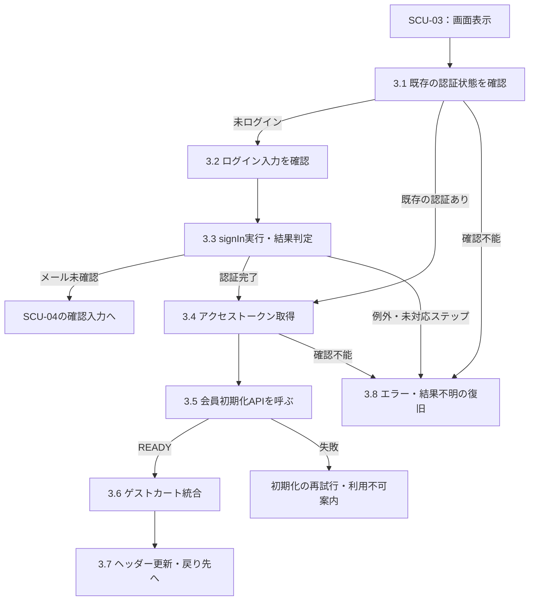

# APU001_06_会員ログイン

## 0. 処理フロー



## 1. 基本情報

| 項目 | 内容 |
| --- | --- |
| 機能ID | APU001_06 |
| 論理名 | 会員ログイン |
| 物理名 | login-user |
| 実装箇所 | フロントエンドJavaScript |
| 呼出元 | SCU-03（ユーザーログイン画面） |
| SDK | aws-amplify/auth：signIn、fetchAuthSession |
| 独自ログインAPI・Controller・Business | 作成しない |
| 認証 | 会員用Cognitoプール・シークレットなしのアプリクライアント |
| 認証方式 | メールアドレス＋パスワード。USER_SRP_AUTHを使用できる設定とする |
| 後続API | APU001_01（会員初期化）、APU003_05（カート統合）、必要時APU003_01（カート取得） |
| ログイン期間 | Cognitoのトークン有効期限・Amplifyの更新処理に従う。独自12時間タイマーやDBセッションを作らない |
| DB操作 | 本JavaScriptからは行わない。後続ECS APIが担当 |
| 対象外 | MFA・パスワード再設定・仮パスワード変更の専用UI |

**認証成功と、アプリの会員利用準備完了は別に管理する。** Cognito認証成功後も、APU001_01がREADYを返すまでは会員専用機能を開始しない。

会員用・管理者用のAmplify設定とアプリ側キャッシュは分離する。本機能で管理者側の認証情報を変更しない。ECS共通機能COM001系の内部処理は後続APIの設計書に委ねる。

## 2. 入力・リクエスト

### 2.1 入力項目

| 項目 | 型 | 必須 | 用途 |
| --- | --- | --- | --- |
| email | string | 必須 | ログインID。SDKのusernameに設定 |
| password | string | 必須 | パスワード。加工せずSDKに渡す |
| returnTo | string | 任意 | ログイン後の遷移先。SDKへ送信しない |

### 2.2 signInへのJSON例

```json
{
  "username": "user@example.com",
  "password": "SamplePassword123!",
  "options": {
    "authFlowType": "USER_SRP_AUTH"
  }
}
```

```javascript
import { signIn, fetchAuthSession } from "aws-amplify/auth";

const result = await signIn({
  username: email,
  password,
  options: { authFlowType: "USER_SRP_AUTH" }
});
// 3.3で完了を確認してから実行する。
const session = await fetchAuthSession();
const accessToken = session.tokens?.accessToken?.toString();
```

これはSDKへの引数例。メール・パスワードをECSへ送信しない。トークンはアプリ独自のlocalStorageやCookieへ複製せず、Amplifyの管理に委ねる。

### 2.3 認証後の会員初期化リクエスト

```http
POST /api/v1/users/initialize
Authorization: Bearer <会員アクセストークン>
Content-Type: application/json

{}
```

- IDトークンではなくアクセストークンを使用する。
- 本文にメール・氏名・sub・会員IDを入れない。
- カート統合のリクエスト項目・操作識別情報はAPU003_05で定義する。本書で未確定のJSON項目を追加しない。

## 3. 処理詳細 — フロントエンドJavaScript

### 3.1 既存の認証状態を確認

SCU-03の初回表示時にfetchAuthSessionを呼ぶ。

| 結果 | 処理 |
| --- | --- |
| アクセストークン取得可 | signInを再実行せず3.4〜3.5へ |
| 正常終了したがtokensなし、または明確な未認証 | ログインフォームを表示 |
| 通信・設定エラー等 | 未ログインと断定せず「ログイン状態を確認できませんでした。」と「再確認」 |

- 確認中はアカウント情報を表示しない。
- 別会員のキャッシュを再利用しない。認証主体の変更時は以前の会員表示・注文情報を破棄する。
- 既存セッションありの場合、入力されたメールで別会員へ切り替わったと扱わない。切替が必要なら先にログアウトを案内する。

### 3.2 ログイン入力を確認

| 順序 | 対象 | 処理・正常条件 | NG時 |
| --- | --- | --- | --- |
| 1 | 実行状態 | ログイン・初期化・ログアウト中でない | 重複送信しない |
| 2 | Enter | IME変換確定中でない | 送信しない |
| 3 | email | 前後空白を除去。空欄でない | 「メールアドレスを入力してください。」 |
| 4 | email | メール形式・254文字以内。大文字小文字を変更しない | 「有効なメールアドレスを入力してください。」 |
| 5 | password | 空文字・空白のみでない | 「パスワードを入力してください。」 |
| 6 | returnTo | 同一サイト内の許可されたユーザー画面 | 不正値・未指定はSCU-01 |

- パスワードをトリムしない。登録時の16〜30文字・文字種ポリシーはログイン時に再適用せず、認証はCognitoに委ねる。
- 管理者領域、外部URL、SCU-03自身・SCU-04・SCU-10は戻り先にしない。
- 商品ID・注文ID等を含む戻り先は許可されたルート形式を検証する。文字列が「/」で始まるだけでは許可しない。
- 入力エラー時はSDKを呼ばず最初のエラー欄へフォーカスする。

### 3.3 signIn実行・結果判定

1. 入力欄、表示切替、ログインボタン、通常の遷移を通信中のみ抑止し「ログイン処理中…」を表示する。
2. 2.2の引数でsignInを1回呼び出す。
3. 下表で分岐し、応答取得後はパスワード欄を消去して伏字に戻す。

| 結果 | 処理 |
| --- | --- |
| isSignedIn=true、nextStep.signInStep=DONE | 3.4へ |
| CONFIRM_SIGN_UP、またはUserNotConfirmedException | email・有効なreturnToのみSCU-04の確認入力へ渡す。APU001_04／05を利用 |
| RESET_PASSWORD、PasswordResetRequiredException | 「パスワードの再設定が必要です。現在、このサイトでは再設定を受け付けていません。」と表示して停止 |
| MFA・仮パスワード変更等、その他の追加ステップ | 「追加の認証手続きが必要です。現在、このサイトでは対応していません。」と表示して停止 |
| 完了フラグとステップの不整合・欠損 | 成功とせず、3.8の認証状態再確認へ |
| SDK例外 | 3.8へ |

メール未確認時も確認メールを無条件に自動再送しない。ユーザーがSCU-04で再送を選んだ場合だけAPU001_05を実行する。

確認・再送APIのusernameは128文字上限のため、129〜254文字のメールで未確認となった場合はSCU-04で再開できない場合がある。APU001_05に記載した識別子設計の整合事項を引き継ぎ、文字列を切り詰めない。

### 3.4 アクセストークン取得

| 項目 | 処理 |
| --- | --- |
| 呼出 | fetchAuthSession() |
| 正常条件 | tokens.accessTokenが存在し文字列化できる |
| 正常時 | 認証状態を「認証済み・会員準備中」にして3.5へ |
| tokensなし | 会員APIを呼ばず再ログインを案内 |
| 通信失敗 | 認証状態を未確定として再確認操作を表示 |

- SDKは更新可能な期限切れトークンを更新する。毎回forceRefreshを指定しない。
- JWTの正当性・権限はAPI GatewayとECS共通受付が判定する。画面側の判定で代替しない。
- 各後続APIの送信前にも現在の会員用トークンを取得する。途中で会員切替・ログアウトが起きたら後続処理を停止する。

### 3.5 会員初期化APIを呼ぶ

**機能使用：APU001_01 会員初期化・会員情報取得**

| 項目 | 内容 |
| --- | --- |
| 呼出位置 | SCU-03のログイン処理内。認証完了後、画面遷移前 |
| URL | POST /api/v1/users/initialize |
| ボディ | {} |
| 正常条件 | HTTP成功、JSON形式が正常、error=null、data.initializationStatus=READY、user情報あり |
| 正常時 | 返却された会員情報を保持して3.6へ |
| 通信失敗・SERVICE_UNAVAILABLE等 | 認証を維持し、初期化のみ再試行できるようにする |
| ACCOUNT_DISABLED等の利用不可 | 会員機能・カート統合へ進めず、APIの利用者向けエラーとログアウト導線を表示 |
| Gatewayの401・明確な認証無効 | 再ログインを案内。業務APIを繰り返さない |

初期化失敗時は「ログインは完了しましたが、会員情報の準備ができませんでした。」を表示する。再試行時は3.4から再開し、signInを再実行しない。

HTTP 200だけで成功にしない。errorが非nullなら失敗。JSON不正・必須項目欠損もREADYとして扱わない。Gatewayやネットワークが返す非200・非JSONにも対応する。

### 3.6 ゲストカート統合

**機能使用：APU003_05 ゲストカート統合（初回・再試行）**

| 順序 | 処理 |
| --- | --- |
| 1 | READY確認後、会員JWTとブラウザのゲスト識別Cookieを伴って統合APIを呼ぶ |
| 2 | ゲストCookieはHttpOnlyを前提とし、JavaScriptで読み取って本文へ転記しない |
| 3 | 統合APIが返す統合結果・調整情報・最新数量を反映 |
| 4 | 統合失敗・結果不明でも認証と会員情報は維持し、3.7へ |

- CookieがJavaScriptから見えないことを理由に統合を省略しない。統合元なし・期限切れ・統合済みはAPU003_05が判定する。
- 同一オリジン経由を基本とする。クロスオリジンの場合はCookie送信・CORS設定をAPI共通仕様に合わせる。
- Origin／CSRF対策、操作識別情報、再送時の二重加算防止はAPU003_05に従う。
- 統合失敗時はC11「ログイン前のカート情報の引き継ぎが完了していません。再試行してください。」とSCU-06への導線を表示する。
- 統合元CookieをJavaScriptで削除しない。成功確定後の解除は統合APIが担当する。
- 統合APIの詳細設計では「統合元なし」を正常終了として返せる契約を確定する。本書では未確定の結果コードやリクエスト項目を固定しない。

### 3.7 ヘッダー更新・戻り先へ

| 項目 | 処理 |
| --- | --- |
| 会員表示 | APU001_01の氏名から「氏名様」をテキスト表示 |
| アカウントメニュー | マイページ・ログアウトへ切り替える |
| カートバッジ | 統合応答の最新数量を使用。未取得ならAPU003_01で会員カートを取得 |
| 数量取得失敗 | 数量不明にする。0と断定しない。ログイン成功は維持 |
| 通常遷移 | 有効なreturnTo、なければSCU-01へ履歴置換 |
| 統合未完了かつ戻り先がSCU-07 | 注文へ進めずSCU-06へ案内し、統合再試行を表示 |
| 統合時の数量調整・除外 | 共通通知またはSCU-06で内容を表示 |

初期化や統合の応答待ち中にログアウト・会員切替があった場合、古い氏名・カート数量でヘッダーを上書きしない。処理開始時の認証主体・世代番号を照合する。

### 3.8 エラー・結果不明の復旧

| 発生箇所・条件 | 画面処理 | 再開位置 |
| --- | --- | --- |
| signIn：NotAuthorizedException／UserNotFoundException | 「メールアドレスまたはパスワードが正しくありません。」 | 入力から再実行 |
| signIn：TooManyRequestsException／LimitExceededException | 「ログインが制限されています。時間をおいて再度お試しください。」 | 時間をおいて入力から |
| signIn：通信切断・タイムアウト／既存ログインを示す例外 | 自動でsignInを再送せずfetchAuthSessionで現在の状態を確認 | 下記分岐 |
| SDK設定不備・その他の例外 | 「ログイン処理に失敗しました。時間をおいて再度お試しください。」 | 手動再試行 |
| 初期化の一時失敗 | 認証を維持して準備失敗を表示 | 3.4 |
| 統合失敗・結果不明 | 認証を維持してC11表示 | SCU-06の統合再試行 |
| カート数量取得失敗 | 共通ヘッダーの取得失敗表示 | 数量取得のみ |

認証状態を再確認した結果：

- トークンあり：現在の認証主体の処理として3.5へ。別アカウントの既存セッションの場合、入力したメールでログインできたとは表示しない。
- 明確な未認証：パスワードを消去してログイン入力を再開する。
- 通信等で確認不能：「ログイン結果を確認できませんでした。ログイン状態を再確認してください。」と「再確認」を表示する。

全終了経路でパスワードを入力欄・アプリの一時保持から除去し、finallyで操作抑止を解除する。SDK内の管理領域を独自操作しない。パスワード・トークン・生の例外をログやURLへ出力しない。

## 4. データ更新・復旧の担当

| 対象 | 更新担当 | 失敗・結果不明時 |
| --- | --- | --- |
| 認証情報 | Amplify／Cognito | fetchAuthSessionで再確認。DBセッションを作らない |
| usersの初期化 | APU001_01 | 同じ認証主体でAPIを再試行。一意制約による復旧に従う |
| ゲストカート統合 | APU003_05 | 同じ統合手続きの再試行。フロントで数量を加算し直さない |
| ヘッダー表示 | 本機能・CMN-01 | 同一会員の最新結果で更新。取得失敗を空データにしない |

認証・会員初期化・カート統合を単一のDBトランザクションで囲まない。後続失敗を理由にCognitoアカウントや作成済みusersを削除しない。

## 5. 確認ケース・参照

| ケース | 期待結果 |
| --- | --- |
| 初回ログイン | signIn→初期化READY→統合→戻り先 |
| 既存セッション | signInを再送せず初期化へ |
| メール未確認 | SCU-04へ。初期化・統合は未実行 |
| 追加認証が必要 | 成功扱いせず案内 |
| 初期化がHTTP 200＋error | 成功扱いせず初期化再試行 |
| 初期化の応答消失 | 同じ主体で再試行。会員削除なし |
| 統合失敗 | ログイン維持、C11、注文への進行抑止 |
| 外部URLのreturnTo | SCU-01へ |
| 別タブのログアウト | 後着応答を破棄 |
| 管理者が別途ログイン中 | 管理者側の認証情報を変更しない |

参照（2026-11-15確認）：

- 機能一覧：APU001_06、APU001_01、APU003_01、APU003_05。
- APU001_01_initialize-user.md（第10版）、APU001_04／05。
- [Amplify Auth：Sign-in](https://docs.amplify.aws/javascript/frontend/auth/sign-in/)
- [Amplify Auth：Manage user sessions](https://docs.amplify.aws/javascript/frontend/auth/manage-user-sessions/)

## 6. 返却項目

### 6.1 SDKからの結果

| 項目 | 型 | 用途 |
| --- | --- | --- |
| isSignedIn | boolean | signIn完了フラグ |
| nextStep.signInStep | string | DONE・CONFIRM_SIGN_UP等の分岐 |
| fetchAuthSessionのtokens.accessToken | SDKのトークンオブジェクト | 後続APIのAuthorizationに使用 |
| SDK例外のname等 | string | エラー分類 |

signInの正常結果例：

```json
{
  "isSignedIn": true,
  "nextStep": {
    "signInStep": "DONE"
  }
}
```

### 6.2 後続APIから使う項目

| API | 使用項目 |
| --- | --- |
| APU001_01 | requestId、data.initializationStatus、会員情報、error |
| APU003_05 | 統合の成否・未完了・対象なし等の結果、調整内容、最新数量、エラー。物理項目は当該API設計に従う |
| APU003_01 | 保存済み全明細の合計数量、取得結果 |

### 6.3 JavaScript内の画面用結果

HTTPレスポンスではない。本機能の画面制御用の結果とする。

| 項目 | 型 | 内容 |
| --- | --- | --- |
| status | string | READY／CONFIRMATION_REQUIRED／MEMBER_PREPARATION_FAILED／SIGN_IN_INCOMPLETE／ERROR／UNKNOWN |
| message | stringまたはnull | 利用者向け案内 |
| nextScreen | stringまたはnull | 遷移先。パスへの変換は検証済みルート情報を使用 |
| cartMergeStatus | string | COMPLETED／NOT_REQUIRED／INCOMPLETE／NOT_STARTED |
| fieldErrors | array | 入力不正時のfield・message。通常は空配列 |

正常例：

```json
{
  "status": "READY",
  "message": null,
  "nextScreen": "SCU-01",
  "cartMergeStatus": "COMPLETED",
  "fieldErrors": []
}
```

会員初期化失敗例：

```json
{
  "status": "MEMBER_PREPARATION_FAILED",
  "message": "ログインは完了しましたが、会員情報の準備ができませんでした。",
  "nextScreen": null,
  "cartMergeStatus": "NOT_STARTED",
  "fieldErrors": []
}
```

認証・会員初期化は成功、統合だけ失敗した例：

```json
{
  "status": "READY",
  "message": "ログイン前のカート情報の引き継ぎが完了していません。再試行してください。",
  "nextScreen": "SCU-06",
  "cartMergeStatus": "INCOMPLETE",
  "fieldErrors": []
}
```

READYは会員情報の準備完了を示し、注文可能を保証しない。注文可否はカート統合状態と注文前検証で判定する。

