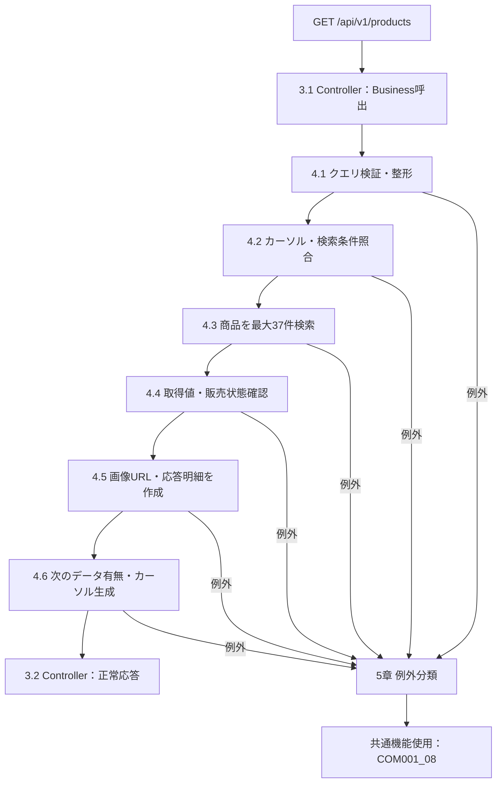

# APU002_01_公開商品一覧取得・キーワード検索・追加取得

## 0. 処理フロー



## 1. 基本情報

| 項目 | 内容 |
| --- | --- |
| 機能ID | APU002_01（旧API-U07） |
| 論理名 | 公開商品一覧取得・キーワード検索・追加取得 |
| 物理名 | list-public-products |
| HTTP・URL | GET /api/v1/products |
| Controller | PublicProductListController |
| Business | PublicProductListBusiness.execute(command) |
| Mapper | ProductMapper.selectPublicProducts |
| 呼出画面 | SCU-01 |
| 認証 | 不要。会員・ゲストで同一結果 |
| API Gateway | JWT認証なしの公開ルート |
| DB処理 | productsのSELECTのみ |
| 取得順 | 商品ID降順 |
| 取得件数 | 応答は最大36件固定。次ページ判定用にDBから最大37件取得 |
| 対象外 | 会員初期化、カート数量、在庫確保、商品詳細説明、カテゴリ・価格絞り込み |
| HTTP応答 | 正常・ECSで捕捉できるエラーとも200。errorの有無で判定 |

本書で定める実装案：クエリ名keyword／cursor、署名付きカーソル、初回発行から30分の有効期限、大小文字を区別する部分一致。既存の確定事項を補う設計値とし、他APIの方式を変更しない。

## 2. リクエスト・内部入力

### 2.1 リクエスト項目

| 場所 | 項目 | 必須 | 条件 |
| --- | --- | --- | --- |
| クエリ | keyword | 任意 | 前後空白除去後0〜50 Unicodeコードポイント。未指定・空欄は条件なし |
| クエリ | cursor | 任意 | 初回は未指定。追加取得では前回成功応答のnextCursorをそのまま指定 |
| ボディ | なし | — | {}・nullを含め、ボディを送信しない |
| ヘッダー | Authorization | 不要 | 本APIでは会員識別に使用しない |
| Cookie | すべて | 不要 | 本APIでは参照・発行・変更しない |

limit・page・offset・sort等の未定義クエリは受け付けない。同名クエリの複数指定も拒否する。

### 2.2 呼出例

```http
GET /api/v1/products
```

```http
GET /api/v1/products?keyword=coffee
```

```http
GET /api/v1/products?keyword=coffee&cursor=<前回のnextCursor>
```

クエリ値はURLエンコードする。**リクエストJSONはない。** 例えば以下は仕様説明用の値であり、HTTPボディとして送信しない。

```json
{
  "keyword": "coffee",
  "cursor": null
}
```

### 2.3 Controllerへの入力

**共通機能使用：COM001_01 要求コンテキスト、COM001_10 HTTP共通受付（ボディなし方式）。**

| 項目 | 型 | 用途 |
| --- | --- | --- |
| requestId | String | 追跡・共通応答 |
| query | Map<String, List<String>> | デコード済みの全クエリ値。Businessへ渡す |

COM001_02の認証必須チェック、COM001_04〜06の会員検索・判定・Cognito属性取得は使用しない。公開ルートとして認証必須処理の対象から外す。

## 3. Controllerの処理

### 3.1 Business呼出

| 順序 | 処理 |
| --- | --- |
| 1 | 共通受付済みqueryをListPublicProductsCommandへ設定 |
| 2 | PublicProductListBusiness.execute(command)を1回呼ぶ |
| 3 | 正常時は3.2へ。例外はCOM001_08へ伝播 |

Controllerに@Validを付けず、単項目・項目間チェックはBusinessで行う。Controller内でDB検索、税計算、カーソル検証を実行しない。

### 3.2 正常応答

結果DTOを親Controllerの正常応答メソッドへ渡す。

**共通機能使用：COM001_07 共通レスポンス生成（親Controller経由）。**

0件も正常応答。7章のdataを返し、画面文言の選択はフロントエンドに委ねる。

## 4. Businessの処理

### 4.1 クエリ検証・整形

| 順序 | 対象 | チェック・整形 | NG時 |
| --- | --- | --- | --- |
| 1 | クエリ名 | keyword・cursorのみ | INVALID_REQUEST |
| 2 | 各キーの値数 | 指定時はちょうど1個。複数値を結合・先頭採用しない | INVALID_REQUEST |
| 3 | keyword | 未指定は空文字。String.strip()で前後空白除去 | — |
| 4 | keyword | 不正サロゲート・U+0000を含まない | VALIDATION_ERROR |
| 5 | keyword | codePointCountで50以下 | VALIDATION_ERROR |
| 6 | cursor | 未指定はnull。指定時は空文字不可・2048文字以内・トリムしない | CURSOR_INVALID |
| 7 | cursor | Base64url文字列2個を「.」で連結した形式。パディング「=」不可 | CURSOR_INVALID |

- 空白だけのkeywordは条件なし。検索語内部の空白は保持し、複数キーワードへ分割しない。
- URLデコードは共通受付済み。再度デコードしない。
- 大小文字、全角半角、ひらがな・カタカナ、Unicode正規化による同一視は行わない。
- keywordはコードポイント数で判定するため、UTF-16単位の@Size(max=50)では代替しない。
- cursorの長さ・形式はDTOの@Size・@PatternをBusinessからValidatorで検証できる。その違反は本BusinessでCURSOR_INVALIDへ変換する。COM001_03は使用しない。
- 入力エラー時はDB検索しない。keyword超過のfieldErrorsには「検索キーワードは50文字以内で入力してください。」を設定する。

### 4.2 カーソル・検索条件照合

**共通機能使用：COM001_12。** scope=APU002_01、条件・主体＝正規化済みkeyword。未指定は先頭。指定時はdecodeで検証した商品IDだけをSQLの境界に使う。権限・所有者は毎回別途確認。

次ページがある場合のみ、返した最後の行からencode。追加取得時は初回の期限を引き継ぎ返却直前に再確認する。旧形式・不一致・期限切れはCURSOR_INVALID、fieldErrors=[]。

### 4.3 商品を最大37件検索

| 項目 | 条件 |
| --- | --- |
| テーブル | products |
| 必須条件 | is_deleted=false AND publish_status='PUBLIC' |
| 販売・在庫条件 | WHEREに追加しない。販売停止・在庫0も取得 |
| 検索対象 | nameまたはsummaryの部分一致 |
| 検索方式 | LIKE、明示的なC照合順序で大小文字を区別 |
| 追加取得 | id < lastId |
| 並び順 | id DESC |
| DB取得上限 | 37 |
| ロック | FOR UPDATEなし |
| 件数カウント | COUNT(*)を実行しない |

| 取得カラム | Java型 | 用途 |
| --- | --- | --- |
| id | Long | 商品識別・継続位置 |
| name | String | 商品名 |
| summary | String／null | 商品概要 |
| price_including_tax | Integer | 税込単価 |
| stock_quantity | Integer | 在庫数 |
| sales_status | String | 販売可能判定 |
| image_s3_key | String／null | 画像URL作成 |

検索パターンはkeyword内の「!」→「!!」、「%」→「!%」、「_」→「!_」の順で置換し、前後に「%」を付ける。入力の%・_はワイルドカードとして使わせない。

MyBatisの検索例：

```xml
<select id="selectPublicProducts" resultType="PublicProductRow">
  SELECT id, name, summary, price_including_tax,
         stock_quantity, sales_status, image_s3_key
  FROM products
  WHERE is_deleted = FALSE
    AND publish_status = 'PUBLIC'
  <if test="keyword != ''">
    AND (
      name COLLATE "C" LIKE #{likePattern} ESCAPE '!'
      OR summary COLLATE "C" LIKE #{likePattern} ESCAPE '!'
    )
  </if>
  <if test="lastId != null">
    AND id &lt; #{lastId}
  </if>
  ORDER BY id DESC
  LIMIT 37
</select>
```

- ResultMapまたはMyBatis設定でsnake_caseをJava項目へ対応付ける。SQLの値はすべてバインドする。
- summaryがNULLでも、nameが一致すれば取得する。
- Mapperのクエリタイムアウトは初期値5秒とし設定化する。SQL失敗時に無制限リトライしない。
- DBの既存部分インデックスidx_products_user_listを利用可能にする。先頭%の検索が通常のB-treeで効率化されるとは保証しない。

### 4.4 取得値・販売状態確認

先頭36件を応答候補にする。37件目は継続有無の判定用とする。

| 項目 | 検証 | 不正時 |
| --- | --- | --- |
| id | 正のLong、重複なし、降順、指定時はlastId未満 | INTERNAL_ERROR |
| name | nullでなく1〜100コードポイント | INTERNAL_ERROR |
| summary | nullまたは200コードポイント以内 | INTERNAL_ERROR |
| price_including_tax | 1以上のInteger | INTERNAL_ERROR |
| stock_quantity | 0〜99999のInteger | INTERNAL_ERROR |
| sales_status | ON_SALEまたはSUSPENDED | INTERNAL_ERROR |

一覧データの不正を0円・0在庫に補完しない。本APIでは不正な明細を黙って除外せず全体エラーとする。応答用に商品の文字列をトリム・省略しない。

| 優先順 | 使用するDB項目 | 判定条件 | availability | stockQuantity（返却値） |
| --- | --- | --- | --- | --- |
| 1 | products.sales_status | sales_status = 'SUSPENDED' | UNAVAILABLE | null |
| 2 | products.sales_status、products.stock_quantity | sales_status = 'ON_SALE' AND stock_quantity = 0 | SOLD_OUT | 0 |
| 3 | products.sales_status、products.stock_quantity | sales_status = 'ON_SALE' AND stock_quantity BETWEEN 1 AND 10 | AVAILABLE | stock_quantityの実数 |
| 4 | products.sales_status、products.stock_quantity | sales_status = 'ON_SALE' AND stock_quantity >= 11 | AVAILABLE | null |

products.publish_status = 'PUBLIC'、products.is_deleted = FALSEは前段のSQLで絞り込み済み。上表はDBから取得した実在庫で判定し、返却用のstockQuantityへ変換してから判定しない。

stockQuantityのnullは数量非公開を表す。DB在庫が欠損・不正な場合は従来どおりINTERNAL_ERRORとし、正常な数量非公開へ置き換えない。availabilityは取得時点の状態であり、追加成功・在庫確保は保証しない。カート追加APIで最新のDB値を再検証する。

canAddToCartはDB列ではない。公開・未削除の商品でsales_status=ON_SALEかつstock_quantity>=1ならtrue。それ以外はfalse。追加時は再検証する。

### 4.5 画像URL・応答明細を作成

| 対象 | 処理 |
| --- | --- |
| 税込価格 | DBのprice_including_taxをそのまま返す。税抜価格・税率の再計算を行わない |
| 商品ID | Longを10進文字列へ変換 |
| stockQuantity | 4.4の判定結果。0〜10またはnull |
| canAddToCart | boolean。availabilityがAVAILABLEのときのみtrue |
| availability | 4.4の判定結果。canAddToCartは同じ判定から導出 |
| 商品名・概要 | 全文を返す。画面の20文字・30文字省略はフロントエンド担当 |
| image_s3_key=NULLまたは空文字 | imageUrl=null |
| image_s3_keyあり | 設定済みの画像配信ベースURLとキーからHTTPS URLを作成 |

画像URLの組立条件：

1. 配信元はサーバー設定のHTTPSベースURLのみ。商品データやリクエストからホストを指定させない。
2. キーの各パス要素をUTF-8パーセントエンコードし、「/」で連結する。空白を「+」へ変換するフォーム用エンコードを流用しない。
3. 先頭/、空要素、.・..要素、制御文字・不正Unicodeを含むキーは画像不正としてimageUrl=null。商品全体は返す。
4. S3のHEAD／GETを商品ごとに呼ばない。実ファイル不存在・画像取得失敗はフロントエンドのNo Image表示で扱う。

既存DBはURLでなくS3キーを保持しているため、配信ベースURLの環境設定が必要。画像を閲覧できる配信経路を事前に構成する。本設計は安定した配信URL方式であり、都度署名付きURLが必要な構成の場合はこの節を変更する。ベースURLの設定欠落は起動時に検出する。

### 4.6 次のデータ有無・カーソル生成

| DB取得件数 | items | hasNext | nextCursor |
| --- | --- | --- | --- |
| 0件 | [] | false | null |
| 1〜36件 | 取得した全明細 | false | null |
| 37件 | 先頭36件 | true | 新しいカーソル |

hasNext=trueの場合：

1. lastIdに**返却する36件目**のIDを設定する。37件目のIDは使わない。
2. queryHashに正規化済み検索語のハッシュを設定する。
3. 初回はexp=現在UTC Unix秒+1800、追加取得は受信カーソルのexpを引き継ぐ。有効期限を延長しない。
4. v・scope・lastId・queryHash・expをJSON化し、UTF-8→Base64url（パディングなし）へ変換する。
5. そのBase64url文字列のASCIIバイト列をHMAC-SHA256で署名し、署名もBase64url化する。
6. 「ペイロード.署名」をnextCursorに設定する。

検索・応答作成完了時にカーソル期限が切れていればCURSOR_INVALIDとし、期限切れカーソルを正常応答に含めない。4.2と同じキーを使用する。

**ページ間の整合性：** 商品IDによる継続取得で、OFFSET方式の位置ずれを避ける。ただし全ページを初回時点のスナップショットにはしない。公開・削除・商品名の変更は各SELECT時点の状態に従う。既に通過したIDの新規公開や検索条件変更は後続ページに現れない場合がある。先頭再取得で反映する。同じカーソルの再試行でも在庫・価格・明細が変わり得る。

## 5. Exception発生時・復旧

**共通機能使用：COM001_08 共通例外変換。ログ出力は同部品からCOM001_09を使用。**

| 条件 | error.code | message | fieldErrors |
| --- | --- | --- | --- |
| 未定義・重複クエリ、ボディあり | INVALID_REQUEST | リクエストの内容が正しくありません。 | [] |
| 検索語の長さ・文字不正 | VALIDATION_ERROR | 入力内容をご確認ください。 | keywordの固定文言 |
| カーソル形式・署名・期限・検索条件不一致 | CURSOR_INVALID | 続きの情報を取得できません。先頭から再読み込みしてください。 | [] |
| DB接続・タイムアウト等の一時障害 | SERVICE_UNAVAILABLE | 処理を完了できませんでした。時間をおいて再試行してください。 | [] |
| SQL定義不備・DB取得値異常・暗号処理不備・想定外例外 | INTERNAL_ERROR | 処理を完了できませんでした。 | [] |

- 不正なカーソルの各理由を外部へ細分化しない。設定不備は利用者のCURSOR_INVALIDにしない。
- SQL例外・検索語・カーソル・署名キーを応答やログへそのまま出さない。
- 全件0件・追加取得0件は例外ではない。RESOURCE_NOT_FOUNDを返さない。
- Gateway等で拒否された場合や通信切断では、200・共通JSONを保証しない。

| 項目 | 内容 |
| --- | --- |
| DB更新・登録・削除 | なし |
| トランザクション | 明示的な業務TXなし。単一SELECTの読取り |
| 排他ロック・在庫確保 | なし |
| データ復旧 | 更新がないためロールバック・補償削除不要 |
| 通信・DB一時失敗 | 同じkeyword・cursorで手動再取得可能 |
| カーソル失効 | keywordを保持しcursorを外して先頭再取得 |
| フロントの追加取得失敗 | 既存一覧を残し、成功するまで継続位置を進めない |

## 6. 確認ケース・参照

| ケース | 期待結果 |
| --- | --- |
| 未指定／空文字／前後空白のみ | 条件なし検索 |
| 検索語50／51コードポイント | 50は許可、51はVALIDATION_ERROR |
| %・_・!を含む検索 | 文字そのものを検索 |
| 非公開・論理削除 | 取得しない |
| 公開・販売停止／在庫0 | 取得し、購入不可状態を返す |
| 36／37件 | 36件はhasNext=false、37件は36件返却＋true |
| カーソル境界の商品が削除 | id未満の条件で続きから取得 |
| 検索条件変更・改ざん・期限切れ | CURSOR_INVALID、DB検索なし |
| 画像未設定・不正キー | imageUrl=null |
| DB障害・価格欠損 | 0件・0円にしない |
| 不要なJWT・Cookieなし | 正常に公開商品を取得できる |

参照資料（2026-11-15確認）：

- 機能一覧：00A_全機能一覧 APU002_01、09_エラーコード・メッセージ。
- DB設計書：05_products。
- アプリケーション設計・実装 共通ガイドライン：入力検証、例外、検索、読取り処理。
- COM001_10_parse-http-request.md。
- [PostgreSQL：パターン検索](https://www.postgresql.org/docs/current/functions-matching.html)
- [PostgreSQL：LIMITとORDER BY](https://www.postgresql.org/docs/current/queries-limit.html)

## 7. 返却項目

### 7.1 共通項目

| 項目 | 型・null可否 | 内容 |
| --- | --- | --- |
| requestId | string・不可 | 追跡ID |
| data | object・可 | 正常結果。失敗時null |
| error | object・可 | 正常時null |
| error.code | string | 5章のコード |
| error.message | string | 利用者向け文言 |
| error.fieldErrors | array | field・message。通常[] |

HTTP 200、Content-Type=application/json、Cache-Control=no-store。共通応答機能が設定する。

### 7.2 正常data

| 項目 | 型・null可否 | 内容 |
| --- | --- | --- |
| items | array・不可 | 最大36件。0件時[] |
| items[].productId | string・不可 | BIGINTの10進文字列 |
| items[].name | string・不可 | 商品名全文 |
| items[].summary | string・可 | 商品概要全文 |
| items[].imageUrl | string・可 | HTTPS画像URL。取得不能時null |
| items[].priceIncludingTax | number・不可 | 円単位の整数。通貨記号・カンマなし |
| items[].stockQuantity | number・可 | 0〜10。11以上・販売停止はnull（数量非公開） |
| items[].canAddToCart | boolean・不可 | availabilityがAVAILABLEのときのみtrue |
| items[].availability | string・不可 | AVAILABLE／SOLD_OUT／UNAVAILABLE |
| hasNext | boolean・不可 | 続きの有無 |
| nextCursor | string・可 | hasNext=true時のみ設定 |

正常例（全件1件）：

```json
{
  "requestId": "req-products-001",
  "data": {
    "items": [
      {
        "productId": "101",
        "name": "サンプル商品",
        "summary": "商品概要",
        "imageUrl": null,
        "priceIncludingTax": 1980,
        "stockQuantity": null,
        "canAddToCart": true,
        "availability": "AVAILABLE"
      }
    ],
    "hasNext": false,
    "nextCursor": null
  },
  "error": null
}
```

0件例：

```json
{
  "requestId": "req-products-002",
  "data": {
    "items": [],
    "hasNext": false,
    "nextCursor": null
  },
  "error": null
}
```

検索語エラー例：

```json
{
  "requestId": "req-products-003",
  "data": null,
  "error": {
    "code": "VALIDATION_ERROR",
    "message": "入力内容をご確認ください。",
    "fieldErrors": [
      {
        "field": "keyword",
        "message": "検索キーワードは50文字以内で入力してください。"
      }
    ]
  }
}
```

カーソルエラー例：

```json
{
  "requestId": "req-products-004",
  "data": null,
  "error": {
    "code": "CURSOR_INVALID",
    "message": "続きの情報を取得できません。先頭から再読み込みしてください。",
    "fieldErrors": []
  }
}
```

