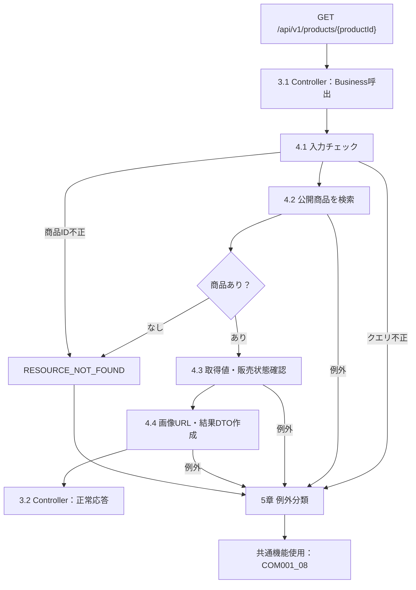

# APU002_02_公開商品詳細取得

## 0. 処理フロー



## 1. 基本情報

| 項目 | 内容 |
| --- | --- |
| 機能ID | APU002_02（旧API-U08） |
| 論理名 | 公開商品詳細取得 |
| 物理名 | get-public-product |
| HTTP・URL | GET /api/v1/products/{productId} |
| Controller | PublicProductDetailController |
| Business | PublicProductDetailBusiness.execute(command) |
| Mapper | ProductMapper.selectPublicProductById |
| 呼出画面 | SCU-02（商品詳細） |
| 認証 | 不要。会員・ゲストで同じ公開情報を返す |
| API Gateway | JWT認証なしの公開ルート |
| DB処理 | productsのSELECTのみ |
| 対象外 | カートへの追加、在庫確保、数量変更、会員初期化、カートバッジ取得 |
| 正常・エラー応答 | ECSで捕捉して応答可能な場合はHTTP 200。errorで成否を判定 |

機能一覧の「404相当」は商品を表示できない業務結果を指す。本APIではHTTP 404ではなくHTTP 200＋RESOURCE_NOT_FOUNDを返す。

## 2. リクエスト・内部入力

### 2.1 リクエスト項目

| 場所 | 項目 | 必須 | 許容内容 |
| --- | --- | --- | --- |
| パス | productId | 必須 | 1〜9223372036854775807の10進整数文字列。半角数字のみ・先頭0なし |
| クエリ | なし | — | 1項目でも指定されたら拒否 |
| ボディ | なし | — | {}・nullも送信しない |
| ヘッダー | Authorization | 不要 | 本APIでは会員識別・認可に使用しない |
| Cookie | すべて | 不要 | 本APIでは参照・発行・変更しない |

正常なHTTPリクエスト例：

```http
GET /api/v1/products/101
Accept: application/json
```

**リクエストJSONはない。** 商品IDはURLのパスに指定する。以下は受信値の説明用であり、ボディとして送信しない。

```json
{
  "productId": "101"
}
```

| 要求例 | 結果 |
| --- | --- |
| /api/v1/products/101 | 入力チェック後に検索 |
| /api/v1/products/0 | RESOURCE_NOT_FOUND、DB検索なし |
| /api/v1/products/001 | RESOURCE_NOT_FOUND、DB検索なし |
| /api/v1/products/-1 | RESOURCE_NOT_FOUND、DB検索なし |
| /api/v1/products/abc | RESOURCE_NOT_FOUND、DB検索なし |
| /api/v1/products/9223372036854775808 | RESOURCE_NOT_FOUND、DB検索なし |
| /api/v1/products/101?quantity=2 | INVALID_REQUEST、DB検索なし |
| /api/v1/products | APU002_01の一覧ルート。本APIのID欠損とは扱わない |

画面URLは `/products/{表示用商品名}?productId=101` とし、API URLは `/api/v1/products/101` を維持する。フロントはクエリのproductIdだけで対象を特定し、表示用商品名をAPIに渡さない。URL生成・JS例は共通ガイドラインGL-12に記載する。商品名とIDの不一致時もAPIから取得した正式名称を表示する。

SCU-02の画面URLに商品IDがない場合は、フロントでSCU-10相当表示にし、本APIを呼び出さない。追加のパス要素等でルートが一致しない要求は共通受付で扱う。

### 2.2 Controllerへ渡す値

**共通機能使用：COM001_01 要求コンテキスト、COM001_10 HTTP共通受付（ボディなし方式）。**

| 項目 | 型 | 用途 |
| --- | --- | --- |
| productId | String | 解決済みパス値。数値化せずBusinessへ渡す |
| query | Map<String, List<String>> | 許可されないクエリの有無確認 |
| requestId | String | 共通応答・処理追跡 |

公開ルートとしてCOM001_02の認証必須処理の対象から外す。会員検索・会員状態判定・Cognito属性取得も実行しない。

## 3. Controllerの処理

### 3.1 Business呼出

| 順序 | 処理 |
| --- | --- |
| 1 | 共通受付済みのproductId・queryをGetPublicProductCommandへ設定 |
| 2 | PublicProductDetailBusiness.execute(command)を1回呼ぶ |
| 3 | 正常結果は3.2へ。例外はCOM001_08へ伝播 |

Controllerでは単項目チェック・Long変換・DB検索を行わない。productIdを最初からLongのパス引数で受けない。これにより形式不正の分岐をBusinessで統一する。

### 3.2 正常応答

Businessが返すPublicProductDetailResultを親Controllerの正常応答メソッドへ渡す。

**共通機能使用：COM001_07 共通レスポンス生成（親Controller経由）。**

結果がない場合にdata=null・error=nullを返さない。不在の判定は4.2で例外として処理する。

## 4. Businessの処理

### 4.1 入力チェック

| 順序 | 対象 | 正常条件・処理 | NG時 |
| --- | --- | --- | --- |
| 1 | query | 空Map | INVALID_REQUEST |
| 2 | productId | null・空文字でない | RESOURCE_NOT_FOUND |
| 3 | productId | 1〜19文字、正規表現[1-9][0-9]{0,18}に一致 | RESOURCE_NOT_FOUND |
| 4 | productId | Long.parseLongで変換可能 | RESOURCE_NOT_FOUND |
| 5 | 変換済みID | 1以上 | RESOURCE_NOT_FOUND |

- 前後空白除去、全角数字変換、先頭0除去は行わない。共通受付後に再度URLデコードしない。
- 検証用DTOに@NotNull・@Patternを設定し、Businessで注入済みValidator.validateを実行できる。本項目の違反はRESOURCE_NOT_FOUNDへ変換する。ConstraintViolationExceptionのまま共通のVALIDATION_ERRORへ流さない。
- Long変換のNumberFormatExceptionはこの変換箇所でのみ捕捉してRESOURCE_NOT_FOUNDとする。他の実装不備を同じ扱いにしない。
- Command自体のnull、queryの内部欠損等はINTERNAL_ERROR。
- 入力間チェックはない。IDの公開・削除状態はDB検索条件で判定する。
- COM001_03は使用しない。

### 4.2 公開商品を検索

| 項目 | 指定内容 |
| --- | --- |
| テーブル | products |
| 検索キー | id = 4.1で変換したID |
| 公開条件 | publish_status = 'PUBLIC' |
| 削除条件 | is_deleted = FALSE |
| 販売・在庫条件 | WHEREに指定しない |
| 使用インデックス | idの主キー |
| ロック | FOR UPDATEなし |
| 上限 | 主キーで最大1件。LIMIT 1で複数件異常を隠さない |
| タイムアウト | Mapperのクエリタイムアウト初期値5秒。環境設定化 |

| 取得カラム | Java型 | 用途 |
| --- | --- | --- |
| id | Long | 商品ID |
| name | String | 商品名 |
| summary | String／null | 商品概要 |
| description | String／null | 詳細説明 |
| price_including_tax | Integer | 税込単価 |
| stock_quantity | Integer | 在庫数 |
| sales_status | String | 販売状態判定 |
| image_s3_key | String／null | 画像URL生成 |

```sql
SELECT
    id,
    name,
    summary,
    description,
    price_including_tax,
    stock_quantity,
    sales_status,
    image_s3_key
FROM products
WHERE id = #{productId, jdbcType=BIGINT}
  AND is_deleted = FALSE
  AND publish_status = 'PUBLIC';
```

| 検索結果 | 次処理 |
| --- | --- |
| 1件 | 4.3へ |
| 0件 | RESOURCE_NOT_FOUNDを送出 |
| 複数件・SQL不備 | INTERNAL_ERROR |
| DB接続障害・タイムアウト | SERVICE_UNAVAILABLE |

- IDだけで検索して非公開の商品データを一旦結果DTOへ入れる実装にしない。
- 不存在・非公開・論理削除を同じコード・文言にする。理由を返却しない。
- Mapperの検索失敗をOptional.emptyやnullへ置き換えない。
- MyBatisのResultMap等でカラムとJava項目を明示対応する。値はバインドする。
- リクエスト間で古い公開状態を返さないよう、本Mapperのアプリケーションキャッシュ・MyBatis二次キャッシュは使用しない。

### 4.3 取得値・販売状態確認

| 項目 | 正常条件 | 不正時 |
| --- | --- | --- |
| id | 正のLong、指定したIDと一致 | INTERNAL_ERROR |
| name | nullでなく1〜100コードポイント | INTERNAL_ERROR |
| summary | nullまたは200コードポイント以内 | INTERNAL_ERROR |
| description | nullまたは2000コードポイント以内 | INTERNAL_ERROR |
| price_including_tax | 1以上のInteger | INTERNAL_ERROR |
| stock_quantity | 0〜99999のInteger | INTERNAL_ERROR |
| sales_status | ON_SALEまたはSUSPENDED | INTERNAL_ERROR |

文字数はUnicodeコードポイント単位。取得文字列をトリム・切り詰め・HTML化しない。金額・在庫の欠損を0で補完しない。

| 優先順 | 使用するDB項目 | 判定条件 | availability | stockQuantity（返却値） |
| --- | --- | --- | --- | --- |
| 1 | products.sales_status | sales_status = 'SUSPENDED' | UNAVAILABLE | null |
| 2 | products.sales_status、products.stock_quantity | sales_status = 'ON_SALE' AND stock_quantity = 0 | SOLD_OUT | 0 |
| 3 | products.sales_status、products.stock_quantity | sales_status = 'ON_SALE' AND stock_quantity BETWEEN 1 AND 10 | AVAILABLE | stock_quantityの実数 |
| 4 | products.sales_status、products.stock_quantity | sales_status = 'ON_SALE' AND stock_quantity >= 11 | AVAILABLE | null |

products.publish_status = 'PUBLIC'、products.is_deleted = FALSEは前段のSQLで絞り込み済み。上表はDBから取得した実在庫で判定し、返却用のstockQuantityへ変換してから判定しない。

stockQuantityのnullは数量非公開を表す。DB在庫が欠損・不正な場合は従来どおりINTERNAL_ERRORとし、正常な数量非公開へ置き換えない。availabilityは取得時点の状態であり、追加成功・在庫確保は保証しない。カート追加APIで最新のDB値を再検証する。

canAddToCartはDB列ではない。公開・未削除の商品でsales_status=ON_SALEかつstock_quantity>=1ならtrue。それ以外はfalse。追加時は再検証する。

数量入力欄は1以上の整数とする。stockQuantityが1〜10なら補助的な上限として使用する。nullなら在庫によるmax属性・加算ボタン上限を設定せず、前回のmax属性も除去する。nullを0に変換しない。商品別の購入上限は追加しない。カート内既存数量を含めた追加可否はAPU003_02で実在庫と照合する。

### 4.4 画像URL・結果DTO作成

| 返却項目 | 設定 |
| --- | --- |
| productId | idを10進文字列へ変換 |
| name | 商品名全文 |
| summary | DB値。nullはnullのまま |
| description | DB値。改行を保持、nullはnullのまま |
| priceIncludingTax | 保存済みprice_including_tax |
| stockQuantity | 4.3の返却判定。0〜10またはnull |
| canAddToCart | boolean。availabilityがAVAILABLEのときのみtrue |
| availability | 4.3の判定結果 |
| imageUrl | 下記の画像URL生成結果 |

税抜価格×税率の計算・HALF_UP丸めは商品登録・更新時に実施済み。本APIでは再計算しない。

画像URLの生成：

| 条件・処理 | 結果 |
| --- | --- |
| image_s3_keyがnull・空文字 | imageUrl=null |
| キーが512コードポイント超、先頭/、空のパス要素、.・..要素、制御文字・不正Unicodeを含む | imageUrl=null。商品情報は返す |
| 正常なキー | 各パス要素をUTF-8パーセントエンコードし、設定済みHTTPS配信ベースURLに結合 |
| 配信ベースURLの欠落・不正 | 起動時エラー。実行時に判明した場合はINTERNAL_ERROR |

- 商品一覧と同じ配信元・組立規則を使用する。現在登録されている画像を対象とする。
- キー内の文字をURL全体として解釈しない。ホストは設定値だけを使用する。
- S3のHEAD／GETで存在確認しない。取得時の画像404等はフロントでNo Imageへ切り替える。
- imageUrl=null以外にも画像取得が失敗し得る。代替画像の切替を繰り返さない。
- 画像配信は安定したHTTPS URLを前提とする。配信元・アクセス許可の構築はAWS設計側で行う。都度署名付きURLが必要な場合は一覧APIと合わせて変更する。

商品名・概要・説明はフロントでテキスト表示する。HTMLを許可したり、descriptionの改行をAPIでbrタグへ変換したりしない。

## 5. Exception・データ復旧

**共通機能使用：COM001_08 共通例外変換。エラーログは同部品からCOM001_09を使用。**

| 条件 | error.code | message | fieldErrors |
| --- | --- | --- | --- |
| 商品ID形式・範囲不正、不存在、非公開、削除済み | RESOURCE_NOT_FOUND | 指定された情報を表示できません。 | [] |
| クエリ指定・許可しないボディ | INVALID_REQUEST | リクエストの内容が正しくありません。 | [] |
| DB接続・タイムアウト等の一時障害 | SERVICE_UNAVAILABLE | 処理を完了できませんでした。時間をおいて再試行してください。 | [] |
| SQL不備・取得値不正・設定不備・想定外例外 | INTERNAL_ERROR | 処理を完了できませんでした。 | [] |

共通受付のメソッド不一致・Content-Type不正等は、COM001_10・COM001_08のコードに従う。SQL・スタックトレース・内部画像キーをレスポンスへ含めない。

| 項目 | 内容 |
| --- | --- |
| DB登録・更新・削除 | なし |
| トランザクション | 明示的な業務TXなし。単一SELECTで読取り |
| 行ロック・在庫引当 | なし |
| ロールバック・補償処理 | 更新がないため不要 |
| 通信失敗・結果不明 | 同じ商品IDで再取得可能。操作履歴・べき等キー不要 |
| 復旧時の返却内容 | 最新の公開・削除・価格・在庫を反映。前回と同じ結果は保証しない |

SELECT直後の非公開化・在庫変動まで、この応答が保証するものではない。後続のカート追加APIで公開状態・販売状態・在庫を再検証する。無制限の自動リトライはしない。

## 6. 画面との対応・確認ケース

| API結果 | SCU-02での扱い |
| --- | --- |
| 正常・AVAILABLE | 商品詳細と数量入力・追加操作を表示 |
| 正常・SOLD_OUT | 詳細表示を維持し「売り切れ」。追加不可 |
| 正常・UNAVAILABLE | 詳細表示を維持し「現在購入できません」。追加不可 |
| RESOURCE_NOT_FOUND | 商品詳細・カート操作を除去しSCU-10相当の共通表示 |
| SERVICE_UNAVAILABLE・INTERNAL_ERROR・通信失敗 | 通信・取得エラーと再読み込み。不存在表示へ切り替えない |

| 確認ケース | 期待結果 |
| --- | --- |
| 公開・未削除 | 商品概要と詳細説明を別項目で返す |
| 非公開／削除済み／不存在 | 同じRESOURCE_NOT_FOUND、内部理由なし |
| 0・負数・全角・先頭0・Long範囲超過 | DB検索なし |
| 在庫0／販売停止 | 正常応答、追加不可 |
| 販売停止かつ在庫0 | UNAVAILABLE |
| 画像未設定・不正キー | imageUrl=null、商品情報は正常 |
| DB通信障害 | 商品不存在と扱わない |
| 税込価格欠損・在庫不正 | INTERNAL_ERROR、0で補完しない |
| 認証情報なし | 公開情報を取得できる |
| 商品表示後に在庫変動 | カート追加時の検証へ委ねる |
| 販売可能・在庫10／11 | stockQuantityはそれぞれ10／null。availabilityはどちらもAVAILABLE |
| 販売停止・在庫5 | UNAVAILABLE、stockQuantity=null |
| 在庫非公開 | フロントは在庫maxを設定せず、追加APIで数量確認 |

参照資料（2026-11-15確認）：

- 機能一覧：APU002_02／GET /api/v1/products/{productId}。
- DB設計書：05_products。
- SCU-02、SCU-10、およびアプリケーション設計・実装 共通ガイドライン。
- 商品一覧APIと公開条件・税込価格・画像・販売状態の返却方式を揃える。

## 7. 返却項目

### 7.1 共通レスポンス

| 項目 | 型・null可否 | 内容 |
| --- | --- | --- |
| requestId | string・不可 | 共通受付の追跡ID |
| data | object・可 | 正常時は下記商品情報、異常時null |
| error | object・可 | 正常時null |
| error.code | string | 5章のコード |
| error.message | string | 利用者向け文言 |
| error.fieldErrors | array | 本APIの業務エラーは[] |

HTTP 200、Content-Type=application/json、Cache-Control=no-store。共通レスポンス生成が設定する。基盤側拒否・通信切断は別扱い。

### 7.2 正常data

| 項目 | 型・null可否 | 内容 |
| --- | --- | --- |
| productId | string・不可 | 商品ID。BIGINTの精度を維持するため文字列 |
| name | string・不可 | 商品名全文 |
| summary | string・可 | 商品概要 |
| description | string・可 | 詳細説明。改行保持 |
| imageUrl | string・可 | HTTPS画像URL。未設定・不正キーはnull |
| priceIncludingTax | number・不可 | 円単位の整数、記号・カンマなし |
| stockQuantity | number・可 | 0〜10。11以上・販売停止はnull（数量非公開） |
| canAddToCart | boolean・不可 | availabilityがAVAILABLEのときのみtrue |
| availability | string・不可 | AVAILABLE／SOLD_OUT／UNAVAILABLE |

税抜価格・税率・論理削除理由・管理用版情報・S3キーは返さない。

正常例（在庫11以上のため数量非公開）：

```json
{
  "requestId": "req-product-001",
  "data": {
    "productId": "101",
    "name": "サンプル商品",
    "summary": "商品概要です。",
    "description": "商品の詳細説明です。\n使用方法をご確認ください。",
    "imageUrl": null,
    "priceIncludingTax": 1980,
    "stockQuantity": null,
    "canAddToCart": true,
    "availability": "AVAILABLE"
  },
  "error": null
}
```

売り切れ例：

```json
{
  "requestId": "req-product-002",
  "data": {
    "productId": "101",
    "name": "サンプル商品",
    "summary": null,
    "description": null,
    "imageUrl": null,
    "priceIncludingTax": 1980,
    "stockQuantity": 0,
    "canAddToCart": false,
    "availability": "SOLD_OUT"
  },
  "error": null
}
```

参照不可例：

```json
{
  "requestId": "req-product-003",
  "data": null,
  "error": {
    "code": "RESOURCE_NOT_FOUND",
    "message": "指定された情報を表示できません。",
    "fieldErrors": []
  }
}
```

DB一時障害例：

```json
{
  "requestId": "req-product-004",
  "data": null,
  "error": {
    "code": "SERVICE_UNAVAILABLE",
    "message": "処理を完了できませんでした。時間をおいて再試行してください。",
    "fieldErrors": []
  }
}
```

