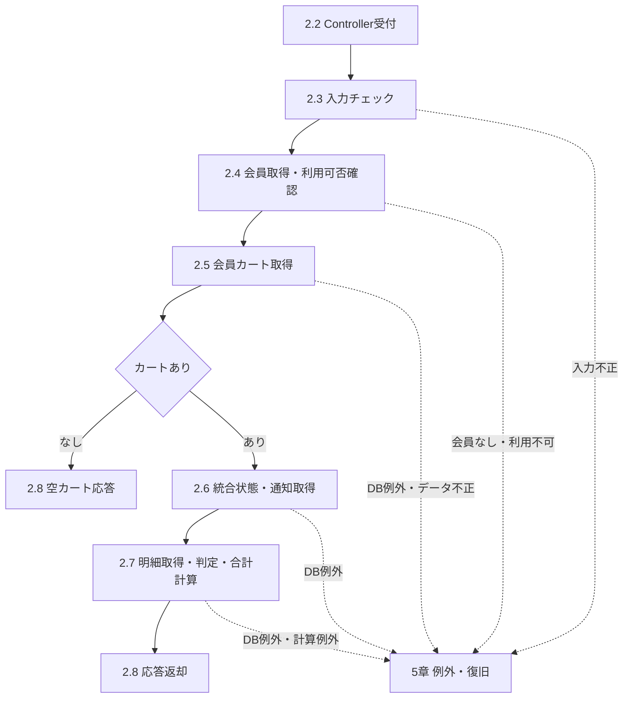
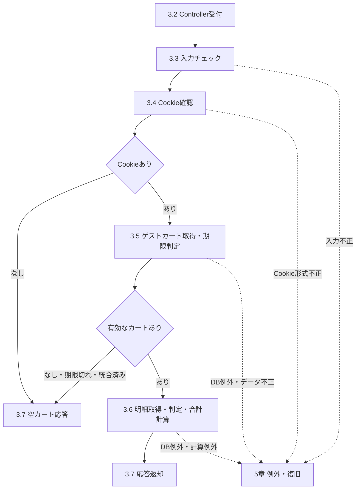

# APU003_01_カート内容・サマリー取得

## 0. 処理フロー

### 0.1 会員の場合



### 0.2 ゲストの場合



## 1. 基本情報

| 項目 | 内容 |
| --- | --- |
| 機能ID／物理名 | APU003_01／get-cart-summary |
| 実行先 | ECSアプリケーション |
| 会員用 | GET /api/v1/cart |
| ゲスト用 | GET /api/v1/guest/cart |
| API Gateway認証 | 会員用：JWT必須／ゲスト用：認証なし |
| 対応画面 | SCU-06、CMN-01 |
| 参照テーブル | users、carts、cart_items、products、cart_merge_logs |
| 更新・登録・削除 | なし。期限延長、Cookie発行・削除、統合通知の既読化もしない |
| 一覧方式 | カート明細を全件取得。created_at昇順、同値は明細ID昇順。ページネーションなし |
| べき等キー | 不要 |
| 正常応答 | HTTP 200。空カートも成功 |
| 例外応答 | ECSが処理できる例外はHTTP 200＋error。Gateway等の認証・通信エラーは対象外 |

会員経路とゲスト経路は別ControllerメソッドからCartQueryBusinessを呼び出す。会員処理は2章、ゲスト処理は3章に記載する。経路から利用者区分を確定し、クライアント指定のuserIdやcartIdは受け付けない。

本書で具体化する表示ルール：

- 保存数量合計は購入不可分も含む全明細数量。ヘッダーバッジに使用する。
- 購入対象数量・商品合計は、保存数量のまま購入できる明細のみを集計する。在庫不足の明細は自動減数せず集計対象外とし、小計はnullとする。
- この合計は送料・手数料を含まない。購入不可明細を除外して注文できる仕様ではなく、1件でも問題があれば注文手続き不可とする。
- 画面は商品合計を「購入可能な商品合計」として表示し、購入不可明細が残っている旨を併記する。

## 2. 会員の場合

### 2.1 リクエスト

| 場所 | 項目 | 必須 | 内容 |
| --- | --- | --- | --- |
| ヘッダー | Authorization: Bearer アクセストークン | 必須 | 共通認証処理で確認済みのsubを使用 |
| パス変数・クエリ・ボディ | なし | — | 未定義クエリ・ボディを受け付けない。{}も不可 |
| Cookie | 使用しない | — | ゲストCookieが送られても会員カート検索には使わない |

```http
GET /api/v1/cart HTTP/1.1
Authorization: Bearer <会員アクセストークン>
Accept: application/json
```

リクエストJSONはなし。JWTが不正・未指定でも、ゲスト処理へ切り替えない。

### 2.2 Controller：会員リクエスト受付

| 項目 | 内容 |
| --- | --- |
| メソッド | CartQueryController.getMemberCart |
| 入力 | 共通認証済みsub、共通解析済みリクエスト |
| 呼出 | CartQueryBusiness.execute(MEMBER, sub, null, parsedRequest) |
| 解析 | **共通機能使用：COM001_10 HTTPリクエスト解析** |

要求ID・認証の準備は共通処理／親Controllerに委ねる。個別Controllerでヘッダーを再検証しない。

### 2.3 Business：個別入力チェック

| 対象 | チェック | NG時 |
| --- | --- | --- |
| クエリ | 項目が存在しない | INVALID_REQUEST |
| ボディ | 存在しない | INVALID_REQUEST |
| 利用者区分 | ControllerがMEMBERを設定 | INTERNAL_ERROR |
| sub | 共通認証情報に存在する | 共通認証処理のエラー。ゲストへ切り替えない |

### 2.4 Business： 会員の取得・利用可否確認

**共通機能使用：COM001_04 subによる会員取得**  
**共通機能使用：COM001_05 会員利用可否判定**

| 結果 | 次の処理 |
| --- | --- |
| 会員あり・利用可能 | users.idを保持し2.5へ |
| 会員なし | USER_NOT_INITIALIZED。フロントはAPU001_01を実行する |
| 無効会員 | ACCOUNT_DISABLED |
| 利用準備未完了 | MEMBER_NOT_READY |
| DB例外 | 5章の例外へ。未登録扱いにしない |

### 2.5 Business：会員カート取得

ここから2.8の応答データ作成まで、読み取り専用トランザクション（REPEATABLE READ）で実行する。カート・明細・統合状態を同一スナップショットで読み、FOR UPDATEは使用しない。

| 項目 | 内容 |
| --- | --- |
| テーブル | carts |
| 条件 | user_id = 2.4のusers.id |
| 取得項目 | id、user_id、status、pending_merge_cart_id、version、expires_at |
| 件数 | 0件または1件 |

| 結果 | 次の処理 |
| --- | --- |
| 0件 | 2.8で空カート。新規作成しない |
| 1件・status=ACTIVE・expires_at IS NULL | 2.6へ |
| その他の状態・複数件 | INTERNAL_ERROR。空カートで隠さない |
| DB例外 | 5章へ。空カートで返さない |

### 2.6 Business：統合状態・通知取得

| 項目 | 内容 |
| --- | --- |
| テーブル | cart_merge_logs |
| 条件 | user_id = 会員ID AND target_cart_id = カートID |
| 未完了判定 | pending_merge_cart_idに対応するログ、およびPROCESSING／FAILEDのログ |
| 通知取得 | merge_status = COMPLETED AND has_adjustments = true AND is_acknowledged = false |
| 通知取得項目 | id、source_cart_id、merge_status、has_adjustments、adjustments_json、is_acknowledged |
| 通知順 | created_at ASC、id ASC |

| DB状態 | merge.status | 注文手続き |
| --- | --- | --- |
| 未完了参照・未完了ログなし | NONE | 明細判定に従う |
| pending参照あり、ログ未作成 | REQUIRED | 不可 |
| PROCESSING | PROCESSING | 不可 |
| FAILED | FAILED | 不可 |
| 完了済みのみ | COMPLETED | 明細判定に従う |
| pending参照先・ログ間の矛盾や未定義状態 | UNKNOWN | 不可。最新状態を確認する案内 |

- 通知は未読の調整ログをすべて返す。最新1件だけに限定しない。
- adjustments_jsonは許可された表示項目へ変換し、JSONをそのまま外部へ返さない。
- 通知内容が解析できない場合、対象通知のdetailsAvailable=falseとし、汎用の統合調整案内を返す。成功を失敗へ変更しない。
- 既読化は行わない。
- 統合API到達前の失敗はDBだけでは検出できない。フロントは保持中の統合未完了状態を本応答のNONEだけで解除せず、APU003_05の結果で確定する。

### 2.7 Business：明細取得・判定・合計計算

| 順序 | 処理 |
| --- | --- |
| 1 | 2.5のcartIdで4.1の明細・商品取得を実行 |
| 2 | 4.2の販売・在庫判定、合計計算を実行 |
| 3 | 2.6の統合状態も含めてcheckoutEligibleを確定 |

明細0件でも統合状態・未読通知は返す。

### 2.8 応答データ作成・Controller返却

| 条件 | 返却内容 |
| --- | --- |
| 会員カートなし | cartId・version=null、items=[]、数量・金額="0"、checkoutEligible=false、merge.status=NONE、notifications=[] |
| 会員カートあり・明細0件 | cartId・versionを保持、items=[]、数量・金額="0"、checkoutEligible=false。2.6の統合情報を返す |
| 明細あり | 2.7の結果と2.6の統合情報 |

carts.versionは文字列で返す。cognito_sub・user_id・S3内部キーは返さない。データ作成後に読取TXを終了する。

Controllerは親Controller経由で**共通機能使用：COM001_07 APIレスポンス生成**。Cache-Control: no-storeを設定する。例外は**共通機能使用：COM001_08 例外応答変換**へ渡す。

## 3. ゲストの場合

### 3.1 リクエスト

| 場所 | 項目 | 必須 | 内容 |
| --- | --- | --- | --- |
| Cookie | ec_guest_cart_token | 任意 | 未指定は空カート |
| Authorization | 使用しない | — | ゲスト経路では会員カートを取得しない |
| パス変数・クエリ・ボディ | なし | — | 未定義クエリ・ボディを受け付けない。{}も不可 |

```http
GET /api/v1/guest/cart HTTP/1.1
Cookie: ec_guest_cart_token=<発行済みトークン>
Accept: application/json
```

リクエストJSONはなし。Cookie未指定でも要求を受け付ける。本APIでCookie発行・削除をしない。

### 3.2 Controller：ゲストリクエスト受付

| 項目 | 内容 |
| --- | --- |
| メソッド | CartQueryController.getGuestCart |
| 入力 | 共通解析済みCookie値・同名Cookie件数、共通解析済みリクエスト |
| 呼出 | CartQueryBusiness.execute(GUEST, null, guestToken, parsedRequest)。Cookie件数もCommand内で保持 |
| 解析 | **共通機能使用：COM001_10 HTTPリクエスト解析** |

会員検索・会員利用状態判定は実行しない。

### 3.3 Business：個別入力チェック

| 対象 | チェック | NG時 |
| --- | --- | --- |
| クエリ | 項目が存在しない | INVALID_REQUEST |
| ボディ | 存在しない | INVALID_REQUEST |
| 利用者区分 | ControllerがGUESTを設定 | INTERNAL_ERROR |

### 3.4 Business： ゲスト識別情報の確認

| 条件 | 判定 |
| --- | --- |
| Cookie未指定 | 空カート。DB検索せず3.7へ |
| 同名Cookieが複数 | INVALID_REQUEST |
| 空文字・64文字超過 | INVALID_REQUEST |
| 空白・制御文字・ASCII範囲外を含む | INVALID_REQUEST |
| その他 | 値を変更せず完全一致検索に使用 |

トリム・大文字小文字変換をしない。トークンの発行文字種はカート追加APIと共通設定に合わせる。本APIではトークンを生成・復号せず、DBへのバインド値として扱う。

### 3.5 Business：ゲストカート取得・期限判定

Cookie指定時のみ、ここから3.7の応答データ作成まで読み取り専用トランザクション（REPEATABLE READ）で実行する。カートと明細を同一スナップショットで読む。FOR UPDATEは使用しない。

| 項目 | 内容 |
| --- | --- |
| テーブル | carts |
| 条件 | guest_cart_token = 3.4のCookie値 AND user_id IS NULL |
| 取得項目 | id、user_id、guest_cart_token、status、version、expires_at |
| 件数 | 0件または1件 |
| 判定時刻 | DBのCURRENT_TIMESTAMP。今回の期限判定で固定 |

| 結果 | 次の処理 |
| --- | --- |
| 0件 | 3.7で空カート |
| ACTIVEかつexpires_at > 判定時刻 | 3.6へ |
| 期限切れ、またはEXPIRED／MERGED | 3.7で空カート。DB状態は変更しない |
| ACTIVEなのにexpires_atがnull／未定義status／複数件 | INTERNAL_ERROR |
| DB例外 | 5章へ。空カートで返さない |

期限切れでも本APIでは延長・削除・新規作成しない。会員カートへ検索範囲を広げない。

### 3.6 Business：明細取得・判定・合計計算

| 順序 | 処理 |
| --- | --- |
| 1 | 3.5のcartIdで4.1の明細・商品取得を実行 |
| 2 | merge.status=NOT_APPLICABLE、notifications=[]を設定。cart_merge_logsは検索しない |
| 3 | 4.2の販売・在庫判定、合計計算を実行 |

checkoutEligibleはカート内容の判定結果であり、ゲスト購入を許可する項目ではない。注文へ進む際はログイン・統合後に再確認する。

### 3.7 応答データ作成・Controller返却

| 条件 | 返却内容 |
| --- | --- |
| Cookieなし／カートなし／期限切れ／統合済み | cartId・version=null、items=[]、数量・金額="0"、checkoutEligible=false |
| 有効カート・明細0件 | cartId・versionを保持、items=[]、数量・金額="0"、checkoutEligible=false |
| 明細あり | 3.6の結果 |
| 全ケース共通 | merge.status=NOT_APPLICABLE、notifications=[] |

carts.versionは文字列で返す。ゲストトークン・user_id・S3内部キーは返さない。開始した読取TXはデータ作成後に終了する。

Controllerは親Controller経由で**共通機能使用：COM001_07 APIレスポンス生成**。Cache-Control: no-storeを設定し、Set-Cookieは出力しない。例外は**共通機能使用：COM001_08 例外応答変換**へ渡す。

## 4. 両経路で使用する明細取得・計算

以下は本API内の同一処理。会員は2.7、ゲストは3.6から実行する。独立した共通機能IDを追加するものではない。

### 4.1 明細・商品取得

| 項目 | 内容 |
| --- | --- |
| 主テーブル | cart_items ci |
| 結合 | products pをci.product_id = p.idでLEFT JOIN |
| 条件 | ci.cart_id = 2.5または3.5で取得したcarts.id |
| 順序 | ci.created_at ASC、ci.id ASC |
| 明細取得項目 | ci.id、product_id、quantity、added_product_name、added_price_including_tax |
| 商品取得項目 | p.id、name、price_including_tax、stock_quantity、publish_status、sales_status、is_deleted、image_s3_key |

非公開・削除済みをWHEREで除外しない。購入できない商品もカート上で削除できるよう明細を返す。

| データ | チェック・取扱い |
| --- | --- |
| 明細ID・商品ID | 正のBIGINT。欠損・不正はINTERNAL_ERROR |
| 数量 | 1以上の整数。不正ならINTERNAL_ERROR。正しいバッジ数量を作れないため |
| 商品なし・非公開・削除済み | 現在の商品属性を公開せず、追加時商品名を表示。詳細リンク不可 |
| 追加時商品名も不明 | 「商品情報を取得できません」 |
| 公開商品の名前 | 現在の商品名。文字列として返し、画面ではHTMLを実行しない |
| 画像 | 公開・未削除商品のみ設定済み配信URLとimage_s3_keyから生成。未設定・不正キーはnull。S3への存在確認はしない |
| 税込単価 | productsの保存済み値を使用。ここで税計算しない |

### 4.2 明細判定・合計計算

上から順に判定する。

| 条件 | availability | 小計対象 | 詳細遷移 |
| --- | --- | --- | --- |
| p.id IS NULL／p.publish_status = PRIVATE／p.is_deleted = true | UNAVAILABLE | 対象外 | 不可 |
| p.publish_status・p.sales_status・p.price_including_tax・p.stock_quantityが欠損、不正、未定義 | UNKNOWN | 対象外 | 公開・未削除を確認できた場合のみ可 |
| p.sales_status = SUSPENDED | UNAVAILABLE | 対象外 | 可 |
| p.sales_status = ON_SALE AND p.stock_quantity = 0 | SOLD_OUT | 対象外 | 可 |
| p.sales_status = ON_SALE AND ci.quantity > p.stock_quantity（在庫1以上） | INSUFFICIENT_STOCK | 対象外 | 可 |
| p.publish_status = PUBLIC AND p.sales_status = ON_SALE AND p.is_deleted = false AND ci.quantity <= p.stock_quantity（在庫1以上） | AVAILABLE | 対象 | 可 |

価格は1以上、在庫数は0〜99999、公開・販売状態はDB定義の列挙値で検証する。非公開等で非表示とする値をAPIに載せない。

判定で使用するpはproducts、ciはcart_items。上表はDBの実在庫p.stock_quantityで判定し、その後に返却用stockQuantityを作る。

| 返却対象の状態 | stockQuantity |
| --- | --- |
| AVAILABLE／INSUFFICIENT_STOCK、実在庫1〜10 | 実在庫数 |
| AVAILABLE／INSUFFICIENT_STOCK、実在庫11以上 | null（数量非公開） |
| SOLD_OUT | 0 |
| UNAVAILABLE／UNKNOWN | null（表示しない） |

nullは0として扱わず、availabilityと組み合わせる。例えば保存数量20・実在庫15ならINSUFFICIENT_STOCK、stockQuantity=null、checkoutEligible=falseとする。実在庫15は返さない。

SCU-06ではstockQuantityが数値の場合だけ在庫上限を補助チェックする。nullの場合は在庫によるmax属性を除去し、数量変更APIで実在庫と照合する。在庫不足で数量非公開のときは「在庫数を超えています。数量を変更してください。」を表示し、「残りN点」は付けない。販売停止・売り切れ等の操作可否はavailabilityで判断する。

統合通知の理由文言にも11以上の実在庫数を埋め込まない。adjustmentsの調整前後数量は利用者自身のカート変更結果として保持する。管理者APIは実在庫数を返す。


| 算出項目 | 計算 |
| --- | --- |
| totalQuantity | 全cart_items.quantityの合計 |
| purchasableQuantity | AVAILABLE明細のquantity合計 |
| lineSubtotalIncludingTax | AVAILABLEのみ、現在税込単価 × 保存数量。それ以外はnull |
| subtotalIncludingTax | AVAILABLEの明細小計合計。該当なしは0 |
| priceChanged | 現在税込単価とadded_price_including_taxの両方が有効な場合に不一致を判定。比較不能はnull |
| checkoutEligible | 1件以上、全明細AVAILABLE、統合がNONE／COMPLETED／NOT_APPLICABLEの場合true。それ以外false |

- 計算は整数のlongで行い、multiplyExact／addExact等でオーバーフローを検出する。オーバーフローはINTERNAL_ERROR。
- 集計数量・金額はJSONで10進文字列を返す。明細数量・在庫数・単価は整数number。
- 送料・決済手数料は本APIに含めない。SCU-07での注文金額と区別する。
- checkoutEligibleは取得時点のカート状態。ゲストのログイン要否、直前の在庫再検証は別途必要。フロントが保持する統合未完了も解除条件に含める。

## 5. 例外・復旧

### 5.1 例外応答

**共通機能使用：COM001_08 例外応答変換**。応答はdata=nullとし、取得途中の明細や部分合計は返さない。

| 発生条件 | HTTP | error.code | error.message |
| --- | --- | --- | --- |
| 未定義クエリ・ボディ・Cookie形式不正 | 200 | INVALID_REQUEST | リクエストの形式が正しくありません。 |
| 会員未初期化 | 200 | USER_NOT_INITIALIZED | 会員情報の準備が必要です。 |
| 会員利用不可 | 200 | ACCOUNT_DISABLED／MEMBER_NOT_READY | COM001_05・共通エラー定義の対応文言 |
| DB接続障害・タイムアウト等 | 200 | SERVICE_UNAVAILABLE | 処理を完了できませんでした。時間をおいて再試行してください。 |
| 不正なDB状態・計算例外・想定外例外 | 200 | INTERNAL_ERROR | 処理を完了できませんでした。 |

SCU-06は取得失敗をC02、CMN-01はUH01として表示する。同じ取得失敗を二重表示しない。JWT拒否等でECSまで到達しない応答は共通認証・通信処理に従う。

### 5.2 データ復旧

| 状況 | 復旧 |
| --- | --- |
| DB例外 | 読み取りトランザクションを終了・ロールバック。登録・更新がないため補償更新なし |
| 応答消失・通信切断 | 同じGETを再実行。数量や期限は変化しない |
| 期限切れゲスト | 空表示。次回の追加APIで必要なカート作成を行う |
| 在庫不足・購入不可 | 数量変更／明細削除APIで利用者が解消する。本APIで修正しない |
| 統合未完了 | APU003_05で再試行。本APIで再統合しない |

SQL・Cookie・アクセストークンをエラー本文に含めない。ログ出力は**共通機能使用：COM001_09 アプリケーションログ出力**。

## 6. 返却項目

### 6.1 共通項目・ヘッダー

| 項目 | 型 | 内容 |
| --- | --- | --- |
| requestId | string | 要求追跡ID |
| data | object / null | 成功時の下記データ。エラー時null |
| error | object / null | 成功時null |
| error.code | string | 5.1のコード |
| error.message | string | 利用者向け文言 |
| error.fieldErrors | array | 共通形式。本APIは通常[] |
| Cache-Control | ヘッダー | no-store |
| Set-Cookie | ヘッダー | 出力しない |

### 6.2 data

| 項目 | 型 | 内容 |
| --- | --- | --- |
| cartId | string / null | カートID |
| version | string / null | カート版情報 |
| items | array | 明細。空の場合[] |
| totalQuantity | string | 保存されている全明細数量合計。バッジ用 |
| purchasableQuantity | string | AVAILABLE明細の数量合計 |
| subtotalIncludingTax | string | AVAILABLE明細の商品合計。送料等は含まない |
| checkoutEligible | boolean | 取得時点のカートが注文可能条件を満たすか |
| merge | object | 下記統合情報 |

### 6.3 items[]

| 項目 | 型 | 内容 |
| --- | --- | --- |
| cartItemId／productId | string | 明細ID／商品ID |
| name | string | 現在名または追加時名・代替文言 |
| imageUrl | string / null | 公開可能な現在画像URL |
| quantity | number | 保存数量 |
| unitPriceIncludingTax | number / null | 公開可能かつ有効な現在税込単価 |
| lineSubtotalIncludingTax | string / null | 集計対象外はnull |
| stockQuantity | number / null | 4.2に従い0〜10またはnull。11以上の実在庫を返さない |
| availability | string | AVAILABLE／INSUFFICIENT_STOCK／SOLD_OUT／UNAVAILABLE／UNKNOWN |
| canViewProduct | boolean | 商品詳細リンク可否 |
| priceChanged | boolean / null | 追加時価格からの変更。比較不能はnull |

### 6.4 merge

| 項目 | 型 | 内容 |
| --- | --- | --- |
| status | string | NOT_APPLICABLE／NONE／REQUIRED／PROCESSING／FAILED／COMPLETED／UNKNOWN |
| notifications | array | 未読の統合調整通知 |
| notifications[].mergeLogId | string | 通知識別子 |
| notifications[].detailsAvailable | boolean | 調整内訳を返却できるか |
| notifications[].adjustments | array | 取得可能な調整内訳。解析不能時[] |
| adjustments[].productId | string | 対象商品ID |
| adjustments[].productName | string / null | 通知用の商品名 |
| adjustments[].beforeQuantity／afterQuantity | number | 調整前後の数量。除外時afterQuantity=0 |
| adjustments[].reason | string | 在庫不足・販売不可等の利用者向け理由 |

adjustments_jsonの物理キーは統合API設計でこの返却形式に対応付ける。DB設計上、現時点ではキーの物理名は未確定。

### 6.5 会員：正常JSON例

```json
{
  "requestId": "req-cart-001",
  "data": {
    "cartId": "101",
    "version": "3",
    "items": [
      {
        "cartItemId": "1001",
        "productId": "60",
        "name": "サンプル商品",
        "imageUrl": null,
        "quantity": 2,
        "unitPriceIncludingTax": 1980,
        "lineSubtotalIncludingTax": "3960",
        "stockQuantity": 5,
        "availability": "AVAILABLE",
        "canViewProduct": true,
        "priceChanged": false
      }
    ],
    "totalQuantity": "2",
    "purchasableQuantity": "2",
    "subtotalIncludingTax": "3960",
    "checkoutEligible": true,
    "merge": {
      "status": "NONE",
      "notifications": []
    }
  },
  "error": null
}
```

### 6.6 ゲストカートなし・期限切れのJSON例

```json
{
  "requestId": "req-cart-002",
  "data": {
    "cartId": null,
    "version": null,
    "items": [],
    "totalQuantity": "0",
    "purchasableQuantity": "0",
    "subtotalIncludingTax": "0",
    "checkoutEligible": false,
    "merge": {
      "status": "NOT_APPLICABLE",
      "notifications": []
    }
  },
  "error": null
}
```

### 6.7 例外JSON例（HTTP 200）

```json
{
  "requestId": "req-cart-003",
  "data": null,
  "error": {
    "code": "SERVICE_UNAVAILABLE",
    "message": "処理を完了できませんでした。時間をおいて再試行してください。",
    "fieldErrors": []
  }
}
```

