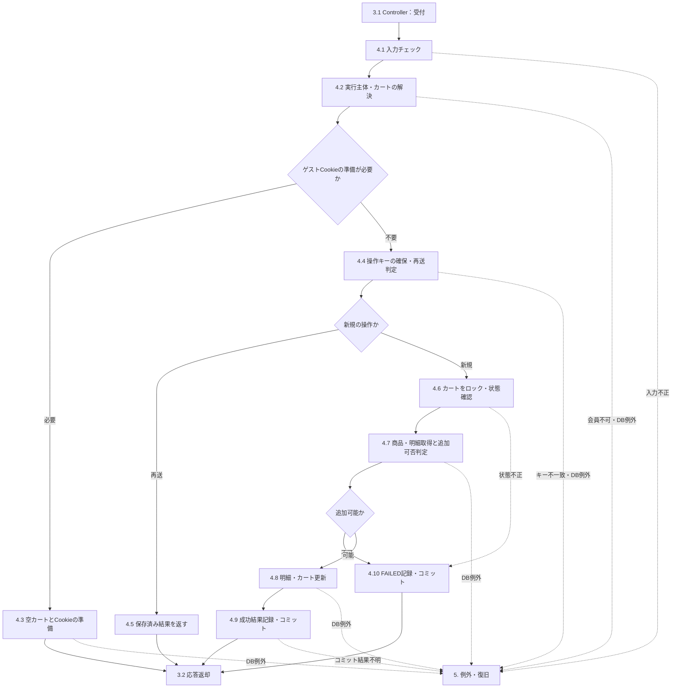

# APU003_02_カートへ商品追加

## 0. 処理フロー



ゲストCookie準備応答は追加成功ではない。フロントはCookieを伴って同じ内容・同じoperationIdを1回送信し、その要求で商品追加を実行する。

## 1. 基本情報

| 項目 | 内容 |
| --- | --- |
| 機能ID／旧ID | APU003_02／API-U10 |
| 論理名／物理名 | カートへ商品追加／add-cart-item |
| 会員用API | POST /api/v1/cart/items |
| ゲスト用API | POST /api/v1/guest/cart/items |
| API Gateway認証 | 会員用：会員JWT必須／ゲスト用：なし |
| Controller／Business | CartItemController／AddCartItemBusiness |
| 対応画面 | SCU-01、SCU-02、CMN-01 |
| 参照・更新 | users、carts、cart_items、products、operation_histories。統合確認はcart_merge_logsを参照 |
| 在庫 | 追加時に実在庫と照合する。在庫確保・減算・products.version更新は行わない |
| 数量 | 今回追加する数量。同一商品の既存数量へ加算する |
| 商品別購入上限 | 設けない。追加後数量が実在庫以下であること |
| 正常・エラー | ECSで捕捉して返却可能な場合はHTTP 200。基盤側エラーは別扱い |
| べき等性 | operationId必須。同一キー・同一要求は二重加算しない |

本書で具体化する方式：
- ゲスト初回はCookie準備と商品追加を分け、同じAPIで2段階に処理する。新しいAPIは増やさない。
- 操作開始・業務更新・成功記録は1つのDBトランザクションで確定する。開始だけを別TXでコミットしない。
- 商品追加は加算操作のため、要求にcartVersionを持たせず、親カート行の排他とoperationIdで制御する。絶対数量を指定する数量変更APIとは分ける。
- 取得時のstockQuantityがnullでも、BusinessではDB実在庫で判定する。在庫公開範囲は0〜10、11以上はnull。canAddToCartは返さない。

## 2. リクエスト

### 2.1 項目

| 場所 | 項目 | 必須 | 内容 |
| --- | --- | --- | --- |
| ヘッダー | Authorization | 会員用のみ | Bearerアクセストークン。共通処理済みのsubを使用 |
| ヘッダー | Content-Type | 必須 | application/json |
| ヘッダー | Origin等のCSRF確認情報 | ゲスト用 | 共通受付で検証。Cookie未発行の準備要求も対象 |
| Cookie | ec_guest_cart_token | ゲスト用・任意 | 未指定時はCookie準備へ。会員用では使用しない |
| ボディ | operationId | 必須 | string。小文字のUUID v4形式、36文字 |
| ボディ | productId | 必須 | string。1〜Long最大値の10進整数、先頭0なし |
| ボディ | quantity | 必須 | JSON整数number。今回追加する数量、1〜99999 |
| クエリ・パス変数 | なし | — | 未定義クエリは拒否 |

quantityの99999はDB在庫の表現上限に合わせた入力上限であり、独立した商品別購入上限ではない。文字列の数量、数値のproductId、小数・指数表記は受け付けない。

### 2.2 JSON例

```json
{
  "operationId": "9c276706-9b2e-4b18-8b85-9ad155da6c24",
  "productId": "101",
  "quantity": 2
}
```

- SCU-01はquantity=1。SCU-02は選択数量を指定する。
- 通信再送は同じoperationId・同じ内容。新たな追加操作は新しいoperationId。
- ゲスト準備後の要求も上記JSONを変更しない。
- userId、cartId、価格、在庫数、商品名は送信しない。

## 3. Controller：CartItemController

### 3.1 受付・Business呼出

| 会員用 | ゲスト用 |
| --- | --- |
| addMemberCartItem | addGuestCartItem |
| actorType=USER、検証済みsub | actorType=GUEST、共通解析済みCookie |
| 共通認証の結果を使用 | Cookieの存在だけで会員認証済みとは扱わない |

**共通機能使用：COM001_10 HTTP共通受付・JSON構文解析。** JSONツリーとクエリをCommandへ渡す。共通ヘッダー・認証・Origin確認の内部処理は本Controllerへ実装しない。

AddCartItemBusiness.execute(command)を呼び出す。Controllerは値の検証・Long変換・SQLを実行しない。

### 3.2 応答返却

- 正常結果は親Controller経由で**共通機能使用：COM001_07 共通レスポンス生成**。
- BusinessがFAILEDをコミットした場合は、TX終了後に対応する業務例外へ変換し、**共通機能使用：COM001_08 共通例外変換**へ渡す。
- ゲストのCookie設定は、Cookie準備または追加処理のコミット成功確認後だけ実施する。
- JSONは共通形式、Cache-Control: no-store。トークンをJSONに含めない。

## 4. Business：AddCartItemBusiness

### 4.1 入力チェック

| 順序 | 対象 | 検証 | NG |
| --- | --- | --- | --- |
| 1 | JSON・クエリ | ボディはobject、許可キーはoperationId／productId／quantityのみ。クエリなし | INVALID_REQUEST |
| 2 | operationId | null不可、UUID v4小文字の36文字 | VALIDATION_ERROR |
| 3 | productId | null不可、string、正規表現[1-9][0-9]{0,18} | VALIDATION_ERROR |
| 4 | productId | Long.parseLongに成功し1以上 | VALIDATION_ERROR |
| 5 | quantity | JSON整数であること。文字列・小数・指数表記・booleanを拒否 | VALIDATION_ERROR |
| 6 | quantity | 1〜99999 | VALIDATION_ERROR |

- 単項目条件はDTOの@NotNull、@Pattern、@Min、@Max等に定義し、BusinessでValidator.validateを実行する。COM001_03は使用しない。
- JSON型の強制変換で不正値を受け入れない。productIdはString受信後にBusinessでLong変換する。
- operationIdの正規表現：`[0-9a-f]{8}-[0-9a-f]{4}-4[0-9a-f]{3}-[89ab][0-9a-f]{3}-[0-9a-f]{12}`。
- 入力をトリム・全角変換・先頭0除去しない。
- 在庫との項目間チェックは4.7で実施する。入力NGの場合はDBへ登録しない。

### 4.2 実行主体・カートの解決

会員用：**共通機能使用：COM001_04 subによる会員情報検索、COM001_05 会員利用状態判定**。

| 条件 | 処理 |
| --- | --- |
| 会員未登録 | USER_NOT_INITIALIZED。会員初期化後に再開 |
| 無効・準備未完了 | ACCOUNT_DISABLED／MEMBER_NOT_READY |
| 利用可能 | actorType=USER、actorId=users.idの文字列表現 |
| ゲストCookieあり | carts.guest_cart_tokenの完全一致でゲストカートを解決 |
| ゲストCookieなし／対象なし／期限切れ | 4.3で準備。ただし同じoperationIdが既に存在する場合は自動で新カートへ追加しない |
| ゲストカートがMERGED | BUSINESS_RULE_VIOLATION。会員側状態を再確認。統合元を再利用しない |

Cookieの同名複数指定、空文字、64文字超、空白・制御文字・ASCII範囲外はINVALID_REQUEST。トークンを正規化しない。

| 参照先 | 条件 | 取得項目 |
| --- | --- | --- |
| carts（会員） | user_id = users.id | id、status、version、expires_at、pending_merge_cart_id |
| carts（ゲスト） | guest_cart_token = Cookie値 AND user_id IS NULL | 上記＋guest_cart_token |
| operation_histories（ゲスト準備前のみ） | operation_id = 要求値 | 存在の有無のみ。既存結果や主体情報は返さない |

会員カートがない場合は短い準備TXで以下を実行する。空カートが残っても商品追加済みとは扱わない。

```sql
INSERT INTO carts (user_id, status, version, expires_at)
VALUES (#{userId}, 'ACTIVE', 1, NULL)
ON CONFLICT (user_id) DO NOTHING;
-- 次のSQLでuser_idによるカート取得。競合相手が作成した行も取得する。
```

既存会員カートの不正status／expires_atはINTERNAL_ERROR。ゲストはactorType=GUEST、actorId=carts.idの文字列表現。userId・トークンを操作履歴へ複製しない（USERのactor_idは内部会員ID）。

### 4.3 ゲストCookie準備

Cookieを取得できない初回要求では、商品をまだ追加しない。追加を先に確定すると、応答消失時にブラウザが対象カートを再特定できなくなるため。

| 順序 | 処理 |
| --- | --- |
| 1 | operationIdの既存記録があればIDEMPOTENCY_KEY_REUSED。所有者を確認できない結果は返さない |
| 2 | SecureRandomで32バイトを生成し、小文字64桁hexをゲストトークンにする |
| 3 | 短い準備TXで空のcartsをINSERT。user_id=null、status=ACTIVE、version=1、expires_at=DB現在時刻＋7日 |
| 4 | コミット成功後にCookieを設定し、action=GUEST_CART_READYを返す |
| 5 | フロントが同じJSONをCookie付きで1回送信し、4.4以降へ進む |

- cart_items、operation_historiesはこの準備で登録しない。追加成功トースト・バッジ加算を行わない。
- トークン一意制約の衝突は準備TXをロールバックし、新トークンで最大3回まで試す。
- Cookieを伴う2回目もGUEST_CART_READYになったら、Cookie保存不可等として停止する。無限再送しない。
- Cookie準備応答だけを失った場合、残るのは空カート。商品は増えていない。再準備で生じた空カートは通常の期限切れ整理対象とする。
- 旧期限切れカート・未解決操作記録はこの処理で削除しない。過去操作の結果不明中に新しいキーで別カートへ追加し直さない。
- 初回の複数追加を並行送信しない。フロントは同一ブラウザのゲスト準備・初回追加を直列化する。別タブの同時初回準備の調停は共通フロント処理で行い、Cookieの上書きでカートを分裂させない。

Cookie設定：
`ec_guest_cart_token=<token>; Path=/; HttpOnly; Secure; SameSite=Lax`。Domainは指定しない。同一オリジンの/api経路を前提とする。
ExpiresはDBのexpires_atから生成し、Max-Ageはその期限までの残秒数（端数切捨て）とする。準備・更新ともDB期限を基準とし、固定7日を再送のたびに設定しない。

### 4.4 操作キーの確保・再送判定

ここから4.9／4.10までが業務TX（READ COMMITTED）。開始記録を単独コミットしない。

要求ハッシュ：
UTF-8の以下文字列のSHA-256を小文字hex64桁にする。改行はLF、末尾LFなし。

```text
v1
CART_ITEM_ADD
<actorType>
<actorId>
<productIdの正規10進表記>
<quantityの正規10進表記>
```

```sql
INSERT INTO operation_histories (
  operation_id, operation_type, actor_type, actor_id,
  operation_status, is_retryable, request_hash, expires_at
) VALUES (
  #{operationId}, 'CART_ITEM_ADD', #{actorType}, #{actorId},
  'PROCESSING', FALSE, #{requestHash}, NULL
)
ON CONFLICT (operation_id) DO NOTHING
RETURNING operation_id;
```

| 結果 | 処理 |
| --- | --- |
| INSERT 1件 | 本要求が実行担当。4.6へ |
| INSERT 0件 | 別SQLでoperation_idの行を取得。主体・種別・ハッシュを照合 |
| 主体／種別／ハッシュ不一致 | IDEMPOTENCY_KEY_REUSED。既存内容は開示しない |
| 一致・SUCCEEDED／FAILED | 4.5へ |
| 一致・PROCESSING | operationStatus=PROCESSINGを返し結果照会へ。再実行しない |
| 一意制約待機のタイムアウト | TXを戻しSERVICE_UNAVAILABLE。相手の結果を確認する |

取得項目：operation_type、actor_type、actor_id、request_hash、operation_status、result_code、result_summary_json、is_retryable、target_resource_id。
他の一意制約・SQL例外を「再送」として扱わない。

### 4.5 保存済み結果を返す

| 状態 | 処理 |
| --- | --- |
| SUCCEEDED | 保存した成功dataを返す。replayed=true、requestIdは今回値 |
| FAILED | 保存したcode／message／fieldErrorsを返す |
| PROCESSING | data.operationStatus=PROCESSING、error=null。追加成功表示をしない |

再送では明細加算・version加算・DB有効期限延長を行わない。ゲストCookieを再設定する場合も、現在の対象カートの期限までの残時間だけを設定する。過去の応答にあった期限を新しい7日として再利用しない。

成功再送の数量・価格は操作完了時の記録であり、現在のカートと異なる場合がある。フロントはreplayed=trueならAPU003_01で再取得し、古い数量で現在のバッジを上書きしない。

### 4.6 カートをロック・状態確認

| 項目 | 内容 |
| --- | --- |
| 検索 | carts.id = 解決済みID |
| 取得 | id、user_id、guest_cart_token、status、version、expires_at、pending_merge_cart_id |
| ロック | SELECT ... FOR UPDATE |
| 所有者 | USERはuser_id一致、GUESTはuser_id IS NULLかつCookie一致を再確認 |
| 有効性 | status=ACTIVE。GUESTはexpires_at > DBの実現在時刻 |
| 版情報 | 1以上、Long上限未満。上限超過はINTERNAL_ERROR |

統合状態確認：
- 会員のpending_merge_cart_idが非null、または同一会員・対象カートのcart_merge_logsにPROCESSING／FAILEDがある場合は追加を止める。
- ゲストカートが統合元としてcart_merge_logsのPROCESSING／FAILEDに残る、またはcarts.pending_merge_cart_idから参照されている場合も追加を止める。
- 4.10でBUSINESS_RULE_VIOLATION（内部理由CART_MERGE_PENDING）。統合再試行へ案内する。
- ロック待機中に期限切れ・統合済みとなった場合は、同じTX内で新カートへ付け替えず4.10で失敗確定。

全カート更新・統合・注文消費は親カート行の排他を守る。複数カートを扱う統合はID昇順で取得する。

### 4.7 商品・明細取得と追加可否判定

| テーブル | 条件・ロック | 取得項目 |
| --- | --- | --- |
| products | id = productId、FOR SHARE | id、name、price_including_tax、stock_quantity、publish_status、sales_status、is_deleted |
| cart_items | cart_id = 対象カートID AND product_id = productId | id、quantity、added_product_name、added_price_including_tax |

商品行のFOR SHAREは、今回の短いTX中に販売状態・在庫が更新されないようにするため。在庫を予約するものではない。ロック取得順は「操作キー→カート→商品」。商品ロック中にCognito・S3等の外部通信をしない。

| 優先順 | 使用項目 | 判定 | NG時 |
| --- | --- | --- | --- |
| 1 | products.id／is_deleted／publish_status | 存在し、is_deleted=false、publish_status=PUBLIC | RESOURCE_NOT_FOUND |
| 2 | products.name／price_including_tax／stock_quantity／sales_status | 名前1〜100文字、税込価格1以上、在庫0〜99999、ON_SALE／SUSPENDED | INTERNAL_ERROR（TXを戻す） |
| 3 | products.sales_status | ON_SALE | BUSINESS_RULE_VIOLATION：販売停止 |
| 4 | products.stock_quantity | 1以上 | BUSINESS_RULE_VIOLATION：売り切れ |
| 5 | cart_items.quantity | 既存明細は1以上の整数。0件は既存数量0 | 不正ならINTERNAL_ERROR |
| 6 | 既存数量＋要求quantity | longへ拡張して加算し、追加後数量 ≦ products.stock_quantity | BUSINESS_RULE_VIOLATION：在庫不足 |

例：保存3＋要求2＝5。実在庫4なら追加しない。実在庫15に対して保存10＋要求6も追加しない。返却用stockQuantity=nullを在庫無制限として扱わない。

非公開・削除・不存在の内部理由は外部へ区別して返さない。DB例外を商品不存在へ置き換えない。

### 4.8 明細・カート更新

| 対象 | 条件 | 設定値 |
| --- | --- | --- |
| cart_items INSERT | 対象明細なし | cart_id、product_id、quantity=要求数量、added_product_name=現在名、added_price_including_tax=現在税込単価 |
| cart_items UPDATE | 対象明細あり | quantity=追加後数量、updated_at=更新時刻 |
| carts UPDATE | ロック済み対象ID | version=version+1、updated_at=更新時刻 |
| ゲストcarts.expires_at | GUESTかつ追加成功 | 更新時刻＋7日 |
| 会員carts.expires_at | USER | NULLのまま |

- 既存明細のcreated_at・added_product_name・added_price_including_taxは変更しない。最初の追加時点からの価格変更を通知できるようにする。
- 削除後の再追加は新しい明細として、その時点の名称・単価を記録する。
- UNIQUE(cart_id, product_id)で1商品1明細を保証。親ロックを守った上での重複違反は実装不整合としてロールバックする。
- 更新時刻はロック取得・検証後にDBのclock_timestamp()から取得し、ミリ秒へ統一した同一値を使う。待機前のTX開始時刻で期限を更新しない。
- carts.versionとquantityの更新件数は各1件。0件・複数件はINTERNAL_ERROR。
- products、注文、未統合ゲスト元カートは更新しない。

### 4.9 成功結果記録・コミット

| 処理 | 内容 |
| --- | --- |
| バッジ数量 | cart_items WHERE cart_id=対象IDのSUM(quantity)。購入不可商品も含む |
| 明細小計 | 現在税込単価×追加後数量。longの安全な整数計算を使用 |
| 公開在庫 | 1〜10は実数、11以上はnull。availability=AVAILABLE |
| 版情報 | 更新後carts.version |
| 操作履歴 | operation_status=SUCCEEDED、is_retryable=false、result_code=CART_ITEM_ADDED、target_resource_id=cartId |
| 保存JSON | 下記の操作完了結果。秘密情報は格納しない |
| コミット | 明細・version・ゲスト期限・SUCCEEDEDを同一TXで確定 |

result_summary_jsonはschemaVersion=1とdata（6.2のSUCCEEDED形式、replayed=false）を保持する。requestId・Cookieトークン・アクセストークンは保存しない。
operation_histories.updated_atは完了時刻へ更新する。今回はexpires_at=nullとしてキーを保持し、自動削除による再実行を避ける。

応答DTOの生成・金額計算・JSON化までTX内で完了させてからコミットする。コミット失敗後に成功応答を返さない。再取得用APIを成功後に呼べなくても、確定済み追加を取り消さない。

### 4.10 業務失敗の記録・コミット

4.6／4.7の業務条件NGは、明細更新前に失敗結果を確定する。

| 項目 | 設定 |
| --- | --- |
| operation_status | FAILED |
| is_retryable | false。現在の要求を無条件再実行させない |
| result_code | RESOURCE_NOT_FOUNDまたはBUSINESS_RULE_VIOLATION |
| target_resource_id | 対象cartId |
| result_summary_json | schemaVersion、reason、error（code／message／fieldErrors） |
| expires_at | NULL |
| updated_at | DB現在時刻 |

reason例：PRODUCT_UNAVAILABLE、SOLD_OUT、INSUFFICIENT_STOCK、CART_MERGE_PENDING、CART_EXPIRED。reasonは内部分類であり、他会員・非公開商品の情報を応答に追加しない。

FAILED記録だけをコミットし、明細・version・ゲスト期限は変更しない。Businessは失敗結果をいったん値として返し、TX終了後に業務例外へ変換する。TX内で例外を投げてFAILED記録まで意図せず戻さない。

利用者が数量等を修正して新しい追加操作を行う場合は新operationId。同じoperationIdの再送は元のFAILEDを返す。

## 5. 例外・トランザクション・復旧

### 5.1 応答コード

**共通機能使用：COM001_08 共通例外変換、COM001_09 安全なログ出力。**

| 条件 | error.code | message |
| --- | --- | --- |
| 不正JSON・未定義項目等 | INVALID_REQUEST | リクエストの内容が正しくありません。 |
| 必須・型・形式・範囲NG | VALIDATION_ERROR | 入力内容をご確認ください。 |
| 会員未初期化 | USER_NOT_INITIALIZED | 会員情報の準備が必要です。 |
| 会員利用不可 | ACCOUNT_DISABLED／MEMBER_NOT_READY | COM001_05の対応文言 |
| 不存在・非公開・削除済み | RESOURCE_NOT_FOUND | 指定された情報を表示できません。 |
| 販売停止・売り切れ | BUSINESS_RULE_VIOLATION | この商品は現在カートに追加できません。 |
| 在庫不足 | BUSINESS_RULE_VIOLATION | 在庫数を超えるため、追加できません。 |
| 統合未完了 | BUSINESS_RULE_VIOLATION | カート情報の引き継ぎが完了していません。再試行してください。 |
| カート期限切れ・利用状態変化 | BUSINESS_RULE_VIOLATION | カート情報が変更されています。最新の内容をご確認ください。 |
| 同一キーで要求・主体不一致 | IDEMPOTENCY_KEY_REUSED | 同じ操作識別子で異なるリクエストが送信されました。 |
| Origin等の共通チェックNG | CSRF_VALIDATION_FAILED | 操作を確認できませんでした。画面を再読み込みしてください。 |
| DB接続障害・ロック待機タイムアウト | SERVICE_UNAVAILABLE | 処理を完了できませんでした。時間をおいて再試行してください。 |
| SQL不備・DB不正・計算例外 | INTERNAL_ERROR | 処理を完了できませんでした。 |

ECSが応答できる場合はHTTP 200。失敗時data=null、fieldErrorsは入力違反時のみ該当項目を設定する。
11以上の実在庫数をエラーメッセージ・fieldErrorsへ含めない。追加不可の最新表示はAPU002_02またはAPU003_01で再取得する。

### 5.2 TX境界と排他

| 区間 | 方式 | 確定内容 |
| --- | --- | --- |
| 会員カートがない場合の準備 | 独立した短いTX | 空の会員カートのみ |
| Cookie準備 | 独立した短いTX | 空のゲストカートのみ |
| 通常追加 | READ COMMITTED | 開始記録→親カートロック→商品共有ロック→明細・版・期限更新→成功記録 |
| 業務条件NG | 通常追加と同じTX | 操作FAILEDのみ |
| 想定外例外 | 通常追加TXをロールバック | 開始記録を含め未確定変更をすべて戻す |

初期設定案：lock_timeout=3秒、statement_timeout=5秒、業務TX上限10秒。環境設定化し、外部タイムアウトとの整合は共通設定で管理する。更新TX内で外部API・長いリトライを行わない。

本方式では正常運用中にPROCESSINGだけがコミットされない。プロセス停止なら接続終了後にTX全体が戻る。既存のコミット済みPROCESSINGを検出した場合は例外的な復旧対象として扱う。

### 5.3 データ復旧

| 障害地点 | DBの扱い | 復旧 |
| --- | --- | --- |
| 入力チェック失敗 | 変更なし | 入力を修正 |
| Cookie準備コミット前 | 空カート登録を戻す | 準備再実行可 |
| Cookie準備成功・応答消失 | 空カートのみ残る可能性 | 商品は未追加。準備を再開 |
| 明細更新途中・SQL例外 | 開始記録・明細・version・期限をすべてロールバック | 結果照会後、安全に再送できると確認できれば同じキー・同じ内容 |
| COMMIT応答消失 | 成功かロールバックか不明 | FAILEDへ上書きしない。operationIdの結果照会を優先 |
| コミット済み・HTTP応答消失 | SUCCEEDEDと追加結果が残る | 同一主体・キーで元結果取得。二重加算しない |
| 例外後にロールバック確認も失敗 | 結果不明 | SERVICE_UNAVAILABLE等を返し、結果照会へ。補償DELETEしない |

結果照会側はoperation_type=CART_ITEM_ADDの所有者を照合する。記録が一時的に見えないだけで未実行と断定しない。元TXの終了を確認できた場合にのみ再送を許可する。同じキーの再送自体も一意制約で直列化される。

コミット済みPROCESSINGが残る例外運用では、自動で明細を再加算しない。運用者が処理中TXの終了と業務反映の有無を確認し、根拠がある場合だけ終端結果を補正する。元結果が判定できないときは保留し、新キーでの再追加を許可しない。

### 5.4 フロント連携と確認ケース

- GUEST_CART_READY：トーストを出さず、Cookie付きで同一要求を1回続行。CookieをJSで読み取る必要はない。
- SUCCEEDED：成功トーストを表示。cartId・versionで古い応答を除外し、totalQuantityでバッジ更新。
- PROCESSING／通信不明：操作結果照会を優先。追加ボタン連打で新キーを発行しない。
- FAILED：バッジを増やさず、必要に応じ商品・カートを再取得。
- Cookie送信は同一オリジンfetch、または許可済み別オリジンでcredentials設定を合わせる。

| ケース | 期待結果 |
| --- | --- |
| 保存3・追加2・在庫5 | 保存5、version+1、保存数量合計更新 |
| 保存3・追加3・在庫5 | FAILED、数量・期限・version不変 |
| 保存10・追加6・在庫15 | 在庫不足。実在庫15を返さない |
| 同一operationIdを同時送信 | 加算は1回。元結果を再提示 |
| 別operationIdで同じカートへ同時追加 | 親カートロックで直列化し、後続は最新保存数量を使う |
| 商品の非公開化・在庫更新と競合 | 商品ロック取得後の状態で判定。コミット後の変化は後続操作で再検証 |
| 初回ゲスト・Cookie受信失敗 | 商品は増えない。無限再送しない |
| 初回ゲスト・商品追加応答消失 | 既にCookieを持つため対象・操作結果を特定できる |
| 再送成功 | 数量・DB期限・versionを再更新しない |
| 在庫10／11 | stockQuantity=10／null、availability=AVAILABLE |
| TX途中停止 | 業務更新と操作開始記録を一緒にロールバック |

技術参照：PostgreSQL公式の[行ロック](https://www.postgresql.org/docs/current/explicit-locking.html)、[INSERT／ON CONFLICT](https://www.postgresql.org/docs/current/sql-insert.html)。業務上の保存値・判定は本書の表に従う。

## 6. 返却項目

### 6.1 共通形式

| 項目 | 型 | 内容 |
| --- | --- | --- |
| requestId | string | 今回の要求追跡ID |
| data | object / null | 正常な処理結果。例外時null |
| error | object / null | 正常時null |
| error.code／message | string | 5.1に従う |
| error.fieldErrors | array | 入力違反項目。その他[] |
| Set-Cookie | ヘッダー | ゲスト準備・成功時等に3.2／4.3／4.5の条件で設定 |

### 6.2 商品追加成功data

| 項目 | 型 | 値・用途 |
| --- | --- | --- |
| action | string | CART_ITEM_ADDED |
| operationId | string | 要求の操作ID |
| operationStatus | string | SUCCEEDED |
| replayed | boolean | 保存済み結果の再提示ならtrue |
| cart.cartId | string | 対象カートID |
| cart.version | string | 操作完了時の版 |
| cart.totalQuantity | string | 購入不可分を含む保存済み全数量 |
| cartItem.cartItemId／productId | string | 対象明細・商品ID |
| cartItem.quantity | number | 追加後の保存数量 |
| cartItem.unitPriceIncludingTax | number | 操作時点の現在税込単価 |
| cartItem.lineSubtotalIncludingTax | string | 現在税込単価×追加後数量 |
| cartItem.availability | string | AVAILABLE |
| cartItem.stockQuantity | number / null | 実在庫1〜10は実数、11以上はnull |

カート全体の金額・注文可否は本応答に含めない。必要な画面はAPU003_01で取得する。保存数量合計を購入対象数量と取り違えない。

```json
{
  "requestId": "req-cart-add-001",
  "data": {
    "action": "CART_ITEM_ADDED",
    "operationId": "9c276706-9b2e-4b18-8b85-9ad155da6c24",
    "operationStatus": "SUCCEEDED",
    "replayed": false,
    "cart": {
      "cartId": "301",
      "version": "2",
      "totalQuantity": "2"
    },
    "cartItem": {
      "cartItemId": "1001",
      "productId": "101",
      "quantity": 2,
      "unitPriceIncludingTax": 1980,
      "lineSubtotalIncludingTax": "3960",
      "availability": "AVAILABLE",
      "stockQuantity": null
    }
  },
  "error": null
}
```

### 6.3 ゲスト準備完了data

| 項目 | 型 | 内容 |
| --- | --- | --- |
| action | string | GUEST_CART_READY |
| operationId | string | 要求値。操作履歴への登録はまだない |
| operationStatus | string | NOT_STARTED（APIの状態。DB列へ保存しない） |
| nextAction | string | SUBMIT_SAME_REQUEST |

```json
{
  "requestId": "req-cart-prepare-001",
  "data": {
    "action": "GUEST_CART_READY",
    "operationId": "9c276706-9b2e-4b18-8b85-9ad155da6c24",
    "operationStatus": "NOT_STARTED",
    "nextAction": "SUBMIT_SAME_REQUEST"
  },
  "error": null
}
```

### 6.4 処理中data

```json
{
  "requestId": "req-cart-processing-001",
  "data": {
    "operationId": "9c276706-9b2e-4b18-8b85-9ad155da6c24",
    "operationStatus": "PROCESSING",
    "nextAction": "QUERY_OPERATION"
  },
  "error": null
}
```

### 6.5 在庫不足・例外JSON（HTTP 200）

```json
{
  "requestId": "req-cart-add-002",
  "data": null,
  "error": {
    "code": "BUSINESS_RULE_VIOLATION",
    "message": "在庫数を超えるため、追加できません。",
    "fieldErrors": []
  }
}
```

```json
{
  "requestId": "req-cart-add-003",
  "data": null,
  "error": {
    "code": "SERVICE_UNAVAILABLE",
    "message": "処理を完了できませんでした。時間をおいて再試行してください。",
    "fieldErrors": []
  }
}
```

SERVICE_UNAVAILABLEだけでは未反映確定と判断しない。フロントは保持しているoperationIdで結果を確認する。

