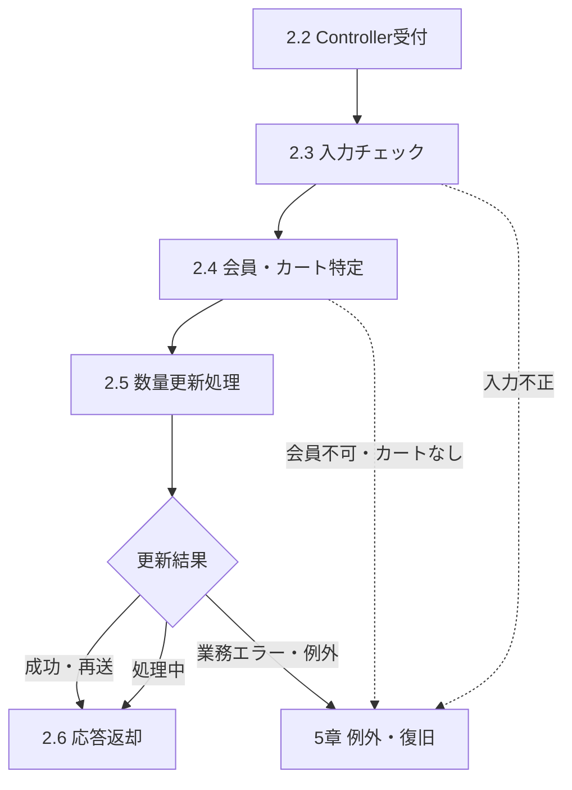
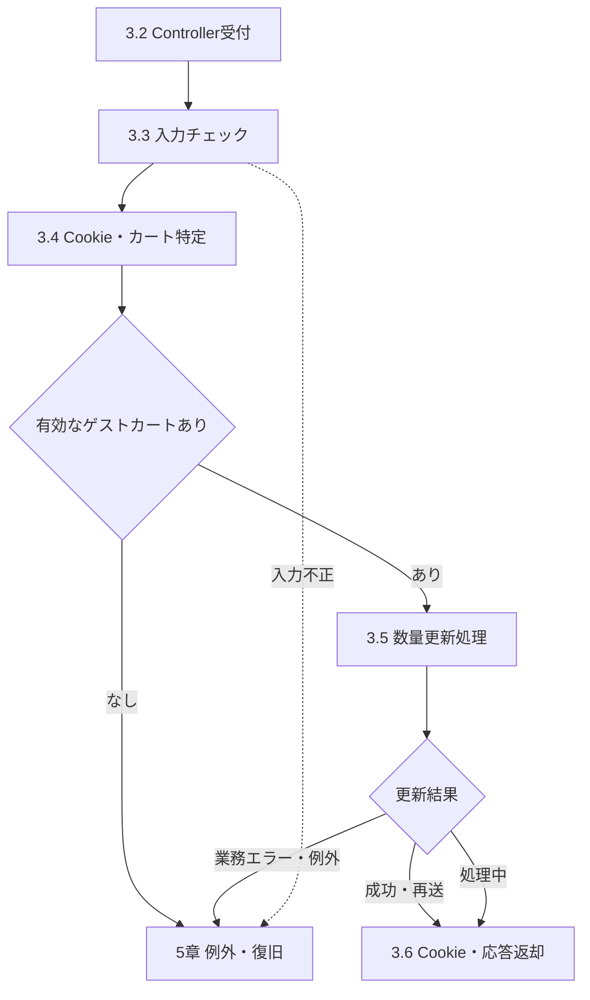
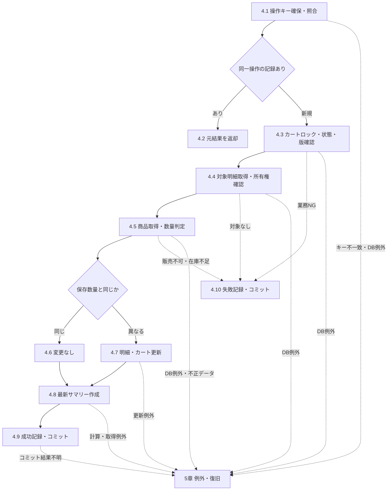

# APU003_03_カート明細の数量更新

## 0. 処理フロー

### 0.1 会員の場合



### 0.2 ゲストの場合



### 0.3 数量更新処理（会員2.5／ゲスト3.5から実行）



## 1. 基本情報

| 項目 | 内容 |
| --- | --- |
| 機能ID／旧ID | APU003_03／API-U11 |
| 論理名／物理名 | カート明細の数量更新／update-cart-item-quantity |
| 会員用API | PUT /api/v1/cart/items/{cartItemId} |
| ゲスト用API | PUT /api/v1/guest/cart/items/{cartItemId} |
| API Gateway認証 | 会員用：会員JWT必須／ゲスト用：認証なし |
| 対応画面 | SCU-06、CMN-01 |
| Controller | CartItemController |
| Business | UpdateCartItemQuantityBusiness |
| 参照先 | users、carts、cart_items、products、cart_merge_logs、operation_histories |
| 更新先 | cart_items.quantity・updated_at、carts.version・updated_at・ゲストexpires_at、operation_histories |
| 作成しないデータ | 会員・カート・カート明細。本APIは既存明細の更新のみ |
| 数量の意味 | 変更後の絶対数量。保存3にquantity=2を送ると保存2になる |
| 0指定 | 入力エラー。削除はAPU003_04を使用 |
| 在庫 | 保存数量が実在庫以下か検証。在庫確保・減算は行わない |
| 排他 | 親カート行ロック＋要求cartVersion照合＋operationId |
| 成功・例外応答 | ECSで捕捉可能な場合はHTTP 200。error等で成否を判断 |

- 商品別の購入上限は設けない。入力数量の上限99999はDB在庫の表現上限に合わせる。
- 在庫はDB実数で判定した後、返却時に0〜10またはnullへ変換する。canAddToCartは返さない。
- 4章は本API内の処理をまとめた章であり、独立した共通機能IDを新設するものではない。
- 同一操作の再送では、成功済み更新による版の変化をVERSION_CONFLICTにしない。べき等判定を先に実行する。

## 2. 会員の場合

### 2.1 リクエスト

| 場所 | 項目 | 必須 | 型・条件 |
| --- | --- | --- | --- |
| ヘッダー | Authorization | 必須 | Bearer会員アクセストークン。共通処理済みsubを使用 |
| ヘッダー | Content-Type | 必須 | application/json |
| パス | cartItemId | 必須 | String。正のBIGINT範囲、先頭0なし |
| ボディ | operationId | 必須 | string。小文字UUID v4、36文字 |
| ボディ | cartVersion | 必須 | string。画面が最後に取得したカート版。正のBIGINT範囲 |
| ボディ | quantity | 必須 | JSON整数number、1〜99999 |
| クエリ | なし | — | 未定義項目を拒否 |
| Cookie | 使用しない | — | ゲストCookieから会員カートを探さない |

```http
PUT /api/v1/cart/items/1001 HTTP/1.1
Authorization: Bearer <会員アクセストークン>
Content-Type: application/json
```

```json
{
  "operationId": "0f6ccbb9-1729-4ca8-8c64-ae4895d90db0",
  "cartVersion": "3",
  "quantity": 2
}
```

userId、cartId、productId、価格、在庫数は送信しない。商品は所有する明細のproduct_idから特定する。

### 2.2 Controller：会員受付

| 項目 | 処理 |
| --- | --- |
| メソッド | updateMemberCartItemQuantity |
| 解析 | **共通機能使用：COM001_10 HTTP共通受付・JSON構文解析** |
| Command | cartItemId文字列、JSONツリー、クエリ、actorType=USER、共通認証済みsub |
| 呼出 | UpdateCartItemQuantityBusiness.execute(command) |

共通認証・ヘッダーの内部処理は親Controller／共通受付に委ねる。個別Controllerで入力検証・Long変換・DB更新を実行しない。

### 2.3 Business：入力チェック

| 対象 | 検証条件 | NG時 |
| --- | --- | --- |
| JSON・クエリ | ボディはobject。許可キーはoperationId／cartVersion／quantityのみ。クエリなし | INVALID_REQUEST |
| cartItemId | 1〜19文字、[1-9][0-9]{0,18}、Long.parseLong可能 | VALIDATION_ERROR |
| operationId | 小文字UUID v4、36文字、null不可 | VALIDATION_ERROR |
| cartVersion | string、[1-9][0-9]{0,18}、Long.parseLong可能 | VALIDATION_ERROR |
| quantity | 整数number、1〜99999、null不可 | VALIDATION_ERROR |

- ID・版はStringで受け、BusinessでLongへ変換する。先頭0除去・トリムはしない。
- quantityの文字列・小数・指数表記・booleanを自動変換して受け入れない。
- 単項目条件はDTOの@NotNull・@Pattern・@Min・@Max等に定義し、BusinessでValidator.validateを実行する。COM001_03は使用しない。
- operationIdの正規表現：`[0-9a-f]{8}-[0-9a-f]{4}-4[0-9a-f]{3}-[89ab][0-9a-f]{3}-[0-9a-f]{12}`。
- 実在庫との比較は4.5。入力NG時は操作履歴も登録しない。

### 2.4 Business：会員・カート特定

**共通機能使用：COM001_04 subによる会員情報検索、COM001_05 会員利用状態判定。**

| 結果 | 処理 |
| --- | --- |
| 会員未登録 | USER_NOT_INITIALIZED |
| 会員DISABLED／PENDING | ACCOUNT_DISABLED／MEMBER_NOT_READY |
| 利用可能 | actorId=users.idの文字列。会員カートを検索 |
| カートなし | RESOURCE_NOT_FOUND。新規作成しない |
| DB例外 | 5章へ。カートなしと扱わない |

| テーブル | 条件 | 取得項目 |
| --- | --- | --- |
| carts | user_id = users.id | id、user_id |

この時点の検索は対象特定だけ。状態・所有者・版は4.3のロック後に再確認する。明細IDだけから他会員のカートを逆引きして更新しない。

### 2.5 Business：数量更新

4.1〜4.10をactorType=USER、actorId=users.id、cartId=2.4のIDで実行する。
会員カートのexpires_atはNULLのまま。ゲストCookie・ゲストカートを変更しない。

### 2.6 Controller：応答返却

- BusinessのTX終了後に、親Controller経由で**共通機能使用：COM001_07 共通レスポンス生成**。
- FAILEDを記録した結果は、コミット後に業務例外へ変換する。**共通機能使用：COM001_08 共通例外変換**。
- Cache-Control: no-store。Set-Cookieは出力しない。
- SUCCEEDEDでもreplayed=trueの場合は、フロントでAPU003_01を再取得して最新表示へ同期する。

## 3. ゲストの場合

### 3.1 リクエスト

| 場所 | 項目 | 必須 | 型・条件 |
| --- | --- | --- | --- |
| Cookie | ec_guest_cart_token | 必須 | 既存ゲストカートの識別情報 |
| ヘッダー | Content-Type | 必須 | application/json |
| ヘッダー | Origin等 | 共通規定に従う | Cookie更新APIのOrigin／CSRF対策は共通受付で検証 |
| パス | cartItemId | 必須 | String。正のBIGINT範囲 |
| ボディ | operationId／cartVersion／quantity | 必須 | 会員用と同じ |
| クエリ | なし | — | 未定義項目を拒否 |

```http
PUT /api/v1/guest/cart/items/1001 HTTP/1.1
Cookie: ec_guest_cart_token=<発行済みトークン>
Content-Type: application/json
```

```json
{
  "operationId": "67e13134-3590-4f43-a880-dae9abf36258",
  "cartVersion": "3",
  "quantity": 2
}
```

追加APIの初回Cookie準備は本APIでは行わない。ゲストカートの読取りAPIと違い、Cookieなしを空カートの正常応答にはしない。

### 3.2 Controller：ゲスト受付

| 項目 | 処理 |
| --- | --- |
| メソッド | updateGuestCartItemQuantity |
| 解析 | **共通機能使用：COM001_10 HTTP共通受付・JSON構文解析** |
| Command | cartItemId文字列、JSONツリー、クエリ、actorType=GUEST、Cookie値・同名Cookie件数 |
| 呼出 | UpdateCartItemQuantityBusiness.execute(command) |

会員検索・Cognito属性取得は実行しない。ユーザーが認証済みでも、この経路ではCookieのゲストカートだけを対象にする。

### 3.3 Business：入力チェック

パス・JSONの項目と検証条件は2.3と同じ。ゲスト固有のCookie確認は3.4で行う。
bodyのuserIdやcartId等を受け付けない。ヘッダー・Originの共通検証をここへ重複実装しない。

### 3.4 Business：Cookie・カート特定

| 条件 | 処理 |
| --- | --- |
| Cookie未指定 | RESOURCE_NOT_FOUND。カート再取得を案内 |
| 同名Cookie複数・空文字・64文字超 | INVALID_REQUEST |
| 空白・制御文字・ASCII範囲外を含む | INVALID_REQUEST |
| 正常形式 | 値を変更せずDB検索 |

| テーブル | 条件 | 取得項目 |
| --- | --- | --- |
| carts | guest_cart_token = Cookie値 AND user_id IS NULL | id、status、expires_at |

| 結果 | 処理 |
| --- | --- |
| 0件 | RESOURCE_NOT_FOUND |
| ACTIVEかつexpires_at > DB現在時刻 | actorId=carts.idの文字列として3.5へ |
| EXPIRED／MERGED／期限切れ | BUSINESS_RULE_VIOLATION。新カートへ付け替えない |
| 未定義状態・ACTIVEのexpires_at欠損 | INTERNAL_ERROR |
| DB例外 | SERVICE_UNAVAILABLE等。対象なしと扱わない |

ロック待機中に状態が変わるため4.3でも再確認する。Cookieから所有者を確認できない場合、operationIdだけで過去の結果を開示しない。

### 3.5 Business：数量更新

4.1〜4.10をactorType=GUEST、actorId=ゲストcarts.id、cartId=3.4のIDで実行する。
変更成功時だけ、明細更新と同じTXでexpires_atを更新時刻＋7日にする。変更なし・失敗・結果照会・再送でDB期限を延長しない。

### 3.6 Controller：Cookie・応答返却

- 成功コミット後、親Controller経由で**共通機能使用：COM001_07 共通レスポンス生成**。例外は**共通機能使用：COM001_08 共通例外変換**。
- changed=trueかつreplayed=falseのゲスト成功時のみ、同じトークンをCookieへ再設定する。新しいトークンは発行しない。
- Cookie属性はPath=/、HttpOnly、Secure、SameSite=Lax、Domainなし。Expiresは更新後DB期限、Max-Ageはその期限までの残秒数（端数切捨て）。
- changed=false、FAILED、PROCESSINGではCookieを設定しない。
- 成功再送でCookie再同期が必要な場合は、現在も同じACTIVEゲストカートであることを確認し、現在のDB期限までの残時間だけ設定する。過去の記録を基に「今から7日」にしない。
- Cookie設定失敗・応答消失でも、確定済み更新を補償削除しない。同一キーで結果を確認する。

## 4. 数量更新処理（両経路のBusiness内）

4.1から4.9／4.10までを1つのREAD COMMITTEDトランザクションで実行する。
開始記録だけを別TXでコミットしない。ゲスト・会員とも親カートの特定ができてから開始する。

### 4.1 操作キー確保・照合

operation_typeはCART_ITEM_QUANTITY_UPDATE。request_hashは以下UTF-8文字列のSHA-256、小文字hex64桁。改行はLF、末尾改行なし。

```text
v1
CART_ITEM_QUANTITY_UPDATE
<actorType>
<actorId>
<cartItemIdの正規10進表記>
<cartVersionの正規10進表記>
<quantityの正規10進表記>
```

```sql
INSERT INTO operation_histories (
  operation_id, operation_type, actor_type, actor_id,
  operation_status, is_retryable, request_hash, expires_at
) VALUES (
  #{operationId}, 'CART_ITEM_QUANTITY_UPDATE', #{actorType}, #{actorId},
  'PROCESSING', FALSE, #{requestHash}, NULL
)
ON CONFLICT (operation_id) DO NOTHING
RETURNING operation_id;
```

| 結果 | 次の処理 |
| --- | --- |
| INSERT 1件 | 新規操作。4.3へ |
| INSERT 0件 | 別SQLで同じoperation_idの記録を取得 |
| actor_type／actor_id／operation_type／request_hashのどれか不一致 | IDEMPOTENCY_KEY_REUSED。過去結果は開示しない |
| 全項目一致 | 4.2へ |
| 競合待ちタイムアウト・DB例外 | ロールバックして5章へ |

取得項目：actor_type、actor_id、operation_type、request_hash、operation_status、result_code、result_summary_json、is_retryable、target_resource_id。

### 4.2 保存済み結果の再提示

| 状態 | 返却 |
| --- | --- |
| SUCCEEDED | 保存済みdata、replayed=true。requestIdだけ今回の値 |
| FAILED | 保存済みerror |
| PROCESSING | operationStatus=PROCESSING、nextAction=QUERY_OPERATION、error=null |

版照合・明細更新・DB期限延長を実行しない。例えば要求版3で成功しDB版4になった後も、同じキー・版3・数量の再送は成功結果を返す。
新しいキーで版3を送った場合は4.3のVERSION_CONFLICTになる。

### 4.3 カートロック・状態・版確認

```sql
SELECT id, user_id, guest_cart_token, status,
       version, expires_at, pending_merge_cart_id
FROM carts
WHERE id = #{cartId}
FOR UPDATE;
```

| 順序 | 使用項目 | 確認内容 | NG時 |
| --- | --- | --- | --- |
| 1 | carts.id／user_id／guest_cart_token | 存在・実行主体の所有者一致 | RESOURCE_NOT_FOUND |
| 2 | carts.status | ACTIVE | BUSINESS_RULE_VIOLATION |
| 3 | expires_at | 会員はNULL、ゲストはDB実現在時刻より未来 | ゲスト失効は業務NG、欠損等の不正はINTERNAL_ERROR |
| 4 | pending_merge_cart_id／cart_merge_logs | 統合未完了でない | BUSINESS_RULE_VIOLATION |
| 5 | carts.version／要求cartVersion | 正の版情報で完全一致 | VERSION_CONFLICT。不正DB値はINTERNAL_ERROR |

統合確認条件：
- USER：pending_merge_cart_idが非null、またはuser_id・target_cart_idが対象に一致するログのmerge_statusがPROCESSING／FAILEDなら不可。
- GUEST：対象がsource_cart_idのログにPROCESSING／FAILEDがある、または他カートのpending_merge_cart_idに参照されていれば不可。
- カート統合側も親カート行をロックする規約に従う。

VERSION_CONFLICT時は入力値を勝手に更新済み扱いにしない。フロントは最新カートを再取得し、利用者が再確定した数量を新しい版・新しいoperationIdで送る。

### 4.4 対象明細取得・所有権確認

| 項目 | 内容 |
| --- | --- |
| テーブル | cart_items |
| 条件 | id = 要求cartItemId AND cart_id = ロック済みcartId |
| 取得項目 | id、cart_id、product_id、quantity、added_product_name、added_price_including_tax |
| 0件 | RESOURCE_NOT_FOUND。不存在・別カートの明細を区別しない |
| 複数件・ID不正・quantityが1未満 | INTERNAL_ERROR |

数量変更・削除・追加・統合・注文消費は同じ親カートのロックを守る。明細IDだけのUPDATEは禁止する。

### 4.5 商品取得・数量判定

| 項目 | 内容 |
| --- | --- |
| テーブル | products |
| 条件 | id = 4.4で取得したproduct_id |
| ロック | FOR SHARE |
| 取得項目 | id、name、price_including_tax、stock_quantity、publish_status、sales_status、is_deleted |
| 順序 | 操作キー→親カート→対象商品。外部APIは呼ばない |

| 順序 | 使用するDB項目 | 条件 | NG時 |
| --- | --- | --- | --- |
| 1 | products.id／is_deleted／publish_status | 商品が存在、is_deleted=false、publish_status=PUBLIC | BUSINESS_RULE_VIOLATION：購入不可 |
| 2 | name／price_including_tax／stock_quantity／sales_status | 名前1〜100文字、価格1以上、在庫0〜99999、販売設定が既知値 | INTERNAL_ERROR |
| 3 | sales_status | ON_SALE | BUSINESS_RULE_VIOLATION：購入不可 |
| 4 | stock_quantity | 1以上 | BUSINESS_RULE_VIOLATION：売り切れ |
| 5 | 要求quantity／stock_quantity | 要求quantity ≦ 実在庫 | BUSINESS_RULE_VIOLATION：在庫不足 |

- 現在の保存数量が在庫超過でも、変更後数量が在庫内なら減らせる。保存数量に要求数量を加算しない。
- 保存8・実在庫5にquantity=5は成功、quantity=6は失敗。
- 在庫0・販売停止等は数量変更せず、削除APIで解消する。
- 判定には返却用stockQuantityではなくproducts.stock_quantityを使う。11以上の実在庫も検証する。
- ロック後の実在庫で照合するが、カート更新完了後の在庫確保を保証するものではない。

### 4.6 変更なし

4.3〜4.5を通過し、要求quantity = cart_items.quantityの場合：
- changed=false。
- 明細・親カートのupdated_at、version、expires_atは変更しない。
- 操作履歴はSUCCEEDEDとして残し、4.8の最新サマリーを返す。
- 版不一致・購入不可を「数量が同じ」という理由で成功にしない。

フロントも未変更の数量では送信しない。サーバーは届いた場合を上記で処理する。

### 4.7 明細・親カート更新

変更時は、ロック待機後のDB clock_timestamp()をミリ秒精度で取得してupdatedAtとする。
ゲストはこの時刻でもexpires_atが未来であることを再確認し、既に失効なら4.10へ進む。

| 対象 | 更新条件 | 設定値 |
| --- | --- | --- |
| cart_items | id=要求明細ID AND cart_id=対象カートID | quantity=要求数量、updated_at=updatedAt |
| carts | id=対象カートID AND version=要求cartVersion | version=version+1、updated_at=updatedAt |
| carts.expires_at | ゲストの上記更新時 | updatedAt＋7日 |
| carts.expires_at | 会員 | NULLのまま |

```sql
UPDATE cart_items
SET quantity = #{quantity}, updated_at = #{updatedAt}
WHERE id = #{cartItemId} AND cart_id = #{cartId};

-- 会員用。ゲスト用ではexpires_atも同じUPDATEで設定する。
UPDATE carts
SET version = version + 1, updated_at = #{updatedAt}
WHERE id = #{cartId} AND version = #{cartVersion};
```

- どちらも更新件数1件が必要。その他は全TXをロールバックしINTERNAL_ERROR。途中更新だけを残さない。
- versionの加算前にLong上限を検証する。
- created_at、added_product_name、added_price_including_taxは変更しない。並び順と価格変更比較の基準を維持する。
- productsの在庫・版、orders、統合元カートは更新しない。

### 4.8 更新後カート・サマリー作成

親カートのロックを保持したまま、同じTX内で全明細を取得する。APU003_01をHTTPで呼ばず、別の読取トランザクションも開始しない。

| テーブル・条件 | 取得項目・処理 |
| --- | --- |
| cart_items ci WHERE ci.cart_id=対象ID | id、product_id、quantity、added_product_name、added_price_including_tax |
| LEFT JOIN products p ON p.id=ci.product_id | name、image_s3_key、price_including_tax、stock_quantity、publish_status、sales_status、is_deleted、存在確認用id |
| 順序 | ci.created_at ASC、ci.id ASC |
| 会員のcart_merge_logs | user_id・target_cart_idで取得。未読調整通知はCOMPLETED、has_adjustments=true、is_acknowledged=false |
| ゲスト | merge.status=NOT_APPLICABLE、notifications=[] |

全明細・商品は1つのSELECTで取得し、そのSQLのスナップショットで合計する。対象商品だけをロックしており、他商品の将来の在庫・価格まで固定するものではない。

APU003_01の4章と同じ判定を本Business内の結果作成処理で使用する。

| 結果 | 条件・計算 |
| --- | --- |
| UNAVAILABLE | p.idなし、PRIVATE、is_deleted=true、またはSUSPENDED |
| UNKNOWN | 必要な商品状態・価格・在庫が欠損・不正 |
| SOLD_OUT | 公開・販売可能、stock_quantity=0 |
| INSUFFICIENT_STOCK | 公開・販売可能、ci.quantity > stock_quantity（在庫1以上） |
| AVAILABLE | 公開・販売可能、1 ≦ ci.quantity ≦ stock_quantity |
| totalQuantity | 購入不可分を含む全ci.quantityの合計 |
| purchasableQuantity | AVAILABLE明細の数量合計 |
| lineSubtotalIncludingTax | AVAILABLEのみ現在税込単価×保存数量。それ以外null |
| subtotalIncludingTax | AVAILABLEの明細小計合計。送料等を含めない |
| checkoutEligible | 1件以上、全明細AVAILABLE、統合未完了なしの場合true |
| stockQuantity | AVAILABLE／INSUFFICIENT_STOCKは実在庫1〜10のみ実数、11以上null。SOLD_OUTは0、UNAVAILABLE／UNKNOWNはnull |

不正データ時の優先順位、画像・名称・priceChanged・通知形式はAPU003_01の4章・6章に合わせる。明細数量の不正や合計オーバーフローは全TXをロールバックする。
他明細が購入不可でも対象明細の数量変更は成功可能。ただしcheckoutEligible=false、対象外明細の小計はnullとする。

合計は安全なlong整数演算で算出する。画像URL生成は設定済み配信元を使用し、S3通信はしない。11以上の実在庫を文言や別の返却項目へ埋め込まない。

### 4.9 成功記録・コミット

| operation_histories項目 | 設定値 |
| --- | --- |
| operation_status | SUCCEEDED |
| result_code | changed=true：CART_ITEM_QUANTITY_UPDATED／false：CART_ITEM_QUANTITY_UNCHANGED |
| target_resource_id | cartId |
| is_retryable | false |
| result_summary_json | schemaVersion=1、6章の成功data（replayed=false） |
| expires_at | NULL。今回の実装では自動削除しない |
| updated_at | DB現在時刻 |

DTO生成・保存用JSON化までTX内で終え、明細・親カート・成功記録を同時にコミットする。
Cookie、アクセストークン、requestIdを履歴JSONへ含めない。コミット確認前に成功応答やCookieを送らない。

### 4.10 業務失敗の記録・コミット

4.3〜4.5、または4.7の更新前再確認で業務NGなら、明細を変更せず操作履歴のみFAILEDにする。

| 項目 | 設定値 |
| --- | --- |
| operation_status／is_retryable | FAILED／false |
| result_code | VERSION_CONFLICT、RESOURCE_NOT_FOUND、BUSINESS_RULE_VIOLATION |
| target_resource_id | 対象cartId |
| result_summary_json | schemaVersion=1、reason、error（code／message／fieldErrors） |
| expires_at／updated_at | NULL／DB現在時刻 |

reasonはVERSION_CHANGED、ITEM_NOT_FOUND、PRODUCT_UNAVAILABLE、INSUFFICIENT_STOCK、CART_MERGE_PENDING、CART_EXPIRED等の内部分類。
FAILED記録をコミット後に業務例外へ変換する。予期しない例外・SQL例外・途中更新後の異常はこの経路へ流さず、5章に従って全TXを戻す。

## 5. 例外・復旧

### 5.1 例外応答

**共通機能使用：COM001_08 共通例外変換、COM001_09 安全なログ出力。**

| 発生条件 | error.code | message |
| --- | --- | --- |
| JSON・未定義項目・クエリ不正 | INVALID_REQUEST | リクエストの内容が正しくありません。 |
| 単項目条件NG | VALIDATION_ERROR | 入力内容をご確認ください。 |
| 会員未登録 | USER_NOT_INITIALIZED | 会員情報の準備が必要です。 |
| 会員利用不可 | ACCOUNT_DISABLED／MEMBER_NOT_READY | COM001_05の対応文言 |
| Cookie・カート・対象明細なし／所有者不一致 | RESOURCE_NOT_FOUND | 指定された情報を表示できません。 |
| カート版不一致 | VERSION_CONFLICT | 情報が更新されています。最新の内容をご確認ください。 |
| 在庫不足 | BUSINESS_RULE_VIOLATION | 在庫数を超えるため、数量を変更できません。 |
| 販売不可・売り切れ | BUSINESS_RULE_VIOLATION | この商品は現在購入できません。カートから削除してください。 |
| 統合未完了 | BUSINESS_RULE_VIOLATION | カート情報の引き継ぎが完了していません。再試行してください。 |
| ゲスト失効・状態変化 | BUSINESS_RULE_VIOLATION | カート情報が変更されています。最新の内容をご確認ください。 |
| 同一キーで別内容・別主体 | IDEMPOTENCY_KEY_REUSED | 同じ操作識別子で異なるリクエストが送信されました。 |
| Origin等の共通検証NG | CSRF_VALIDATION_FAILED | 操作を確認できませんでした。画面を再読み込みしてください。 |
| DB接続障害・タイムアウト・デッドロック | SERVICE_UNAVAILABLE | 処理を完了できませんでした。時間をおいて再試行してください。 |
| 不正DB値・SQL不備・計算例外 | INTERNAL_ERROR | 処理を完了できませんでした。 |

HTTP 200、data=null、errorあり。項目エラー以外のfieldErrorsは[]。内部SQL・トークン・11以上の実在庫を返さない。
Gatewayで拒否された要求や応答消失は共通JSONを保証しない。

### 5.2 トランザクションとデータ復旧

| 状況 | DB結果 | 復旧 |
| --- | --- | --- |
| 入力チェック・対象特定でNG | 変更なし | 入力・認証・カート表示を確認 |
| 版不一致・在庫不足等の確定業務NG | FAILEDだけ保存。明細・版・期限は不変 | 再取得。利用者が再確定する新操作は新キー |
| 同じ数量で成功 | SUCCEEDEDだけ保存。明細・版・期限は不変 | 正常応答 |
| SQL例外・処理途中停止 | 開始記録・明細・版・期限をまとめてロールバック | 結果照会で状況を確認 |
| コミット成功・応答消失 | 業務更新とSUCCEEDEDが残る | 同一キーの元結果を取得 |
| COMMITの応答消失 | 成功・ロールバックの判別不可 | FAILEDに上書きしない。operationIdの結果照会を優先 |
| ゲストCookie失効で結果を取得できない | 過去成功の有無は断定しない | 新キーで自動更新しない。カート再確認・必要なら運用確認 |

- 開始・更新・結果記録は同じTX。正常運用ではPROCESSINGだけがコミットされない。
- 結果照会で記録が一時的に見えないだけで未実行と断定しない。元TXの終了と再送の安全性を確認する。
- 同一キーでの再送は元のcartVersion・quantityを保持する。新しい版だけへ差し替えない。
- 予期せぬコミット済みPROCESSINGは運用復旧対象とし、時刻経過だけで再更新しない。
- ロールバック確認不能時も補償目的の数量書戻しはしない。他タブの正常更新を上書きするため。
- 初期設定案：lock_timeout=3秒、statement_timeout=5秒、業務TX上限10秒。設定化し、外部通信・無制限リトライをTXに含めない。

### 5.3 フロント側の同期

| 結果 | 操作 |
| --- | --- |
| SUCCEEDED・replayed=false | 応答cartで明細・合計・バッジを更新。cartId・versionで古い応答を除外 |
| SUCCEEDED・replayed=true | 元結果を成功として認識し、APU003_01で最新表示を取得 |
| VERSION_CONFLICT | 入力値を保持して再取得。利用者の確認後に新しい版・新キーで送信 |
| 在庫・販売条件NG | 数量を確定済み表示へ戻し、APU003_01で現在状態を反映 |
| PROCESSING／通信不明 | 結果照会。変更前数量へ強制保存するAPIは送らない |

SCU-06ではカート内の更新要求を直列化する。同じ版で複数明細を並列更新しない。版情報はJSON文字列のため、大小比較はNumberでなくBigInt等を使用する。

### 5.4 確認ケース

| ケース | 期待結果 |
| --- | --- |
| 保存3→要求2 | 保存2。差分加算しない |
| 保存8・実在庫5→要求5 | 成功 |
| 保存8・実在庫5→要求6 | 失敗。数量・版・期限不変 |
| 実在庫15→要求16 | 失敗。実在庫15を返さない |
| 在庫10／11で成功 | stockQuantity=10／null |
| 0・小数・文字列数量 | 入力エラー。削除や更新をしない |
| 他者のcartItemId | 所有者の明細検索で0件。存在を開示しない |
| 版3で成功後、同じキー・版3を再送 | 元成功を返す。再更新・再延長なし |
| 版3で成功後、別キー・版3を送信 | VERSION_CONFLICT |
| 数量同一・版一致・購入可能 | changed=false。版・期限不変 |
| 数量同一・版不一致 | VERSION_CONFLICT |
| SQL例外・コミット不明 | 5.2の手順。成功未確認でバッジを増減しない |
| ゲスト期限切れ | 更新不可。新カート・Cookieを作成しない |

## 6. 返却項目

### 6.1 共通項目

| 項目 | 型 | 内容 |
| --- | --- | --- |
| requestId | string | 今回の要求追跡ID |
| data | object / null | 正常な処理結果。例外時null |
| error | object / null | 正常時null |
| error.code／message | string | 5.1に従う |
| error.fieldErrors | array | 入力違反以外は[] |
| Cache-Control | ヘッダー | no-store |
| Set-Cookie | ヘッダー | ゲスト時のみ3.6の条件で設定 |

### 6.2 成功data

| 項目 | 型 | 内容 |
| --- | --- | --- |
| action | string | CART_ITEM_QUANTITY_UPDATED／CART_ITEM_QUANTITY_UNCHANGED |
| operationId | string | 要求の操作ID |
| operationStatus | string | SUCCEEDED |
| replayed | boolean | 保存済み結果の再提示ならtrue |
| changed | boolean | 明細数量が実際に変わったか |
| updatedCartItemId | string | 対象明細ID |
| cart | object | 操作完了時のカート詳細・サマリー |

### 6.3 cart

| 項目 | 型 | 内容 |
| --- | --- | --- |
| cartId／version | string | カートID／完了時の版 |
| totalQuantity | string | 購入不可分を含む全保存数量 |
| purchasableQuantity | string | AVAILABLE明細の数量合計 |
| subtotalIncludingTax | string | AVAILABLE明細の税込商品合計 |
| checkoutEligible | boolean | カート内容・統合状態から判定。ゲストのログイン要否は別 |
| items | array | 全明細。追加日時昇順・明細ID昇順 |
| merge | object | APU003_01と同じ統合状態・未読通知 |

### 6.4 cart.items[]／cart.merge

| 明細項目 | 型 | 内容 |
| --- | --- | --- |
| cartItemId／productId | string | 明細／商品ID |
| name | string | 現在名または追加時名・代替文言 |
| imageUrl | string / null | 公開可能な画像URL |
| quantity | number | 保存数量 |
| unitPriceIncludingTax | number / null | 公開可能な現在税込単価 |
| lineSubtotalIncludingTax | string / null | AVAILABLEの小計。それ以外null |
| stockQuantity | number / null | 0〜10。11以上・表示不可はnull |
| availability | string | AVAILABLE／INSUFFICIENT_STOCK／SOLD_OUT／UNAVAILABLE／UNKNOWN |
| canViewProduct | boolean | 詳細リンク可否 |
| priceChanged | boolean / null | 追加時価格からの変更。比較不能はnull |

merge.statusは会員：NONE／REQUIRED／PROCESSING／FAILED／COMPLETED／UNKNOWN、ゲスト：NOT_APPLICABLE。
merge.notifications[]はmergeLogId、detailsAvailable、adjustments[]。調整内訳はproductId、productName、beforeQuantity、afterQuantity、reason。物理JSONキーの対応付けは統合API設計に従う。

### 6.5 正常JSON例（会員、保存3から2へ変更）

```json
{
  "requestId": "req-cart-update-001",
  "data": {
    "action": "CART_ITEM_QUANTITY_UPDATED",
    "operationId": "0f6ccbb9-1729-4ca8-8c64-ae4895d90db0",
    "operationStatus": "SUCCEEDED",
    "replayed": false,
    "changed": true,
    "updatedCartItemId": "1001",
    "cart": {
      "cartId": "301",
      "version": "4",
      "totalQuantity": "2",
      "purchasableQuantity": "2",
      "subtotalIncludingTax": "3960",
      "checkoutEligible": true,
      "items": [
        {
          "cartItemId": "1001",
          "productId": "101",
          "name": "サンプル商品",
          "imageUrl": null,
          "quantity": 2,
          "unitPriceIncludingTax": 1980,
          "lineSubtotalIncludingTax": "3960",
          "stockQuantity": null,
          "availability": "AVAILABLE",
          "canViewProduct": true,
          "priceChanged": false
        }
      ],
      "merge": {
        "status": "NONE",
        "notifications": []
      }
    }
  },
  "error": null
}
```

ゲスト成功も同じ形式で、merge.status=NOT_APPLICABLE、notifications=[]とする。
変更なしはaction=CART_ITEM_QUANTITY_UNCHANGED、changed=false、versionは要求時と同じ。再送時もchangedは元操作の値を維持し、replayedだけtrueにする。

### 6.6 処理中JSON例

```json
{
  "requestId": "req-cart-update-002",
  "data": {
    "operationId": "0f6ccbb9-1729-4ca8-8c64-ae4895d90db0",
    "operationStatus": "PROCESSING",
    "nextAction": "QUERY_OPERATION"
  },
  "error": null
}
```

### 6.7 例外JSON例（HTTP 200）

```json
{
  "requestId": "req-cart-update-003",
  "data": null,
  "error": {
    "code": "VERSION_CONFLICT",
    "message": "情報が更新されています。最新の内容をご確認ください。",
    "fieldErrors": []
  }
}
```

```json
{
  "requestId": "req-cart-update-004",
  "data": null,
  "error": {
    "code": "SERVICE_UNAVAILABLE",
    "message": "処理を完了できませんでした。時間をおいて再試行してください。",
    "fieldErrors": []
  }
}
```

SERVICE_UNAVAILABLEだけで未反映確定と扱わない。元のoperationIdを使って結果を確認する。

