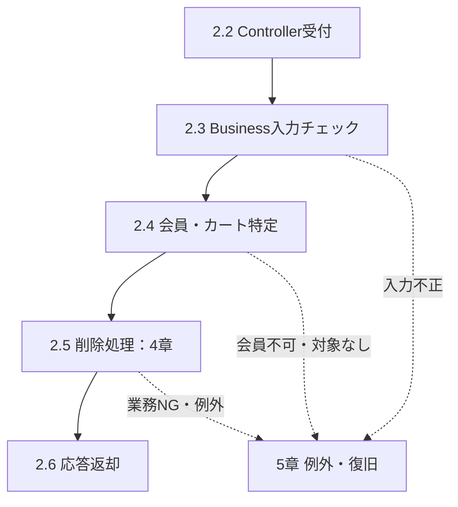
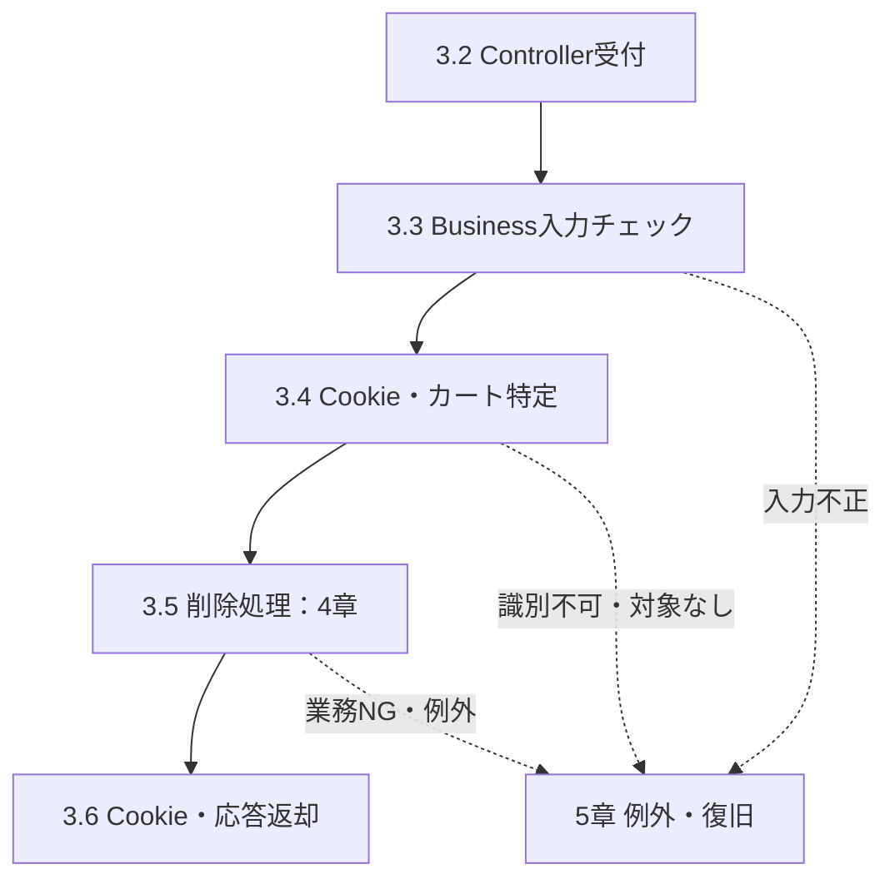
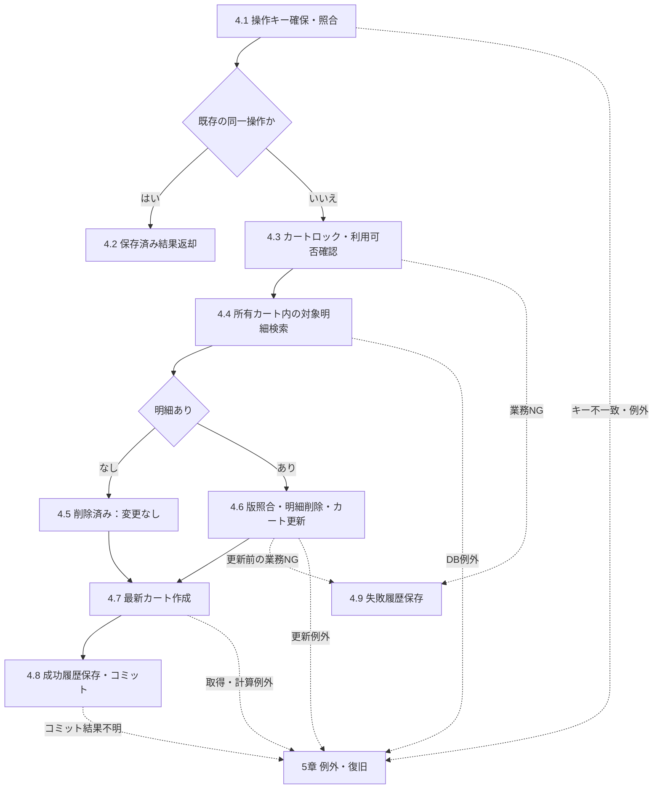

# APU003_04_カート明細の削除

## 0. 処理フロー

### 0.1 会員の場合



### 0.2 ゲストの場合



### 0.3 削除処理（両経路のBusiness内）



## 1. 基本情報

| 項目 | 内容 |
| --- | --- |
| 機能ID | APU003_04 |
| 論理名／物理名 | カート明細の削除／delete-cart-item |
| 会員用 | DELETE /api/v1/cart/items/{cartItemId} |
| ゲスト用 | DELETE /api/v1/guest/cart/items/{cartItemId} |
| API Gateway認証 | 会員：会員JWT必須／ゲスト：認証なし |
| 対応画面 | SCU-06、CMN-01 |
| Controller | CartItemController |
| Business | DeleteCartItemBusiness |
| 参照 | users、carts、cart_items、products、cart_merge_logs、operation_histories |
| 削除 | 指定された所有カートのcart_itemsを1件物理削除 |
| 更新 | carts.version・updated_at・ゲストexpires_at、operation_histories |
| 変更しないもの | 商品・在庫・注文・会員・統合元データ。商品自体の論理削除とは別処理 |
| 排他・再送 | 親カート行ロック、cartVersion、operationId |
| 成功・例外 | ECSで捕捉可能な場合HTTP 200。data／errorで判定 |

- 全数量を削除する。1個減らす場合はAPU003_03を使用する。
- 売り切れ・非公開・販売停止・商品削除済みでも、カート明細は削除可能。
- 最後の明細を削除しても親カートを削除しない。空カートの版を保持する。
- 4章は本APIのBusiness内処理。新しい共通機能IDは設けない。
- DELETEでも本APIはJSONボディを受け付ける。Gateway・プロキシで本文を転送するAPI契約とし、operationId・cartVersionを本文に統一する。

## 2. 会員の場合

### 2.1 リクエスト

| 場所 | 項目 | 必須 | 型・条件 |
| --- | --- | --- | --- |
| ヘッダー | Authorization | 必須 | Bearer会員アクセストークン。共通処理済みsubを使用 |
| ヘッダー | Content-Type | 必須 | application/json |
| パス | cartItemId | 必須 | String、正のBIGINT範囲 |
| JSON | operationId | 必須 | string、小文字UUID v4、36文字 |
| JSON | cartVersion | 必須 | string、最後に取得した正のカート版 |
| クエリ | なし | — | 未定義項目は拒否 |
| Cookie | 使用しない | — | ゲストCookieから会員カートを特定しない |

```http
DELETE /api/v1/cart/items/1001 HTTP/1.1
Authorization: Bearer <会員アクセストークン>
Content-Type: application/json
```

```json
{
  "operationId": "3dad4cc4-3166-4bea-8231-f4b3aa84ac82",
  "cartVersion": "4"
}
```

userId、cartId、productId、数量、価格は受け付けない。

### 2.2 Controller：会員受付

| 項目 | 処理 |
| --- | --- |
| メソッド | deleteMemberCartItem |
| 受付 | **共通機能使用：COM001_10 HTTP共通受付・JSON構文解析** |
| Command | パス文字列、JSONツリー、クエリ、actorType=USER、共通認証済みsub |
| 呼出 | DeleteCartItemBusiness.execute(command) |

ヘッダー・認証の共通検証は親Controller／共通受付に委ねる。個別Controllerに単項目チェック・ID変換・SQLを実装しない。

### 2.3 Business：入力チェック

| 対象 | 条件 | NG時 |
| --- | --- | --- |
| JSON | object必須。operationId・cartVersion以外のキー不可 | INVALID_REQUEST |
| クエリ | 指定なし | INVALID_REQUEST |
| cartItemId | 1〜19文字、[1-9][0-9]{0,18}、Long.parseLong可能 | VALIDATION_ERROR |
| cartVersion | JSON string、上記と同じ正のBIGINT範囲 | VALIDATION_ERROR |
| operationId | 小文字UUID v4、36文字、null不可 | VALIDATION_ERROR |

- operationIdの形式：`[0-9a-f]{8}-[0-9a-f]{4}-4[0-9a-f]{3}-[89ab][0-9a-f]{3}-[0-9a-f]{12}`。
- DTOの@NotNull・@Pattern・@Size等をBusinessのValidator.validateで検証する。COM001_03は使用しない。
- JSON型確認後にDTOへ変換する。数値のcartVersionを文字列へ自動変換しない。
- ID・版はBusinessでLongへ変換。トリム・先頭0除去はしない。Long上限超過も項目エラー。
- 項目間チェック：cartItemIdが所有カートに属するかは4.4、cartVersion一致は4.6で行う。
- 入力NGではDB登録・更新・削除を行わない。

### 2.4 Business：会員・カート特定

**共通機能使用：COM001_04 subによる会員情報検索、COM001_05 会員利用状態判定。**

| 結果 | 処理 |
| --- | --- |
| 会員なし | USER_NOT_INITIALIZED |
| DISABLED／PENDING | ACCOUNT_DISABLED／MEMBER_NOT_READY |
| 利用可能 | actorId=users.idの文字列。下表のカート検索 |
| カートなし | RESOURCE_NOT_FOUND。新規作成しない |
| DB例外 | 5章。未登録や空カートとして扱わない |

| テーブル | 条件 | 取得項目 |
| --- | --- | --- |
| carts | user_id = 共通処理で取得したusers.id | id、user_id |

対象カートを先に特定する。cartItemIdから別会員のカートを逆引きしない。状態・所有者は4.3でロック後に再確認する。

### 2.5 Business：削除

4章をactorType=USER、actorId=users.id、cartId=2.4のIDで実行する。
会員カートのexpires_atはNULLのまま。ゲストカート・Cookieは変更しない。

### 2.6 Controller：返却

- TX完了後、親Controller経由で**共通機能使用：COM001_07 共通レスポンス生成**。
- 失敗履歴を保存する業務NGはコミット後に例外へ変換。**共通機能使用：COM001_08 共通例外変換**。
- Cache-Control: no-store。会員経路はSet-Cookieなし。

## 3. ゲストの場合

### 3.1 リクエスト

| 場所 | 項目 | 必須 | 型・条件 |
| --- | --- | --- | --- |
| Cookie | ec_guest_cart_token | 必須 | 既存ゲストカートの識別子 |
| ヘッダー | Content-Type | 必須 | application/json |
| ヘッダー | Origin等 | 共通規定 | Origin／CSRFの共通受付検証を使用 |
| パス | cartItemId | 必須 | String、正のBIGINT範囲 |
| JSON | operationId、cartVersion | 必須 | 2.1と同じ |
| クエリ | なし | — | 未定義項目を拒否 |

```http
DELETE /api/v1/guest/cart/items/1001 HTTP/1.1
Cookie: ec_guest_cart_token=<発行済みトークン>
Content-Type: application/json
```

```json
{
  "operationId": "5106385e-722c-4cd7-883c-da949dbed625",
  "cartVersion": "4"
}
```

### 3.2 Controller：ゲスト受付

| 項目 | 処理 |
| --- | --- |
| メソッド | deleteGuestCartItem |
| 受付 | **共通機能使用：COM001_10 HTTP共通受付・JSON構文解析** |
| Command | パス文字列、JSONツリー、クエリ、actorType=GUEST、Cookie値・同名Cookie件数 |
| 呼出 | DeleteCartItemBusiness.execute(command) |

会員検索・Cognito属性取得はしない。この経路はCookieで指定されるゲストカートだけを操作する。

### 3.3 Business：入力チェック

2.3と同じパス・ボディ検証を実行する。Cookie確認は3.4。
共通ヘッダー検証・Origin検証をBusinessに重複実装しない。

### 3.4 Business：Cookie・カート特定

| 条件 | 処理 |
| --- | --- |
| Cookie未指定 | RESOURCE_NOT_FOUND |
| 同名Cookie複数、空文字、64文字超、空白・制御文字・ASCII範囲外あり | INVALID_REQUEST |
| 正常形式 | 値を変更せず検索 |

| テーブル | 条件 | 取得項目 |
| --- | --- | --- |
| carts | guest_cart_token = Cookie値 AND user_id IS NULL | id、status、expires_at |

| 結果 | 処理 |
| --- | --- |
| 0件 | RESOURCE_NOT_FOUND |
| 存在 | actorId=carts.idの文字列。3.5へ |
| DB例外 | 5章へ |

状態・期限は4.3でロック後に判定する。同じ所有者の保存済み結果は4.2で先に照合できるが、失効済みゲストへの結果開示は行わない。
Cookieから所有者が分からない場合、operationIdだけで結果を開示しない。新カート作成・Cookie新規発行はしない。

### 3.5 Business：削除

4章をactorType=GUEST、actorId=ゲストcarts.id、cartId=3.4のIDで実行する。
実際の削除成功時だけDB期限を更新時刻＋7日へ延長する。空になっても親カートを残す。

### 3.6 Controller：Cookie・返却

- 成功TX完了後、**共通機能使用：COM001_07 共通レスポンス生成**。例外は**共通機能使用：COM001_08 共通例外変換**。
- changed=true・replayed=falseの成功時だけ、同一トークンを再設定する。
- Cookie属性：Path=/、HttpOnly、Secure、SameSite=Lax、Domainなし。Expires=更新後DB期限、Max-Age=期限までの残秒数（端数切捨て）。
- changed=false、PROCESSING、エラー時はCookieを更新しない。
- 成功再送時にCookieの再同期が必要なら、現在の同一ACTIVEカート・未失効を確認し、現在のDB期限までの残時間だけ設定する。「再送時から7日」に延長しない。
- Cookie／応答の送信失敗で、コミット済み明細を再作成しない。

## 4. Business：削除処理

4.1〜4.8／4.9は1つのREAD COMMITTEDトランザクション。操作開始だけを別TXでコミットしない。

### 4.1 操作キー確保・照合

operation_type=`CART_ITEM_DELETE`。request_hashは次のUTF-8文字列をSHA-256にした小文字hex64桁。改行LF、末尾改行なし。

```text
v1
CART_ITEM_DELETE
<actorType>
<actorId>
<cartItemIdの正規10進表記>
<cartVersionの正規10進表記>
```

```sql
INSERT INTO operation_histories (
  operation_id, operation_type, actor_type, actor_id,
  operation_status, is_retryable, request_hash, expires_at
) VALUES (
  #{operationId}, 'CART_ITEM_DELETE', #{actorType}, #{actorId},
  'PROCESSING', FALSE, #{requestHash}, NULL
)
ON CONFLICT (operation_id) DO NOTHING
RETURNING operation_id;
```

| 結果 | 処理 |
| --- | --- |
| INSERT 1件 | 新規操作。4.3へ |
| INSERT 0件 | operation_idで既存履歴を別SQLで取得 |
| 主体・種別・ハッシュ不一致 | IDEMPOTENCY_KEY_REUSED。既存結果を開示しない |
| すべて一致 | 4.2へ |
| 競合待ちタイムアウト・DB例外 | 全ロールバック、5章へ |

照合・取得項目：actor_type、actor_id、operation_type、request_hash、operation_status、result_code、result_summary_json、target_resource_id。

### 4.2 保存済み結果返却

| 条件 | 返却 |
| --- | --- |
| ゲストのカートがACTIVEでない／期限切れ | BUSINESS_RULE_VIOLATION。履歴は変更しない |
| SUCCEEDED | 元dataのreplayedだけtrueへ変更。requestIdは今回の値 |
| FAILED | 元errorを返す |
| PROCESSING | operationStatus=PROCESSING、nextAction=QUERY_OPERATION |
| 不正な履歴状態・保存JSON | INTERNAL_ERROR。再削除しない |

版照合より先に処理する。同一キー・元の版での再送は、最初の削除で版が進んでいても元結果を返す。
この経路で明細・カート版・DB期限を変更しない。再提示したcartは過去結果のため、画面はAPU003_01を再取得する。

### 4.3 カートロック・利用可否確認

```sql
SELECT id, user_id, guest_cart_token, status, version,
       expires_at, pending_merge_cart_id
FROM carts
WHERE id = #{cartId}
FOR UPDATE;
```

| 順序 | 使用項目・条件 | NG時 |
| --- | --- | --- |
| 1 | 行が存在、USERはuser_id一致、GUESTはuser_id IS NULL・guest_cart_token一致 | RESOURCE_NOT_FOUND |
| 2 | status=ACTIVE | BUSINESS_RULE_VIOLATION |
| 3 | USERのexpires_at IS NULL。GUESTのexpires_atがロック後DB現在時刻より未来 | 期限切れは業務NG。不正データはINTERNAL_ERROR |
| 4 | versionが1以上 | INTERNAL_ERROR |
| 5 | 下記の統合未完了なし | BUSINESS_RULE_VIOLATION |

統合判定に使用する項目：

| 主体 | 未完了とする条件 |
| --- | --- |
| USER | carts.pending_merge_cart_id IS NOT NULL、またはcart_merge_logsのuser_id・target_cart_idが対象と一致しmerge_status IN (PROCESSING, FAILED) |
| GUEST | cart_merge_logs.source_cart_id=対象IDかつmerge_status IN (PROCESSING, FAILED)、または他carts.pending_merge_cart_idに対象IDの参照あり |

統合中のデータ変更は行わず統合再試行へ案内する。商品が購入不可という理由では削除を止めない。
cartVersionの一致確認は4.6。全更新機能は同じ親カートロックを守る。

### 4.4 所有カート内の対象明細検索

```sql
SELECT id, cart_id
FROM cart_items
WHERE id = #{cartItemId} AND cart_id = #{cartId};
```

| 結果 | 処理 |
| --- | --- |
| 1件 | 4.6へ |
| 0件 | 4.5へ。削除済み・元から不存在・別カートの明細を区別しない |
| DB例外・複数件 | 全ロールバック、5章へ |

他カートを検索して存在有無を確認しない。productsの在庫・公開・販売状態を削除許可条件にしない。

### 4.5 削除済み・変更なし

所有カートに対象明細がなければ、changed=false、action=CART_ITEM_ALREADY_ABSENTとして4.7へ進む。

- 正常応答だが、過去にこの利用者が削除したことを保証するものではない。
- 対象明細がない場合はcartVersionの一致を要求しない。入力形式と4.3の利用可否は必須。
- カート版・updated_at・期限は更新しない。操作成功記録のみ保存する。
- 古い明細IDを指定した再送で、同じ商品の新しい明細を消さない。product_idでは削除しない。

### 4.6 版照合・明細削除・親カート更新

| 判定 | 処理 |
| --- | --- |
| carts.version ≠ 要求cartVersion | VERSION_CONFLICT。4.9へ |
| versionがLong上限 | INTERNAL_ERROR。全ロールバック |
| 一致 | ロック待機後のclock_timestamp()をミリ秒精度でupdatedAtとして取得 |
| ゲストexpires_at ≦ updatedAt | 業務NG。削除せず4.9へ |

```sql
DELETE FROM cart_items
WHERE id = #{cartItemId} AND cart_id = #{cartId};

-- 会員
UPDATE carts
SET version = version + 1, updated_at = #{updatedAt}
WHERE id = #{cartId} AND version = #{cartVersion};

-- ゲストは会員用UPDATEの代わりに実行
UPDATE carts
SET version = version + 1,
    updated_at = #{updatedAt},
    expires_at = #{updatedAt} + INTERVAL '7 days'
WHERE id = #{cartId} AND version = #{cartVersion};
```

| 対象 | 件数・処理 |
| --- | --- |
| DELETE cart_items | 必ず1件。0件・その他なら全ロールバック |
| UPDATE carts | 必ず1件。0件・その他なら全ロールバック |
| 正常 | changed=true、action=CART_ITEM_DELETED。4.7へ |

SQLのID・版はLong、updatedAtは日時型でMyBatisへバインドする。文字列連結でSQLを組み立てない。
カートcreated_at、商品在庫、商品版、注文、他明細を変更しない。最後の明細でも親カート・ゲストCookieは削除しない。

### 4.7 最新カート・サマリー作成

親カートのロックを保持し、同じTX内で取得する。APU003_01をHTTP呼出ししない。

| 取得元 | 条件・項目 |
| --- | --- |
| cart_items ci | ci.cart_id=対象ID。id、product_id、quantity、added_product_name、added_price_including_tax、created_at |
| LEFT JOIN products p | p.id=ci.product_id。id、name、image_s3_key、price_including_tax、stock_quantity、publish_status、sales_status、is_deleted |
| 並び順 | ci.created_at ASC、ci.id ASC |
| cart_merge_logs | 対象user_id・target_cart_idの統合状態。通知はCOMPLETED、has_adjustments=true、is_acknowledged=false |

全明細・商品は1つのSELECTで取得する。APU003_01の表示仕様に従い、商品更新後の現時点情報で集計する。

| 条件・項目 | 設定・計算 |
| --- | --- |
| 商品なし／削除済み／PRIVATE／SUSPENDED | availability=UNAVAILABLE |
| 必要な状態・価格・在庫が欠損・不正 | UNKNOWN。不正状態をAVAILABLEにしない |
| 公開・販売可能、在庫0 | SOLD_OUT |
| 公開・販売可能、在庫1以上で保存数量が在庫超過 | INSUFFICIENT_STOCK |
| 公開・販売可能、保存数量が在庫内 | AVAILABLE |
| totalQuantity | 購入不可も含む全保存数量合計 |
| purchasableQuantity | AVAILABLE明細の数量合計 |
| lineSubtotalIncludingTax | AVAILABLEのみ現在税込単価×保存数量。その他null |
| subtotalIncludingTax | AVAILABLEの明細小計合計。送料なし |
| checkoutEligible | 明細1件以上、全明細AVAILABLE、統合未完了なし |
| stockQuantity | SOLD_OUTは0、AVAILABLE／INSUFFICIENT_STOCKは実在庫1〜10のみ数値、11以上null。その他null |
| itemsが空 | totalQuantity・purchasableQuantity・subtotalIncludingTaxは文字列"0"、checkoutEligible=false |
| ゲストmerge | status=NOT_APPLICABLE、notifications=[] |

名称は公開商品の現在名を使用し、表示不可商品は追加時名称、それもなければ「商品情報を取得できません」。詳細リンクは公開・未削除の場合のみ許可する。画像は現在の公開商品の画像URL、未設定・表示不可はnull。URL生成にS3通信は行わない。
priceChangedは現在価格とadded_price_including_taxの比較、比較不能はnull。非公開商品の情報公開範囲はAPU003_01と同じ。
合計は安全なlong整数演算を用い、明細数量不正・オーバーフローは全ロールバック。残存商品の購入不可は削除失敗理由にしない。

### 4.8 成功履歴・コミット

| operation_histories項目 | 設定 |
| --- | --- |
| operation_status | SUCCEEDED |
| result_code | CART_ITEM_DELETED／CART_ITEM_ALREADY_ABSENT |
| target_resource_id | 対象cartId |
| is_retryable | false |
| result_summary_json | schemaVersion=1、6章のdata（replayed=false） |
| expires_at | NULL。今回の実装では自動削除しない |
| updated_at | DB現在時刻 |

operation_idが本要求、operation_status=PROCESSINGの行を更新し、更新件数1件を確認する。
レスポンスDTO生成・保存用JSON化までTX内で行い、明細削除・親カート更新・成功履歴を同時コミットする。
履歴にCookie・JWT・requestIdを保存しない。COMMIT確認前に成功やSet-Cookieを返さない。

### 4.9 業務NGの履歴・コミット

明細削除前の版不一致・期限切れ・統合未完了などでは、カートを変更せず操作履歴だけFAILEDにする。

| 項目 | 設定 |
| --- | --- |
| operation_status／is_retryable | FAILED／false |
| result_code | VERSION_CONFLICT／RESOURCE_NOT_FOUND／BUSINESS_RULE_VIOLATION |
| target_resource_id | 対象cartId |
| result_summary_json | schemaVersion=1、reason、error（code・message・fieldErrors） |
| reason | VERSION_CHANGED／CART_NOT_FOUND／CART_EXPIRED／CART_MERGE_PENDING等 |
| expires_at／updated_at | NULL／DB現在時刻 |

FAILED保存をコミットした後に業務例外へ変換する。SQL例外・不正DB値・削除開始後の異常はこの経路に流さず、全体をロールバックする。

## 5. 例外・データ復旧

### 5.1 例外返却

**共通機能使用：COM001_08 共通例外変換、COM001_09 安全なログ出力。**

| 条件 | error.code | message |
| --- | --- | --- |
| JSON構造・未知項目・Cookie形式不正 | INVALID_REQUEST | リクエストの内容が正しくありません。 |
| 必須・文字数・形式・範囲NG | VALIDATION_ERROR | 入力内容をご確認ください。 |
| 会員未初期化 | USER_NOT_INITIALIZED | 会員情報の準備が必要です。 |
| 会員利用不可 | ACCOUNT_DISABLED／MEMBER_NOT_READY | COM001_05の文言 |
| カート特定不可・所有者不一致 | RESOURCE_NOT_FOUND | 指定された情報を表示できません。 |
| 版不一致 | VERSION_CONFLICT | 情報が更新されています。最新の内容をご確認ください。 |
| 統合未完了 | BUSINESS_RULE_VIOLATION | カート情報の引き継ぎが完了していません。再試行してください。 |
| 失効・状態変更 | BUSINESS_RULE_VIOLATION | カート情報が変更されています。最新の内容をご確認ください。 |
| 操作キーの別内容利用 | IDEMPOTENCY_KEY_REUSED | 同じ操作識別子で異なるリクエストが送信されました。 |
| 共通Origin等検証NG | CSRF_VALIDATION_FAILED | 操作を確認できませんでした。画面を再読み込みしてください。 |
| DB接続障害・ロックタイムアウト・デッドロック | SERVICE_UNAVAILABLE | 処理を完了できませんでした。時間をおいて再試行してください。 |
| 不正DB値・SQL不備・計算異常 | INTERNAL_ERROR | 処理を完了できませんでした。 |

捕捉可能な例外はHTTP 200、data=null、errorあり。項目エラー以外のfieldErrorsは[]。
Gateway側の認証拒否・ネットワーク障害は同形式やHTTP 200を保証しない。内部SQL・他者情報・実在庫11以上をメッセージへ含めない。

### 5.2 DB復旧方法

| 発生箇所・状態 | 残るデータ | 復旧 |
| --- | --- | --- |
| 入力・所有カート特定前のNG | 変更なし | 入力・認証・カートを再確認 |
| 削除前の業務NG | FAILED履歴のみ | 最新カート取得。新たな操作は新しいキー・版 |
| 対象明細なし | SUCCEEDED履歴のみ | 正常終了。カート版・期限不変 |
| DELETE後のUPDATE失敗・サマリー計算失敗・履歴保存失敗 | 全TXロールバック | 明細・親カート・操作開始記録をまとめて戻す |
| コミット成功、応答消失 | 削除・版更新・SUCCEEDEDが残る | 同一キー・同一本文で結果確認／再送 |
| COMMIT応答が不明 | 成功かロールバックか未確定 | 結果照会を優先。FAILEDへ決め打ち上書きしない |
| Cookieを失い所有確認不可 | 過去成功の有無を断定しない | operationIdだけで結果開示しない。カート再確認 |

- 元の明細を補償INSERTして復旧しない。他タブでの追加・更新や削除意図を壊すため。
- 正常実装ではPROCESSINGだけをコミットしない。予期しない残存PROCESSINGは運用確認対象とし、時間経過だけで再実行しない。
- 同一キー再送は元のcartVersion・cartItemIdを維持する。内容変更は別操作として新キーを発行する。
- 結果照会で一時的に記録が見えなくても、未実行と即断しない。同一キー再送時は一意制約で元TXの終了と競合を解決する。
- ロック・SQLタイムアウトは設定化し、無制限リトライや外部通信をTXに含めない。

### 5.3 画面連携・確認ケース

| ケース | 動作・期待結果 |
| --- | --- |
| 通常削除 | 対象のみ削除。version+1、ゲスト期限+7日 |
| 最後の1件 | items=[]、数量・金額"0"。親カートは残す |
| 売り切れ／非公開商品 | 削除可能。商品在庫は変更しない |
| 同じキー再送 | 元結果replayed=true。再削除・期限延長なし |
| 別キー、既にない明細 | changed=falseの正常終了。版が古くても破壊的操作なし |
| 他カートの明細ID | 対象カートには存在しない扱い。他カートを変更・開示しない |
| 存在する明細、古い版 | VERSION_CONFLICT。再取得後に利用者が再確定 |
| 削除後同商品を再追加、旧明細IDで再要求 | 新しい明細を削除しない |
| 統合未完了／ゲスト失効 | 削除不可。状態を案内 |
| SQL例外 | 明細だけ削除された状態を残さない |

画面はカート更新・削除を直列化する。成功時は応答cartで一覧・合計・バッジを同期し、古いcartId／versionの応答を採用しない。版比較はBigInt等を使用する。
replayed=trueは最新カートを再取得する。結果不明時は「削除できなかった」と断定せず、結果確認とカート再取得を行う。自動で新キーの削除を発行しない。

## 6. 返却項目

### 6.1 共通・ヘッダー

| 項目 | 型 | 内容 |
| --- | --- | --- |
| HTTP | — | ECS捕捉可能範囲は200 |
| Content-Type | header | application/json; charset=UTF-8 |
| Cache-Control | header | no-store |
| Set-Cookie | header | ゲストのみ3.6の条件 |
| requestId | string | 今回の要求追跡ID |
| data | object / null | 正常時の結果。例外時null |
| error | object / null | 正常時null |
| error.code・message | string | 5.1 |
| error.fieldErrors | array | 項目エラー。その他[] |

### 6.2 成功data

| 項目 | 型 | 内容 |
| --- | --- | --- |
| action | string | CART_ITEM_DELETED／CART_ITEM_ALREADY_ABSENT |
| operationId | string | 要求の操作ID |
| operationStatus | string | SUCCEEDED |
| replayed | boolean | 保存済み結果の再提示時true |
| changed | boolean | 元操作で実際に明細を削除したか |
| targetCartItemId | string | 要求した対象明細ID。削除済み応答も同じ |
| cart | object | 処理完了時点のカート。再提示時は元結果 |

### 6.3 cart・明細

| 項目 | 型 | 内容 |
| --- | --- | --- |
| cartId・version | string | カートID・完了時の版 |
| totalQuantity | string | 購入不可分を含む保存数量合計 |
| purchasableQuantity | string | AVAILABLE明細の数量合計 |
| subtotalIncludingTax | string | AVAILABLEの税込商品合計 |
| checkoutEligible | boolean | 4.7の判定。ゲストのログイン要否は別 |
| items | array | 全明細。空なら[] |
| items[].cartItemId・productId | string | 明細ID・商品ID |
| items[].name | string | 現在の商品名または追加時の名称・代替文言 |
| items[].imageUrl | string / null | 現在の表示用画像URL |
| items[].quantity | integer | 保存数量 |
| items[].unitPriceIncludingTax | integer / null | 現在の表示可能な税込単価 |
| items[].lineSubtotalIncludingTax | string / null | AVAILABLEのみ小計 |
| items[].stockQuantity | integer / null | 実在庫0〜10のみ数値。11以上・不明・購入不可はnull |
| items[].availability | string | AVAILABLE／INSUFFICIENT_STOCK／SOLD_OUT／UNAVAILABLE／UNKNOWN |
| items[].canViewProduct | boolean | 現在の商品詳細への遷移可否 |
| items[].priceChanged | boolean / null | 追加時価格からの変更。比較不能null |
| merge.status | string | 会員NONE／REQUIRED／PROCESSING／FAILED／COMPLETED／UNKNOWN、ゲストNOT_APPLICABLE |
| merge.notifications | array | 未読調整通知。通知なし[] |
| merge.notifications[].mergeLogId | string | 統合ログID |
| merge.notifications[].detailsAvailable | boolean | 調整詳細の取得可否 |
| merge.notifications[].adjustments | array | productId、productName、beforeQuantity、afterQuantity、reason。APU003_01と同形式 |

canAddToCartは返さない。ID・版・合計は文字列で返す。

### 6.4 正常JSON例（最後の明細を削除）

```json
{
  "requestId": "req-cart-delete-001",
  "data": {
    "action": "CART_ITEM_DELETED",
    "operationId": "3dad4cc4-3166-4bea-8231-f4b3aa84ac82",
    "operationStatus": "SUCCEEDED",
    "replayed": false,
    "changed": true,
    "targetCartItemId": "1001",
    "cart": {
      "cartId": "301",
      "version": "5",
      "totalQuantity": "0",
      "purchasableQuantity": "0",
      "subtotalIncludingTax": "0",
      "checkoutEligible": false,
      "items": [],
      "merge": { "status": "NONE", "notifications": [] }
    }
  },
  "error": null
}
```

削除済みはaction=CART_ITEM_ALREADY_ABSENT、changed=false。versionは現在値を維持する。ゲストはmerge.status=NOT_APPLICABLE。

### 6.5 処理中JSON例

```json
{
  "requestId": "req-cart-delete-002",
  "data": {
    "operationId": "3dad4cc4-3166-4bea-8231-f4b3aa84ac82",
    "operationStatus": "PROCESSING",
    "nextAction": "QUERY_OPERATION"
  },
  "error": null
}
```

PROCESSINGは削除完了を意味しない。通常の単一TXでは競合待機となるが、既存履歴にPROCESSINGがある場合の返却として定義する。

### 6.6 例外JSON例（HTTP 200）

```json
{
  "requestId": "req-cart-delete-003",
  "data": null,
  "error": {
    "code": "VERSION_CONFLICT",
    "message": "情報が更新されています。最新の内容をご確認ください。",
    "fieldErrors": []
  }
}
```

```json
{
  "requestId": "req-cart-delete-004",
  "data": null,
  "error": {
    "code": "SERVICE_UNAVAILABLE",
    "message": "処理を完了できませんでした。時間をおいて再試行してください。",
    "fieldErrors": []
  }
}
```

SERVICE_UNAVAILABLEだけで削除未実行と断定しない。5.2の復旧手順で元のoperationIdを確認する。
