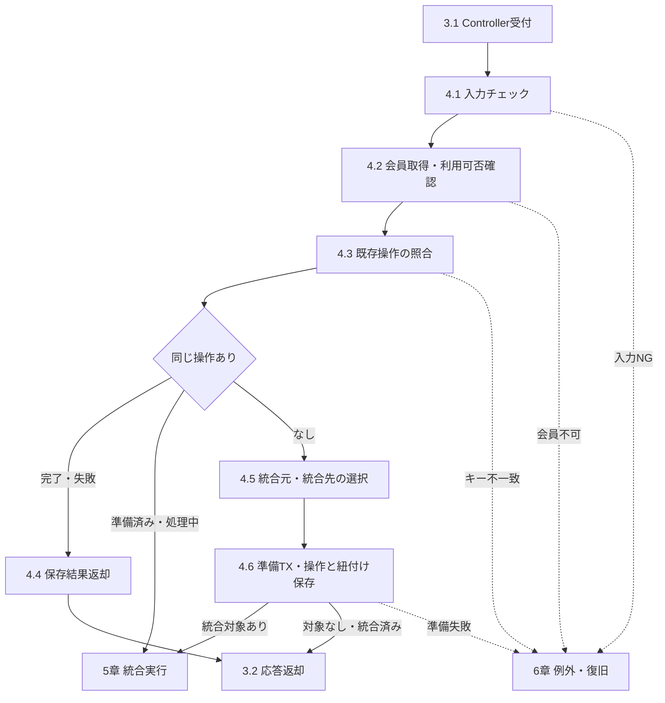
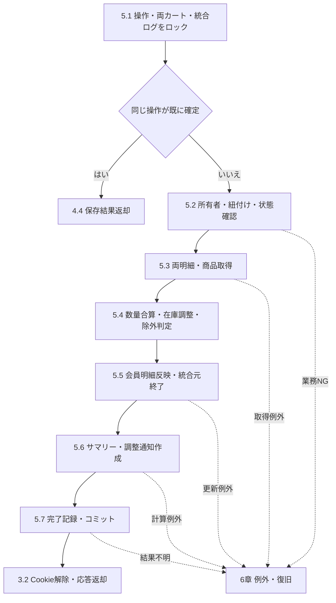

# APU003_05_ゲストカート統合（初回・再試行）

## 0. 処理フロー

### 0.1 受付・統合対象の確定



### 0.2 統合実行トランザクション



## 1. 基本情報

| 項目 | 内容 |
| --- | --- |
| 機能ID／旧ID | APU003_05／API-U13 |
| 論理名／物理名 | ゲストカート統合（初回・再試行）／merge-guest-cart |
| メソッド・URL | POST /api/v1/cart/merge |
| API Gateway認証 | 会員アクセストークン必須 |
| 対応画面 | SCU-03、SCU-04、SCU-06、CMN-01 |
| Controller | CartMergeController |
| Business | MergeGuestCartBusiness |
| 参照・更新 | carts、cart_items、cart_merge_logs、operation_histories。users・productsは参照 |
| 起動 | 会員初期化APU001_01成功後の統合要求、または統合再試行 |
| 対象外 | Cognitoログイン、トークン更新、会員登録、在庫引当、商品在庫の更新 |
| 失敗時 | 会員認証・会員登録を維持し、統合元を保全 |
| 応答 | ECSで捕捉可能な成功・例外はHTTP 200。data／errorで成否を判定 |

本APIは「会員の認証」と「ゲストカートの識別」を併用する。未ログイン用APIは設けない。
会員カートの数量を基準にゲスト数量を合算し、統合対象商品だけを最新在庫・販売状態で調整する。

## 2. リクエスト

### 2.1 項目

| 場所 | 項目 | 必須 | 内容 |
| --- | --- | --- | --- |
| ヘッダー | Authorization | 必須 | Bearer会員アクセストークン。共通処理済みsubを使用 |
| ヘッダー | Content-Type | 必須 | application/json |
| ヘッダー | Origin等 | 共通規定 | Cookieを使う更新要求のOrigin／CSRF対策 |
| Cookie | ec_guest_cart_token | 初回対象指定時 | ゲストカートの識別。準備済み操作・会員pending参照による再開時は省略可能 |
| JSON | operationId | 必須 | 小文字UUID v4、36文字 |
| パス・クエリ | なし | — | 未定義クエリは拒否 |

```http
POST /api/v1/cart/merge HTTP/1.1
Authorization: Bearer <会員アクセストークン>
Cookie: ec_guest_cart_token=<発行済みトークン>
Content-Type: application/json
```

```json
{
  "operationId": "9d4506fb-e778-44bd-b5f4-dd216695ba9c"
}
```

- userId、sourceCartId、targetCartId、数量、価格、cartVersionをフロントから受け付けない。
- 統合先はJWTのsubから検索した会員、統合元はCookieまたは保存済みの紐付けで確定する。
- 最新内容を統合する操作のためcartVersion照合は行わない。両カートの行ロック下で明細を読み直す。
- 同じ操作の通信再送は同じoperationId。確定FAILEDから利用者が新たに再試行する場合のみ新しいoperationId。

### 2.2 初回と再試行の違い

| 状況 | 使用する統合元 |
| --- | --- |
| 新規操作・pendingなし | Cookieで特定した有効ゲストカート |
| 新規操作・pendingあり | 会員カートのpending_merge_cart_id。Cookieが別カートを指す場合は拒否 |
| 同じoperationIdの再送 | 操作履歴に保存したsourceCartId・targetCartId |
| 統合済みCookieの再送 | 同じ会員・同じ統合先のCOMPLETEDログを確認して再加算なし |
| Cookieなし・pendingなし | 統合対象なしの成功。会員カートはそのまま |

保存済み操作に紐付く統合元を、現在のCookieで別カートへ置き換えない。

## 3. Controller

### 3.1 受付

| 項目 | 処理 |
| --- | --- |
| メソッド | CartMergeController.mergeGuestCart |
| 解析 | **共通機能使用：COM001_10 HTTP共通受付・JSON構文解析** |
| Command | 共通認証済みsub、JSONツリー、クエリ、Cookie値・同名Cookie件数 |
| 呼出 | MergeGuestCartBusiness.execute(command) |

ヘッダー・認証・Originの共通検証は親Controller／共通受付に委ねる。個別Controllerで再検証しない。ボディの入力チェック・会員検索・DB操作はBusinessで実施する。

### 3.2 応答返却・Cookie解除

- TX終了後、親Controller経由で**共通機能使用：COM001_07 共通レスポンス生成**。
- 例外は**共通機能使用：COM001_08 共通例外変換**。Cache-Control: no-store。
- 統合成功が確定し、要求Cookieが今回の統合元を指す場合だけ、以下を設定する。

```http
Set-Cookie: ec_guest_cart_token=; Path=/; Max-Age=0; HttpOnly; Secure; SameSite=Lax
```

| 状態 | Cookie |
| --- | --- |
| 新規統合成功・同一会員への統合済み確認 | 一致する旧Cookieのみ解除 |
| 成功再提示 | 要求Cookieが保存済み統合元と一致すると確認できた場合のみ解除 |
| 対象なし・期限切れ・失敗・処理中・結果不明 | 変更しない |
| 要求Cookieが別の新しいゲストカートを指す | 過去操作の成功再提示でそのCookieを解除しない |

フロントは統合中にゲスト追加・新Cookie発行を並行実行しない。Cookie解除の遅延応答で新しいCookieを消さないよう、別タブを含め共通認証・カート同期で直列化する。
本APIで会員・管理者の認証情報を失効させない。

## 4. Business：受付・統合準備

### 4.1 入力チェック

| 対象 | 条件 | NG時 |
| --- | --- | --- |
| JSON | object必須。許可キーはoperationIdのみ | INVALID_REQUEST |
| operationId | JSON string、小文字UUID v4、36文字、null不可 | VALIDATION_ERROR |
| クエリ | 指定なし | INVALID_REQUEST |
| Cookie | 任意。指定時は同名1件、1〜64文字、空白・制御文字・ASCII範囲外なし | INVALID_REQUEST |

operationIdの形式：`[0-9a-f]{8}-[0-9a-f]{4}-4[0-9a-f]{3}-[89ab][0-9a-f]{3}-[0-9a-f]{12}`。
DTOの@NotNull・@Pattern等をBusinessのValidator.validateで検証する。COM001_03は使用しない。
Cookieはトリム・大小変換しない。入力不正なら操作履歴も作らない。

### 4.2 会員取得・利用可否確認

**共通機能使用：COM001_04 subによる会員取得、COM001_05 会員利用状態判定。**

| 結果 | 次の処理 |
| --- | --- |
| 会員なし | USER_NOT_INITIALIZED |
| DISABLED／PENDING | ACCOUNT_DISABLED／MEMBER_NOT_READY |
| 利用可能 | actorType=USER、actorId=users.idの文字列で4.3へ |
| DB例外 | 6章へ。未登録扱いにしない |

### 4.3 既存操作照合

| テーブル | 条件 | 取得項目 |
| --- | --- | --- |
| operation_histories | operation_id=要求operationId | actor_type、actor_id、operation_type、request_hash、operation_status、result_code、result_summary_json、target_resource_id、is_retryable |

operation_type=`CART_MERGE`。request_hashは次のUTF-8・LF区切り文字列のSHA-256、小文字hex64桁。末尾改行なし。

```text
v1
CART_MERGE
USER
<users.idの正規10進表記>
```

- 要求ボディはoperationIdのみ。統合元は準備時にサーバーで選び、履歴のcontextへ固定するためハッシュにCookieを含めない。
- 主体・種別・ハッシュ不一致はIDEMPOTENCY_KEY_REUSED。既存結果や統合元を開示しない。
- 一致しSUCCEEDED／FAILEDは4.4。PROCESSINGは保存済みcontextで5章へ。
- 0件は4.5。並行要求に備え4.6でも一意制約を使用する。

### 4.4 保存結果返却

| 状態 | 返却・処理 |
| --- | --- |
| SUCCEEDED | 保存済みdata、replayed=true。requestIdのみ今回の値 |
| FAILED | 保存済みerror。同じキーで再実行しない |
| PROCESSING | 5章で操作行をロックし、未確定分のみ再開。待機時間超過なら6章 |
| 履歴JSON・状態不正 | INTERNAL_ERROR。推測で再加算しない |

PROCESSINGの再開は本APIの準備TX方式に限る。他機能のPROCESSINGを再実行する共通仕様にはしない。
成功応答のcartは元操作時点。フロントは再提示時にAPU003_01を取得して最新化する。

### 4.5 統合元・統合先の選択

| テーブル | 条件 | 取得項目 |
| --- | --- | --- |
| carts（統合先候補） | user_id=会員ID | id、pending_merge_cart_id、status、expires_at |
| carts（Cookie候補） | guest_cart_token=Cookie AND user_id IS NULL | id、status、expires_at |
| cart_merge_logs | source_cart_id=候補ID | id、user_id、target_cart_id、merge_status |

| 条件 | 選択 |
| --- | --- |
| 会員pendingあり | pendingを優先。Cookie指定があるなら同じsourceを指すことを確認 |
| pendingなし・有効Cookie候補あり | そのゲストカート |
| Cookieなし／候補0件、pendingなし | 統合対象なし |
| Cookie候補がEXPIRED／期限切れ、紐付けなし | 統合対象なし。理由GUEST_CART_EXPIRED |
| Cookie候補がMERGED | 同会員のCOMPLETEDログなら統合済み。別会員なら汎用業務エラー |
| 未定義status・不正な参照関係 | INTERNAL_ERROR |

ここでの検索は候補選択だけ。4.6でロック後に再判定する。

### 4.6 準備トランザクション

短いREAD COMMITTED TXで「誰の、どのカートを統合するか」を先に確定する。明細合算はしない。

#### 4.6.1 操作キー確保

```sql
INSERT INTO operation_histories (
  operation_id, operation_type, actor_type, actor_id,
  operation_status, is_retryable, request_hash, expires_at
) VALUES (
  #{operationId}, 'CART_MERGE', 'USER', #{userIdString},
  'PROCESSING', FALSE, #{requestHash}, NULL
)
ON CONFLICT (operation_id) DO NOTHING
RETURNING operation_id;
```

0件なら既存操作を再取得・照合する。この準備TXを終了し4.4または5章へ進む。候補Cookieで既存contextを書き換えない。

#### 4.6.2 カート確保・ロック

| 順序 | 処理 |
| --- | --- |
| 1 | 統合対象ありで会員カートなしの場合のみ、user_id一意制約で会員カートをINSERT ON CONFLICT DO NOTHING。別SELECTでid取得 |
| 2 | 統合元・先のcartsをid昇順でFOR UPDATE。候補からIDが変わった場合はTXを戻して再選択 |
| 3 | cart_merge_logsをsource_cart_idで確認・ロック。新規はsource_cart_id一意制約で登録 |

sourceに既存のCOMPLETEDログがある場合は、そのログの統合先と現在の会員カートを照合する。別の未完了pendingがある場合は解除せず、その状態をサマリーに保持する。

会員カート新規値：user_id=会員ID、guest_cart_token=NULL、status=ACTIVE、version=1、expires_at=NULL。
ロック順は「操作行→両カートID昇順→統合ログ」。商品ロックは実行TXでその後に取得する。
統合元の所有・ログ照合は他会員への再統合を拒否する。会員pendingが別のsourceを指す場合も拒否する。

#### 4.6.3 新規紐付け・再試行

| 対象 | 条件・設定 |
| --- | --- |
| 新規source | user_id IS NULL、status=ACTIVE、expires_at > ロック後DB時刻 |
| 同じsourceの既存ログ | user_id・target_cart_idが一致必須。別会員・別統合先なら拒否 |
| sourceの他pending参照 | 同じ会員以外のcarts.pending_merge_cart_idに参照されていないこと |
| 会員carts | pending_merge_cart_id=sourceCartId、updated_at=DB時刻。版・期限はまだ変更しない |
| cart_merge_logs | 初回INSERT：user_id、target_cart_id、source_cart_id、merge_status=PROCESSING、has_adjustments=false、adjustments_json=NULL、is_acknowledged=false |
| 再試行のログ | FAILED／PROCESSINGの同一行をPROCESSINGへ。COMPLETEDは再処理しない |
| operation_histories | target_resource_id=targetCartId、result_summary_jsonへ下記context、updated_at更新 |

```json
{
  "schemaVersion": 1,
  "context": {
    "sourceCartId": "201",
    "targetCartId": "301",
    "mergeLogId": "501"
  }
}
```

contextのIDは文字列。Cookie・JWT・氏名・メールは保存しない。
未完了紐付けがあるsourceは通常のゲスト追加・更新・削除を停止する。会員側更新・注文もpendingがある間は停止する。

**期限の扱い：**初回紐付け時は7日以内が必須。期限内にこのTXで受け付けた統合は、未完了の同一会員への復旧に限り、その後7日を過ぎても再開可能とする。ゲストとしての再利用や別会員への移管は許可しない。expires_at自体は延長しない。

#### 4.6.4 対象なし・既に統合済み

| 状況 | 処理 |
| --- | --- |
| Cookieなし／候補なし／未紐付けで期限切れ | 明細・親カートを作成・変更せず、action=CART_MERGE_NOT_REQUIRED、reasonを保存してSUCCEEDED |
| 同会員・同統合先のCOMPLETEDログあり | 明細を変更せずaction=CART_ALREADY_MERGED、既存mergeLogIdでSUCCEEDED |
| 同会員pendingとCOMPLETEDログが矛盾 | INTERNAL_ERROR。勝手にpendingを解除しない |

最新会員カートは5.6と同じ方法で作成し、成功dataを履歴へ保存して準備TXをコミットする。Cookie解除条件は3.2。
会員カートなしならcartId・version=null、items=[]、合計"0"、checkoutEligible=false、merge.status=NONE。
対象ありの場合はPROCESSING・context・pending・統合ログを同時コミットして5章へ。
準備TX中のエラーは全体をロールバックする。

## 5. Business：統合実行トランザクション

### 5.1 操作・カート・ログのロック

READ COMMITTEDの新しいTXを開始する。

| 順序 | SQL条件・ロック |
| --- | --- |
| 1 | operation_histories WHERE operation_id=要求ID FOR UPDATE |
| 2 | 主体・種別・ハッシュ再照合。確定済みなら4.4へ |
| 3 | contextのsource／targetのcartsをid昇順でFOR UPDATE |
| 4 | cart_merge_logs WHERE id=context.mergeLogId AND source_cart_id=context.sourceCartId FOR UPDATE |

同一キーの並行要求は操作行で待機する。先行処理成功後、後続は再加算せず元結果を返す。
別キーでも同じsourceの並行要求はカート・統合ログで直列化する。先行のCOMPLETEDが確認できればCART_ALREADY_MERGEDとしてその要求も成功記録し、合算をしない。

### 5.2 所有者・状態確認

| 項目 | 必須条件 | NG時 |
| --- | --- | --- |
| target.user_id | ログイン会員users.idと一致 | RESOURCE_NOT_FOUND |
| source.user_id | NULL | BUSINESS_RULE_VIOLATION |
| merge_log | user_id・source_cart_id・target_cart_idがcontextと一致 | BUSINESS_RULE_VIOLATION |
| target | ACTIVE、expires_at=NULL、pending_merge_cart_id=source.id | 不正ならINTERNAL_ERROR |
| source | ACTIVE。準備済み紐付けがあれば期限超過は復旧対象 | 他状態は業務NG／矛盾ならINTERNAL_ERROR |
| version | 両カートとも正、加算可能なBIGINT範囲 | INTERNAL_ERROR |

COMPLETED／MERGEDの整合する組合せは既に統合済みとして処理し、上記の未完了条件を適用しない。
Cookie値の有無だけで所有者を再決定しない。準備後の統合先会員変更は禁止する。

### 5.3 両明細・商品取得

| 取得元 | 条件・項目 |
| --- | --- |
| cart_items（source） | cart_id=source.id。id、product_id、quantity、added_product_name、added_price_including_tax、created_at |
| cart_items（target） | cart_id=target.id。同じ項目 |
| products | source明細に含まれるproduct_id。id昇順でFOR SHARE |
| 商品取得項目 | id、name、price_including_tax、stock_quantity、publish_status、sales_status、is_deleted |

明細はcreated_at ASC、id ASCで取得。1商品1明細の一意制約を前提とする。
数量1未満・重複・不正なIDはINTERNAL_ERROR。商品IDを昇順でロックし、統合対象商品の販売・在庫状態を計算からコミットまで固定する。在庫を減算・確保しない。

### 5.4 商品ごとの合算・調整

sourceに含まれる商品ごとに、G=ゲスト保存数量、M=会員保存数量（未登録0）、B=M+Gをlongで計算する。

| 商品条件（上から判定） | 会員側の統合後数量A | 通知 |
| --- | --- | --- |
| 商品不存在、is_deleted=true、publish_status=PRIVATE | Mを維持。ゲスト分は取り込まない | G→0、PRODUCT_UNAVAILABLE |
| 必要な状態・価格・在庫が不正／未定義 | 全統合を失敗。推測で除外しない | INTERNAL_ERROR |
| sales_status=SUSPENDED | Mを維持。ゲスト分は取り込まない | G→0、PRODUCT_UNAVAILABLE |
| stock_quantity=0 | Mを維持。ゲスト分は取り込まない | G→0、SOLD_OUT |
| PUBLIC・ON_SALE・未削除、在庫1以上 | A=min(B, stock_quantity) | A<BならB→A、STOCK_LIMIT |
| 上記でA=B | 合算数量を保存 | 調整通知なし |

- 公開・販売可能商品のM自体が在庫超過なら、AはMより小さくなる場合がある。例：M=8、G=2、在庫5→A=5。
- 販売不可の既存会員明細は自動削除しない。会員自身がカート画面から削除できる状態を残し、注文手続き不可とする。
- sourceに存在しない会員明細は変更しない。
- 数量以外に、商品名・税込価格等を入力から採用しない。税計算は行わず保存済み税込価格を使用する。
- 不正価格・在庫は在庫0とみなさない。価格は1以上、在庫は0〜99999、状態はDB列挙値を検証する。

#### 調整通知の保存形式

cart_merge_logs.adjustments_jsonは次の配列を保存する。数量の意味をscopeで固定する。

```json
[
  {
    "productId": "101",
    "productName": "サンプル商品",
    "scope": "COMBINED_QUANTITY",
    "beforeQuantity": 7,
    "afterQuantity": 5,
    "reason": "STOCK_LIMIT"
  },
  {
    "productId": "102",
    "productName": "追加時の商品名",
    "scope": "GUEST_CONTRIBUTION",
    "beforeQuantity": 2,
    "afterQuantity": 0,
    "reason": "PRODUCT_UNAVAILABLE"
  }
]
```

STOCK_LIMITは合算数量B→保存数量A。PRODUCT_UNAVAILABLE／SOLD_OUTはゲスト追加分G→0。
APIの既存通知形式に合わせ、scopeは直接返さずreasonの表示文言で意味を示す。

| 保存reason | APIで返す利用者向けreason |
| --- | --- |
| STOCK_LIMIT | 在庫状況により、統合後の数量を調整しました。 |
| PRODUCT_UNAVAILABLE | 現在購入できないため、ログイン前のカートの商品を引き継ぎませんでした。 |
| SOLD_OUT | 売り切れのため、ログイン前のカートの商品を引き継ぎませんでした。 |

通知名は公開・未削除商品なら現在名、その他はsource.added_product_name。不明なら「商品情報を取得できません」。
実在庫11以上を別項目や理由文言に載せない。beforeQuantity／afterQuantityは利用者自身の数量変更結果として返す。

### 5.5 明細反映・統合元終了

5.4の全商品計算が完了してから更新を開始する。

| 対象 | 条件・更新内容 |
| --- | --- |
| target既存明細 | A≠Mの場合のみquantity=A、updated_at=updatedAt。id・created_at・追加時商品名・追加時価格を維持 |
| target未登録・A>0 | 新規INSERT。cart_id=target、product_id、quantity=A、created_at・updated_at=updatedAt |
| 新規明細の追加時名称・価格 | sourceのadded_product_name・added_price_including_taxを継承。価格変更の比較基準を保つ |
| source明細 | 削除・数量変更しない。MERGEDカート配下に統合前記録として保持 |
| source親 | status=MERGED、version=version+1、updated_at=updatedAt。guest_cart_token・expires_atは保持 |
| target親 | pending_merge_cart_id=NULL、version=version+1、updated_at=updatedAt。expires_at=NULL維持 |

```sql
UPDATE carts
SET status = 'MERGED', version = version + 1, updated_at = #{updatedAt}
WHERE id = #{sourceCartId} AND user_id IS NULL AND status = 'ACTIVE';

UPDATE carts
SET pending_merge_cart_id = NULL, version = version + 1, updated_at = #{updatedAt}
WHERE id = #{targetCartId} AND user_id = #{userId}
  AND pending_merge_cart_id = #{sourceCartId} AND status = 'ACTIVE';
```

両親UPDATEは各1件必須。既存明細UPDATEも各1件、新規INSERTも各1件。期待件数不一致は全ロールバック。
updatedAtはロック待機後のDB clock_timestamp()をミリ秒精度で取得する。
取り込み0件・source空でも、今回初めて統合を完了させる場合は両版を1増やす。再送・統合済み判定では増やさない。
統合元を残しても、通常のゲスト取得ではMERGEDを空扱いとするため二重表示・再利用はしない。

### 5.6 統合後サマリー・通知

同一TXでtargetの全明細をproductsへLEFT JOINし、created_at・id昇順に取得する。APU003_01の4章・6章と同じ項目・判定を使用し、HTTP呼出しはしない。

| 項目 | 計算・設定 |
| --- | --- |
| totalQuantity | 購入不可分を含む保存数量合計 |
| purchasableQuantity | AVAILABLE明細の数量合計 |
| subtotalIncludingTax | AVAILABLEの現在税込単価×数量の合計 |
| checkoutEligible | 明細1件以上・全AVAILABLE・未完了統合なし |
| stockQuantity | 実在庫0〜10のみ公開。11以上または表示不可はnull |
| merge.status | 今回の統合完了はCOMPLETED |
| merge.notifications | 今回を含む全未読の調整通知 |

明細の名称・価格・販売状態・画像はAPU003_01の公開範囲に従う。canAddToCartは返さない。
合計はlong整数の安全演算。合計オーバーフロー等は全ロールバック。
ログのCOMPLETED更新後に通知を検索するか、今回の調整配列を既存未読通知へ重複なく追加する。

### 5.7 統合完了・操作成功の保存

| テーブル | 更新項目 |
| --- | --- |
| cart_merge_logs | merge_status=COMPLETED、has_adjustments=配列が非空、adjustments_json=調整配列、is_acknowledged=false、updated_at |
| operation_histories | operation_status=SUCCEEDED、is_retryable=false、result_code=CART_MERGED、target_resource_id=target.id、updated_at、expires_at=NULL |
| 操作結果JSON | schemaVersion=1、準備時context、7章のdata（replayed=false） |

統合済み分岐はresult_code=CART_ALREADY_MERGED。新規の明細更新を実行せず最新サマリーを保存する。
ログ・操作履歴の各UPDATE件数は1件。DTO・JSON生成までTX内で完了する。
明細・両カート・統合ログCOMPLETED・操作SUCCEEDEDを一緒にコミットする。どれかだけを確定させない。
sourceのトークンを操作結果JSONに複製しない。source親の削除は本APIの対象外。

## 6. 例外・再試行・復旧

### 6.1 例外応答

**共通機能使用：COM001_08 共通例外変換、COM001_09 安全なログ出力。**

| 条件 | error.code | message |
| --- | --- | --- |
| JSON・Cookie・未定義項目不正 | INVALID_REQUEST | リクエストの内容が正しくありません。 |
| operationIdの必須・形式不正 | VALIDATION_ERROR | 入力内容をご確認ください。 |
| 会員未初期化 | USER_NOT_INITIALIZED | 会員情報の準備が必要です。 |
| 会員利用不可 | ACCOUNT_DISABLED／MEMBER_NOT_READY | COM001_05の対応文言 |
| 別会員への紐付け・別pending競合 | BUSINESS_RULE_VIOLATION | カート情報を引き継げません。最新のカート状態をご確認ください。 |
| 操作キーの別主体・別用途利用 | IDEMPOTENCY_KEY_REUSED | 同じ操作識別子で異なるリクエストが送信されました。 |
| DB接続・待機・デッドロック | SERVICE_UNAVAILABLE | カート情報の引き継ぎを完了できませんでした。再試行してください。 |
| 不正DB値・計算異常・想定外例外 | INTERNAL_ERROR | カート情報の引き継ぎを完了できませんでした。 |
| 共通Origin等検証NG | CSRF_VALIDATION_FAILED | 操作を確認できませんでした。画面を再読み込みしてください。 |

HTTP 200、data=null、errorあり。項目エラー以外のfieldErrorsは[]。Gateway拒否・応答消失はこの形式を保証しない。
認証成功を取り消さない。パスワードやCognitoログインAPIを本Businessから呼ばない。

### 6.2 失敗記録の確定

準備TX済み・統合実行TXのロールバックが確認できた場合だけ、必要に応じ次の短い復旧TXでFAILEDを保存する。

| 順序 | 処理 |
| --- | --- |
| 1 | operation_idをFOR UPDATE。既にSUCCEEDEDなら上書きせず成功を返す |
| 2 | 両カートID昇順、統合ログをロック。既にCOMPLETEDなら失敗状態へ戻さず、同会員・同統合先を確認して当該操作もCART_ALREADY_MERGEDの成功として保存 |
| 3 | 未統合・同じ紐付けを再確認。operation_histories=FAILED、result_code・error保存 |
| 4 | cart_merge_logs=FAILED。pending・source明細は保持 |
| 5 | 復旧TXコミット後、共通例外へ渡す |

FAILEDのis_retryable=trueは、一時的DB障害等でロールバックが確定し、新しい操作として安全に再試行できる場合だけ。データ矛盾・権限問題はfalse。
同じキーはFAILEDを返す。安全な新操作は新キーで同じ統合ログを再利用する。確定失敗のerror JSONは保存結果から再提示する。

**コミット結果不明・復旧TX失敗時はFAILEDにしない。** PROCESSING・pendingを残し、同じoperationIdで5.1から再確認・再開する。
同じ操作の再開は操作行ロック下で行い、前回の統合実行TXが成功済みなら必ずSUCCEEDEDを読み取るため、二重加算しない。

### 6.3 データ復旧表

| 状況 | DB状態 | 対応 |
| --- | --- | --- |
| 入力NG・準備前NG | 未変更 | 入力・会員状態確認 |
| 準備TX失敗 | 全準備ロールバック | 同じキーで再試行。初回Cookieを保持 |
| 準備コミット後にプロセス停止 | 操作PROCESSING・pending・統合ログPROCESSING、明細未変更 | 同じキーで5章再開。Cookieなしでも同会員とcontextで復旧可能 |
| 統合途中のSQL例外 | 明細・版・COMPLETED・SUCCEEDEDが全ロールバック。準備記録は残る | 6.2で確定失敗を保存できれば新キー。できなければ同じキーで再確認 |
| 統合コミット成功・応答消失 | 明細反映済み・ログCOMPLETED・操作SUCCEEDED | 同じキーで元結果。Cookie解除を再試行 |
| 統合COMMIT結果不明 | 成功かロールバックか不明 | 操作行をロックして確定状態確認。時間経過だけでFAILEDにしない |
| 別キーで同じsourceを送信 | source一意ログあり | 同じ会員なら統合済み判定、別会員なら拒否 |
| 未完了のままゲスト期限超過 | 紐付け済みsourceを保全 | 同一会員への統合復旧のみ許可。ゲストAPIでは失効扱い |

逆向きの数量減算やsource再ACTIVE化を補償処理として行わない。後続操作の内容を壊すため。
未解決pending・PROCESSING・FAILEDに参照されるsource、操作結果、ログは削除対象にしない。
ロック待機・SQL・TXには設定済み上限を適用し、無制限再試行や外部API通信を含めない。

### 6.4 呼出側との連携

| 結果 | フロントの扱い |
| --- | --- |
| CART_MERGED | 最新サマリーでバッジ・カート更新。調整があればC12を表示 |
| CART_ALREADY_MERGED | 二重加算しない。最新表示へ同期 |
| CART_MERGE_NOT_REQUIRED | 統合対象なしのreasonを確認。期限切れならその旨を案内 |
| 失敗・結果不明 | ログインを維持。C11と再試行導線。注文手続きは未完了解消まで停止 |
| replayed=true | 操作結果を確認したうえでAPU003_01を再取得 |

API到達前の失敗はDBに未完了記録がない場合がある。APU003_01のmerge.status=NONEだけでフロントの未完了状態を解除しない。
確定FAILEDの再試行可否は操作結果照会のis_retryableに従う。初回・通信再送・業務再試行を区別する。

### 6.5 確認ケース

| ケース | 期待結果 |
| --- | --- |
| 会員2・ゲスト3・在庫10 | 会員5、調整なし |
| 会員2・ゲスト5・在庫5 | 会員5、7→5の調整通知 |
| 会員8・ゲスト2・在庫5 | 会員5、10→5の調整通知 |
| 非公開商品、会員2・ゲスト3 | 会員2を残しゲスト3を引き継がない |
| ゲストのみ売り切れ商品 | 会員へ登録せず除外通知 |
| 空ゲストカート | 統合完了・source終了。二重統合不可 |
| 同じキー同時実行 | 操作行で直列化、合算1回 |
| 別キー同じsource同時実行 | source一意ログ・両カートロックで合算1回 |
| 同じsourceを別会員が要求 | 拒否。元会員・明細情報を開示しない |
| 明細更新後に例外 | 全合算をロールバック、元明細・準備記録保持 |
| 成功後Cookieがなく同じキー再送 | 同会員の保存結果返却 |
| 準備後7日経過 | 紐付け済み会員の復旧のみ可能 |
| 期限切れsourceの初回統合 | 対象外。新たな紐付けなし |

## 7. 返却項目

### 7.1 共通項目

| 項目 | 型 | 内容 |
| --- | --- | --- |
| HTTP | — | ECS捕捉可能範囲は200 |
| Content-Type | header | application/json; charset=UTF-8 |
| Cache-Control | header | no-store |
| Set-Cookie | header | 3.2の成功条件のみ旧ゲストCookie解除 |
| requestId | string | 今回の追跡ID |
| data | object / null | 成功時の結果。例外時null |
| error | object / null | 成功時null |
| error.code・message | string | 6.1のコード・文言 |
| error.fieldErrors | array | 共通の項目エラー形式。その他[] |

### 7.2 成功data

| 項目 | 型 | 内容 |
| --- | --- | --- |
| action | string | CART_MERGED／CART_ALREADY_MERGED／CART_MERGE_NOT_REQUIRED |
| operationId | string | 操作ID |
| operationStatus | string | SUCCEEDED |
| replayed | boolean | 同じ操作の保存結果ならtrue |
| mergeLogId | string / null | 統合ログID。対象なしはnull |
| hasAdjustments | boolean | 対象統合ログに調整・除外があるか |
| reason | string / null | 対象なし時NO_GUEST_CART／GUEST_CART_EXPIRED。それ以外null |
| cart | object | 統合後の会員カートサマリー。APU003_01と同形式 |

### 7.3 cart

| 項目 | 型 | 内容 |
| --- | --- | --- |
| cartId・version | string / null | 会員カートID・版。カート未作成時null |
| totalQuantity | string | 購入不可分を含む保存数量合計 |
| purchasableQuantity | string | AVAILABLE明細数量合計 |
| subtotalIncludingTax | string | AVAILABLEの税込商品合計 |
| checkoutEligible | boolean | 注文手続き可否 |
| items | array | 全明細、追加日時・明細ID昇順 |
| items[].cartItemId・productId | string | 明細・商品ID |
| items[].name・imageUrl | string、string / null | 表示名・現在の公開可能な画像 |
| items[].quantity | integer | 保存数量 |
| items[].unitPriceIncludingTax | integer / null | 現在の公開可能な税込単価 |
| items[].lineSubtotalIncludingTax | string / null | AVAILABLEの小計 |
| items[].stockQuantity | integer / null | 0〜10、11以上・非表示はnull |
| items[].availability | string | AVAILABLE／INSUFFICIENT_STOCK／SOLD_OUT／UNAVAILABLE／UNKNOWN |
| items[].canViewProduct | boolean | 詳細遷移可否 |
| items[].priceChanged | boolean / null | 追加時価格からの変更 |
| merge.status | string | 今回完了時COMPLETED。対象なしは現在の状態 |
| merge.notifications | array | 全未読調整通知 |
| notifications[].mergeLogId・detailsAvailable | string、boolean | 通知ID・詳細取得可否 |
| notifications[].adjustments | array | productId、productName、beforeQuantity、afterQuantity、reason。5.4の対応 |

### 7.4 正常JSON例（会員2＋ゲスト5を在庫5へ調整）

```json
{
  "requestId": "req-cart-merge-001",
  "data": {
    "action": "CART_MERGED",
    "operationId": "9d4506fb-e778-44bd-b5f4-dd216695ba9c",
    "operationStatus": "SUCCEEDED",
    "replayed": false,
    "mergeLogId": "501",
    "hasAdjustments": true,
    "reason": null,
    "cart": {
      "cartId": "301",
      "version": "5",
      "totalQuantity": "5",
      "purchasableQuantity": "5",
      "subtotalIncludingTax": "9900",
      "checkoutEligible": true,
      "items": [
        {
          "cartItemId": "1001",
          "productId": "101",
          "name": "サンプル商品",
          "imageUrl": null,
          "quantity": 5,
          "unitPriceIncludingTax": 1980,
          "lineSubtotalIncludingTax": "9900",
          "stockQuantity": 5,
          "availability": "AVAILABLE",
          "canViewProduct": true,
          "priceChanged": false
        }
      ],
      "merge": {
        "status": "COMPLETED",
        "notifications": [
          {
            "mergeLogId": "501",
            "detailsAvailable": true,
            "adjustments": [
              {
                "productId": "101",
                "productName": "サンプル商品",
                "beforeQuantity": 7,
                "afterQuantity": 5,
                "reason": "在庫状況により、統合後の数量を調整しました。"
              }
            ]
          }
        ]
      }
    }
  },
  "error": null
}
```

### 7.5 例外JSON例（HTTP 200）

```json
{
  "requestId": "req-cart-merge-002",
  "data": null,
  "error": {
    "code": "SERVICE_UNAVAILABLE",
    "message": "カート情報の引き継ぎを完了できませんでした。再試行してください。",
    "fieldErrors": []
  }
}
```

この応答だけで未反映確定とみなさない。元operationIdで結果を確認する。認証状態は変更しない。
