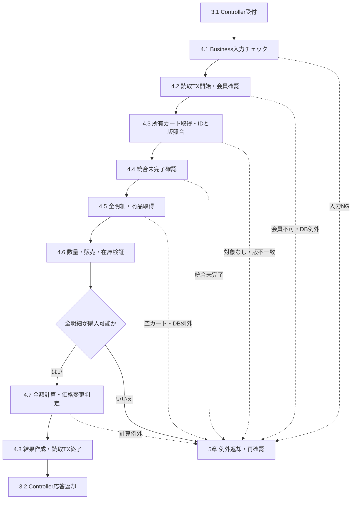

# APU003_06_注文手続きへ進む前のカート検証

## 0. 処理フロー



## 1. 基本情報

| 項目 | 内容 |
| --- | --- |
| 機能ID／旧ID | APU003_06／API-U14 |
| 論理名／物理名 | 注文手続きへ進む前のカート検証／validate-cart-for-checkout |
| HTTPメソッド・URL | POST /api/v1/cart/validate-for-checkout |
| API Gateway認証 | 会員アクセストークン必須 |
| 対応画面 | SCU-06「レジへ進む」→SCU-07 |
| Controller | CartCheckoutValidationController |
| Business | ValidateCartForCheckoutBusiness |
| 参照テーブル | users、carts、cart_items、products、cart_merge_logs |
| 登録・更新・削除 | なし。カート数量・版・期限・統合通知既読も変更しない |
| operationId | 不要。operation_historiesへ記録しない |
| トランザクション | 読み取り専用・REPEATABLE READ |
| 行ロック | FOR UPDATE／FOR SHAREを使用しない |
| 応答 | ECSが捕捉可能な成功・例外はHTTP 200。data／errorで判定 |

本APIの成功は、取得したスナップショットで注文手続きへ進めることを示す。在庫・価格の予約、注文成立を保証しない。
確認トークン・checkoutId・検証済みDBフラグは新設しない。要求追跡には共通requestIdを使用する。

### 1.1 呼出条件と責務

| 項目 | 内容 |
| --- | --- |
| 会員 | 最新カートを表示し、数量変更・削除・統合が完了した後に呼ぶ |
| ゲスト | 直接呼ばない。ログイン→APU001_01会員初期化→APU003_05統合→会員カート再取得後に呼ぶ |
| 未保存の数量入力 | 画面側で保存または取消してから呼ぶ。本APIはDB保存済み数量だけを検証 |
| フロント保持中の統合未完了 | APU003_05の結果で解消するまで呼出し・注文遷移を停止 |
| 成功後 | SCU-07でAPU004_01を呼び、注文確認情報を改めて取得 |
| 注文確定時 | APU004_03で所有権・会員状態・カート・統合・価格・在庫を再検証 |

APU003_05到達前に失敗した統合はDB上に記録がない場合がある。本APIだけでその有無を判定できると扱わない。

## 2. リクエスト

### 2.1 項目

| 場所 | 項目 | 必須 | 型・条件 |
| --- | --- | --- | --- |
| ヘッダー | Authorization | 必須 | Bearer会員アクセストークン。共通処理済みsubを使用 |
| ヘッダー | Content-Type | 必須 | application/json |
| JSON | cartId | 必須 | string。最後に表示した会員カートID |
| JSON | cartVersion | 必須 | string。最後に表示した会員カート版 |
| パス・クエリ | なし | — | 未定義クエリは拒否 |
| Cookie | 使用しない | — | ゲストCookieでカートを検索・統合しない |

```http
POST /api/v1/cart/validate-for-checkout HTTP/1.1
Authorization: Bearer <会員アクセストークン>
Content-Type: application/json
```

```json
{
  "cartId": "301",
  "cartVersion": "5"
}
```

cartIdは所有者を決める値ではなく、画面が表示していたカートとの一致確認用。DB検索はログイン会員のusers.idで行う。
カートの再作成等で版が同じ値になった場合も、別カートを誤って検証済みとしないためIDを併せて照合する。
userId、商品ID、数量、価格、送料、operationId、統合完了フラグ等は受け付けない。

### 2.2 DTOと型変換

```java
public record ValidateCartForCheckoutRequest(
    @NotNull
    @Pattern(regexp = "[1-9][0-9]{0,18}")
    String cartId,

    @NotNull
    @Pattern(regexp = "[1-9][0-9]{0,18}")
    String cartVersion
) {}
```

- jakarta.validationのアノテーションを使用し、BusinessでValidator.validateを実行する。
- JSONのstring型を確認してDTOへ変換する。numberやbooleanを自動的にStringへ変換しない。
- @PatternだけではLong上限を保証しない。BusinessでLong.parseLongを行い、変換失敗を項目エラーにする。
- トリム、先頭0除去、小数の丸めは行わない。COM001_03は使用しない。

## 3. Controller

### 3.1 リクエスト受付

| 項目 | 処理 |
| --- | --- |
| メソッド | CartCheckoutValidationController.validateForCheckout |
| 解析 | **共通機能使用：COM001_10 HTTP共通受付・JSON構文解析** |
| Command | 共通認証済みsub、厳密変換済みの専用DTO、クエリ |
| 呼出 | ValidateCartForCheckoutBusiness.execute(command) |

ヘッダー・アクセストークンの共通検証は親Controller／共通受付に委ねる。個別ControllerでJWT検証、DTO単項目検証、Long変換、DB参照を行わない。
JWT不正・未指定をゲスト経路へ切り替えない。

### 3.2 応答返却

| 結果 | 処理 |
| --- | --- |
| Business正常終了 | 親Controller経由で**共通機能使用：COM001_07 共通レスポンス生成** |
| Business例外 | **共通機能使用：COM001_08 共通例外変換** |
| 全応答 | Cache-Control: no-store |
| Cookie | 発行・更新・削除しない |

読取TXが終了してから応答する。途中まで取得した商品や部分合計を例外応答に混在させない。

共通機能使用：COM001_10。JSON構造・未知項目・型不一致は受付でINVALID_REQUEST。BusinessがDTOの必須・値域・相関を検証し、違反はVALIDATION_ERROR。

## 4. Business

### 4.1 入力チェック

| 対象 | 条件 | NG時 |
| --- | --- | --- |
| ボディ | object必須。空ボディ・null・配列不可 | INVALID_REQUEST |
| 許可項目 | cartId・cartVersionのみ | INVALID_REQUEST |
| クエリ | 項目なし | INVALID_REQUEST |
| cartId | string必須、1〜19文字、[1-9][0-9]{0,18}、Long範囲内 | VALIDATION_ERROR |
| cartVersion | string必須、同じく正のLong範囲内 | VALIDATION_ERROR |

数値0・負数・先頭0・空白・小数・指数表記・Long上限超過を拒否する。
項目同士の判定は以下で行う。

| 組合せ | 判定箇所 |
| --- | --- |
| 認証会員とDBカート所有者 | 4.3 |
| 要求cartIdとDBカートID | 4.3 |
| 要求cartVersionとそのカートのDB版 | 4.3 |
| pending参照と統合履歴 | 4.4 |
| 各明細の保存数量と同商品の実在庫 | 4.6 |

入力NGではDB参照・操作履歴登録を行わない。

### 4.2 読取TX開始・会員確認

ここから4.8まで、読み取り専用のREPEATABLE READトランザクションで実行する。
会員・カート・明細・商品・統合状態を同一スナップショットで確認する。共通の会員検索はこのTXに参加させ、別TXやキャッシュ結果を使わない。

**共通機能使用：COM001_04 subによる会員取得、COM001_05 会員利用状態判定。**

| 結果 | 処理 |
| --- | --- |
| 会員なし | USER_NOT_INITIALIZED |
| 会員DISABLED | ACCOUNT_DISABLED |
| 会員PENDING | MEMBER_NOT_READY |
| 利用可能 | users.idを保持し4.3へ |
| DB例外・不正な会員状態 | 5章へ。未登録扱いにしない |

参照スナップショットの基準時刻をDBのtransaction_timestamp()から取得し、validatedAtとして返す。これは検証対象時点の目安であり有効期限ではない。

### 4.3 所有カート取得・IDと版の照合

| テーブル | 条件 | 取得項目 |
| --- | --- | --- |
| carts | user_id=4.2のusers.id | id、user_id、status、version、expires_at、pending_merge_cart_id |

```sql
SELECT id, user_id, status, version, expires_at, pending_merge_cart_id
FROM carts
WHERE user_id = #{userId,jdbcType=BIGINT};
```

| 判定順 | 使用項目 | 条件・次の処理 |
| --- | --- | --- |
| 1 | 取得件数 | 0件はRESOURCE_NOT_FOUND。複数件はINTERNAL_ERROR |
| 2 | user_id、id、version、status、expires_at | 所有者一致、正のID・版、ACTIVE、expires_at IS NULL。DB不整合はINTERNAL_ERROR |
| 3 | 要求cartId、carts.id | 一致しなければRESOURCE_NOT_FOUND |
| 4 | 要求cartVersion、carts.version | 一致しなければVERSION_CONFLICT |
| 5 | 正常 | 4.4へ |

要求cartIdで他会員のカートを直接取得しない。他者カートと不存在を区別して返さない。
版が異なる場合は、数量が偶然同じでも停止する。画面に最新状態を再表示してから再検証する。
商品価格・在庫の変更はcarts.versionだけでは検出できないため、版一致後も4.5以降を実行する。

### 4.4 統合未完了の確認

| 取得元 | 条件・項目 |
| --- | --- |
| carts | 4.3のpending_merge_cart_id |
| cart_merge_logs | user_id=会員ID AND target_cart_id=カートID |
| ログ取得項目 | id、user_id、source_cart_id、target_cart_id、merge_status |

```sql
SELECT id, user_id, source_cart_id, target_cart_id, merge_status
FROM cart_merge_logs
WHERE user_id = #{userId,jdbcType=BIGINT}
  AND target_cart_id = #{cartId,jdbcType=BIGINT}
ORDER BY created_at ASC, id ASC;
```

| 条件 | 判定 |
| --- | --- |
| pendingあり、対応する未完了ログなし | 統合待ちとしてBUSINESS_RULE_VIOLATION |
| PROCESSING／FAILEDのログあり | 統合未完了としてBUSINESS_RULE_VIOLATION |
| pendingなし、ログなし | 統合未完了なし。4.5へ |
| pendingなし、全ログCOMPLETED | 統合完了。4.5へ |
| pendingがCOMPLETEDを指す、未定義状態など整合しない | INTERNAL_ERROR。注文手続き不可 |

pendingがある場合は参照先cartsをidで取得し、存在・user_id IS NULL・targetと別IDを確認する。不正参照を「統合済み」とみなさない。
調整通知の未読だけでは注文を止めない。is_acknowledgedを変更せず、統合APIを自動実行しない。

### 4.5 全明細・商品取得

| 取得元 | 条件・項目 |
| --- | --- |
| cart_items ci | ci.cart_id=4.3で確認したcartId |
| LEFT JOIN products p | p.id=ci.product_id |
| 明細項目 | ci.id、ci.product_id、ci.quantity、ci.added_price_including_tax |
| 商品項目 | p.id、p.name、p.price_including_tax、p.stock_quantity、p.publish_status、p.sales_status、p.is_deleted |
| 並び順 | ci.created_at ASC、ci.id ASC |

```sql
SELECT ci.id AS cart_item_id,
       ci.product_id,
       ci.quantity,
       ci.added_price_including_tax,
       p.id AS current_product_id,
       p.name,
       p.price_including_tax,
       p.stock_quantity,
       p.publish_status,
       p.sales_status,
       p.is_deleted
FROM cart_items ci
LEFT JOIN products p ON p.id = ci.product_id
WHERE ci.cart_id = #{cartId,jdbcType=BIGINT}
ORDER BY ci.created_at ASC, ci.id ASC;
```

| 結果 | 処理 |
| --- | --- |
| 0件 | BUSINESS_RULE_VIOLATION：カートが空 |
| 1件以上 | 4.6へ |
| DB例外 | 5章へ |

非公開・削除済みをWHERE句で除外しない。不正な商品が残るカートを、問題なしとして通過させないため。
サーバー側で明細を全件検証する。画面が表示・送信した商品のみを検証する方式にはしない。

### 4.6 数量・販売・在庫検証

各明細について上から順に確認する。DB構造異常と、通常起こる販売不可を分ける。

| 順序 | 使用項目 | 条件 | NG時 |
| --- | --- | --- | --- |
| 1 | ci.id、ci.product_id、ci.quantity | 正のID、数量1以上の整数。商品ID重複なし | INTERNAL_ERROR |
| 2 | p.id | 存在する | BUSINESS_RULE_VIOLATION：購入不可商品 |
| 3 | p.is_deleted、p.publish_status | is_deleted=false、publish_status=PUBLIC | 削除済み・PRIVATEは購入不可。null・未定義値はINTERNAL_ERROR |
| 4 | p.sales_status | ON_SALE | SUSPENDEDは購入不可。null・未定義値はINTERNAL_ERROR |
| 5 | p.name、p.price_including_tax、p.stock_quantity | 商品名1〜100文字、税込価格1以上、在庫0〜99999 | INTERNAL_ERROR |
| 6 | p.stock_quantity | 1以上 | BUSINESS_RULE_VIOLATION：売り切れ |
| 7 | ci.quantity、p.stock_quantity | ci.quantity <= p.stock_quantity | BUSINESS_RULE_VIOLATION：在庫不足 |

全件を検証し、不正DB値があればINTERNAL_ERROR。通常の購入不可があれば共通の購入不可・在庫不足エラーを返す。
購入不可明細が1件でもあれば、購入可能な明細だけで通過させない。

- 比較に使用するのはDBの実在庫。返却用stockQuantityがnullでも実在庫照合を省略しない。
- 例：保存数量20・実在庫15はエラー。実在庫15を文言・別項目で返さない。
- 数量を在庫まで自動で減らさない。購入不可商品の自動削除もしない。
- 商品別の購入上限は設けず、保存数量と実在庫で判定する。
- 注文手続きの権利を確保する処理ではない。SELECT時点以降の変動は注文確認・注文確定APIで再検証する。

### 4.7 金額計算・価格変更判定

全明細が4.6を通過した場合のみ実施する。

| 算出項目 | 使用項目・計算 |
| --- | --- |
| 明細小計 | p.price_including_tax × ci.quantity |
| 保存数量合計 | 全ci.quantityの合計 |
| 税込商品合計 | 全明細小計の合計 |
| priceChanged | 有効なci.added_price_including_taxと現在p.price_including_taxを比較 |
| hasPriceChanges | priceChanged=trueの明細が1件以上ならtrue |

計算はlong整数、Math.multiplyExact／Math.addExact等を使用する。浮動小数点を使わず、オーバーフローはINTERNAL_ERROR。
税抜価格・税率から再計算せず、products.price_including_taxの保存値を使用する。送料・決済手数料・注文総額は本APIでは計算しない。
追加時価格が不正で比較できない場合はpriceChanged=nullとし、現在価格が有効なら検証を継続する。hasPriceChangesは「確認できた変更」の有無とする。
価格が追加時から変わっていても本APIは成功可能。SCU-07で現在価格・総額を提示して注文を確定する。priceChangedは直前の画面表示との差分を保証する項目ではない。

### 4.8 結果作成・読取TX終了

| 項目 | 設定 |
| --- | --- |
| action | CART_VALIDATED_FOR_CHECKOUT |
| checkoutEligible | true固定。検証NGは例外応答 |
| validatedAt | 4.2の時刻。UTC・ミリ秒・Z付き文字列 |
| cartId・cartVersion | 検証したDB値を10進文字列化 |
| items | 全検証済み明細。4.5の順序 |
| totalQuantity・subtotalIncludingTax | 4.7の合計を10進文字列化 |
| hasPriceChanges | 4.7の判定 |
| stockQuantity | 実在庫1〜10は数値、11以上はnull |

成功では全明細購入可能なためstockQuantity=0は返らない。値がnullでも購入可否は実在庫で検証済み。
DTO作成後に読取TXを終了し、Controllerへ返す。途中のSQLやDTO作成が失敗したら成功応答を返さない。
本APIは結果をDBへ保存しない。同じリクエストでも商品・在庫・カートの変更によって次回の判定結果は変わる。

## 5. 例外・復旧・画面連携

### 5.1 例外返却

**共通機能使用：COM001_08 共通例外変換、COM001_09 安全なログ出力。**

| 条件 | error.code | message |
| --- | --- | --- |
| JSON構造・未知項目・クエリ不正 | INVALID_REQUEST | リクエストの内容が正しくありません。 |
| 必須・形式・型・Long範囲NG | VALIDATION_ERROR | 入力内容をご確認ください。 |
| 会員未初期化 | USER_NOT_INITIALIZED | 会員情報の準備が必要です。 |
| 会員利用不可 | ACCOUNT_DISABLED／MEMBER_NOT_READY | COM001_05の対応文言 |
| 会員カートなし・要求cartId不一致 | RESOURCE_NOT_FOUND | 指定された情報を表示できません。 |
| カート版不一致 | VERSION_CONFLICT | 情報が更新されています。最新の内容をご確認ください。 |
| 統合待ち・PROCESSING・FAILED | BUSINESS_RULE_VIOLATION | カート情報の引き継ぎが完了していません。再試行してください。 |
| カート明細0件 | BUSINESS_RULE_VIOLATION | カートに商品が入っていません。 |
| 非公開・販売停止・削除済み・売り切れ・在庫不足 | BUSINESS_RULE_VIOLATION | 在庫不足または購入できない商品が含まれています。該当商品の数量変更または削除を行ってください。 |
| DB接続障害・SQLタイムアウト | SERVICE_UNAVAILABLE | カート内容を確認できませんでした。時間をおいて再度お試しください。 |
| DB不整合・不正値・計算例外 | INTERNAL_ERROR | カート内容を確認できませんでした。 |

- 捕捉可能な例外はHTTP 200、data=null、errorあり。正常応答のcheckoutEligible=falseとエラー応答を混在させない。
- 入力項目違反は共通形式のfieldErrorsへcartId／cartVersionを設定。その他のfieldErrorsは[]。
- 購入不可の個別明細はAPU003_01で再取得し、availabilityに従って画面へ表示する。例外に部分サマリーを追加しない。
- GatewayでのJWT拒否やネットワーク遮断は、本APIのHTTP 200・JSON形式を保証しない。
- SQL、JWT、他会員情報、11以上の実在庫を返却・ログ出力しない。

### 5.2 データ復旧

| 状況 | 復旧方法 |
| --- | --- |
| 入力NG | DB変更なし。入力・画面保持値を確認 |
| 版不一致 | APU003_01で最新カートを取得し再表示。利用者が確認後、新しいID・版で再実行 |
| 統合未完了 | APU003_05で結果確認・再試行後、最新カートを取得して再実行 |
| 在庫不足・購入不可 | APU003_03の数量更新またはAPU003_04の1明細削除で解消し、再取得・再実行 |
| DB例外・計算異常 | 読取TXを終了・ロールバック。更新がないため補償更新なし |
| 応答消失・タイムアウト | 同じ検証要求を再送可能。前回成功の結果照会は不要 |
| 応答成功後に商品・カートが変動 | 注文確認・注文確定時の再検証で検出 |

本APIでは登録・更新・削除がないため、operation_historiesや手動データ書戻しを使用しない。
再送時に版不一致になった場合は最新表示へ戻す。失敗を理由に在庫数・カート数量を変更しない。

### 5.3 次画面への引き継ぎ

| 情報・状態 | 扱い |
| --- | --- |
| 成功時 | 返却cartId・cartVersionを画面状態へ反映し、SCU-07へ遷移 |
| バッジ | 成功totalQuantityで同期。別カート・古い版の応答を採用しない |
| 価格変更 | hasPriceChanges=trueなら現在価格確認を案内。SCU-07で最新金額を表示 |
| SCU-07初期表示 | APU004_01で注文確認情報・保存済み配送先等を再取得 |
| 注文確定 | 本API成功フラグやvalidatedAtだけを信用しない。APU004_03が業務条件を再検証 |
| 本API未実行でSCU-07へ直接アクセス | APU004_01側でも認証・カート等を検証。本APIの実行有無を認可条件にしない |
| 検証中 | カート変更との競合を避け、画面内の数量更新・削除・レジ操作を停止 |
| 読取中に画面離脱 | DB変更はない。離脱後の応答は画面へ反映しない |

検証中でも別タブ・他端末の更新は起こり得る。read-onlyの検証結果を長時間キャッシュして通過判定に使わない。

### 5.4 確認ケース

| ケース | 期待結果 |
| --- | --- |
| 所有カート・ID版一致・全商品購入可能 | 成功、checkoutEligible=true |
| cartIdが他会員のID | RESOURCE_NOT_FOUND。相手の情報を開示しない |
| カート版が古い | VERSION_CONFLICT。自動で最新化して通過しない |
| pending参照あり、ログ未作成 | 統合待ちで停止 |
| 統合ログPROCESSING／FAILED | 停止。ログイン状態維持 |
| 統合COMPLETED、未読調整通知あり | 明細条件を満たせば成功。既読化しない |
| カート明細0件 | 空カートエラー |
| 公開商品と非公開商品が混在 | 全体エラー。公開商品のみで通過しない |
| 保存数量5・実在庫5／4 | 成功／在庫不足 |
| 保存数量20・実在庫15 | 在庫不足。実在庫15を返さない |
| 実在庫10／11、保存数量1 | 成功stockQuantity=10／null |
| 追加時価格1980、現在2200 | 成功、priceChanged=true、現在2200で集計 |
| 別タブの更新が読取TX開始後に確定 | 取得スナップショットで判定。後続APIで再検証 |
| リクエストcartVersionが数値・小数・null | 入力エラー |
| DB障害 | 空カート扱いにせず例外。補償更新なし |
| 同じ要求の再送 | 再検証のみ。数量・版・期限は変更なし |

## 6. 返却項目

### 6.1 共通項目・ヘッダー

| 項目 | 型 | 内容 |
| --- | --- | --- |
| HTTP | — | ECSが捕捉可能な場合は200 |
| Content-Type | header | application/json; charset=UTF-8 |
| Cache-Control | header | no-store |
| Set-Cookie | header | 出力しない |
| requestId | string | 今回の要求追跡ID。検証許可トークンではない |
| data | object / null | 正常時は6.2、例外時null |
| error | object / null | 正常時null |
| error.code・message | string | 5.1のコード・文言 |
| error.fieldErrors | array | 共通形式。項目エラー以外[] |

### 6.2 正常data

| 項目 | 型 | 内容 |
| --- | --- | --- |
| action | string | CART_VALIDATED_FOR_CHECKOUT固定 |
| checkoutEligible | boolean | true固定 |
| validatedAt | string | 参照TXの基準時刻。例：2026-11-15T06:00:00.123Z |
| cartId | string | 検証した会員カートID |
| cartVersion | string | 検証したカート版 |
| totalQuantity | string | 保存済み全明細数量合計 |
| subtotalIncludingTax | string | 商品の税込小計合計。送料・手数料なし |
| hasPriceChanges | boolean | 比較可能な追加時価格から変更された明細の有無 |
| items | array | 検証済み全明細。追加日時・明細ID昇順 |

### 6.3 items[]

| 項目 | 型 | 内容 |
| --- | --- | --- |
| cartItemId | string | 明細ID |
| productId | string | 商品ID |
| name | string | 現在の公開商品名 |
| quantity | integer | 保存数量 |
| unitPriceIncludingTax | integer | 現在の税込単価 |
| lineSubtotalIncludingTax | string | 現在税込単価×数量 |
| stockQuantity | integer / null | 実在庫1〜10、11以上はnull |
| availability | string | 成功時はAVAILABLE固定 |
| priceChanged | boolean / null | 追加時価格との比較。比較不能null |

本APIは検証結果に必要な項目を返す。画像・統合通知はAPU003_01、配送先・カード・送料を含む確認表示はAPU004_01で取得する。

### 6.4 正常JSON例

```json
{
  "requestId": "req-cart-checkout-validation-001",
  "data": {
    "action": "CART_VALIDATED_FOR_CHECKOUT",
    "checkoutEligible": true,
    "validatedAt": "2026-11-15T06:00:00.123Z",
    "cartId": "301",
    "cartVersion": "5",
    "totalQuantity": "2",
    "subtotalIncludingTax": "3960",
    "hasPriceChanges": false,
    "items": [
      {
        "cartItemId": "1001",
        "productId": "101",
        "name": "サンプル商品",
        "quantity": 2,
        "unitPriceIncludingTax": 1980,
        "lineSubtotalIncludingTax": "3960",
        "stockQuantity": null,
        "availability": "AVAILABLE",
        "priceChanged": false
      }
    ]
  },
  "error": null
}
```

### 6.5 カート版不一致（HTTP 200）

```json
{
  "requestId": "req-cart-checkout-validation-002",
  "data": null,
  "error": {
    "code": "VERSION_CONFLICT",
    "message": "情報が更新されています。最新の内容をご確認ください。",
    "fieldErrors": []
  }
}
```

### 6.6 購入不可・在庫不足（HTTP 200）

```json
{
  "requestId": "req-cart-checkout-validation-003",
  "data": null,
  "error": {
    "code": "BUSINESS_RULE_VIOLATION",
    "message": "在庫不足または購入できない商品が含まれています。該当商品の数量変更または削除を行ってください。",
    "fieldErrors": []
  }
}
```

### 6.7 DB障害（HTTP 200）

```json
{
  "requestId": "req-cart-checkout-validation-004",
  "data": null,
  "error": {
    "code": "SERVICE_UNAVAILABLE",
    "message": "カート内容を確認できませんでした。時間をおいて再度お試しください。",
    "fieldErrors": []
  }
}
```
