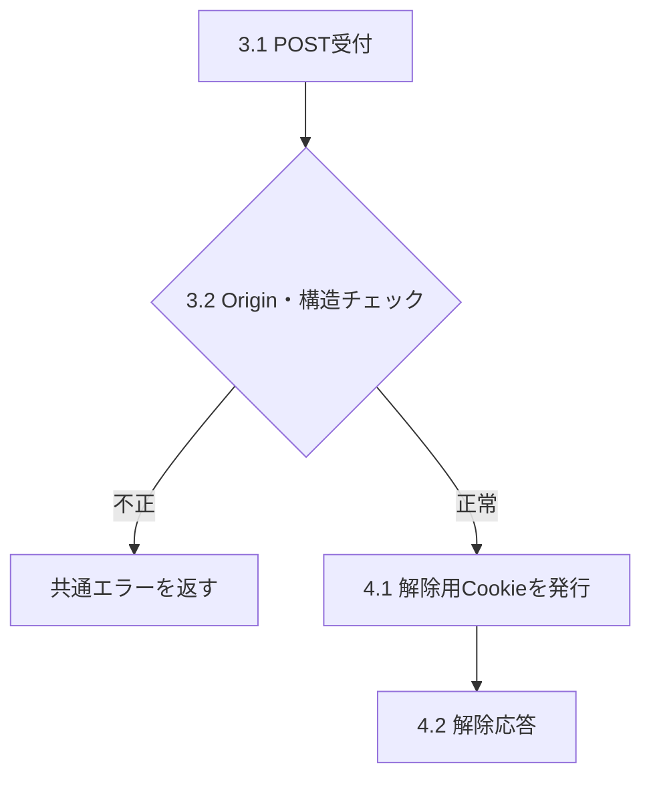

# APU003_07_ゲストカート識別解除



## 1. 機能
会員のAmplifyログアウト後にブラウザのゲスト識別だけを解除する。DBカート、統合履歴、操作履歴、会員・管理者の認証情報は変更しない。

## 2. リクエスト
POST /api/v1/guest/cart/clear-token。Gateway JWTなし。Origin（欠落時のみReferer）、Cookieは任意。ボディなし・クエリなし。JSONの送信例はなく、空ボディで送る。操作ID不要。

## 3. Controller
### 3.1 受付
親Controllerの共通受付を使用。既存Cookieの値でカートや会員を検索しない。
### 3.2 チェック
共通機能使用：COM001_10。発行・解除を行うため、CookieがなくてもOriginを検証。本文あり・未知クエリはINVALID_REQUEST、Originを確認できなければCSRF_VALIDATION_FAILED。どちらもSet-Cookieなし。

## 4. Business・応答
### 4.1 解除
DBの検索・登録・更新なし。Cookieの発行設定と同じDomain（host-onlyなら省略）・Pathで、ec_guest_cart_tokenの空値・Max-Age=0を設定。具体値：ec_guest_cart_token=; Path=/; Max-Age=0; HttpOnly; Secure; SameSite=Lax（Domainなし）。未所持・失効・再実行でも同じ応答。
### 4.2 結果
ControllerがSet-CookieとCache-Control: no-storeを付ける。共通機能使用：COM001_07。別タブでも次回通信時から旧Cookieを送らない。

## 5. 例外・復旧
共通機能使用：COM001_08。ECSで応答可能な例外は原則HTTP 200、data=null・error={code,message,fieldErrors:[]}。予期しない障害はINTERNAL_ERROR。通信結果不明時はゲスト表示を保留し本APIだけを再試行。DBに補償更新なし。認証ログアウト成功とは別に扱う。

## 6. 返却項目
requestIdは追跡文字列。成功時data.cleared=trueは解除指示の発行を示す。ゲストカート件数・Cookie値は返さない。

```json
{"requestId":"req-clear-001","data":{"cleared":true},"error":null}
```
