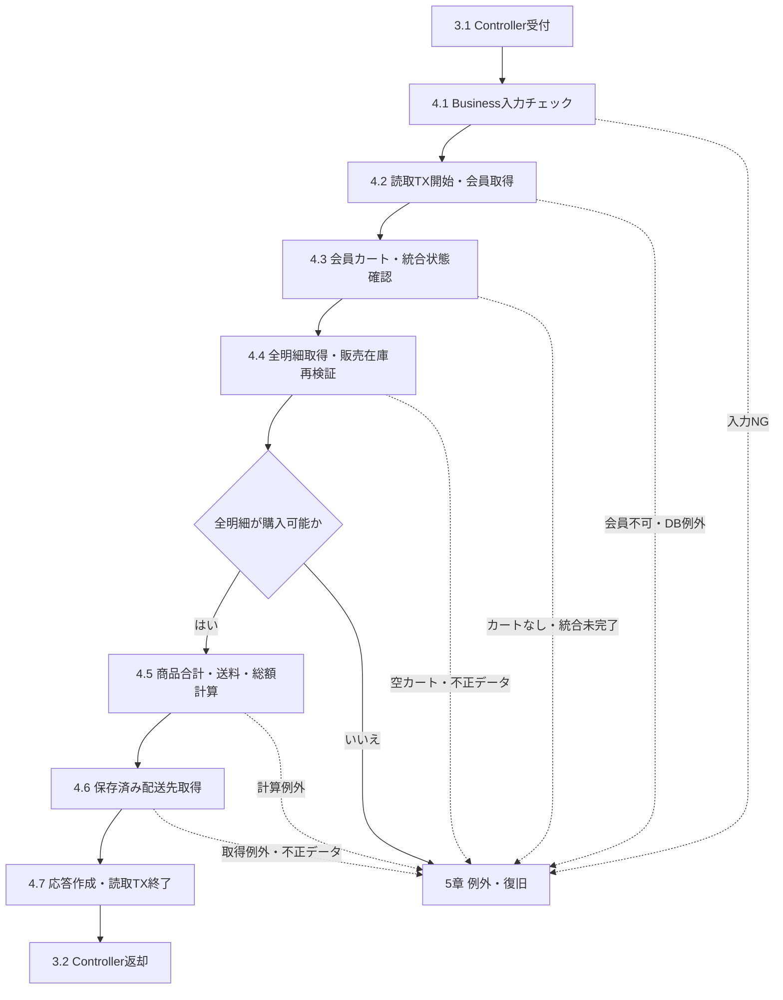

# APU004_01_注文確認情報・保存済み配送先一括取得

> 2026-11-16改訂：購入完了メールのSNS連携を反映。添付版を基に更新。

> 2026-11-15改訂：カード情報の入力・保存・選択・解除を廃止。モック決済と配送先保存は継続。


## 0. 処理フロー



## 1. 基本情報

| 項目 | 内容 |
| --- | --- |
| 機能ID／旧ID | APU004_01／API-U15 |
| 論理名／物理名 | 注文確認情報・保存済み配送先一括取得／get-checkout-confirmation |
| HTTPメソッド・URL | GET /api/v1/checkout/confirm |
| API Gateway認証 | 会員アクセストークン必須 |
| 対応画面 | SCU-07（注文・決済確認画面） |
| Controller | CheckoutConfirmationController |
| Business | GetCheckoutConfirmationBusiness |
| 参照テーブル | users、carts、cart_items、products、cart_merge_logs、user_saved_addresses |
| 登録・更新・削除 | なし。保存情報・カート・在庫・統合通知既読も変更しない |
| べき等キー | 不要。operation_histories登録なし |
| トランザクション | 読取専用・REPEATABLE READ。FOR UPDATE／FOR SHAREなし |
| 金額 | 税込商品合計＋税込送料500円＋決済手数料0円 |
| 決済 | クレジットカードのモックのみ。実決済・実請求なし |
| 応答 | ECSで捕捉可能な成功・例外はHTTP 200。data／errorで判定 |

### 1.1 役割と呼出条件

| 場面 | 処理 |
| --- | --- |
| SCU-06から遷移 | APU003_06成功後に本APIを呼ぶ |
| SCU-07直接アクセス・再読み込み | 本APIを呼ぶ。APU003_06の実行済みフラグは要求しない |
| カートや保存情報の変更後 | 本APIを再取得して最新のID・版・金額を表示 |
| ゲスト | 本APIを直接利用しない。ログイン・会員初期化・必要なカート統合後に呼ぶ |
| 注文確定 | APU004_03で再検証・注文登録。取得成功だけでは注文は成立しない |

本APIが返す金額は取得時点の確認用。金額・在庫の予約、注文確定権限を表すトークンではない。
保存済み配送先は選択候補として返す。今回使用するか、上書き保存するかは利用者が選択し、注文確定APIへ送る。

### 1.2 購入完了メールとの境界

本APIは注文前の確認情報取得のみ。SNS発行・SES送信・SES宛先確認APIは実行しない。buyer.emailは会員情報の表示用であり、購入完了メールはAPU004_03が注文時にorders.purchaser_emailへ保存した値を使用する。SES未確認を理由に本APIの取得やモック注文を拒否しない。

SESはサンドボックス継続（解除申請なし）。事前確認は運用者がSESで実施し、アプリ独自の宛先リストは設けない。メール送信はAPU004_03 → SNS → SQS → BAT001_01（Lambda）→ SESで行う。

## 2. リクエスト

### 2.1 項目

| 場所 | 項目 | 必須 | 内容 |
| --- | --- | --- | --- |
| ヘッダー | Authorization | 必須 | Bearer会員アクセストークン。共通処理済みsubを使用 |
| ヘッダー | Accept | 任意 | application/json |
| パス変数 | なし | — | — |
| クエリ | なし | — | 未定義項目を拒否 |
| ボディ | なし | — | {}、null、配列を含め送信しない |
| Cookie | 使用しない | — | ゲストカート識別には使用せず変更もしない |

```http
GET /api/v1/checkout/confirm HTTP/1.1
Authorization: Bearer <会員アクセストークン>
Accept: application/json
```

リクエストJSONはなし。userId、cartId、配送先ID、価格、送料等を送信しない。
会員の現在のカートをサーバー側で特定する。JWTが無効な場合、ゲストの確認情報へ切り替えない。

### 2.2 前画面のカート版との関係

本APIは最新状態を取り直す取得APIなので、前画面のcartVersionを受け取って一致判定する処理は設けない。
フロントは、前画面が保持するcartId・cartVersionと返却値を比較する。変わっていた場合は確認内容を更新したことを案内し、最新内容を表示する。
商品価格はカート版が同じでも変わり得る。再取得時は商品単価・数量・総額も比較し、編集中の確認内容を黙って確定扱いにしない。

## 3. Controller

### 3.1 受付

| 項目 | 内容 |
| --- | --- |
| メソッド | CheckoutConfirmationController.getConfirmation |
| 解析 | **共通機能使用：COM001_10 HTTPリクエスト解析** |
| Command | 共通認証済みsub、クエリ、ボディ有無 |
| 呼出 | GetCheckoutConfirmationBusiness.execute(command) |

ヘッダー・JWTの共通検証は親Controller／共通受付に委ねる。個別Controllerで再検証・会員検索・金額計算をしない。

### 3.2 返却

- 読取TX終了後、親Controller経由で**共通機能使用：COM001_07 共通レスポンス生成**。
- 例外は**共通機能使用：COM001_08 共通例外変換**。
- Cache-Control: no-store。Set-Cookieは出力しない。
- DB取得用オブジェクトをそのままJSON化せず、6章の返却専用DTOへ設定する。
- 部分的に取得できた氏名・住所をエラー応答へ含めない。

## 4. Business

### 4.1 個別入力チェック

| 対象 | 条件 | NG時 |
| --- | --- | --- |
| クエリ | 項目なし | INVALID_REQUEST |
| ボディ | 存在しない。{}等も不可 | INVALID_REQUEST |

入力項目がないため、リクエストDTOの必須・文字数検証は不要。会員・カート・保存先の対応は以下のDB取得条件で検証する。

### 4.2 読取TX開始・会員取得

ここから4.7まで、読み取り専用REPEATABLE READの1つのTXで実行する。会員・カート・商品・保存情報を同一スナップショットで取得する。

**共通機能使用：COM001_04 subによる会員取得、COM001_05 会員利用状態判定。**

| 取得・使用項目 | 用途 |
| --- | --- |
| users.id | カート・保存配送先の検索条件 |
| users.status | 会員利用可否 |
| users.name | 注文者氏名の初期表示 |
| users.email | 注文者メールアドレスの初期表示 |

| 結果 | 処理 |
| --- | --- |
| 会員なし | USER_NOT_INITIALIZED |
| DISABLED／PENDING | ACCOUNT_DISABLED／MEMBER_NOT_READY |
| 利用可能 | 取得したusers.idで4.3へ |
| DB例外 | 5章へ。未登録扱いにしない |

共通検索は同じTXへ参加させ、別TX・キャッシュから古い会員情報を採用しない。
氏名はDB定義の1〜50文字、メールは1〜254文字・メール形式を確認する。欠損・不正ならINTERNAL_ERROR。Cognitoから自動補完・上書きしない。
DB transaction_timestamp()を取得し、参照基準時刻asOfとして保持する。

### 4.3 会員カート・統合状態確認

#### カート取得

| テーブル | 条件 | 取得項目 |
| --- | --- | --- |
| carts | user_id=4.2のusers.id | id、user_id、status、version、expires_at、pending_merge_cart_id |

```sql
SELECT id, user_id, status, version, expires_at, pending_merge_cart_id
FROM carts
WHERE user_id = #{userId,jdbcType=BIGINT};
```

| 結果 | 次の処理 |
| --- | --- |
| 0件 | BUSINESS_RULE_VIOLATION：空カート。作成しない |
| 1件・ACTIVE・expires_at IS NULL・正のIDと版 | 統合状態を確認 |
| 複数件・不正な状態 | INTERNAL_ERROR |

#### 統合状態取得

| テーブル | 条件 | 取得項目 |
| --- | --- | --- |
| cart_merge_logs | user_id=会員ID AND target_cart_id=カートID | id、source_cart_id、target_cart_id、merge_status |
| carts（pending先がある場合） | id=pending_merge_cart_id | id、user_id |

| 条件 | 判定 |
| --- | --- |
| pendingなし、ログなし／全COMPLETED | 4.4へ |
| pendingあり、未完了ログなし | 統合待ちとしてBUSINESS_RULE_VIOLATION |
| PROCESSING／FAILEDログあり | 統合未完了としてBUSINESS_RULE_VIOLATION |
| pending先不存在・会員カートを参照・自分自身を参照 | INTERNAL_ERROR |
| pendingがCOMPLETEDログを指す・未定義状態 | INTERNAL_ERROR |

未読の統合調整通知だけでは停止しない。既読化もしない。
統合API到達前の失敗はDBに残らない場合がある。フロントが保持する統合未完了状態を本API成功だけで解除しない。

### 4.4 全明細取得・販売在庫再検証

| 取得元 | 項目・条件 |
| --- | --- |
| cart_items ci | ci.cart_id=会員カートID |
| LEFT JOIN products p | p.id=ci.product_id |
| 明細取得項目 | ci.id、ci.product_id、ci.quantity、ci.added_price_including_tax |
| 商品取得項目 | p.id、name、image_s3_key、price_including_tax、stock_quantity、publish_status、sales_status、is_deleted、version |
| 並び順 | ci.created_at ASC、ci.id ASC |

```sql
SELECT ci.id AS cart_item_id, ci.product_id, ci.quantity,
       ci.added_price_including_tax,
       p.id AS current_product_id, p.name, p.image_s3_key,
       p.price_including_tax, p.stock_quantity,
       p.publish_status, p.sales_status, p.is_deleted,
       p.version AS product_version
FROM cart_items ci
LEFT JOIN products p ON p.id = ci.product_id
WHERE ci.cart_id = #{cartId,jdbcType=BIGINT}
ORDER BY ci.created_at ASC, ci.id ASC;
```

非公開・削除済み商品をWHERE句で除外しない。存在する全明細を検証し、問題のある明細を隠したまま注文確認を通さない。

| 順序 | 使用項目 | 判定 |
| --- | --- | --- |
| 1 | 明細件数 | 0件は空カートエラー |
| 2 | ci.id、product_id、quantity | 正のID・数量1以上、商品ID重複なし。不正はINTERNAL_ERROR |
| 3 | p.id、is_deleted、publish_status | 不存在・削除済み・PRIVATEは購入不可。null・未定義状態はINTERNAL_ERROR |
| 4 | sales_status | SUSPENDEDは購入不可。未定義・欠損はINTERNAL_ERROR |
| 5 | name、price_including_tax、stock_quantity、version | 名前1〜100文字、価格1以上、在庫0〜99999、正の版。不正はINTERNAL_ERROR |
| 6 | stock_quantity | 0は売り切れとして購入不可 |
| 7 | ci.quantity、p.stock_quantity | 保存数量が実在庫超過なら購入不可 |

全明細がPUBLIC・ON_SALE・未削除・在庫内の場合だけ4.5へ進む。
在庫不足・販売不可はBUSINESS_RULE_VIOLATION。不正DB値があればINTERNAL_ERRORを優先する。

- 実在庫で判定し、表示用stockQuantityのnullを判定に使わない。
- 成功時の返却在庫は1〜10の実数、11以上はnull。11以上の実数をエラー文言にも入れない。
- カート数量の自動調整・削除はしない。問題解消はSCU-06の数量更新・明細削除で行う。
- 商品画像は現在の公開画像。配信元設定とimage_s3_keyからURLを生成する。未設定・不正キーはnull。S3への存在確認はしない。
- APU003_06の過去の成功結果を流用せず、本TXで再検証する。別APIへのHTTP呼出しは行わない。

### 4.5 商品合計・送料・総額計算

| 項目 | 使用値・計算 |
| --- | --- |
| 明細小計 | products.price_including_tax × cart_items.quantity |
| 商品数量合計 | 全cart_items.quantityの合計 |
| 税込商品合計 | 全明細小計の合計 |
| 送料（税込） | 500円。1注文につき1回 |
| 決済手数料（税込） | 0円 |
| 合計（税込） | 税込商品合計＋500＋0 |
| 通貨 | JPY |

税込単価はDB保存値を使用し、税抜価格・税率から再計算しない。税の丸めは商品保存時のHALF_UP処理に従う。
送料500円は税込額として扱い、さらに税を加算しない。今回は配送先・数量・金額による送料変更や送料無料条件を設けない。
設定例：checkout.shipping-fee-including-tax=500、checkout.payment-fee-including-tax=0。注文確定APIも同じ設定値を使用する。
設定欠損・負数・範囲不正はINTERNAL_ERROR。未設定を0円で補完しない。
計算はlong整数でmultiplyExact／addExact等を使用し、オーバーフロー時はINTERNAL_ERROR。

| 価格変更項目 | 判定 |
| --- | --- |
| items[].priceChanged | 有効な追加時価格と現在税込単価を比較。不一致true、一致false、比較不能null |
| hasPriceChanges | 比較可能な明細でpriceChanged=trueが1件以上ならtrue |

価格変更があっても現在価格を返して確認表示を継続する。追加時価格は書き換えない。直前表示との差分はフロントが保持値と比較する。

### 4.6 保存済み配送先取得

会員ごとに最大1件。未登録は正常状態として返す。

| テーブル | 条件 | 取得項目 |
| --- | --- | --- |
| user_saved_addresses | user_id=4.2のusers.id | id、version、recipient_name、postal_code、prefecture、city_street、building、phone_number |

```sql
SELECT id, version, recipient_name, postal_code,
       prefecture, city_street, building, phone_number
FROM user_saved_addresses
WHERE user_id = #{userId,jdbcType=BIGINT};
```

| 取得結果 | 処理 |
| --- | --- |
| 0件 | savedAddress=null |
| 1件・下記条件を満たす | 返却DTOへ項目を設定 |
| 複数件・不正な保存値 | INTERNAL_ERROR。未登録へ置き換えない |
| DB例外 | SERVICE_UNAVAILABLE等。nullで成功扱いにしない |

| 使用項目 | 保存値の確認 |
| --- | --- |
| id、version | 正のBIGINT |
| recipient_name | 必須、1〜50文字 |
| postal_code | 半角数字7文字。文字列のまま返し先頭0を維持 |
| prefecture | 国内47都道府県名の許可リスト、10文字以内 |
| city_street | 必須、1〜100文字 |
| building | nullまたは100文字以内 |
| phone_number | 半角数字10〜11文字。文字列のまま返し先頭0を維持 |

本APIでは住所の実在確認・郵便番号検索・文字列補正を行わない。保存値の形式を確認して返す。
会員氏名と受取人氏名が異なっていても有効。注文者情報へ上書きしない。
保存先ID・版を返し、注文後の上書き保存で他タブ更新を検出できるようにする。ID・版を返しただけでは保存を実行しない。

### 4.7 応答作成・読取TX終了

| 項目 | 設定 |
| --- | --- |
| action | CHECKOUT_CONFIRMATION_READY |
| asOf | 4.2のDB参照基準時刻。UTC・ミリ秒・Z付き |
| testOrder | true固定 |
| buyer | users.name、users.email |
| cart | 会員カートID・版・数量合計・検証済み全明細 |
| amounts | 税込商品合計・送料・手数料・総額・通貨 |
| savedAddress | 4.6の結果。未登録null |
| payment.method | MOCK_CREDIT_CARD固定 |
| cartValidated | true固定 |
| hasPriceChanges | 4.5の結果 |

cartValidated=trueはカート条件だけの確認結果。配送先入力・同意等が完了し、注文ボタンを押せる状態を示す値ではない。
保存配送先が未登録でも確認画面は表示できる。フロントは入力・選択を求め、注文確定APIでも必須条件を検証する。
DTO作成まで同じ読取TXで行い、正常終了後にControllerへ返す。JWT・sub・user_id・S3内部キーは返さない。

## 5. 例外・復旧・画面連携

### 5.1 例外返却

**共通機能使用：COM001_08 共通例外変換、COM001_09 安全なログ出力。**

| 発生条件 | error.code | message |
| --- | --- | --- |
| 未定義クエリ・ボディあり | INVALID_REQUEST | リクエストの内容が正しくありません。 |
| 会員未登録 | USER_NOT_INITIALIZED | 会員情報の準備が必要です。 |
| 会員利用不可 | ACCOUNT_DISABLED／MEMBER_NOT_READY | COM001_05の対応文言 |
| カートなし・明細0件 | BUSINESS_RULE_VIOLATION | カートに商品が入っていません。 |
| 統合未完了 | BUSINESS_RULE_VIOLATION | カート情報の引き継ぎが完了していません。再試行してください。 |
| 在庫不足・非公開・販売停止・削除済み・売り切れ | BUSINESS_RULE_VIOLATION | 在庫不足または購入できない商品が含まれています。カート内容をご確認ください。 |
| DB接続障害・SQLタイムアウト | SERVICE_UNAVAILABLE | 注文確認情報を取得できませんでした。時間をおいて再度お試しください。 |
| 不正DB値・計算異常・設定不正 | INTERNAL_ERROR | 注文確認情報を取得できませんでした。 |

全てHTTP 200、data=null、errorあり、fieldErrors=[]。保存情報の取得失敗を「保存なし」の正常応答へ変換しない。
本APIは一括取得のため、SQL障害があれば全体をエラーとする。エラー中に前回の取得データで注文確定を許可しない。
Gatewayでの認証拒否・通信切断はHTTP 200・共通JSONを保証しない。
ログへ注文者・住所・電話番号・メール・JWT・Command全体を出力しない。要求ID・処理位置・例外分類を記録する。

### 5.2 データ復旧方法

| 状況 | 復旧 |
| --- | --- |
| 読取TXでDB例外・計算例外 | TXを終了・ロールバック。更新がないため補償更新なし |
| 応答消失 | 同じGETを再実行。operationId・結果照会不要 |
| カート空 | SCU-06／SCU-01への導線。自動カート作成なし |
| 在庫・販売条件NG | SCU-06で数量更新・1明細削除後、再取得 |
| 統合未完了 | APU003_05で結果確認・再試行後、再取得 |
| 保存情報なし | SCU-07で新規入力。取得APIでは保存しない |
| 不正な保存情報 | 失敗を通知。DB確認・修復後に再取得。自動削除しない |

カート・保存先・在庫・注文・操作履歴のいずれにも書込みがないため、データ書戻し処理は設けない。

### 5.3 フロント・後続APIとの連携

| 状況 | 扱い |
| --- | --- |
| 初期表示 | 取得した注文者・明細・金額を表示。保存情報は選択候補として表示 |
| 保存先を使用 | savedAddressのID・版と表示値を保持。今回の配送先として選択 |
| 再取得中に手入力がある | 入力内容を無条件に上書きしない。保存値の変更を案内して再選択を促す |
| 商品・総額が更新された | 最新値を表示し、確認前の金額で注文を送信しない |
| エラー時 | 注文確定を停止。未登録と取得失敗を区別する |
| モック注意表示 | 実際の決済・請求・発送がないことを画面で明示 |

APU004_03へ引き継ぐ情報の候補：cartId・cartVersion、各明細の商品ID・数量・表示単価、表示総額、選択した保存配送先のID・版、今回入力した配送先、保存希望。
これらは認可や金額確定の根拠ではない。APU004_03で本人のDB値・現在価格・在庫を再取得し、表示内容との相違を検出して再確認を促す。具体的な要求形式はAPU004_03で定義する。

### 5.4 確認ケース

| ケース | 期待結果 |
| --- | --- |
| 商品1980円×2、送料500円 | 商品3960円、総額4460円 |
| 保存配送先なし | savedAddress=nullで成功 |
| 保存配送先あり | ログイン会員の情報だけを返す |
| 郵便番号・電話番号が0始まり | 文字列のまま先頭0を維持 |
| カート・明細なし | 空カートエラー。500円だけの注文確認を返さない |
| 購入不可商品が1件ある | 全体エラー。残りだけで通過しない |
| 保存数量20、実在庫15 | 在庫不足。実在庫15は非公開 |
| 保存数量1、実在庫10／11 | stockQuantity=10／null |
| 前画面検証後に在庫・価格変更 | 本APIで新しい状態を再取得・検証 |
| 保存情報だけDB通信失敗 | 全体エラー。保存なし扱いにしない |
| 保存情報が別タブで上書きされた | 取得時の版を返す。注文確定・配送先保存処理で再照合 |
| ページ再読込・同じGET再送 | 再取得のみ。版・期限・数量不変 |
| 本API未実行で注文確定要求 | 注文確定APIが独立して全条件を検証 |

## 6. 返却項目

### 6.1 共通項目・ヘッダー

| 項目 | 型 | 内容 |
| --- | --- | --- |
| HTTP | — | ECS捕捉可能範囲は200 |
| Content-Type | header | application/json; charset=UTF-8 |
| Cache-Control | header | no-store |
| Set-Cookie | header | 出力しない |
| requestId | string | 今回の要求追跡ID |
| data | object / null | 成功時は下記、例外時null |
| error | object / null | 正常時null |
| error.code・message | string | 5.1の内容 |
| error.fieldErrors | array | 本APIは[] |

### 6.2 data・注文者

| 項目 | 型 | 内容 |
| --- | --- | --- |
| action | string | CHECKOUT_CONFIRMATION_READY |
| asOf | string | DB参照基準時刻。UTC・ミリ秒・Z付き |
| testOrder | boolean | true固定 |
| cartValidated | boolean | true固定。カート検証結果 |
| hasPriceChanges | boolean | 追加時価格からの変更が確認されたか |
| buyer.name | string | 会員氏名 |
| buyer.email | string | 会員メールアドレス |
| savedAddress | object / null | 保存配送先。未登録null |
| payment | object | 6.6 |

### 6.3 cart・items

| 項目 | 型 | 内容 |
| --- | --- | --- |
| cart.cartId | string | 会員カートID |
| cart.version | string | 現在のカート版 |
| cart.totalQuantity | string | 保存数量合計。成功時は全明細購入可能 |
| cart.items | array | 全明細、追加日時・ID昇順 |
| items[].cartItemId・productId | string | 明細・商品ID |
| items[].productVersion | string | 取得時点の商品版。注文確定を保証しない |
| items[].name | string | 現在の商品名 |
| items[].imageUrl | string / null | 現在の公開画像URL |
| items[].quantity | integer | 保存数量 |
| items[].unitPriceIncludingTax | integer | 現在税込単価 |
| items[].lineSubtotalIncludingTax | string | 明細税込小計 |
| items[].stockQuantity | integer / null | 実在庫1〜10。11以上null |
| items[].availability | string | AVAILABLE固定 |
| items[].priceChanged | boolean / null | 追加時価格との比較、比較不能null |

### 6.4 amounts

| 項目 | 型 | 内容 |
| --- | --- | --- |
| currency | string | JPY |
| subtotalIncludingTax | string | 税込商品合計 |
| shippingFeeIncludingTax | string | "500" |
| paymentFeeIncludingTax | string | "0" |
| totalIncludingTax | string | 商品合計＋送料＋手数料 |

合計金額・合計数量・ID・版は10進文字列。画面側で再計算して確定金額にしない。

### 6.5 savedAddress

| 項目 | 型 | DB項目 |
| --- | --- | --- |
| savedAddressId | string | id |
| version | string | version |
| recipientName | string | recipient_name |
| postalCode | string | postal_code。数字7桁 |
| prefecture | string | prefecture |
| cityStreet | string | city_street |
| building | string / null | building |
| phoneNumber | string | phone_number。数字10〜11桁 |

### 6.6 payment

| 項目 | 型 | 内容 |
| --- | --- | --- |
| payment.method | string | MOCK_CREDIT_CARD固定。DB検索不要 |

カード番号・下4桁・名義・有効期限・セキュリティコード・保存カードIDは入力・保持・返却しない。支払い方法は固定で、カードの選択・保存・解除は行わない。

### 6.7 正常JSON例（保存情報あり）

```json
{
  "requestId": "req-checkout-confirm-001",
  "data": {
    "action": "CHECKOUT_CONFIRMATION_READY",
    "asOf": "2026-11-15T07:00:00.123Z",
    "testOrder": true,
    "cartValidated": true,
    "hasPriceChanges": false,
    "buyer": {
      "name": "テスト 太郎",
      "email": "user@example.com"
    },
    "cart": {
      "cartId": "301",
      "version": "5",
      "totalQuantity": "2",
      "items": [
        {
          "cartItemId": "1001",
          "productId": "101",
          "productVersion": "8",
          "name": "サンプル商品",
          "imageUrl": null,
          "quantity": 2,
          "unitPriceIncludingTax": 1980,
          "lineSubtotalIncludingTax": "3960",
          "stockQuantity": null,
          "availability": "AVAILABLE",
          "priceChanged": false
        }
      ]
    },
    "amounts": {
      "currency": "JPY",
      "subtotalIncludingTax": "3960",
      "shippingFeeIncludingTax": "500",
      "paymentFeeIncludingTax": "0",
      "totalIncludingTax": "4460"
    },
    "savedAddress": {
      "savedAddressId": "401",
      "version": "2",
      "recipientName": "テスト 太郎",
      "postalCode": "1000001",
      "prefecture": "東京都",
      "cityStreet": "テスト市サンプル町1-2-3",
      "building": null,
      "phoneNumber": "09000000000"
    },
    "payment": {
      "method": "MOCK_CREDIT_CARD"
    }
  },
  "error": null
}
```

### 6.8 保存情報が未登録の場合

正常dataの該当部分を次のように返す。その他の注文者・カート・金額項目は6.7と同じ構造。

```json
{
  "savedAddress": null,
  "payment": {
    "method": "MOCK_CREDIT_CARD"
  }
}
```

### 6.9 購入不可・在庫不足（HTTP 200）

```json
{
  "requestId": "req-checkout-confirm-002",
  "data": null,
  "error": {
    "code": "BUSINESS_RULE_VIOLATION",
    "message": "在庫不足または購入できない商品が含まれています。カート内容をご確認ください。",
    "fieldErrors": []
  }
}
```

### 6.10 DB取得失敗（HTTP 200）

```json
{
  "requestId": "req-checkout-confirm-003",
  "data": null,
  "error": {
    "code": "SERVICE_UNAVAILABLE",
    "message": "注文確認情報を取得できませんでした。時間をおいて再度お試しください。",
    "fieldErrors": []
  }
}
```
