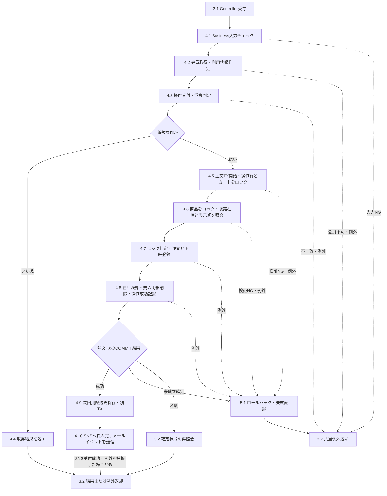

# APU004_03_テスト注文確定・モック決済・次回用配送先保存

> 2026-11-16改訂：購入完了メールのSNS連携を反映。添付版を基に更新。

作成日：2026-11-15。カード情報非保持版。

## 0. 処理フロー



4.9の保存失敗、4.10の通知失敗では、成立済み注文をロールバックしない。

## 1. 基本情報

| 項目 | 内容 |
| --- | --- |
| 機能ID／旧ID | APU004_03／API-U17 |
| 物理名 | place-test-order |
| HTTP | POST /api/v1/orders |
| 対応画面 | SCU-07（注文・決済確認） |
| API Gateway認証 | 会員JWT必須 |
| Controller／Business | OrderController.placeOrder／PlaceTestOrderBusiness.execute |
| 参照 | users、carts、cart_items、cart_merge_logs、products |
| 登録・更新・削除 | operation_histories、orders、order_items、products、carts、cart_items、user_saved_addresses |
| べき等キー | Idempotency-Key必須。注文操作ごとに新規発行。同一要求の再送では同じキー |
| 決済 | MOCK_CREDIT_CARD固定。カード入力・保存・外部決済なし |
| 金額 | 現在税込単価×数量＋送料500円＋手数料0円 |
| 応答 | ECSで捕捉可能な例外もHTTP 200。data／errorで判定 |

APU004_01の取得結果だけを信用せず、このAPIが注文成立条件を再確認する。APU004_02は廃止・欠番。
 
### 1.1 トランザクションの区切り

| 単位 | 内容 | 確定・復旧 |
| --- | --- | --- |
| 受付TX | 操作キーをPROCESSINGで予約 | 注文前にCOMMIT。注文未成立の操作も結果照会可能にする |
| 注文TX | 操作行・カート・商品ロック、注文／明細、在庫、カート、操作成功 | READ COMMITTED。全件成功時だけCOMMIT |
| 保存TX | 成立済み注文の配送先を次回用に保存し、保存結果を更新 | 注文TXの後。配送先更新とSUCCEEDED記録は同じTX |
| 失敗記録TX | 確定した未成立／配送先保存失敗を記録 | 元TX終了後に開始。COMMIT不明を失敗へ変換しない |

Business.execute自体はTXで全体を囲まない。別Beanの@TransactionalメソッドまたはTransactionTemplateで各境界を実装する。自己呼出しによるTXアノテーションの無効化を避ける。

SNS PublishはECSのBusinessに追加実装する。通知の入口は本APIの4.10のみ。APU004_01・04・05からは発行しない。

## 2. リクエスト

### 2.1 ヘッダー・基本条件

| 場所 | 項目 | 必須 | 内容 |
| --- | --- | --- | --- |
| ヘッダー | Authorization | ○ | Bearer会員アクセストークン |
| ヘッダー | Content-Type | ○ | application/json |
| ヘッダー | Idempotency-Key | ○ | 共通受付で検証済みの操作識別子。DB格納上限64文字 |
| パス・クエリ | なし | — | クエリを受け付けない |
| ボディ | JSONオブジェクト | ○ | null・配列・未定義項目は不可 |

共通ヘッダー検証は親Controller側。本Businessには検証済みsub・operationIdが渡される。

### 2.2 ボディ項目と単項目チェック

Businessで正規化後、Bean Validationを実行する。ネストしたDTOも検証する。ID・版・総額は文字列で受け、検証後にLongへ変換する。

| 項目 | 型・必須 | 条件／アノテーション例 |
| --- | --- | --- |
| cartId | string・○ | 正のBIGINT、1〜19桁。@NotBlank、@Pattern＋Long範囲チェック |
| cartVersion | string・○ | 同上 |
| items | array・○ | @NotEmpty、@Valid。カート全明細を送信 |
| items[].cartItemId | string・○ | 正のBIGINT |
| items[].productId | string・○ | 正のBIGINT |
| items[].quantity | integer・○ | @NotNull、@Min(1)。整数型の範囲内 |
| items[].unitPriceIncludingTax | integer・○ | @NotNull、@Min(1)。確認画面で表示した単価 |
| expectedTotalIncludingTax | string・○ | 正のBIGINT。確認画面で表示した総額 |
| deliveryAddress | object・○ | @NotNull、@Valid |
| deliveryAddress.recipientName | string・○ | 前後空白除去後1〜50文字。@NotBlank、@Size(max=50) |
| deliveryAddress.postalCode | string・○ | 前後空白・半角ハイフン除去後、半角数字7桁 |
| deliveryAddress.prefecture | string・○ | 前後空白除去、国内47都道府県名の許可リスト、10文字以内 |
| deliveryAddress.cityStreet | string・○ | 前後空白除去後1〜100文字 |
| deliveryAddress.building | string / null・任意 | 前後空白除去後100文字以内。空文字はnull |
| deliveryAddress.phoneNumber | string・○ | 前後空白・半角ハイフン除去後、半角数字10〜11桁 |
| saveAddress | boolean・○ | true=成立後に次回用保存。false=保存しない |
| savedAddressId | string / null・条件付 | 上書き対象の保存先ID。正のBIGINT |
| savedAddressVersion | string / null・条件付 | 上書き対象の版。正のBIGINT |

itemsの商品名・画像・在庫数は要求しない。buyer、userId、支払い方法、カード情報、モック結果指定は受け付けない。郵便番号・電話は数値化しない。ID・版・金額の先頭0や符号付き文字列は受け付けない。

### 2.3 項目間チェック

| 条件 | 判定 |
| --- | --- |
| cartItemIdまたはproductIdの重複 | INVALID_REQUEST |
| saveAddress=false | savedAddressId／savedAddressVersionは両方nullまたは省略のみ |
| saveAddress=true・新規保存 | savedAddressId／savedAddressVersionは両方nullまたは省略 |
| saveAddress=true・上書き | savedAddressId／savedAddressVersionは両方必須 |
| 片方だけ指定 | INVALID_REQUEST |
| 配送先と注文者の氏名が異なる | 許可する |

保存済み住所を使う場合もdeliveryAddress全項目を送る。savedAddressIdは今回注文の住所取得用ではなく、次回用保存の上書き対象を示す。住所実在確認・郵便番号と都道府県の外部照合は行わない。

### 2.4 リクエスト例

```http
POST /api/v1/orders HTTP/1.1
Authorization: Bearer <会員アクセストークン>
Content-Type: application/json
Idempotency-Key: 4df45f8d-bb7a-4ce5-9d49-e5d0d5d34687
```

```json
{
  "cartId": "301",
  "cartVersion": "5",
  "items": [
    {"cartItemId": "1001", "productId": "101", "quantity": 2, "unitPriceIncludingTax": 1980}
  ],
  "expectedTotalIncludingTax": "4460",
  "deliveryAddress": {
    "recipientName": "テスト 太郎",
    "postalCode": "1000001",
    "prefecture": "東京都",
    "cityStreet": "テスト市サンプル町1-2-3",
    "building": null,
    "phoneNumber": "09000000000"
  },
  "saveAddress": true,
  "savedAddressId": "401",
  "savedAddressVersion": "2"
}
```

## 3. Controller

### 3.1 受付

| 処理 | 実施内容 |
| --- | --- |
| 入力受取 | **共通機能使用：COM001_10 HTTP共通受付・JSON構文解析** |
| Command作成 | 認証済みsub、operationId、解析済み本文、クエリをBusinessへ渡す |
| Business呼出 | PlaceTestOrderBusiness.execute(command) |

Controllerで個別入力チェック、会員・カート検索、TX開始を実装しない。

### 3.2 返却

- **共通機能使用：COM001_07 共通レスポンス生成**。
- 例外は**共通機能使用：COM001_08 共通例外変換**。
- Content-Type: application/json; charset=UTF-8、Cache-Control: no-store。Cookieを変更しない。
- COMMIT前の正常DTOを返さない。注文成立後の配送先保存・通知の失敗を、注文失敗のerrorへ置き換えない。

## 4. Business

### 4.1 個別入力チェック

2.2・2.3を実行する。違反時はINVALID_REQUESTと項目パス付きfieldErrorsを返し、DBへ書き込まない。
正規化後のCommandを以降で共用する。空白除去前の住所や要求本文全体をログ出力しない。

### 4.2 会員取得・利用状態判定

**共通機能使用：COM001_04 subによる会員情報検索、COM001_05 会員利用状態判定。**

| 使用項目 | 用途 |
| --- | --- |
| users.id | 全DB処理の所有者、操作履歴actor_id |
| users.status | ACTIVEのみ注文可能 |
| users.name / email | 注文者スナップショット。氏名1〜50文字・メール1〜254文字／形式を確認 |

未登録はUSER_NOT_INITIALIZED、利用不可は共通状態判定の例外。不正な氏名・メールはINTERNAL_ERROR。Cognitoの属性を取得し直す処理はない。

### 4.3 操作受付・重複判定（受付TX）

#### 要求ハッシュ

正規化済みの以下を固定項目順のJSONへ変換し、UTF-8のSHA-256を小文字64桁で算出する。

- operation_type=ORDER_CREATE、actor_type=USER、actor_id=users.idの10進文字列。
- cartId、cartVersion、items、expectedTotalIncludingTax、deliveryAddress、saveAddress、savedAddressId、savedAddressVersion。
- itemsはcartItemIdの数値昇順へ並べる。省略可能項目はnullへ統一。JSONキー順・数値／文字列型を固定する。
- operationId、JWT、requestId、現在時刻はハッシュ対象外。本文・住所は操作履歴に保存せず、ハッシュだけを保持する。

#### 操作行予約

| テーブル | 条件・処理 | 設定項目 |
| --- | --- | --- |
| operation_histories | operation_id主キーでINSERT、競合時DO NOTHING | 下表 |

| 項目 | 登録値 |
| --- | --- |
| operation_id | 共通受付済みoperationId |
| operation_type / actor_type / actor_id | ORDER_CREATE / USER / 会員ID文字列 |
| request_hash | 正規化済み要求ハッシュ |
| operation_status / is_retryable | PROCESSING / false |
| target_resource_id / result_code / expires_at | null / null / null |
| result_summary_json | schemaVersion=1、saveAddress、savedAddressId、savedAddressVersion。住所本文・氏名・メールを入れない |
| created_at / updated_at | DB現在時刻 |

```sql
INSERT INTO operation_histories
(operation_id, operation_type, actor_type, actor_id, request_hash,
 operation_status, is_retryable, result_summary_json, expires_at)
VALUES
(#{operationId}, 'ORDER_CREATE', 'USER', #{userIdText}, #{requestHash},
 'PROCESSING', FALSE, CAST(#{recoveryMetadataJson} AS jsonb), NULL)
ON CONFLICT (operation_id) DO NOTHING;
```

| 結果 | 処理 |
| --- | --- |
| 挿入1件・受付COMMIT成功 | この要求だけが4.5を実行 |
| 挿入0件 | operation_idで既存行取得。種別・主体・hash一致時のみ4.4 |
| 主体・種別・hash不一致 | CONFLICT。既存の注文IDや結果を開示しない |
| 受付COMMIT不明 | 注文TXへ進まない。5.2へ |

同じキーを再使用して新しい注文を作らない。受付TXで競合待ちがタイムアウトした場合も、成功・未成立を断定せず再照会する。

### 4.4 既存結果を返す

| 保存状態 | 処理 |
| --- | --- |
| SUCCEEDED | actor照合後、target_resource_idかつuser_idでordersを取得。既存注文の確定結果を返す。注文・住所保存・通知を再実行しない |
| FAILED | 保存済みresult_codeと再操作可否を返す。同一キーでは再実行しない |
| PROCESSING | 注文結果PROCESSINGとして結果照会を案内。経過時間だけで再実行しない |
| 状態不正・成功なのに注文がない | INTERNAL_ERROR。新規注文を開始しない |

既存成功時の配送先保存結果はordersから読み取る。保存希望・結果がPROCESSINGでも注文は成立済み。現在のカート数量・版は同一会員カートと明細を単一SELECTの同一スナップショットで集計できた場合だけ返す。取得失敗時はnullとし、注文成功は維持する。

### 4.5 注文TX開始・操作行とカートをロック

ロック順は **操作履歴 → 会員カート → 商品ID昇順**。カート明細を変更する他APIも親カートを先にロックする。

| 順序 | テーブル・条件 | 取得項目・判定 |
| --- | --- | --- |
| 1 | operation_histories.operation_id=operationId FOR UPDATE | 予約時と同一主体・hash・PROCESSINGであることを再確認 |
| 2 | usersをsubで再取得 | 共通機能使用：COM001_04／05。状態・注文者情報を再確認 |
| 3 | carts.id=cartId AND user_id=users.id FOR UPDATE | id、status、version、expires_at、pending_merge_cart_id |
| 4 | cart_merge_logs.user_id=users.id AND target_cart_id=cartId | merge_status、source_cart_id |
| 5 | cart_items.cart_id=cartId | id、product_id、quantity、created_at。created_at ASC、id ASC |

```sql
SELECT id, user_id, status, version, expires_at, pending_merge_cart_id
FROM carts
WHERE id = #{cartId,jdbcType=BIGINT}
  AND user_id = #{userId,jdbcType=BIGINT}
FOR UPDATE;
```

| 判定 | NG時 |
| --- | --- |
| カートが本人所有・ACTIVE、expires_at=null、正の版 | 不存在／所有者不一致はRESOURCE_NOT_FOUND。不正DB値はINTERNAL_ERROR |
| version=要求cartVersion | 不一致はCONFLICT。先に最新の確認画面を取得 |
| pendingなし、統合ログなしまたは全COMPLETED | 未完了はBUSINESS_RULE_VIOLATION。不整合はINTERNAL_ERROR |
| カート明細が1件以上 | 0件はBUSINESS_RULE_VIOLATION |
| DBと要求の明細集合が一致 | 明細ID・商品ID・数量を全件照合。不足・余分・変更はCONFLICT |

統合のpending先不正／COMPLETEDとの矛盾はAPU004_01と同じ条件で検出する。購入不可明細を勝手に除外しない。要求外の明細が増えていた場合も注文は確定しない。

### 4.6 商品をロック・販売在庫と表示額を照合

商品IDを数値昇順に並べ、1件ずつ次のSQLでロックして検証する。商品更新・在庫操作は同じ商品行ロックと整合させる。

```sql
SELECT id, name, price_excluding_tax, tax_rate, price_including_tax,
       stock_quantity, publish_status, sales_status, is_deleted, version
FROM products
WHERE id = #{productId,jdbcType=BIGINT}
FOR UPDATE;
```

| 使用項目 | 必須条件／計算 | NG時 |
| --- | --- | --- |
| id、is_deleted、publish_status、sales_status | 存在、未削除、PUBLIC、ON_SALE | 購入不可はBUSINESS_RULE_VIOLATION |
| name、各価格、tax_rate、stock_quantity、version | 名前1〜100、価格1以上、税率0以上、在庫0〜99999、正の版。null／未知状態不可 | INTERNAL_ERROR |
| stock_quantity、cart_items.quantity | 在庫1以上かつ在庫≧DB保存数量 | 不足はBUSINESS_RULE_VIOLATION |
| price_including_tax、要求単価 | 全件一致 | 不一致はCONFLICT |
| 明細小計 | 現在税込単価×DB保存数量 | longのmultiplyExact。超過はINTERNAL_ERROR |
| 商品小計／数量合計 | DB明細を加算 | addExact。超過はINTERNAL_ERROR |
| 総額 | 商品小計＋税込送料500＋手数料0 | expectedTotalIncludingTaxと不一致はCONFLICT |

税込単価は保存済みHALF_UP計算結果を使用する。サーバー設定から送料・手数料を取得し、未設定・不正値はエラー。送信価格・総額をDB登録値にしない。
実在庫が11以上の場合、エラーに実数を入れない。要求のproductVersionは不要。注文時点の名称・税率等は最新ロック済み値を記録する。

### 4.7 モック判定・注文と明細登録

- MockPaymentServiceは外部通信を行わず、通常は成功を返す。カード番号等を引数に取らない。
- テスト差替えで失敗した場合は注文TXをロールバック。実決済の補償取消は不要。
- SNS Publish・メール送信はこのTXで行わない。SNS PublishはCOMMIT成功後の4.10で実装する。

#### orders登録

orders.id用の既存IDENTITYシーケンスからIDを取得し、order_numberを `ORD-`＋IDの10進表記で作成する（最大23文字）。MAX(id)+1は使わない。ロールバック時の欠番は許容する。IDENTITYがGENERATED ALWAYSの場合、予約IDのINSERTにはOVERRIDING SYSTEM VALUEを使用する。

| DB項目 | 登録値 |
| --- | --- |
| id / order_number | 予約ID／ORD-{id} |
| user_id / order_status | 会員ID／ORDER_RECEIVED |
| total_item_quantity | 4.6の数量合計 |
| subtotal_including_tax | 4.6の商品小計 |
| shipping_fee_including_tax / payment_fee_including_tax | 500／0 |
| total_amount_including_tax | 4.6の総額 |
| purchaser_name / purchaser_email | 4.5で取得したusers.name／email |
| recipient_name / recipient_postal_code | 正規化済みrecipientName／postalCode |
| recipient_prefecture / recipient_city_street | prefecture／cityStreet |
| recipient_building / recipient_phone_number | building／phoneNumber |
| payment_method_name | クレジットカード（モック） |
| mock_payment_status / mock_refund_status / mock_refund_amount | PAID／NOT_APPLICABLE／null |
| save_address_requested | 要求saveAddress |
| save_address_result | trueならPROCESSING、falseならNOT_APPLICABLE |
| cancelled_at / cancel_reason | null／null |
| version | 1 |
| ordered_at / updated_at | 注文TXのDB基準時刻 |
| order_create_operation_id | operationId。UNIQUE・FKを適用 |

#### order_items登録（全明細）

| DB項目 | 登録値 |
| --- | --- |
| id | IDENTITY |
| order_id / line_number | orders.id／カート追加日時・明細ID順に1から採番 |
| product_id / product_name_snapshot | ロック済み商品ID／name |
| unit_price_excluding_tax_snapshot / tax_rate_snapshot | price_excluding_tax／tax_rate |
| unit_price_including_tax_snapshot | price_including_tax |
| quantity / subtotal_including_tax_snapshot | DB保存数量／4.6の明細小計 |
| created_at | 注文TX基準時刻 |

カード列・画像スナップショット列は登録しない。注文番号の一意違反や明細登録件数不一致は全体ロールバックし、原因を調査する。

### 4.8 在庫減算・購入明細削除・操作成功記録

#### 在庫更新（商品ID昇順）

```sql
UPDATE products
SET stock_quantity = stock_quantity - #{quantity,jdbcType=INTEGER},
    version = version + 1, updated_at = CURRENT_TIMESTAMP
WHERE id = #{productId,jdbcType=BIGINT}
  AND version = #{lockedVersion,jdbcType=BIGINT}
  AND stock_quantity >= #{quantity,jdbcType=INTEGER}
  AND is_deleted = FALSE AND publish_status = 'PUBLIC'
  AND sales_status = 'ON_SALE';
```

1商品につき更新1件を確認。0件は全体ロールバック。版の加算オーバーフローも内部エラーとして扱う。

| テーブル | 条件 | 更新・検証 |
| --- | --- | --- |
| cart_items | cart_id=本人カートID AND id IN（確定対象明細ID） | 対象明細だけDELETE。削除件数が確定明細数と一致 |
| carts | id=cartId AND user_id=会員ID AND version=要求版 | version+1、updated_at=DB時刻。1件更新。カート親は削除しない |
| operation_histories | operation_id=操作ID AND PROCESSING | SUCCEEDED、target_resource_id=注文ID、result_code=ORDER_COMPLETED、is_retryable=false、updated_at=DB時刻 |

操作結果JSONにはschemaVersion、注文ID・番号・成立日時・総額、保存希望と保存先ID／要求版、配送先保存結果、確定直後のカート版・数量を記録する。住所・メール本文を複製しない。注文作成履歴のexpires_atはnullで保持する。

全明細が要求と一致してから消費するため、今回のCOMMIT時点のカート数量は0になる。ただし応答を受け取るまでに別タブが追加する可能性があるため、返却値はそのCOMMIT時点の値とする。
ここまでの変更を一括COMMITする。COMMIT成功確認後に4.9へ進む。

### 4.9 次回用配送先保存（注文成立後・別TX）

saveAddress=falseなら実行しない。trueの場合は注文時のdeliveryAddressスナップショットを使う。処理再開時も新しい要求本文ではなくordersの記録を使う。

| 手順 | 検索・ロック／処理 |
| --- | --- |
| 1 | operation_historiesを操作IDでFOR UPDATEし、本人のORDER_CREATE・SUCCEEDEDを確認 |
| 2 | ordersを注文ID・user_idでFOR UPDATE。save_address_requested=true、結果PROCESSINGの場合だけ続行 |
| 3 | SUCCEEDED／FAILEDなら終了。結果を再適用しない |
| 4 | 初回要求または操作結果JSONから保存先ID・要求版を取得 |
| 5 | 以下の新規／上書きを行う |
| 6 | orders.save_address_result=SUCCEEDED、version+1、updated_at更新。操作結果JSONの保存結果も同じTXで更新 |
| 7 | COMMIT。結果だけ応答へ反映 |

| 保存方法 | 条件・更新 |
| --- | --- |
| 新規 | user_saved_addressesへuser_id・ordersの配送先項目・version=1をINSERT。user_id一意競合はDO NOTHINGで0件→保存失敗。既存配送先を無条件UPSERTしない |
| 上書き | WHERE id=要求保存先ID AND user_id=本人 AND version=要求版。配送先全項目・version+1・updated_at更新。1件のみ成功 |
| 0件 | 保存先変更・競合・不存在として保存TXをロールバック。注文は成功のまま、下記の失敗記録へ |

保存項目の対応：orders.recipient_name→recipient_name、recipient_postal_code→postal_code、recipient_prefecture→prefecture、recipient_city_street→city_street、recipient_building→building、recipient_phone_number→phone_number。

保存失敗が確定した場合は別の失敗記録TXで、操作行→注文行をロックし、まだPROCESSINGの場合だけsave_address_result=FAILED、version+1、updated_at更新、操作結果JSONも更新する。操作全体のSUCCEEDEDは変えない。
DB障害で失敗記録もできなければPROCESSINGを維持し、応答は保存結果UNKNOWNとする。保存結果の例外はこの段階で捕捉し、共通例外へ注文失敗として投げ直さない。COMMIT結果不明時は新しい接続で結果を読み直すまで保存成功・失敗を断定しない。

### 4.10 SNSへ購入完了メールイベントを送信

**実装箇所：PlaceTestOrderBusiness。AWSによる自動転送ではなく、ECSのJavaコードからAWS SDKのSnsClient.publish()を呼び出す。** ControllerはSNS送信を行わない。

#### 4.10.1 実行条件・値の取得元

| 条件 | 処理 |
| --- | --- |
| この要求で新規注文を作成し、4.8のCOMMIT成功を確認済み | 4.9の終了後、本処理を1回呼び出す。配送先保存の成否には依存しない |
| 4.4で既存成功結果を返す | SNSへ送信しない |
| 注文未成立・ロールバック・COMMIT結果不明 | SNSへ送信しない。結果不明時は5.2で注文を確認し、通知の復旧は運用者が行う |
| APU004_01・04・05による取得 | SNSへ送信しない |

4.7でordersへ登録した以下の値を、注文TXメソッドの戻り値（CommittedOrderSnapshot）としてBusinessへ返す。TXプロキシまたはTransactionTemplateの処理がCOMMIT成功して戻った後だけ使用する。送信のための追加DB検索・DB更新は行わない。

| イベント項目 | 型 | 設定値・DB項目 |
| --- | --- | --- |
| schemaVersion | integer | 1 |
| eventType | string | ORDER_COMPLETED |
| eventId | string | ORDER_COMPLETED:{orders.id} |
| orderId | string | orders.idの10進文字列 |
| operationId | string | orders.order_create_operation_id |
| orderNumber | string | orders.order_number |
| recipientEmail | string | orders.purchaser_email（登録時のusers.email。要求本文から受け取らない） |
| totalAmountIncludingTax | string | orders.total_amount_including_taxの10進文字列 |
| testOrder | boolean | true |

住所・氏名・電話・カード・JWTを含めない。メールアドレスは注文時に保存した値を使用し、現在の会員情報へ置き換えない。購入者メールがSES確認済みかどうかを本APIから照会しない。

#### 4.10.2 JSON作成・SNS Publish

1. 上表からOrderCompletedEvent DTOを生成する。BAT001_01の入力契約に合わせる。
2. JacksonのObjectMapperでJSONに変換する。文字列連結でJSONを作らない。UTF-8で4KiB以内であることを確認する。
3. サーバー設定ORDER_COMPLETED_TOPIC_ARNを送信先とし、SnsClient.publish()を呼ぶ。
4. 正常応答のMessageIdが取得できたらSNS受付成功とする。これはメール到着成功ではない。
5. JSON変換失敗・設定欠損・SDK例外・応答欠損はこの処理内で捕捉し、4.10.3へ進む。
6. 送信結果にかかわらず、成立済み注文について6章の正常DTOを返す。メール送信完了を待たない。

| 設定 | 内容 |
| --- | --- |
| SNS_REGION | SNSトピックを作成したリージョン |
| ORDER_COMPLETED_TOPIC_ARN | CDKからECSへ設定する対象トピックARN。クライアント指定不可 |
| 認証 | ECSタスクロール。対象Topicへのsns:Publishを許可。固定アクセスキーをコードに持たない |
| 通信 | ECSからSNS APIへHTTPS到達可能であること |
| タイムアウト | API全体3秒、1試行2秒。SDK自動リトライ0回 |
| TX | 注文TX・配送先保存TXの外。DBロックを保持して送信しない |

Publish呼出箇所のJava例（SnsClient・ObjectMapperはDI、タイムアウト等はClient生成時に設定）：

```java
String message = objectMapper.writeValueAsString(event);
PublishResponse response = snsClient.publish(
    PublishRequest.builder()
        .topicArn(orderCompletedTopicArn)
        .message(message)
        .build()
);
String snsMessageId = response.messageId();
```

上記を4.10.1の実行条件と例外捕捉の内側に実装する。SNSの購読設定でSQSへ配送し、Lambda（BAT001_01）がSES送信を行う。ECSからSQS／SESを直接呼ばない。

送信JSON例：

```json
{
  "schemaVersion": 1,
  "eventType": "ORDER_COMPLETED",
  "eventId": "ORDER_COMPLETED:501",
  "orderId": "501",
  "operationId": "4df45f8d-bb7a-4ce5-9d49-e5d0d5d34687",
  "orderNumber": "ORD-501",
  "recipientEmail": "buyer@example.com",
  "totalAmountIncludingTax": "4460",
  "testOrder": true
}
```

#### 4.10.3 例外・ログ・復旧

| 結果 | API返却・DBへの影響 | 復旧 |
| --- | --- | --- |
| SNS受付成功 | HTTP 200、注文成功、error=null | SQS／Lambdaが後続処理 |
| 設定欠損・JSON変換失敗・権限不足等 | 注文成功維持。注文・在庫・カートを戻さない | 原因修正後、運用者が成立注文からイベントを再構成してSNSへ発行 |
| SNSタイムアウト・応答不明 | 注文成功維持。SNS未受付とは断定しない | 発行ログ・AWS側の記録を確認。再発行は重複メールの可能性あり |
| SNS受付後のLambda／SES失敗 | 注文成功維持。API応答は後から変更しない | BAT001_01のSQS再試行・DLQ復旧に従う |

**共通機能使用：COM001_09 安全なログ出力。** requestId・eventId・orderId・operationId・取得できたSNS MessageIdと固定理由コードを記録する。失敗理由コードはORDER_NOTIFICATION_PUBLISH_FAILED、結果不明はORDER_NOTIFICATION_PUBLISH_UNKNOWN。JSON全体・メールアドレス・生のSDK例外文は記録しない。ログ失敗だけで再Publishしない。

Outbox・配信結果DBは今回は追加しない。COMMIT直後や4.9処理中のプロセス停止では通知が漏れ得る。既存成功の再返却・GET結果照会から自動再送しない。運用者がorders.idとorder_create_operation_idで成立済み注文を特定して必要な通知のみ再投入する。SNS／SQSの重複配送と結果不明時の再投入による重複メールはデモとして許容する。

SESはサンドボックス継続・解除申請なし。送信元とテスト購入者のアドレスをSESで事前確認する。アプリ独自のテスト宛先リストは設けない。宛先未確認でメールが拒否されても、注文を失敗扱いにせず利用者に再注文を求めない。


## 5. 例外・データ復旧

### 5.1 未成立が確定した場合

注文TXをロールバックした後、失敗記録TXで操作行をFOR UPDATEする。ORDER_CREATE・同一会員・hashを再確認し、対応するordersが存在せず、操作がPROCESSINGの場合だけFAILEDへ更新する。

| 項目 | 設定 |
| --- | --- |
| operation_status | FAILED |
| result_code | 検証例外／システム例外のコード |
| is_retryable | 未成立が確定し、条件修正／障害復旧後に新しいキーで実行できる場合true |
| result_summary_json | 未成立確定・利用者向け理由・schemaVersion。復旧メタデータは維持 |
| expires_at | null。キーの再利用を認めない |

失敗記録に失敗した場合はPROCESSINGを維持する。フロントに新しいキーでの再注文を許可せず、結果照会へ案内する。保存済みFAILEDへの同一キー再送は保存済み結果を返す。

### 5.2 COMMIT結果不明・停止時の復旧

| 状況 | 判定・復旧 |
| --- | --- |
| 注文COMMIT成功後に応答断 | APU004_04でoperationIdを照会。既存注文を返す。在庫・カート・注文を再更新しない |
| COMMIT例外で成否不明 | 新しいDB接続で操作履歴とorders.order_create_operation_idを照会。成功が読めれば成立済み。読めない／PROCESSINGなら結果不明 |
| 受付後、注文TX開始前に停止 | PROCESSINGが残る。GET照会だけでは再実行しない。復旧担当処理が操作行ロックを取って確定する |
| 注文TX中に停止・DBがロールバック | 注文・在庫・カート変更は全て取り消される。受付操作はPROCESSINGのため復旧確認が必要 |
| 配送先保存前に停止 | 注文はSUCCEEDED、保存結果PROCESSING。注文スナップショットと操作メタデータで4.9を復旧実行可能 |
| 配送先保存COMMIT後に停止 | 保存先と保存結果が同時に確定済み。再確認でSUCCEEDEDなら上書きを繰り返さない |

#### PROCESSINGの確定手順（運用時の復旧処理）

1. 復旧TXで対象operation_historiesをFOR UPDATE NOWAIT。取得できなければ稼働中の可能性があるため終了する。
2. operation_type・主体・hash・現在状態を検証し、ordersをorder_create_operation_idで照会する。
3. 注文なし／PROCESSINGならFAILED・is_retryable=trueへ更新してCOMMIT。以後、遅れて来た元の処理は4.5のPROCESSING再確認で停止する。
4. 成立注文ありなら、操作成功との原子性を確認する。不整合は自動で注文・在庫を再構築せず調査する。
5. 注文SUCCEEDEDかつ配送先PROCESSINGなら4.9を再開できる。新しい配送先を古い版で上書きせず、競合時は保存だけFAILEDとする。

通常のGET結果照会は更新を行わない。復旧処理の自動スケジューラは本APIの実装範囲に含めず、初期実装は運用から同じ復旧Serviceを実行する。未成立を単なる時間経過・カートが空・履歴一覧にないことで判断しない。

### 5.3 例外と返却

**共通機能使用：COM001_08 共通例外変換、COM001_09 安全なログ出力。**

| 条件 | error.code | message | 後続 |
| --- | --- | --- | --- |
| 入力不正 | INVALID_REQUEST | 入力内容をご確認ください。 | fieldErrorsの項目を修正 |
| 会員未初期化 | USER_NOT_INITIALIZED | 会員情報の準備が必要です。 | 会員初期化 |
| 会員利用不可 | ACCOUNT_DISABLED／MEMBER_NOT_READY | COM001_05の文言 | 注文不可 |
| 本人カートなし | RESOURCE_NOT_FOUND | 対象のカートを確認できませんでした。 | カート再取得 |
| 同一キーで要求・主体・種別不一致 | CONFLICT | 同じ操作識別情報で異なる処理は実行できません。 | 自動再送しない |
| カート・単価・総額の変化 | CONFLICT | 注文内容が変更されています。最新の内容をご確認ください。 | 未成立確定後に再確認 |
| 空／統合未完了／在庫不足／販売不可 | BUSINESS_RULE_VIOLATION | カートの内容または引き継ぎ状態をご確認ください。 | 未成立確定後に修正 |
| テスト用モック失敗 | BUSINESS_RULE_VIOLATION | テスト決済に失敗したため、注文は成立していません。 | 未成立確定後に再試行 |
| 未成立確定のDB障害・ロック待ち等 | SERVICE_UNAVAILABLE | 注文処理を完了できませんでした。操作結果をご確認ください。 | 結果照会 |
| 不正DB値・計算異常 | INTERNAL_ERROR | 注文処理を完了できませんでした。操作結果をご確認ください。 | 結果照会・調査 |
| 成否を照会できない | SERVICE_UNAVAILABLE | 注文が確定したか確認できませんでした。再注文せず、操作結果をご確認ください。 | 同一operationIdで結果照会 |

ECSで捕捉できた例外はHTTP 200、data=null、errorあり。項目チェック以外はfieldErrors=[]。エラーに新規注文可否を推測させない。受付済み要求の再操作可否はAPU004_04で確認する。
注文成立済みなら配送先保存失敗・通知送信失敗をこの表の注文失敗へ変換しない。Gatewayの401／403、ECS停止、応答断等は共通JSONを保証しない。

### 5.4 確認ケース

| ケース | 期待結果 |
| --- | --- |
| 正常・保存希望なし | 注文／在庫／カート／操作成功が同時確定。配送先NOT_APPLICABLE |
| 保存希望あり・保存先競合 | 注文成功、次回用保存FAILED。既存保存先を上書きしない |
| 同一キー同時送信 | 注文は1件。後続要求は既存結果／PROCESSING |
| 別キー・同一カート版で同時送信 | 最初の注文だけ成立。後続はカート版不一致 |
| 別会員が同じ残り在庫を注文 | 商品ロックで直列化。不足側は全体ロールバック |
| 価格変動・合計同額の単価入替 | 明細単価照合で不一致を検出 |
| 注文／明細登録後に在庫更新失敗 | 注文・明細・在庫・カート全てロールバック |
| 配送先保存時にDB断 | 注文成功維持。保存結果不明ならUNKNOWN表示、再照会 |
| 注文COMMIT後に応答断 | 結果照会で既存注文。二重減算なし |
| カード項目を送信 | 未定義項目として拒否。値をログへ出さない |
| 新規注文のCOMMIT成功 | 4.10でSNS Publishを1回実行し、recipientEmailはorders.purchaser_emailと一致 |
| 注文ロールバック・既存成功結果の再返却 | SNS Publishを実行しない |
| SNS Publish例外・タイムアウト | 注文成功維持、HTTP 200、error=null。安全なログのみ |
| SESで宛先未確認 | Lambda側で送信失敗。APIの注文成功は維持 |

## 6. 返却項目

SNS MessageIdやメールアドレス・配信状態をAPIレスポンスへ追加しない。SNS受付は配信完了ではない。通知失敗だけでdata=nullやerrorありに変更しない。

### 6.1 共通・結果項目

| 項目 | 型 | 内容 |
| --- | --- | --- |
| requestId | string | 今回の要求追跡ID。同一操作再送でも要求ごとに発行 |
| data | object / null | 正常結果。例外時null |
| error | object / null | 正常時null |
| error.code / message | string | 5.3の例外分類・文言 |
| error.fieldErrors | array | 入力エラー時のみfield／message。それ以外[] |
| data.operationId | string | 操作識別子 |
| data.operationStatus | string | SUCCEEDED／PROCESSING／FAILED |
| data.resultCode | string / null | ORDER_COMPLETED／保存済み失敗コード／処理中null |
| data.isRetryable | boolean | FAILEDかつ安全な新規操作を許可する場合のみtrue |
| data.order | object / null | 成立時のみ。本人の注文情報 |
| data.cart | object / null | 数量取得できた場合のみ。取得失敗を0にしない |
| data.addressSaveResult | string | SUCCEEDED／FAILED／PROCESSING／UNKNOWN／NOT_APPLICABLE |
| data.message | string | 結果の案内文言 |

UNKNOWNはDB保存値ではなく保存結果を確認できない応答状態。PROCESSING／FAILEDの操作で注文未成立の場合、addressSaveResultはNOT_APPLICABLE。同一キーのFAILED再送は正常な「既存結果取得」としてdataで返す。

### 6.2 order・cart

| 項目 | 型 | 内容 |
| --- | --- | --- |
| order.orderId / orderNumber | string | 注文ID／利用者向け注文番号 |
| order.orderedAt | string | UTC・ミリ秒・Z付き |
| order.orderStatus | string | 初回ORDER_RECEIVED。再送時は現在状態（キャンセル済み等もあり） |
| order.totalIncludingTax | string | 注文確定時の総額 |
| order.paymentMethod | string | MOCK_CREDIT_CARD |
| order.mockPaymentStatus | string | 初回PAID。再送時は保存済み現在状態 |
| cart.cartId / version | string | カートID／集計時の版 |
| cart.totalQuantity | string | 保存済み全明細の数量合計 |

金額・ID・版・数量合計は10進文字列。カード・住所本文・JWT・subを返却しない。注文詳細・保存結果の再確認は対応する取得APIを利用する。

### 6.3 正常JSON（配送先保存成功）

```json
{
  "requestId": "req-order-001",
  "data": {
    "operationId": "4df45f8d-bb7a-4ce5-9d49-e5d0d5d34687",
    "operationStatus": "SUCCEEDED",
    "resultCode": "ORDER_COMPLETED",
    "isRetryable": false,
    "order": {
      "orderId": "501",
      "orderNumber": "ORD-501",
      "orderedAt": "2026-11-15T08:00:00.123Z",
      "orderStatus": "ORDER_RECEIVED",
      "totalIncludingTax": "4460",
      "paymentMethod": "MOCK_CREDIT_CARD",
      "mockPaymentStatus": "PAID"
    },
    "cart": {"cartId": "301", "version": "6", "totalQuantity": "0"},
    "addressSaveResult": "SUCCEEDED",
    "message": "注文が完了しました。"
  },
  "error": null
}
```

配送先保存失敗時も同じ成功構造でaddressSaveResult=FAILED、messageは「注文は完了しましたが、次回用配送先の保存に失敗しました。次回ご注文時に保存状態をご確認ください。再注文は不要です。」とする。

### 6.4 同一操作が処理中

```json
{
  "requestId": "req-order-002",
  "data": {
    "operationId": "4df45f8d-bb7a-4ce5-9d49-e5d0d5d34687",
    "operationStatus": "PROCESSING",
    "resultCode": null,
    "isRetryable": false,
    "order": null,
    "cart": null,
    "addressSaveResult": "NOT_APPLICABLE",
    "message": "注文処理の結果を確認しています。再注文せず、操作結果をご確認ください。"
  },
  "error": null
}
```

### 6.5 入力エラー（HTTP 200）

```json
{
  "requestId": "req-order-003",
  "data": null,
  "error": {
    "code": "INVALID_REQUEST",
    "message": "入力内容をご確認ください。",
    "fieldErrors": [
      {"field": "deliveryAddress.postalCode", "message": "郵便番号は7桁の数字で入力してください。"}
    ]
  }
}
```

### 6.6 成否不明・再照会も失敗（HTTP 200）

```json
{
  "requestId": "req-order-004",
  "data": null,
  "error": {
    "code": "SERVICE_UNAVAILABLE",
    "message": "注文が確定したか確認できませんでした。再注文せず、操作結果をご確認ください。",
    "fieldErrors": []
  }
}
```

フロントは元のoperationIdを保持してAPU004_04へ照会する。新しいキーへ切り替えた自動再送はしない。
