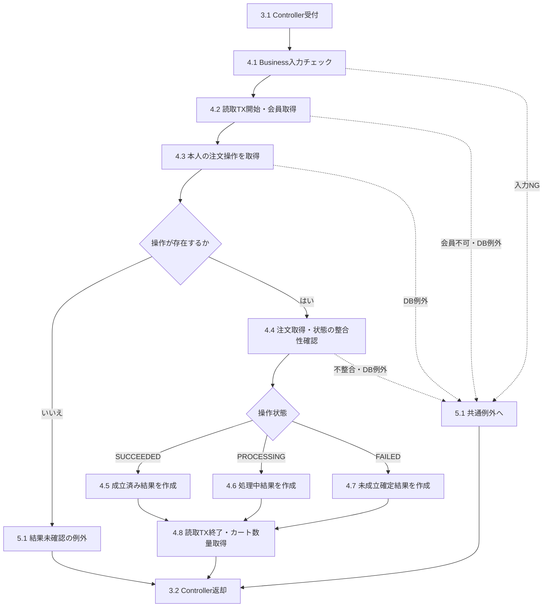

# APU004_04_注文操作の結果照会

> 2026-11-16改訂：購入完了メールのSNS連携を反映。添付版を基に更新。

作成日：2026-11-15。APU004_03（カード情報非保持版）に対応。

## 0. 処理フロー



本APIは参照のみ。注文・在庫・カート・配送先・操作履歴を変更せず、PROCESSINGの復旧処理も起動しない。

## 1. 基本情報

| 項目 | 内容 |
| --- | --- |
| 機能ID／旧ID | APU004_04／API-U18 |
| 物理名 | get-order-operation-result |
| HTTPメソッド・URL | GET /api/v1/orders/operations/{operationId} |
| 対応画面 | SCU-07（注文処理の結果確認）、SCU-08への遷移判定 |
| API Gateway認証 | 会員アクセストークン必須 |
| Controller | OrderOperationController.getResult |
| Business | GetOrderOperationResultBusiness.execute |
| 参照テーブル | users、operation_histories、orders。成立済みの場合は補助的にcarts、cart_items |
| DB更新・外部サービス呼出 | なし。Cognito属性取得・SNS／SQS送信・SES送信・モック決済の実行なし |
| べき等キー | 新規発行・受付不要。照会対象の既存operationIdをパスで指定 |
| TX | 操作・注文の照会は読取専用REPEATABLE READ。ロック句なし。カート数量は終了後の独立した参照 |
| 応答 | ECSで捕捉可能な成功・例外はHTTP 200。data／errorで判定 |

### 1.1 呼出契機と対象

| 契機 | 対象 |
| --- | --- |
| APU004_03のタイムアウト・通信断 | 送信時に使用したoperationId |
| 注文確定でPROCESSING応答を受信 | 同じoperationId |
| 再読み込み・再ログイン後の未解決操作再開 | 同じ会員に紐づけて保持しているoperationId |
| 「結果の再確認」押下 | 確認中のoperationId |

一般の注文履歴検索や、カート操作の結果照会には使用しない。注文確定後にキャンセルされても、元の注文作成操作はSUCCEEDEDのままとする。

### 1.2 購入完了メールとの境界

本APIは注文操作の成立結果を照会するだけで、SNSイベントの発行・再発行、SES送信、配信状態確認は実行しない。SUCCEEDEDは注文成立を示し、メール到着を意味しない。通知失敗は注文失敗に変換しない。通知だけの復旧はAPU004_03の4.10.3およびBAT001_01に従い運用者が実施する。

SESはサンドボックス継続（解除申請なし）。事前確認は運用者がSESで実施し、アプリ独自の宛先リストは設けない。メール送信はAPU004_03 → SNS → SQS → BAT001_01（Lambda）→ SESで行う。

## 2. リクエスト

### 2.1 項目

| 場所 | 項目 | 型・必須 | 内容 |
| --- | --- | --- | --- |
| ヘッダー | Authorization | string・必須 | Bearer会員アクセストークン。共通受付で検証 |
| ヘッダー | Accept | string・任意 | application/json |
| パス | operationId | string・必須 | 注文確定要求のIdempotency-Keyで使用した識別子 |
| クエリ | なし | — | 未定義項目を受け付けない |
| ボディ | なし | — | {}、null、配列も送信しない |

Idempotency-Keyヘッダー、userId、orderId、要求ハッシュは要求しない。Cookieを参照・更新しない。
パスのoperationIdは文字列のまま扱い、Longへ変換しない。

### 2.2 リクエスト例

```http
GET /api/v1/orders/operations/4df45f8d-bb7a-4ce5-9d49-e5d0d5d34687 HTTP/1.1
Authorization: Bearer <会員アクセストークン>
Accept: application/json
```

**リクエストJSONはなし。** ボディを空のまま送信する。

## 3. Controller

### 3.1 受付

| 処理 | 内容 |
| --- | --- |
| HTTP解析 | **共通機能使用：COM001_10 HTTP共通受付・JSON構文解析** |
| Command作成 | 共通認証済みsub、パスoperationId、クエリ、ボディ有無 |
| 呼出 | GetOrderOperationResultBusiness.execute(command) |

共通ヘッダー検証は親Controller側で実施。個別Controllerでは、会員検索・所有権判定・状態分岐を行わない。

### 3.2 返却

- **共通機能使用：COM001_07 共通レスポンス生成**。
- 例外は**共通機能使用：COM001_08 共通例外変換**。
- Content-Type: application/json; charset=UTF-8、Cache-Control: no-store。Set-Cookieは出力しない。
- 処理中・未成立確定も「照会成功」としてdataへ返し、error=nullとする。
- DB取得失敗をPROCESSINGやFAILEDへ置き換えない。

## 4. Business

### 4.1 個別入力チェック

BusinessでCommandを検証する。値の前後空白除去・大文字小文字変換は行わず、元の操作キーと完全一致させる。

| 対象 | チェック | NG時 |
| --- | --- | --- |
| operationId | 必須、小文字UUID v4、36文字固定 | VALIDATION_ERROR |
| クエリ | 項目なし | INVALID_REQUEST |
| ボディ | 存在しない | INVALID_REQUEST |

DTO：@NotBlank、@Size(min=36,max=36)、小文字UUID v4の@Pattern。Businessで検証する。
操作IDの許可形式は注文確定時の共通Idempotency-Key検証と一致させる。本書の形式外を注文側で受け付けないことを実装時に確認する。

項目間チェックはなし。会員と操作・注文の対応は4.3・4.4のDB条件で検証する。パス変数自体が欠落しルートに一致しない要求は、共通ルーティングで処理する。

### 4.2 読取TX開始・会員取得

4.2〜4.7を、読取専用REPEATABLE READの1つのTXで実行する。確定元と同じ書込み先DBを参照し、レプリカ遅延やキャッシュで未成立と判定しない。

**共通機能使用：COM001_04 subによる会員情報検索、COM001_05 会員利用状態判定。**

| 使用項目 | 用途 |
| --- | --- |
| users.id | 操作履歴のactor_id、注文のuser_id、会員カートの所有者確認 |
| users.status | 会員利用状態の判定 |

| 判定 | 次の処理 |
| --- | --- |
| 未登録 | USER_NOT_INITIALIZED |
| 利用不可 | ACCOUNT_DISABLED／MEMBER_NOT_READY等、共通判定の例外 |
| 利用可能 | 会員IDを保持して4.3へ |
| DB例外 | 5.1へ |

氏名・メール・配送先を本APIの応答へ含めない。DB transaction_timestamp()をasOfとして取得する。これは参照TXの基準時刻であり、最後の状態変更日時ではない。

### 4.3 本人の注文操作を取得

| テーブル | 条件 | 取得項目 |
| --- | --- | --- |
| operation_histories | operation_id=パス値、operation_type=ORDER_CREATE、actor_type=USER、actor_id=本人IDの10進文字列 | operation_id、operation_status、is_retryable、target_resource_id、result_code、created_at、updated_at |

```sql
SELECT operation_id, operation_status, is_retryable,
       target_resource_id, result_code, created_at, updated_at
FROM operation_histories
WHERE operation_id = #{operationId,jdbcType=VARCHAR}
  AND operation_type = 'ORDER_CREATE'
  AND actor_type = 'USER'
  AND actor_id = #{userIdText,jdbcType=VARCHAR};
```

| 結果 | 判定 |
| --- | --- |
| 0件 | RESOURCE_NOT_FOUND。未登録・別会員・別操作種別を同じ応答にする |
| 1件 | 4.4へ |
| 状態が未定義・必須値欠損・時刻不正 | INTERNAL_ERROR |
| DB例外 | SERVICE_UNAVAILABLE等 |

**0件でも注文未成立とは断定しない。** 元のPOSTがまだ到達していない／受付TXが未COMMITの場合がある。新しいキーによる再注文は許可しない。

request_hashは同一キーの書込み再送検証用。本GETは本人の操作結果だけを参照するため、要求本文・hashの送信や再計算を要求しない。
result_summary_jsonをそのまま返さず、成立情報・配送先保存結果はordersから取得する。住所・復旧メタデータ・保存配送先IDは返さない。

### 4.4 注文取得・状態の整合性確認

状態にかかわらず対応する本人の注文を取得し、FAILEDなのに成立注文がある等の矛盾を検出する。

| テーブル | 条件 | 取得項目 |
| --- | --- | --- |
| orders | order_create_operation_id=operationId AND user_id=本人ID | 下記SQL |

```sql
SELECT id, order_number, user_id, order_create_operation_id,
       order_status, ordered_at, total_amount_including_tax,
       payment_method_name, mock_payment_status,
       save_address_requested, save_address_result
FROM orders
WHERE order_create_operation_id = #{operationId,jdbcType=VARCHAR}
  AND user_id = #{userId,jdbcType=BIGINT};
```

| 操作状態 | 注文件数・操作項目 | 判定 |
| --- | --- | --- |
| SUCCEEDED | 1件、orders.id=target_resource_id、is_retryable=false、result_code=ORDER_COMPLETED | 4.5へ |
| PROCESSING | 0件、target_resource_id=null、is_retryable=false、result_code=null | 4.6へ |
| FAILED | 0件、target_resource_id=null、result_codeが設定済み | 4.7へ |
| 上記以外 | 成功なのに注文なし、失敗／処理中なのに注文あり、対象ID不一致等 | INTERNAL_ERROR。注文・在庫を修復しない |

注文作成と操作成功はAPU004_03で同じTXにより確定する。この読取TX内では片側だけが確定した状態を正常とみなさない。PROCESSINGが古くても、期限切れや失敗へ更新しない。

### 4.5 成立済み結果を作成

#### 注文項目の確認

| 使用項目 | 条件・設定 |
| --- | --- |
| id | 正のBIGINT。order.orderIdへ10進文字列で設定 |
| order_number | 1〜32文字。order.orderNumberへ設定 |
| ordered_at | 有効な確定日時。UTC・ミリ秒・Z付きへ整形 |
| total_amount_including_tax | 1以上のBIGINT。再計算せず文字列で返す |
| order_status | ORDER_RECEIVED／PREPARING／SHIPPED／CANCELLED |
| payment_method_name | 「クレジットカード（モック）」であること。paymentMethod=MOCK_CREDIT_CARD |
| mock_payment_status | 共通モック状態定義の現在値。初回PAID、取消後は定義済み取消状態 |

必須値欠損・未定義状態はINTERNAL_ERROR。初期値や0円で補完しない。
注文状態がCANCELLEDでも、注文作成操作のoperationStatusはSUCCEEDED、isRetryable=false。キャンセル済みを理由に元の注文確定要求を再実行しない。

#### 配送先保存結果

| orders.save_address_requested | orders.save_address_result | 応答 |
| --- | --- | --- |
| false | NOT_APPLICABLE | NOT_APPLICABLE |
| true | SUCCEEDED | SUCCEEDED |
| true | FAILED | FAILED |
| true | PROCESSING | PROCESSING |
| 欠損・上記以外 | 不整合 | UNKNOWN。注文成功を維持し、安全なログへ記録 |

UNKNOWNは応答上の状態でありDBへ保存しない。保存結果だけが不正な場合は注文成立を取り消さず、再確認を案内する。注文SQL自体の通信失敗で成立情報を取得できない場合は全体エラーとする。
保存結果がPROCESSINGの場合、稼働中／停止後の復旧待ちをこの読取だけで区別せず、「保存完了が確認できていない」状態として返す。

#### 成立済み結果

| DTO項目 | 値 |
| --- | --- |
| operationStatus / resultCode | SUCCEEDED / ORDER_COMPLETED |
| isRetryable | false |
| order | 上記注文情報 |
| addressSaveResult | 上記判定結果 |
| message | 通常「注文は成立しています。」。キャンセル済みなら「この注文はキャンセルされています。注文詳細をご確認ください。」 |

保存結果の文言は画面側がaddressSaveResultに対応するSCU-08の文言を表示する。保存失敗を新規注文の再実行で回復しない。

### 4.6 処理中結果を作成

| DTO項目 | 値 |
| --- | --- |
| operationStatus | PROCESSING |
| resultCode | null |
| isRetryable | false |
| order / cart | null / null |
| addressSaveResult | NOT_APPLICABLE |
| message | 注文の成立をまだ確認できません。再注文せず、操作結果を再確認してください。 |

NOT_APPLICABLEは「この参照時点で成立注文がなく、保存結果表示の対象外」という意味。要求のsaveAddress=falseを断定するものではない。
受付直後、注文TX実行中、失敗記録前、復旧待ちのいずれもあり得る。時間経過を根拠にisRetryable=trueへ変更しない。

### 4.7 未成立確定結果を作成

| DTO項目 | 値 |
| --- | --- |
| operationStatus | FAILED |
| resultCode | operation_histories.result_code |
| isRetryable | operation_histories.is_retryable |
| order / cart | null / null |
| addressSaveResult | NOT_APPLICABLE |
| message | 下表のコード対応文言 |

| 保存済みresult_code | message |
| --- | --- |
| CONFLICT | 注文内容の変更により注文は成立していません。最新の内容をご確認ください。 |
| BUSINESS_RULE_VIOLATION | 注文は成立していません。カートの内容や表示された案内をご確認ください。 |
| SERVICE_UNAVAILABLE | 注文処理を完了できず、注文は成立していません。時間をおいて再度ご確認ください。 |
| INTERNAL_ERROR等、その他の登録済みコード | 注文は成立していません。再操作の可否をご確認ください。 |

DBに保存された任意の例外文・SQL文をそのままmessageへ使用しない。
isRetryable=trueは、**この操作では注文が成立しておらず、新しい操作キーでやり直せる**ことを意味する。現在の在庫・価格・会員状態で注文可能なことまでは保証しない。
再操作前にAPU004_01で最新内容を確認する。同じoperationIdの再送でFAILEDをPROCESSINGへ戻さない。

### 4.8 読取TX終了・カート数量取得

4.2〜4.7の正常DTOを確定し、読取TXを終了する。
SUCCEEDEDの場合だけ、独立した参照処理で現在の本人カート・数量を取得する。PROCESSING／FAILEDではcart=null。

```sql
SELECT c.id, c.version, c.status, c.expires_at,
       COUNT(ci.id) AS line_count,
       COUNT(*) FILTER (
         WHERE ci.id IS NOT NULL AND (ci.quantity IS NULL OR ci.quantity < 1)
       ) AS invalid_line_count,
       COALESCE(SUM(ci.quantity), 0) AS total_quantity
FROM carts c
LEFT JOIN cart_items ci ON ci.cart_id = c.id
WHERE c.user_id = #{userId,jdbcType=BIGINT}
GROUP BY c.id, c.version, c.status, c.expires_at;
```

| 結果 | 応答 |
| --- | --- |
| 1件、ACTIVE、期限null、正のID・版、invalid_line_count=0、非負BIGINT数量合計 | cartId・version・totalQuantityを10進文字列で返す |
| 明細0件 | totalQuantity="0" |
| カートなし・複数件・不正値・通信失敗 | cart=null。注文結果は維持する |

購入不可分を含む保存済み全明細数量を集計する。注文後の別タブ追加があれば0以外も返す。商品テーブルをJOINして購入可能分だけへ絞らない。
数量・版は単一SELECTの同じ参照時点で取得する。補助取得失敗を捕捉し、**共通機能使用：COM001_09 安全なログ出力**で記録する。注文結果の読取TXとは別にするため、カートSQL失敗で注文結果を失わない。

## 5. 例外・復旧・連携

### 5.1 例外返却

**共通機能使用：COM001_08 共通例外変換、COM001_09 安全なログ出力。**

| 条件 | error.code | message |
| --- | --- | --- |
| パス値不正 | VALIDATION_ERROR | 入力内容をご確認ください。 |
| 未定義クエリ／不要なボディ | INVALID_REQUEST | リクエストの内容が正しくありません。 |
| 会員なし | USER_NOT_INITIALIZED | 会員情報の準備が必要です。 |
| 利用不可 | ACCOUNT_DISABLED／MEMBER_NOT_READY | COM001_05の文言 |
| 本人のORDER_CREATE操作が取得できない | RESOURCE_NOT_FOUND | 操作結果を確認できませんでした。再注文せず、指定した操作情報をご確認ください。 |
| DB接続障害・SQLタイムアウト | SERVICE_UNAVAILABLE | 注文の操作結果を取得できませんでした。再注文せず、時間をおいて再確認してください。 |
| 操作・注文不整合／不正データ | INTERNAL_ERROR | 注文の操作結果を確認できませんでした。再注文せず、時間をおいて再確認してください。 |

ECSで捕捉した例外はHTTP 200、data=null、errorあり。入力不正は項目パス付きfieldErrors、それ以外[]。
他会員の操作か、本当に存在しないかを文言で区別しない。エラー応答に内部注文ID・保存内容を含めない。
Gatewayの認証拒否や通信断では共通JSONを保証しない。errorまたは通信失敗を受けたフロントは「未成立」「再注文可」と解釈しない。

### 5.2 データ復旧方法

| 状況 | 対応 |
| --- | --- |
| 本APIのDB参照失敗 | 読取TXを終了／ロールバック。同じGETを再実行できる |
| 応答消失 | 同じoperationIdで再照会。GETの二重実行によるデータ変更なし |
| PROCESSINGが継続 | 注文ボタンを再開しない。運用の復旧対象として扱う |
| 配送先PROCESSINGが継続 | 注文成功は維持。APU004_03の復旧Serviceで保存処理を確認 |
| 不整合検出 | 調査対象としてログ出力。GET内で自動補正しない |

本APIに登録・更新・削除がないため、データの書戻し・補償更新は不要。
実際の復旧はAPU004_03の5.2（操作行ロック・注文存在確認・未成立の確定／保存再開）で実施する。結果照会の呼出しだけでは、その復旧処理を起動しない。

### 5.3 画面との対応

| 応答 | 画面側の動作 |
| --- | --- |
| SUCCEEDED、注文がキャンセルされていない | SCU-08へ注文ID・保存結果を引き継ぐ |
| SUCCEEDED、CANCELLED | 完了の再通知は避け、キャンセル案内とSCU-09への導線 |
| SUCCEEDED、住所保存FAILED／PROCESSING／UNKNOWN | 注文成立表示を維持し、保存結果だけ案内 |
| PROCESSING | 注文確定ボタンは非活性。元のoperationIdで結果再確認 |
| FAILED、isRetryable=true | 最新カート・注文確認情報を取得し、利用者の明示操作で新しいキーを発行 |
| FAILED、isRetryable=false | 注文を再送せず、案内を表示 |
| RESOURCE_NOT_FOUND／その他のerror／通信断 | 注文結果未確認。新しいキーで注文を自動再送しない |
| cart=null | バッジを0件と断定せず、共通のカート数量再取得を使用 |

初期実装は手動の再確認で利用可能。サーバー側で長時間待機するロングポーリングは行わず、1回の要求で1回照会する。

### 5.4 確認ケース

| ケース | 期待結果 |
| --- | --- |
| 注文TX成功・応答だけ消失 | SUCCEEDEDと既存注文。新規注文なし |
| 受付TX未COMMIT | RESOURCE_NOT_FOUND。未成立・再注文可と判定しない |
| 受付COMMIT済み・注文未確定 | PROCESSING、isRetryable=false |
| 注文TX実行中に照会 | 同一スナップショットのPROCESSING。未確定データを読まない |
| FAILED記録済み | FAILED、保存済み再操作可否、error=null |
| 他会員のoperationId | 不存在と同じRESOURCE_NOT_FOUND |
| 同じ会員のカート操作ID | ORDER_CREATE対象外のためRESOURCE_NOT_FOUND |
| SUCCEEDEDなのに注文なし／FAILEDなのに注文あり | INTERNAL_ERROR、自動復旧なし |
| 配送先保存だけFAILED | operationStatus=SUCCEEDED、addressSaveResult=FAILED |
| 注文成立後にキャンセル | SUCCEEDEDのままorderStatus=CANCELLED |
| 成立結果取得後、カートSQL失敗 | 注文結果正常、cart=null |
| 同じGETを何度実行しても | 版・数量・期限・操作状態・通知送信回数は変化しない |

## 6. 返却項目

### 6.1 共通・照会結果

APU004_03の結果DTOと共通の項目名を使う。asOf・operationUpdatedAtを照会用として追加する。

| 項目 | 型・null | 内容 |
| --- | --- | --- |
| requestId | string・不可 | 今回の要求追跡ID |
| data | object・可 | 照会成功時の結果。例外時null |
| error | object・可 | 照会成功時null |
| error.code / message | string | 5.1のエラー情報 |
| error.fieldErrors | array | 入力エラーならfield／message、それ以外[] |
| data.operationId | string・不可 | 照会対象の操作識別子 |
| data.operationStatus | string・不可 | SUCCEEDED／PROCESSING／FAILED |
| data.resultCode | string・可 | 成功ORDER_COMPLETED、処理中null、失敗は保存済みコード |
| data.isRetryable | boolean・不可 | 新しい操作キーでの再操作を許可するか。trueはFAILEDの場合だけ |
| data.asOf | string・不可 | 注文結果参照TXの基準時刻。UTC・ミリ秒・Z付き |
| data.operationUpdatedAt | string・不可 | 操作履歴updated_at。UTC・ミリ秒・Z付き |
| data.order | object・可 | 成立済みの場合だけ設定 |
| data.cart | object・可 | 成立済みかつ現在数量取得成功時だけ設定 |
| data.addressSaveResult | string・不可 | SUCCEEDED／FAILED／PROCESSING／UNKNOWN／NOT_APPLICABLE |
| data.message | string・不可 | 4.5〜4.7の案内 |

asOfとカート数量は別の参照時点。operationUpdatedAtを注文の更新日時や保存先の更新日時と扱わない。

### 6.2 order・cart

| 項目 | 型 | DB項目／設定 |
| --- | --- | --- |
| order.orderId | string | orders.id |
| order.orderNumber | string | orders.order_number |
| order.orderedAt | string | orders.ordered_atをUTC形式化 |
| order.orderStatus | string | orders.order_statusの現在値 |
| order.totalIncludingTax | string | orders.total_amount_including_taxの確定時総額 |
| order.paymentMethod | string | MOCK_CREDIT_CARD固定 |
| order.mockPaymentStatus | string | orders.mock_payment_statusの現在値 |
| cart.cartId / version | string | carts.id／version |
| cart.totalQuantity | string | 保存済み全明細の数量合計 |

ID・版・金額・数量合計は10進文字列。カード情報・配送先本文・要求ハッシュ・JWT・復旧メタデータは返さない。

### 6.3 成立済みJSON（配送先保存失敗でも注文成功）

```json
{
  "requestId": "req-order-result-001",
  "data": {
    "operationId": "4df45f8d-bb7a-4ce5-9d49-e5d0d5d34687",
    "operationStatus": "SUCCEEDED",
    "resultCode": "ORDER_COMPLETED",
    "isRetryable": false,
    "asOf": "2026-11-15T08:00:05.123Z",
    "operationUpdatedAt": "2026-11-15T08:00:01.456Z",
    "order": {
      "orderId": "501",
      "orderNumber": "ORD-501",
      "orderedAt": "2026-11-15T08:00:00.123Z",
      "orderStatus": "ORDER_RECEIVED",
      "totalIncludingTax": "4460",
      "paymentMethod": "MOCK_CREDIT_CARD",
      "mockPaymentStatus": "PAID"
    },
    "cart": {"cartId": "301", "version": "6", "totalQuantity": "0"},
    "addressSaveResult": "FAILED",
    "message": "注文は成立しています。"
  },
  "error": null
}
```

### 6.4 処理中JSON

```json
{
  "requestId": "req-order-result-002",
  "data": {
    "operationId": "4df45f8d-bb7a-4ce5-9d49-e5d0d5d34687",
    "operationStatus": "PROCESSING",
    "resultCode": null,
    "isRetryable": false,
    "asOf": "2026-11-15T08:00:00.123Z",
    "operationUpdatedAt": "2026-11-15T07:59:59.123Z",
    "order": null,
    "cart": null,
    "addressSaveResult": "NOT_APPLICABLE",
    "message": "注文の成立をまだ確認できません。再注文せず、操作結果を再確認してください。"
  },
  "error": null
}
```

### 6.5 未成立確定JSON

```json
{
  "requestId": "req-order-result-003",
  "data": {
    "operationId": "4df45f8d-bb7a-4ce5-9d49-e5d0d5d34687",
    "operationStatus": "FAILED",
    "resultCode": "CONFLICT",
    "isRetryable": true,
    "asOf": "2026-11-15T08:00:05.123Z",
    "operationUpdatedAt": "2026-11-15T08:00:01.456Z",
    "order": null,
    "cart": null,
    "addressSaveResult": "NOT_APPLICABLE",
    "message": "注文内容の変更により注文は成立していません。最新の内容をご確認ください。"
  },
  "error": null
}
```

### 6.6 操作なし・別会員・対象外の操作（HTTP 200）

```json
{
  "requestId": "req-order-result-004",
  "data": null,
  "error": {
    "code": "RESOURCE_NOT_FOUND",
    "message": "操作結果を確認できませんでした。再注文せず、指定した操作情報をご確認ください。",
    "fieldErrors": []
  }
}
```

### 6.7 DB取得例外（HTTP 200）

```json
{
  "requestId": "req-order-result-005",
  "data": null,
  "error": {
    "code": "SERVICE_UNAVAILABLE",
    "message": "注文の操作結果を取得できませんでした。再注文せず、時間をおいて再確認してください。",
    "fieldErrors": []
  }
}
```
