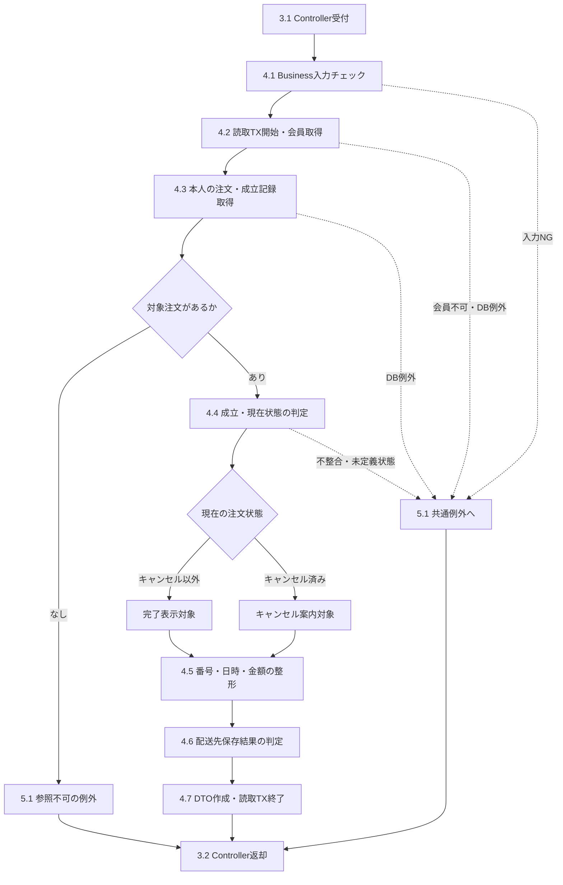

# APU004_05_注文完了画面表示用サマリー取得

> 2026-11-16改訂：購入完了メールのSNS連携を反映。添付版を基に更新。

作成日：2026-11-16。カード情報非保持版。

## 0. 処理フロー



GETによる再表示・保存結果の再確認では、注文確定・配送先保存・通知送信を実行しない。

## 1. 基本情報

| 項目 | 内容 |
| --- | --- |
| 機能ID／旧ID | APU004_05／API-U19 |
| 物理名 | get-order-completion-summary |
| HTTPメソッド・URL | GET /api/v1/orders/{orderId}/completion |
| 対応画面 | SCU-08（注文完了画面） |
| API Gateway認証 | 会員アクセストークン必須 |
| Controller | OrderCompletionController.getSummary |
| Business | GetOrderCompletionSummaryBusiness.execute |
| 参照テーブル | users、orders、operation_histories |
| 登録・更新・削除／外部通信 | なし |
| TX | 読取専用REPEATABLE READ。FOR UPDATE／FOR SHAREなし |
| べき等キー | 不要。操作履歴の新規登録なし |
| 応答 | ECSで捕捉可能な成功・例外はHTTP 200。data／errorで判定 |

### 1.1 APU004_04との役割分担

| 状況 | 使用API・処理 |
| --- | --- |
| 注文IDが判明し、完了画面を表示・再読み込み | 本API。本人の成立済み注文と現在状態を確認 |
| 注文確定の応答が不明、operationIdだけ保持 | APU004_04。成立確認後に得たorderIdで本APIを利用可能 |
| 配送先保存結果を再確認 | 同じorderIdで本APIを再取得。保存処理は再送しない |
| 注文ID・操作IDとも不明 | 直近注文を推測しない。画面側でP07と注文履歴への導線 |
| ヘッダーバッジ更新 | 共通カート取得API。取得失敗で本APIの表示を妨げない |

独自の完了画面表示期限は設けない。URL直接アクセスや古い注文でも、本人の成立済み注文であれば対象とする。現在の注文状態がキャンセル済みなら、完了メッセージではなくキャンセル案内に切り替える。

### 1.2 購入完了メールとの境界

本APIは注文完了画面の表示情報を取得するだけで、SNSイベントの発行・再発行、SES送信、配信状態確認は実行しない。画面再読み込みでメールを再送しない。注文完了はメール到着を待たず表示し、メールの配信済み／未配信を本APIの返却値から判断しない。通知失敗は注文失敗に変換しない。

SESはサンドボックス継続（解除申請なし）。事前確認は運用者がSESで実施し、アプリ独自の宛先リストは設けない。メール送信はAPU004_03 → SNS → SQS → BAT001_01（Lambda）→ SESで行う。

## 2. リクエスト

### 2.1 項目

| 場所 | 項目 | 型・必須 | 条件 |
| --- | --- | --- | --- |
| ヘッダー | Authorization | string・必須 | Bearer会員アクセストークン。共通受付で検証 |
| ヘッダー | Accept | string・任意 | application/json |
| パス | orderId | string・必須 | 正のBIGINT。10進数字1〜19桁、先頭0・符号・空白なし |
| クエリ | なし | — | 未定義項目を受け付けない |
| ボディ | なし | — | {}、null、配列も送信しない |

orderIdは画面・通信では文字列、Business検証後にLongへ変換する。userId、operationId、Idempotency-Key、完了画面への遷移証明トークンは要求しない。Cookieを参照・更新しない。

### 2.2 リクエスト例

```http
GET /api/v1/orders/501/completion HTTP/1.1
Authorization: Bearer <会員アクセストークン>
Accept: application/json
```

**リクエストJSONはなし。** ボディを空のまま送信する。

## 3. Controller

### 3.1 受付

| 処理 | 内容 |
| --- | --- |
| HTTP解析 | **共通機能使用：COM001_10 HTTP共通受付・JSON構文解析** |
| Command作成 | 共通認証済みsub、パスorderId、クエリ、ボディ有無 |
| Business呼出 | GetOrderCompletionSummaryBusiness.execute(command) |

ヘッダーの共通チェックは親Controller側に委ねる。個別Controllerで注文検索・所有権判定・金額計算を行わない。

### 3.2 返却

- **共通機能使用：COM001_07 共通レスポンス生成**。
- 例外は**共通機能使用：COM001_08 共通例外変換**。
- Content-Type: application/json; charset=UTF-8、Cache-Control: no-store。Set-Cookieは出力しない。
- 成立確認済みの注文について、一部の表示項目欠損や配送先保存失敗だけでは全体エラーにしない。4.5・4.6のnull／警告／結果区分で返す。

## 4. Business

### 4.1 個別入力チェック

BusinessでBean Validationと範囲検証を実行する。

| 対象 | 条件・例 | NG時 |
| --- | --- | --- |
| orderId | @NotBlank、@Size(max=19)、@Pattern(regexp="^[1-9][0-9]{0,18}$") | INVALID_REQUEST |
| orderIdの範囲 | Long変換成功、1〜9223372036854775807 | INVALID_REQUEST |
| クエリ | 項目なし | INVALID_REQUEST |
| ボディ | 存在しない | INVALID_REQUEST |

IDをトリム・補正しない。項目間チェックはなし。本人との対応はDB検索条件で確認する。
パス欠落でルートが一致しない場合は共通ルーティング側で処理する。

### 4.2 読取TX開始・会員取得

4.2〜4.7を1つの読取専用REPEATABLE READ TXで実行する。注文確定先と同じDBを参照し、遅延するレプリカや古いキャッシュを成立判定の根拠にしない。

**共通機能使用：COM001_04 subによる会員情報検索、COM001_05 会員利用状態判定。**

| 項目・結果 | 処理 |
| --- | --- |
| users.id | 注文のuser_idと、操作履歴のactor_idを照合するため保持 |
| users.status | 共通機能で利用状態を判定 |
| 未登録 | USER_NOT_INITIALIZED |
| 利用不可 | ACCOUNT_DISABLED／MEMBER_NOT_READY等の共通例外 |
| 利用可能 | 4.3へ |
| DB例外 | 5.1へ |

氏名・メールアドレスを応答に含めない。DB transaction_timestamp()を応答のasOfとして取得する。

### 4.3 本人の注文・成立記録取得

| 取得元 | 条件 | 使用項目 |
| --- | --- | --- |
| orders o | o.id=要求orderId AND o.user_id=会員ID | id、user_id、order_number、order_status、ordered_at、total_amount_including_tax、save_address_requested、save_address_result、order_create_operation_id |
| LEFT JOIN operation_histories op | op.operation_id=o.order_create_operation_id | operation_id、operation_type、actor_type、actor_id、operation_status、target_resource_id、is_retryable、result_code |

```sql
SELECT o.id, o.user_id, o.order_number, o.order_status,
       o.ordered_at, o.total_amount_including_tax,
       o.save_address_requested, o.save_address_result,
       o.order_create_operation_id,
       op.operation_id AS recorded_operation_id,
       op.operation_type, op.actor_type, op.actor_id,
       op.operation_status, op.target_resource_id,
       op.is_retryable, op.result_code
FROM orders o
LEFT JOIN operation_histories op
  ON op.operation_id = o.order_create_operation_id
WHERE o.id = #{orderId,jdbcType=BIGINT}
  AND o.user_id = #{userId,jdbcType=BIGINT};
```

| 結果 | 判定 |
| --- | --- |
| 0件 | RESOURCE_NOT_FOUND。他会員・不存在を区別せず参照不可 |
| 1件 | 4.4へ |
| 複数件 | INTERNAL_ERROR |
| SQL失敗 | SERVICE_UNAVAILABLE等。0件扱いにしない |

注文状態をWHERE句で限定しない。キャンセル済み・不正状態を取得後に判定する。LEFT JOINにより、成立記録の欠損を注文不存在として隠さない。
住所・電話・注文明細・カード情報・保存済み配送先は取得しない。配送先保存結果は当該ordersの記録で判断する。

### 4.4 成立・現在状態の判定

#### 成立記録の整合性

| 使用項目 | 正常条件 |
| --- | --- |
| o.id / o.user_id | 要求ID／本人IDと一致 |
| order_create_operation_id / recorded_operation_id | 設定済み・一致 |
| operation_type / actor_type / actor_id | ORDER_CREATE／USER／本人IDの10進文字列 |
| operation_status / target_resource_id | SUCCEEDED／o.idと一致 |
| is_retryable / result_code | false／ORDER_COMPLETED |

いずれか不整合ならINTERNAL_ERROR。注文と操作成功はAPU004_03で同時確定するため、PROCESSINGやFAILEDの操作に注文行が紐づく状態を正常な完了として返さない。GETで自動修復しない。

#### 現在の注文状態

| orders.order_status | data.displayState | 判定 |
| --- | --- | --- |
| ORDER_RECEIVED | COMPLETED | 注文成立確認済み |
| PREPARING | COMPLETED | 注文成立確認済み。手配中 |
| SHIPPED | COMPLETED | 注文成立確認済み。発送済み |
| CANCELLED | CANCELLED | 過去の成立は確認済みだが現在はキャンセル |
| null・未定義 | — | INTERNAL_ERROR。完了を断定しない |

COMPLETEDは本画面の表示区分であり、DBの注文状態や配送完了を意味しない。orders.order_statusを変更しない。

### 4.5 番号・日時・金額の整形

成立・所有権を確認した後、表示用の値を作成する。

| DB項目 | 正常時 | 欠損・不正時 |
| --- | --- | --- |
| order_number | 1〜32文字の空白のみでない文字列を返す | orderNumber=null、warningsへORDER_NUMBER_UNAVAILABLE |
| ordered_at | 有効な日時をUTC・ミリ秒・Z付きへ整形 | orderedAt=null、warningsへORDER_DATE_UNAVAILABLE |
| total_amount_including_tax | 1以上のBIGINTを10進文字列へ変換 | totalIncludingTax=null、warningsへORDER_TOTAL_UNAVAILABLE |

DBのNOT NULL制約により通常は欠損しないが、画面仕様の補助表示に対応する。0円・現在日時・仮の注文番号を生成して補完しない。
キャンセル済みでも注文時点の総額を返す。現行の商品単価・送料設定から再計算しない。

警告発生時は**共通機能使用：COM001_09 安全なログ出力**で処理番号・対象項目・要求IDを記録する。注文データやSQL結果全体はログに含めない。

### 4.6 配送先保存結果の判定

| save_address_requested | save_address_result | requested | result | 警告 |
| --- | --- | --- | --- | --- |
| false | NOT_APPLICABLE | false | NOT_APPLICABLE | なし |
| true | SUCCEEDED | true | SUCCEEDED | なし |
| true | FAILED | true | FAILED | なし。保存失敗は業務結果 |
| true | PROCESSING | true | PROCESSING | なし。未完了／復旧待ちを含む |
| true | null・未定義・NOT_APPLICABLE | true | UNKNOWN | ADDRESS_SAVE_RESULT_UNAVAILABLE |
| false | NOT_APPLICABLE以外 | null | UNKNOWN | ADDRESS_SAVE_RESULT_UNAVAILABLE |
| null・不正な希望値 | 任意 | null | UNKNOWN | ADDRESS_SAVE_RESULT_UNAVAILABLE |

返却先はdata.addressSave.requested／result。UNKNOWNは応答区分のみでDBへ書き込まない。
希望有無と結果が矛盾した場合はrequested=nullとし、画面が「保存希望なし」と判断して警告を隠さないようにする。

- 保存結果FAILED／PROCESSING／UNKNOWNでも成立済み注文を未成立扱いにしない。
- 現在のuser_saved_addressesの有無で、過去の保存結果を書き換えない。
- PROCESSINGの経過時間だけでFAILEDへ変更しない。
- 保存結果が不正な場合は安全なログを残す。本APIから保存・復旧を呼び出さない。
- 注文取得SQL自体が失敗した場合は全体エラー。成立確認できないまま保存結果だけUNKNOWNで成功応答を返さない。

### 4.7 DTO作成・読取TX終了

| DTO項目 | 設定 |
| --- | --- |
| asOf | 読取TXの基準時刻 |
| displayState | 4.4のCOMPLETED／CANCELLED |
| testOrder | true固定 |
| order.orderId | o.idを10進文字列化 |
| order.orderStatus | 現在のorders.order_status |
| order.orderNumber / orderedAt / totalIncludingTax | 4.5の値 |
| order.currency | JPY固定 |
| addressSave | 4.6のrequested／result |
| warnings | 4.5・4.6の警告配列。該当なしは[]。同一コードを重複登録しない |

TX終了後にControllerへ返す。カート数量・注文明細・配送先本文・決済状態・返金状態は本APIでは返さない。必要な表示は共通カート取得／注文詳細取得APIを利用する。

## 5. 例外・復旧・画面連携

### 5.1 例外返却

**共通機能使用：COM001_08 共通例外変換、COM001_09 安全なログ出力。**

| 条件 | error.code | message |
| --- | --- | --- |
| orderId不正、クエリ／ボディあり | INVALID_REQUEST | リクエストの内容が正しくありません。 |
| 会員未登録 | USER_NOT_INITIALIZED | 会員情報の準備が必要です。 |
| 利用不可 | ACCOUNT_DISABLED／MEMBER_NOT_READY | COM001_05の文言 |
| 他会員の注文・不存在 | RESOURCE_NOT_FOUND | 指定された注文情報を表示できません。マイページの注文履歴からご確認ください。 |
| DB接続障害・SQLタイムアウト | SERVICE_UNAVAILABLE | 注文情報の表示に失敗しました。マイページの注文履歴からご確認いただくか、再読み込みしてください。 |
| 成立記録不整合・注文状態不正 | INTERNAL_ERROR | 注文情報の表示に失敗しました。マイページの注文履歴からご確認いただくか、再読み込みしてください。 |

ECSで捕捉可能な例外はHTTP 200、data=null、errorあり。入力違反のみfieldErrorsにfield／messageを設定し、それ以外は[]。
これらのエラーは表示・照会の失敗であり、注文確定の失敗を示さない。エラーを受けて再注文しない。
Gatewayの認証拒否・応答断・ECS停止は共通JSONを保証しない。

### 5.2 データ復旧方法

| 状況 | 対応 |
| --- | --- |
| 読取TX中の例外 | TXを終了・ロールバック。書込みがないため補償更新なし |
| 応答消失・再読み込み | 同じorderIdでGETを再実行可能 |
| 表示項目欠損 | 警告と補助表示を返す。データ修復は運用対応 |
| 成立記録の不整合 | ログを根拠に調査。GET内で注文・在庫・操作履歴を作り直さない |
| 配送先保存PROCESSING | APU004_03の復旧手順で確認。GETを繰り返しても保存を再実行しない |

注文成立後の状態更新・取消等はそれぞれの業務APIで行う。本APIに復旧用UPDATE／INSERT／DELETEはない。

### 5.3 SCU-08との対応

| 応答・状況 | 画面側の表示 |
| --- | --- |
| displayState=COMPLETED | P01・P02・P03、番号・日時・総額を表示 |
| displayState=CANCELLED | P16と注文詳細への導線。P01は表示しない |
| orderNumber=null | P10。存在する注文IDで詳細への導線は維持 |
| orderedAt／totalIncludingTax=null | 「注文詳細からご確認ください」。0や現在日時で補完しない |
| requested=false、result=NOT_APPLICABLE | 保存結果領域を非表示 |
| requested=true、result=SUCCEEDED／FAILED | P11／P04。対象は配送先のみ |
| requested=true、result=PROCESSING／UNKNOWN | P12／P13と「保存結果を再確認」 |
| requested=null | P14と「保存結果を再確認」。希望なし扱いにしない |
| RESOURCE_NOT_FOUND／orderId形式不正 | P06と注文履歴・商品一覧への導線 |
| SERVICE_UNAVAILABLE／INTERNAL_ERROR | P09と再読み込み。注文失敗とは表示しない |
| 注文ID不明・API未呼出 | P07。operationIdがあればAPU004_04で結果確認可能 |

「保存結果を再確認」は同じGETを呼び、最新の注文状態も反映する。再取得中は既に確認済みの表示を維持できるが、会員切替・ログアウト時は即座に破棄する。

### 5.4 確認ケース

| ケース | 期待結果 |
| --- | --- |
| 本人の成立済み注文 | COMPLETEDと注文時の総額 |
| 成立後に配送先保存だけ失敗 | COMPLETED、addressSave.result=FAILED |
| 後で保存配送先を変更 | 当該注文の保存結果は変わらない |
| キャンセル後にURL再訪 | CANCELLED。再注文・返金処理なし |
| 他会員ID／存在しないID | 同じRESOURCE_NOT_FOUND |
| ORDER_CREATE操作が未成功なのに注文行あり | INTERNAL_ERROR、完了表示を返さない |
| 保存希望・結果が矛盾 | 注文成立維持、requested=null、UNKNOWN、警告 |
| 注文番号・日時・総額だけ欠損 | 該当項目nullとwarnings。成立判定と区別 |
| DB通信失敗 | 全体エラー。未成立扱いにしない |
| 複数回再取得 | 版・在庫・数量・保存結果・通知送信回数を変更しない |
| カート取得だけ失敗 | 本APIは正常。カートバッジは共通処理で未確認扱い |

## 6. 返却項目

### 6.1 共通・サマリー

| 項目 | 型・null | 内容 |
| --- | --- | --- |
| requestId | string・不可 | 今回の要求追跡ID |
| data | object・可 | 正常時のサマリー。例外時null |
| error | object・可 | 正常時null |
| error.code / message | string | 5.1のエラー情報 |
| error.fieldErrors | array | 入力違反のfield／message、その他[] |
| data.asOf | string・不可 | UTC・ミリ秒・Z付きの読取TX基準時刻 |
| data.displayState | string・不可 | COMPLETED／CANCELLED。画面表示区分 |
| data.testOrder | boolean・不可 | true固定 |
| data.order | object・不可 | 以下の本人注文サマリー |
| data.addressSave | object・不可 | 以下の当該注文時の保存結果 |
| data.warnings | array・不可 | 警告コード文字列の配列。通常[] |

### 6.2 order・addressSave

| 項目 | 型・null | 設定元 |
| --- | --- | --- |
| order.orderId | string・不可 | orders.id |
| order.orderNumber | string・可 | orders.order_number。不正時null |
| order.orderedAt | string・可 | orders.ordered_at。UTC・ミリ秒・Z付き |
| order.orderStatus | string・不可 | 現在のorders.order_status |
| order.totalIncludingTax | string・可 | orders.total_amount_including_tax。10進文字列 |
| order.currency | string・不可 | JPY |
| addressSave.requested | boolean・可 | orders.save_address_requested。判定不能時null |
| addressSave.result | string・不可 | SUCCEEDED／FAILED／PROCESSING／UNKNOWN／NOT_APPLICABLE |

warningsの許可値：ORDER_NUMBER_UNAVAILABLE、ORDER_DATE_UNAVAILABLE、ORDER_TOTAL_UNAVAILABLE、ADDRESS_SAVE_RESULT_UNAVAILABLE。これらは表示警告でありerror.codeではない。
日時はフロントでJSTに変換する。注文ID・金額をJSON数値にせず文字列として返す。カード情報・配送先本文・会員ID・操作履歴本文は返さない。

### 6.3 正常JSON

```json
{
  "requestId": "req-completion-001",
  "data": {
    "asOf": "2026-11-16T02:00:00.123Z",
    "displayState": "COMPLETED",
    "testOrder": true,
    "order": {
      "orderId": "501",
      "orderNumber": "ORD-501",
      "orderedAt": "2026-11-15T08:00:00.123Z",
      "orderStatus": "ORDER_RECEIVED",
      "totalIncludingTax": "4460",
      "currency": "JPY"
    },
    "addressSave": {"requested": true, "result": "SUCCEEDED"},
    "warnings": []
  },
  "error": null
}
```

配送先保存失敗時も同じ正常構造でaddressSave.result=FAILEDとする。保存希望なしならrequested=false、result=NOT_APPLICABLE。

### 6.4 キャンセル済みJSON

```json
{
  "requestId": "req-completion-002",
  "data": {
    "asOf": "2026-11-16T02:00:00.123Z",
    "displayState": "CANCELLED",
    "testOrder": true,
    "order": {
      "orderId": "501",
      "orderNumber": "ORD-501",
      "orderedAt": "2026-11-15T08:00:00.123Z",
      "orderStatus": "CANCELLED",
      "totalIncludingTax": "4460",
      "currency": "JPY"
    },
    "addressSave": {"requested": false, "result": "NOT_APPLICABLE"},
    "warnings": []
  },
  "error": null
}
```

### 6.5 配送先保存結果が不正・確認不能な場合

正常dataの該当部分を次のように設定する。注文情報・成立判定は正常値を維持する。

```json
{
  "addressSave": {"requested": null, "result": "UNKNOWN"},
  "warnings": ["ADDRESS_SAVE_RESULT_UNAVAILABLE"]
}
```

### 6.6 参照不可（HTTP 200）

```json
{
  "requestId": "req-completion-003",
  "data": null,
  "error": {
    "code": "RESOURCE_NOT_FOUND",
    "message": "指定された注文情報を表示できません。マイページの注文履歴からご確認ください。",
    "fieldErrors": []
  }
}
```

### 6.7 DB取得例外（HTTP 200）

```json
{
  "requestId": "req-completion-004",
  "data": null,
  "error": {
    "code": "SERVICE_UNAVAILABLE",
    "message": "注文情報の表示に失敗しました。マイページの注文履歴からご確認いただくか、再読み込みしてください。",
    "fieldErrors": []
  }
}
```
