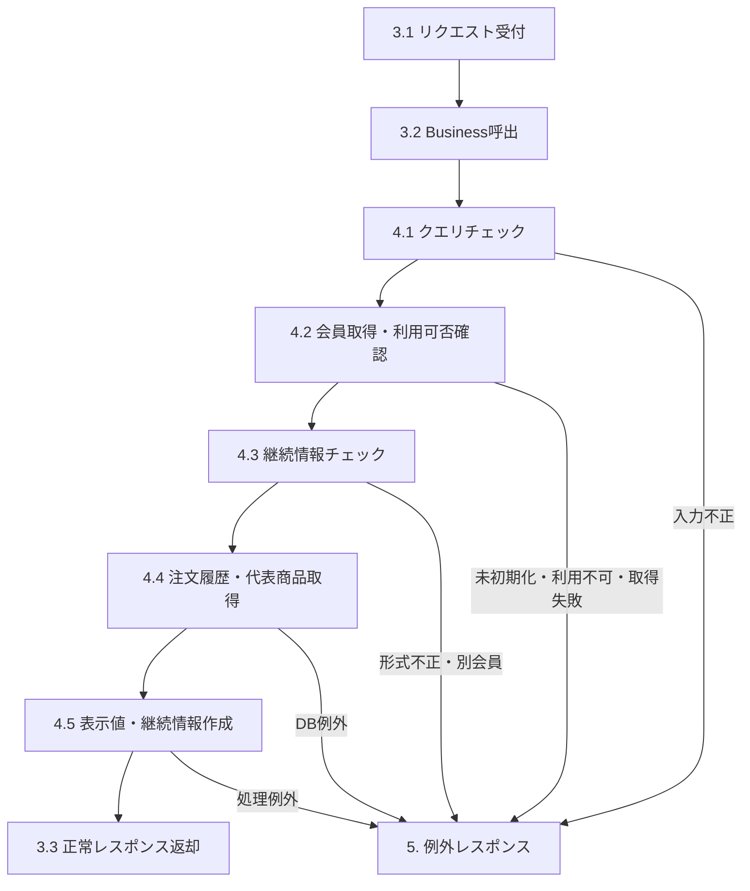

# APU005_01_マイページ情報・注文履歴一覧取得（追加取得対応）

## 0. 処理フロー



## 1. 基本情報

| 項目 | 内容 |
| --- | --- |
| 機能ID | APU005_01 |
| 論理名 | マイページ情報・注文履歴一覧取得（追加取得対応） |
| 物理名 | get-user-order-history |
| メソッド・URL | GET `/api/v1/users/me/orders` |
| 対応画面 | SCU-05（マイページ） |
| API Gateway認証 | あり：会員用アクセストークン |
| Controller | `UserOrderHistoryController.getHistory` |
| Business | `GetUserOrderHistoryBusiness.execute` |
| DB参照 | users、orders、order_items |
| DB登録・更新・削除 | なし |
| 取得件数 | 20件固定。次ページ判定用に最大21件取得 |
| 表示順 | orders.ordered_at DESC、orders.id DESC |
| 作成日 | 2026-11-16 |

会員情報と注文履歴を1回で返す。追加取得時も同じ構造を返す。
成立後のキャンセル済み注文を含め、成立前の操作履歴は取得しない。
カード情報、配送先、カート数量、モック決済情報は返さない。カート数量は共通ヘッダーの取得機能で扱う。

## 2. リクエスト仕様

### 2.1 ヘッダー

| 項目 | 必須 | 内容 |
| --- | --- | --- |
| Authorization | 必須 | Bearer形式の会員アクセストークン。検証・認証情報の受け渡しは親Controller側の共通処理 |
| Idempotency-Key | 不要 | 読み取り専用のため使用しない |

本設計ではCognito・API Gateway・親Controllerでの認証処理の詳細は記載しない。
Businessは共通処理から渡された会員用の検証済みsubを使用し、リクエストから会員IDを受け付けない。

### 2.2 クエリ・ボディ

| 項目 | 型 | 必須 | 制約 |
| --- | --- | --- | --- |
| cursor | string | 任意 | 未指定は先頭取得。指定時は1～2,048文字。内容の検証は4.3 |
| リクエストボディ | — | なし | JSONリクエストなし |

`limit`、`userId`、検索・並び替え条件は受け付けない。

**初回リクエスト例**

```http
GET /api/v1/users/me/orders
Authorization: Bearer <access-token>
```

**追加取得例（実際は前回のnextCursorをURLエンコードして指定）**

```http
GET /api/v1/users/me/orders?cursor=<前回返却されたnextCursor>
Authorization: Bearer <access-token>
```

## 3. Controller

### 3.1 リクエスト受付

| 処理 | 内容 |
| --- | --- |
| クエリ受領 | cursorを文字列のままRequest DTOへ格納 |
| 認証情報受領 | 親Controllerから検証済み会員subを受領 |
| 共通機能使用 | COM001_10：共通HTTP受付。共通処理の詳細は当該設計書に従う |

ControllerではDB検索・会員状態判定・cursor内部値の変換を行わない。
単項目チェックはBusinessからBean Validationを実行するため、Controllerの`@Valid`で先行実行しない。

### 3.2 Business呼出

`execute(requestDto, authenticatedActor)`を1回呼ぶ。
引数はcursorと共通認証情報。戻り値は7章のdataに相当するResponse DTO。

### 3.3 レスポンス返却

| 結果 | 処理 |
| --- | --- |
| 正常終了 | **共通機能使用：COM001_07**。HTTP 200、dataにBusiness結果、error=null |
| 例外 | **共通機能使用：COM001_08**。5章のコード・文言を共通形式で返却 |
| キャッシュ | `Cache-Control: no-store` |

## 4. Business

### 4.1 クエリチェック

Businessで`Validator.validate(requestDto)`を呼び、次のチェックを実行する。

| 対象 | チェック | NG時 |
| --- | --- | --- |
| cursor | 未指定は先頭、指定時は1〜2048文字 | CURSOR_INVALID |
| cursor | COM001_12が署名付き形式を検証。空文字・空白不可 | CURSOR_INVALID |
| クエリ | cursorの重複指定、未定義のクエリ指定を拒否する | INVALID_REQUEST |

カーソルの長さ・形式・署名はCOM001_12で検証する（2048文字まで）。
クエリの重複・未定義項目は、共通受付が保持するパラメータ名・値一覧をBusinessで確認する。

### 4.2 会員取得・利用可否確認

**共通機能使用：COM001_04（会員取得）、COM001_05（会員状態判定）**。

| 参照 | 条件・取得値 |
| --- | --- |
| users | `cognito_sub = 検証済みsub` |
| 必要項目 | id、name、email、status |

| 判定 | 次処理 |
| --- | --- |
| 会員あり・ACTIVE | users.idを内部会員IDとして4.3へ |
| 会員なし | USER_NOT_INITIALIZED。登録処理は行わない |
| DISABLED | ACCOUNT_DISABLED |
| PENDING | MEMBER_NOT_READY |
| DB取得失敗 | SERVICE_UNAVAILABLEまたはINTERNAL_ERROR。0件扱いにしない |
| 状態が未定義・不正 | INTERNAL_ERROR |

会員・注文・代表商品の参照は、Business内の1つの読み取り専用トランザクション
（REPEATABLE READ）で行う。会員取得部品も同じトランザクションへ参加させる。
接続先はプライマリDBとし、`FOR UPDATE`は使用しない。
同一リクエスト内の読み取り時点を揃えるもので、別ページの取得までトランザクションを保持しない。

### 4.3 継続情報チェック

**共通機能使用：COM001_12。** scope=APU005_01、条件・主体＝USER＋会員ID、空の検索条件。未指定は先頭。指定時はdecodeで検証した注文確定日時・注文IDだけをSQLの境界に使う。権限・所有者は毎回別途確認。

次ページがある場合のみ、返した最後の行からencode。追加取得時は初回の期限を引き継ぎ返却直前に再確認する。旧形式・不一致・期限切れはCURSOR_INVALID、fieldErrors=[]。

### 4.4 注文履歴・代表商品取得

| テーブル | 取得項目 | 条件 |
| --- | --- | --- |
| orders | id、order_number、ordered_at、order_status、total_amount_including_tax、total_item_quantity | user_id=4.2の会員ID。cursorありの場合は下記境界条件 |
| order_items | product_name_snapshot | order_id=orders.id AND line_number=1 |
| 取得件数 | 最大21件 | 20件返却＋次の注文有無判定用1件 |
| 並び順 | ordered_at DESC、id DESC | 固定 |

**MyBatis SQL（主な検索条件と取得項目）**

```xml
SELECT
    o.id,
    o.order_number,
    o.ordered_at,
    o.order_status,
    o.total_amount_including_tax,
    o.total_item_quantity,
    oi.product_name_snapshot
FROM orders o
LEFT JOIN order_items oi
  ON oi.order_id = o.id
 AND oi.line_number = 1
WHERE o.user_id = #{userId,jdbcType=BIGINT}
<if test="cursorOrderedAt != null">
  AND (
       o.ordered_at &lt; #{cursorOrderedAt,jdbcType=TIMESTAMP_WITH_TIMEZONE}
       OR (
            o.ordered_at = #{cursorOrderedAt,jdbcType=TIMESTAMP_WITH_TIMEZONE}
            AND o.id &lt; #{cursorOrderId,jdbcType=BIGINT}
          )
      )
</if>
ORDER BY o.ordered_at DESC, o.id DESC
LIMIT 21
```

- 日時バインドはUTCのOffsetDateTimeを使用する。
- 利用インデックス：`orders(user_id, ordered_at DESC, id DESC)`。
- 代表商品は`UNIQUE(order_id,line_number)`で最大1明細。明細欠損でも注文行を落とさない。
- ordersは成立済み注文のみ保存する前提のため、注文状況による除外条件を設けない。キャンセル済みも対象。
- productsは参照しない。現在の商品名・公開状態・価格で注文時点の情報を置き換えない。
- 総件数COUNT、全明細SUM、現在価格による再計算は行わない。
- 会員IDを含むSQLバインドはMyBatisの`#{...}`を使用する。

| 検索結果 | 判定 |
| --- | --- |
| 0件 | 正常。orders=[]、hasNext=false、nextCursor=null |
| 1～20件 | 全行を返す。hasNext=false、nextCursor=null |
| 21件 | 先頭20件を返す。hasNext=true。返却する20件目からnextCursorを生成 |
| DB例外 | 5章の例外返却。空一覧へ変換しない |

21件目をcursorの境界にすると1件読み飛ばすため、必ず返却対象の最終行を使用する。
追加取得で0件の場合は「最初から注文がなかった」とは判定せず、既存一覧を維持して取得終了とする。

### 4.5 表示値・継続情報作成

| レスポンス | 値・処理 |
| --- | --- |
| member.name / email | users.name / email。現在の会員情報 |
| orders[].orderId | orders.idを10進文字列へ変換 |
| orderNumber | orders.order_number |
| orderedAt | orders.ordered_atをUTCのISO 8601・ミリ秒固定で返す。画面でJST表示 |
| orderStatus.code / label | 下記対応表 |
| totalIncludingTax | orders.total_amount_including_taxを10進文字列へ変換 |
| totalQuantity | orders.total_item_quantityを10進文字列へ変換 |
| representativeProductName | order_items.product_name_snapshot。全文を返し、省略は画面側 |
| currency | JPY固定 |
| nextCursor | COM001_12.encodeの結果。hasNext=trueの場合のみ作成 |
| asOf | 読み取りトランザクション開始時刻（UTC） |

| DBのorder_status | code | label |
| --- | --- | --- |
| ORDER_RECEIVED | ORDER_RECEIVED | 注文受付 |
| PREPARING | PREPARING | 手配中 |
| SHIPPED | SHIPPED | 発送済み |
| CANCELLED | CANCELLED | キャンセル |
| 未定義・null | UNKNOWN | 状況を確認できません |

**欠損・不正データ**

| 対象 | 処理 |
| --- | --- |
| 注文ID・注文確定日時 | 並び順・cursorの前提を満たさないためINTERNAL_ERROR。途中までの結果を返さない |
| 氏名・メール | 空欄・nullの場合は該当値をnullにしmember.warningsへ追加 |
| 注文番号・代表商品名 | 空欄・nullの場合は該当値をnullにし注文行のwarningsへ追加 |
| 合計金額・数量 | null・1未満の場合はnullにし注文行のwarningsへ追加。0に補完しない |
| 状況 | UNKNOWNと警告コードを返す。生の未定義コードは外部に出さない |

警告コード：
`MEMBER_NAME_UNAVAILABLE`、`MEMBER_EMAIL_UNAVAILABLE`、
`ORDER_NUMBER_UNAVAILABLE`、`PRODUCT_NAME_UNAVAILABLE`、
`ORDER_TOTAL_UNAVAILABLE`、`ORDER_QUANTITY_UNAVAILABLE`、`ORDER_STATUS_UNAVAILABLE`。
正常データの場合はwarnings=[]。

件数境界となるordered_at・idは注文成立後に変更しない。
ページ間に追加された新規注文は先頭再取得で表示する。ページ間での状態変更は各取得時点の値を返す。
全ページを同一時点のスナップショットに固定する方式ではない。

## 5. 例外・エラー返却

**共通機能使用：COM001_08（例外レスポンス）、COM001_09（例外ログ）**。
アプリケーションで捕捉できた例外は原則HTTP 200、data=null、errorに詳細を設定する。
API GatewayのJWT拒否やネットワーク断等は本APIのJSON形式・HTTP 200を保証しない。

| 発生箇所 | error.code | error.message | fieldErrors |
| --- | --- | --- | --- |
| 4.1 単項目・クエリ不正 | VALIDATION_ERROR | リクエスト内容を確認してください。 | 該当項目を設定 |
| 4.3 継続情報不正 | CURSOR_INVALID | 続きの情報を取得できません。先頭から再読み込みしてください。 | [] |
| 4.2 会員なし | USER_NOT_INITIALIZED | 会員情報の準備が必要です。 | [] |
| 4.2 無効会員 | ACCOUNT_DISABLED | このアカウントは現在利用できません。 | [] |
| 4.2 初期化未完了状態 | MEMBER_NOT_READY | 会員情報の準備が完了していません。 | [] |
| DB接続・タイムアウト等 | SERVICE_UNAVAILABLE | 注文履歴の取得に失敗しました。時間をおいて再度お試しください。 | [] |
| 不整合・想定外例外 | INTERNAL_ERROR | 注文履歴の取得に失敗しました。時間をおいて再度お試しください。 | [] |

- 会員情報と注文履歴は一括取得するため、DB検索失敗時に成功扱いの空一覧・部分一覧は返さない。
- フロントは初回失敗と追加取得失敗を呼出状況で判別する。追加取得失敗では既存一覧・cursorを保持する。
- SQL、JWT、cursor、氏名・メールアドレス、内部スタックトレースを利用者に返さない。
- エラーコードは共通コード表と照合して実装する。本書作成によるコード表の更新は行っていない。

## 6. データ復旧・再実行

| 状況 | 対応 |
| --- | --- |
| DB例外・レスポンス生成失敗 | 読み取りトランザクションをロールバック。本APIによるDB変更がないため補償更新なし |
| 通信タイムアウト | 同じcursorでGETを再実行可能。注文・在庫・カート・会員を変更しない |
| CURSOR_INVALID | cursorを破棄し、先頭から再取得 |
| 初回成功・0件 | 正常終了。復旧不要 |
| 不整合データ | エラーまたは警告を返し、調査対象として記録。本APIでデータを補正しない |
| 会員未初期化 | フロントでAPU001_01の会員初期化完了後、本APIを再実行 |

ロールバックや再取得で他APIが確定済みの注文・キャンセルを取り消さない。
同じcursorを再利用した場合でも、注文状況等は最新の取得時点の値になる。

## 7. 返却項目

### 7.1 ヘッダー・共通構造

| 項目 | 型／値 | 内容 |
| --- | --- | --- |
| HTTPステータス | 200 | アプリケーション内で処理・捕捉できた結果 |
| Content-Type | application/json | JSON形式 |
| Cache-Control | no-store | 個人情報のキャッシュ抑止 |
| requestId | string | 共通処理の要求追跡ID |
| data | object / null | 成功時の取得結果。エラー時null |
| error | object / null | 成功時null |
| error.code | string | 5章のエラーコード |
| error.message | string | 5章のメッセージ |
| error.fieldErrors | array | 各要素はfield、message。項目エラーなしは[] |

### 7.2 data

| 項目 | 型 | null可 | 取得元・用途 |
| --- | --- | --- | --- |
| asOf | string | 不可 | 取得時点。UTC・ミリ秒固定 |
| member | object | 不可 | 現在の会員情報 |
| member.name | string | 可 | users.name |
| member.email | string | 可 | users.email |
| member.warnings | string[] | 不可 | 会員情報の欠損警告 |
| orders | array | 不可 | 最大20件。0件は[] |
| orders[].orderId | string | 不可 | 注文ID・詳細遷移 |
| orders[].orderNumber | string | 可 | 注文番号 |
| orders[].orderedAt | string | 不可 | 注文確定日時 |
| orders[].orderStatus | object | 不可 | code、label |
| orders[].orderStatus.code | string | 不可 | 4.5の状態コード |
| orders[].orderStatus.label | string | 不可 | 利用者向け状態名 |
| orders[].totalIncludingTax | string | 可 | 注文確定時の税込総額。キャンセル後も維持 |
| orders[].totalQuantity | string | 可 | 注文時点の明細数量合計。商品種類数ではない |
| orders[].representativeProductName | string | 可 | 先頭明細の注文時商品名 |
| orders[].currency | string | 不可 | JPY |
| orders[].warnings | string[] | 不可 | 当該注文の表示用警告 |
| pageSize | integer | 不可 | 20固定 |
| hasNext | boolean | 不可 | 21件目があればtrue |
| nextCursor | string | 可 | hasNext=falseならnull |

### 7.3 正常JSON例（最終ページ・1件）

```json
{
  "requestId": "req-order-history-001",
  "data": {
    "asOf": "2026-11-16T09:00:00.000Z",
    "member": {
      "name": "山田太郎",
      "email": "user@example.com",
      "warnings": []
    },
    "orders": [
      {
        "orderId": "201",
        "orderNumber": "ORD-201",
        "orderedAt": "2026-11-15T01:30:00.000Z",
        "orderStatus": {
          "code": "ORDER_RECEIVED",
          "label": "注文受付"
        },
        "totalIncludingTax": "6440",
        "totalQuantity": "3",
        "representativeProductName": "サンプル商品",
        "currency": "JPY",
        "warnings": []
      }
    ],
    "pageSize": 20,
    "hasNext": false,
    "nextCursor": null
  },
  "error": null
}
```

### 7.4 0件JSON例

```json
{
  "requestId": "req-order-history-002",
  "data": {
    "asOf": "2026-11-16T09:00:00.000Z",
    "member": {
      "name": "山田太郎",
      "email": "user@example.com",
      "warnings": []
    },
    "orders": [],
    "pageSize": 20,
    "hasNext": false,
    "nextCursor": null
  },
  "error": null
}
```

### 7.5 例外JSON例（HTTP 200）

```json
{
  "requestId": "req-order-history-003",
  "data": null,
  "error": {
    "code": "CURSOR_INVALID",
    "message": "続きの情報を取得できません。先頭から再読み込みしてください。",
    "fieldErrors": []
  }
}
```

