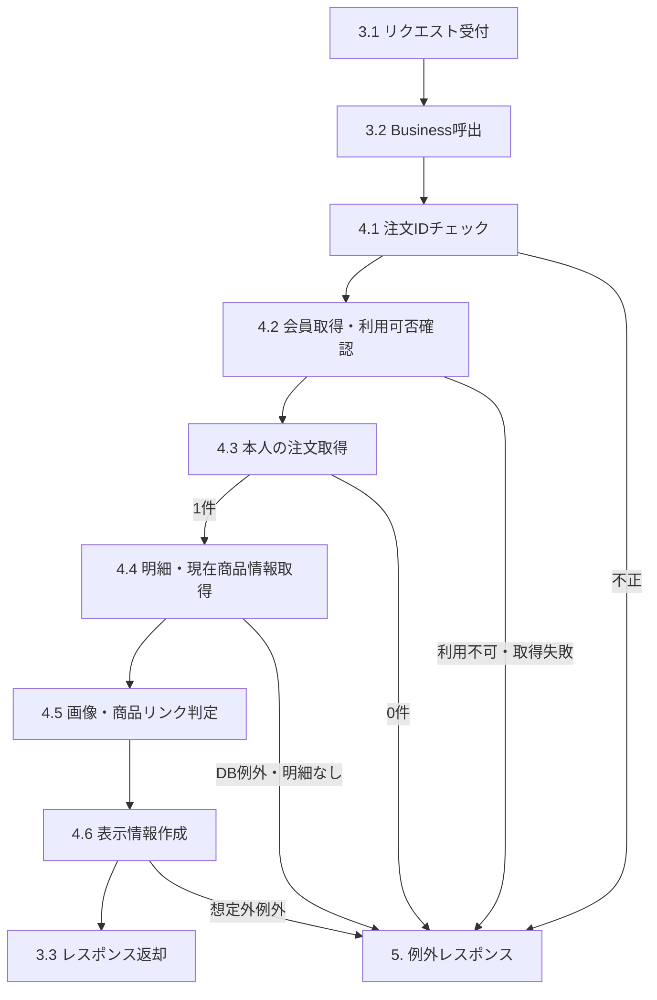

# APU005_02_会員向け注文詳細取得

## 0. 処理フロー



## 1. 基本情報

| 項目 | 内容 |
| --- | --- |
| 機能ID | APU005_02 |
| 論理名 | 会員向け注文詳細取得 |
| 物理名 | get-user-order-detail |
| HTTPメソッド | GET |
| URL | `/api/v1/users/me/orders/{orderId}` |
| 対応画面 | SCU-09（注文詳細）、SCU-05の復帰時対象行更新 |
| 認証 | API Gateway：会員JWT必須 |
| Controller | UserOrderDetailController.getDetail |
| Business | GetUserOrderDetailBusiness.execute |
| DB参照 | users、orders、order_items、products |
| DB登録・更新・削除 | なし |
| 作成日 | 2026-11-16 |

本人の成立済み注文を取得する。キャンセル済みも対象とする。
金額・商品名・配送先・注文者情報は注文時点の記録、画像と商品詳細遷移可否は現在の商品情報から返す。
カード番号・保存カード・模擬下4桁は取得・返却しない。カート数量取得は本APIに含めない。

## 2. リクエスト

### 2.1 項目

| 区分 | 項目 | 型 | 必須 | 内容 |
| --- | --- | --- | --- | --- |
| Header | Authorization | string | 必須 | Bearer形式の会員アクセストークン。共通処理で扱う |
| Path | orderId | string | 必須 | 注文ID。Businessでチェック後Long変換 |
| Query | — | — | — | なし |
| Body | — | — | — | なし |
| Header | Idempotency-Key | — | 不要 | 読み取り専用のため使用しない |

### 2.2 リクエスト例

GETのためリクエストJSONは送信しない。

```http
GET /api/v1/users/me/orders/201
Authorization: Bearer <access-token>
```

## 3. Controller

### 3.1 リクエスト受付

| 処理 | 内容 |
| --- | --- |
| Path受領 | orderIdをStringでRequest DTOへ格納 |
| 認証情報受領 | 親Controllerから会員用の検証済みsubを受領 |
| 共通機能使用 | COM001_10：共通HTTP受付 |

親Controller側のヘッダーチェック・認証情報抽出の詳細はここでは記載しない。
ControllerではLong変換、DB検索、所有者判定を行わない。

### 3.2 Business呼出

`execute(requestDto, authenticatedActor)`を呼び出す。
引数は注文IDと共通認証情報。userIdはクライアントから受け付けない。
Controllerの`@Valid`による先行チェックは行わず、BusinessでBean Validationを実行する。

### 3.3 レスポンス返却

| 結果 | 処理 |
| --- | --- |
| 正常 | **共通機能使用：COM001_07**。HTTP 200、dataに取得結果、error=null |
| 例外 | **共通機能使用：COM001_08**。5章のエラーを返す |
| キャッシュ | Cache-Control: no-store |

## 4. Business

### 4.1 注文IDチェック

Businessから`Validator.validate(requestDto)`を実行する。

| チェック | 実装方法・条件 | NG時 |
| --- | --- | --- |
| 必須 | `@NotBlank` | VALIDATION_ERROR |
| 文字種・桁数 | `@Pattern(regexp="^[1-9][0-9]{0,18}$")` | VALIDATION_ERROR |
| 数値範囲 | Long変換。1～9,223,372,036,854,775,807 | VALIDATION_ERROR |
| 未定義クエリ | 共通受付が保持するパラメータ一覧に値があれば拒否 | INVALID_REQUEST |

前後空白・先頭0・符号・小数は許可せず、トリムしない。
注文ID以外の機能固有入力がないため、項目間チェックはなし。
注文IDを欠いたURLはこのルートに一致しないため、ルーティング側の対象なし処理になる。

### 4.2 会員取得・利用可否確認

**共通機能使用：COM001_04（会員取得）、COM001_05（会員状態判定）**。

| テーブル | 検索条件 | 必要な取得項目 |
| --- | --- | --- |
| users | cognito_sub=検証済み会員sub | id、status |

| 判定 | 次処理 |
| --- | --- |
| あり・ACTIVE | users.idを内部会員IDとして4.3へ |
| 会員なし | USER_NOT_INITIALIZED |
| DISABLED | ACCOUNT_DISABLED |
| PENDING | MEMBER_NOT_READY |
| 未定義状態 | INTERNAL_ERROR |
| DB取得失敗 | SERVICE_UNAVAILABLEまたはINTERNAL_ERROR |

会員・注文・明細・商品の参照は、同じ読み取り専用REPEATABLE READトランザクションに参加させる。
プライマリDBを参照し、`FOR UPDATE`は使用しない。会員初期化やCognito通信は行わない。

### 4.3 本人の注文取得

| テーブル | 条件 | 取得項目 |
| --- | --- | --- |
| orders | id=4.1の注文ID AND user_id=4.2の会員ID | 下記SQLの項目 |

```sql
SELECT id, order_number, ordered_at, order_status,
       total_item_quantity, subtotal_including_tax,
       shipping_fee_including_tax, payment_fee_including_tax,
       total_amount_including_tax,
       purchaser_name, purchaser_email,
       recipient_name, recipient_postal_code, recipient_prefecture,
       recipient_city_street, recipient_building, recipient_phone_number,
       payment_method_name, mock_payment_status,
       mock_refund_status, mock_refund_amount,
       cancelled_at, cancel_reason
FROM orders
WHERE id = #{orderId,jdbcType=BIGINT}
  AND user_id = #{userId,jdbcType=BIGINT}
```

| 件数・状態 | 判定 |
| --- | --- |
| 1件 | 4.4へ |
| 0件 | RESOURCE_NOT_FOUND。存在しない注文・他会員注文・未成立を区別しない |
| DB例外 | 5章へ。0件扱いにしない |

他会員の注文が存在するかを別SQLで確認しない。
ordersには成立済み注文のみを保存する前提で、order_statusによる除外条件は追加しない。
操作履歴、配送先保存テーブル、現在の会員氏名・メールから注文情報を補完しない。

### 4.4 明細・現在商品情報取得

| テーブル | 条件・結合 | 取得項目 |
| --- | --- | --- |
| order_items | order_id=4.3のorders.id | id、line_number、product_id、product_name_snapshot、unit_price_including_tax_snapshot、quantity、subtotal_including_tax_snapshot |
| products | LEFT JOIN products.id=order_items.product_id | id、image_s3_key、publish_status、is_deleted |

```sql
SELECT oi.id AS order_item_id, oi.line_number, oi.product_id,
       oi.product_name_snapshot, oi.unit_price_including_tax_snapshot,
       oi.quantity, oi.subtotal_including_tax_snapshot,
       p.id AS current_product_id, p.image_s3_key,
       p.publish_status, p.is_deleted
FROM order_items oi
LEFT JOIN products p ON p.id = oi.product_id AND p.is_deleted = FALSE
WHERE oi.order_id = #{orderId,jdbcType=BIGINT}
ORDER BY oi.line_number ASC, oi.id ASC
```

- 注文所有者確認に成功した後でのみ実行する。
- productsの公開・削除条件をWHEREに置かず、購入済み明細を欠落させない。
- 全明細を1回で取得する。明細単位のSQL追加発行やページネーションは行わない。
- 0件の場合、成立済み注文の明細不整合としてINTERNAL_ERROR。空明細の正常応答にはしない。
- order_item_idが不正、明細番号が1未満・重複の場合もINTERNAL_ERROR。
- 税・小計・合計の再計算、在庫確認、在庫引当・戻しは行わない。

### 4.5 現在画像・商品詳細遷移可否の判定

**商品詳細遷移可否**

| 取得値 | detailAvailable |
| --- | --- |
| current_product_idあり AND is_deleted=false AND publish_status=PUBLIC | true |
| 商品なし、削除済み、非公開、公開・削除状態不正 | false |

`sales_status`と`stock_quantity`は判定に使用しない。販売停止・売り切れでも公開商品の閲覧は可能なため。
detailAvailableはDB列ではなく上記判定による返却項目。

**画像URL**

| 条件 | imageUrl |
| --- | --- |
| 現在の商品行あり、image_s3_keyが有効 | 現在登録されている画像の配信URL |
| 商品行なし・論理削除済み・キー未設定・キー不正 | null（フロントでNo Image） |

- 過去の画像を復元しない。注文当時と画像が異なっていてよい。
- 論理削除済みは画像・商品リンクなし。注文時点の明細は維持する。
- 画像配信の設定済みHTTPSベースURLにS3キーの各パス要素をURLエンコードして連結する。絶対URL・先頭スラッシュ・空の要素・「.」「..」の要素・制御文字を持つキーは使用しない。
- 共通機能使用：COM001_11。配信設定不備は起動時に検出。実行時に判明した場合はINTERNAL_ERROR。
- S3への存在確認や画像ダウンロードは行わない。URL返却後の404等はフロントがNo Imageへ切り替える。
- URL生成方式は商品APIと同一にする。配信ドメインやバケット名を本Businessに固定文字列で埋め込まない。

### 4.6 表示情報作成

**注文状態**

| orders.order_status | code | label |
| --- | --- | --- |
| ORDER_RECEIVED | ORDER_RECEIVED | 注文受付 |
| PREPARING | PREPARING | 手配中 |
| SHIPPED | SHIPPED | 発送済み |
| CANCELLED | CANCELLED | キャンセル |
| その他・null | UNKNOWN | 状況を確認できません |

**キャンセル・モック決済**

| 項目 | 処理 |
| --- | --- |
| cancellation | order_status=CANCELLEDの場合のみオブジェクトを返し、それ以外はnull |
| cancelledAt / reason | orders.cancelled_at / cancel_reason。未設定はnull |
| payment.methodLabel | orders.payment_method_name。現在設定で上書きしない |
| payment.status | mock_payment_statusを下記対応表で変換 |
| payment.refundStatus | mock_refund_statusを下記対応表で変換 |
| payment.refundAmount | mock_refund_amount。未設定時null。返金対象外を0にしない |
| testOrder | true固定。実際の請求・返金・発送は行わない |

| 区分 | DB値 | 返却code | label |
| --- | --- | --- | --- |
| 決済 | PAID | PAID | テスト決済完了 |
| 決済 | VOIDED | VOIDED | テスト決済取消済み |
| 返金 | NOT_APPLICABLE | NOT_APPLICABLE | 返金・取消対象外 |
| 返金 | REFUNDED | REFUNDED | テスト返金完了 |
| 各区分 | 上記以外・null | UNKNOWN | 決済・返金状態を確認できません |

DB設計書で未確定の中間状態は推測して成功表示しない。取消・返金機能で状態追加時は、この対応表も同時に更新する。

**表示値・欠損時の扱い**

| 対象 | 処理 |
| --- | --- |
| ID | Longから10進文字列へ変換 |
| 日時 | UTC、ISO 8601、ミリ秒固定。画面側でJSTへ整形 |
| 氏名・商品名・住所等 | HTML化せず文字列として返す。商品名は全文 |
| 注文金額 | 注文確定時のDB値を返す。キャンセル後も当初総額を保持 |
| 注文時税込単価・明細数量 | integerとして返す |
| 金額合計・明細小計・商品数量合計・返金額 | BIGINTのため10進文字列として返す |
| 必須表示文字列が空欄・null | 該当値null、warningsへ追加。現在の別データで補完しない |
| 任意の建物名・キャンセル理由・返金額が未設定 | null。欠損警告なし |
| 金額・数量の範囲不正 | 該当値null、warningsへ追加。0に補完しない |
| 注文確定日時が欠損 | null、warningsへ追加。現在日時で補完しない |
| 不明な注文・決済状態 | UNKNOWNと警告を返す |
| 不明な商品公開状態 | detailAvailable=false。注文自体は表示可能 |

範囲は、単価・小計・商品合計・総額・数量は1以上、送料・手数料は0以上。
返金額は0以上かつ有効な注文総額以下。不正ならnull。
本APIは整合性修復や合計計算を行わない。

warningsは`{field, code}`の配列とする。fieldはdata内のパス（例：`items[0].productName`）。
codeは`VALUE_UNAVAILABLE`、`UNKNOWN_STATUS`、`IMAGE_UNAVAILABLE`を使用する。
画像キー未設定は通常のNo Imageとして警告なし。キー不正時のみIMAGE_UNAVAILABLE。

## 5. 例外返却

**共通機能使用：COM001_08（例外応答）、COM001_09（ログ）**。

| 発生条件 | error.code | error.message | fieldErrors |
| --- | --- | --- | --- |
| パス値不正 | VALIDATION_ERROR | 入力内容をご確認ください。 | 該当項目 |
| 未定義クエリ／不要なボディ | INVALID_REQUEST | リクエストの内容が正しくありません。 | [] |
| 会員未初期化 | USER_NOT_INITIALIZED | 会員情報の準備が必要です。 | [] |
| 無効会員 | ACCOUNT_DISABLED | このアカウントは現在利用できません。 | [] |
| 会員準備未完了 | MEMBER_NOT_READY | 会員情報の準備が完了していません。 | [] |
| 注文0件 | RESOURCE_NOT_FOUND | 指定された注文情報を表示できません。マイページの注文履歴からご確認ください。 | [] |
| DB接続障害・タイムアウト | SERVICE_UNAVAILABLE | 注文詳細の取得に失敗しました。再読み込みしてください。 | [] |
| 明細不整合・想定外例外 | INTERNAL_ERROR | 注文詳細の取得に失敗しました。再読み込みしてください。 | [] |

アプリケーションで捕捉した例外はHTTP 200、data=null。
API Gatewayの認証拒否、アプリに到達しない障害・通信断はこの形式を保証しない。
他会員の注文の有無、SQL、内部例外、JWT、氏名・住所・電話番号等をエラーレスポンス・ログに出さない。
ログには共通requestId、処理名、エラー種別を使用する。

## 6. データ復旧方法

| 事象 | 対応 |
| --- | --- |
| DB・処理例外 | 読み取りトランザクションをロールバック。登録・更新がないため補償処理なし |
| 応答未受信 | 同一orderIdでGETを再実行可能。再注文やキャンセルを発生させない |
| RESOURCE_NOT_FOUND | 再注文を促さず注文履歴への導線を表示 |
| USER_NOT_INITIALIZED | APU001_01成功後に再取得。本API内で会員を作成しない |
| 表示項目の欠損 | 警告・nullを返して残りを表示。DB補正は本APIで行わない |
| 画像取得失敗 | フロント側でNo Image。注文取得全体を再実行する必要なし |

再実行時は、その取得時点の注文状況と現在画像を返す。
注文確定時のスナップショットを新しい商品・会員情報で置き換えない。

## 7. 返却項目

### 7.1 ヘッダー・共通項目

| 項目 | 型・値 | 内容 |
| --- | --- | --- |
| HTTP | 200 | アプリで処理・捕捉した場合 |
| Content-Type | application/json | JSON |
| Cache-Control | no-store | 個人情報のキャッシュ抑止 |
| requestId | string | 共通要求追跡ID |
| data | object / null | 正常時の注文詳細。異常時null |
| error | object / null | 正常時null |
| error.code / message | string | 5章 |
| error.fieldErrors | array | `{field,message}`。対象なしは[] |

### 7.2 data内の項目

型末尾の「?」はnull許可。配列・親オブジェクトは、明示した場合以外null不可。

| 項目 | 型 | DB取得元・用途 |
| --- | --- | --- |
| asOf | string | 読み取りトランザクション開始時刻 |
| testOrder | boolean | true固定 |
| order.orderId | string | orders.id |
| order.orderNumber | string? | order_number |
| order.orderedAt | string? | ordered_at |
| order.orderStatus.code / label | string | 4.6の状態対応表 |
| items | array | 明細番号順、1件以上 |
| items[].orderItemId | string | order_items.id |
| items[].lineNumber | integer | line_number |
| items[].productId | string? | product_id。不正時null、リンク不可 |
| items[].productName | string? | product_name_snapshot |
| items[].imageUrl | string? | 現在のimage_s3_keyから生成 |
| items[].detailAvailable | boolean | 4.5の判定結果 |
| items[].unitPriceIncludingTax | integer? | unit_price_including_tax_snapshot |
| items[].quantity | integer? | quantity |
| items[].subtotalIncludingTax | string? | subtotal_including_tax_snapshot |
| amounts.totalQuantity | string? | orders.total_item_quantity |
| amounts.subtotalIncludingTax | string? | subtotal_including_tax |
| amounts.shippingFeeIncludingTax | string? | shipping_fee_including_tax |
| amounts.paymentFeeIncludingTax | string? | payment_fee_including_tax |
| amounts.totalIncludingTax | string? | total_amount_including_tax |
| amounts.currency | string | JPY |
| purchaser.name / email | string? | purchaser_name / purchaser_email |
| deliveryAddress.recipientName | string? | recipient_name |
| deliveryAddress.postalCode | string? | recipient_postal_code。先頭0を保持 |
| deliveryAddress.prefecture | string? | recipient_prefecture |
| deliveryAddress.cityStreet | string? | recipient_city_street |
| deliveryAddress.building | string? | recipient_building |
| deliveryAddress.phoneNumber | string? | recipient_phone_number。先頭0を保持 |
| payment.methodLabel | string? | payment_method_name |
| payment.status.code / label | string | mock_payment_statusの対応表 |
| payment.refundStatus.code / label | string | mock_refund_statusの対応表 |
| payment.refundAmount | string? | mock_refund_amount |
| cancellation | object? | キャンセル済みの場合のみ |
| cancellation.cancelledAt | string? | cancelled_at |
| cancellation.reason | string? | cancel_reason |
| warnings | array | `{field,code}`。正常時[] |

### 7.3 正常JSON例

```json
{
  "requestId": "req-order-detail-001",
  "data": {
    "asOf": "2026-11-16T09:00:00.000Z",
    "testOrder": true,
    "order": {
      "orderId": "201",
      "orderNumber": "ORD-201",
      "orderedAt": "2026-11-15T01:30:00.000Z",
      "orderStatus": {"code": "ORDER_RECEIVED", "label": "注文受付"}
    },
    "items": [
      {
        "orderItemId": "301",
        "lineNumber": 1,
        "productId": "101",
        "productName": "サンプル商品",
        "imageUrl": null,
        "detailAvailable": true,
        "unitPriceIncludingTax": 1980,
        "quantity": 3,
        "subtotalIncludingTax": "5940"
      }
    ],
    "amounts": {
      "totalQuantity": "3",
      "subtotalIncludingTax": "5940",
      "shippingFeeIncludingTax": "500",
      "paymentFeeIncludingTax": "0",
      "totalIncludingTax": "6440",
      "currency": "JPY"
    },
    "purchaser": {"name": "山田太郎", "email": "user@example.com"},
    "deliveryAddress": {
      "recipientName": "山田太郎",
      "postalCode": "1000001",
      "prefecture": "東京都",
      "cityStreet": "サンプル市1-2-3",
      "building": null,
      "phoneNumber": "09012345678"
    },
    "payment": {
      "methodLabel": "クレジットカード（モック）",
      "status": {"code": "PAID", "label": "テスト決済完了"},
      "refundStatus": {"code": "NOT_APPLICABLE", "label": "返金・取消対象外"},
      "refundAmount": null
    },
    "cancellation": null,
    "warnings": []
  },
  "error": null
}
```

### 7.4 対象注文なしJSON例（HTTP 200）

```json
{
  "requestId": "req-order-detail-002",
  "data": null,
  "error": {
    "code": "RESOURCE_NOT_FOUND",
    "message": "指定された注文情報を表示できません。マイページの注文履歴からご確認ください。",
    "fieldErrors": []
  }
}
```

### 7.5 入力エラーJSON例（HTTP 200）

```json
{
  "requestId": "req-order-detail-003",
  "data": null,
  "error": {
    "code": "INVALID_REQUEST",
    "message": "リクエスト内容を確認してください。",
    "fieldErrors": [
      {"field": "orderId", "message": "有効な注文IDを指定してください。"}
    ]
  }
}
```

