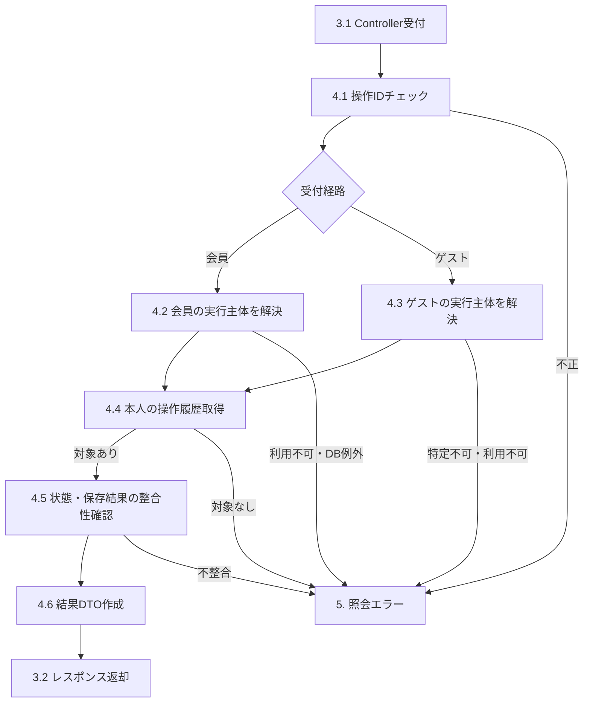

# APU006_01_カート等の操作結果照会

## 0. 処理フロー



## 1. 基本情報

| 項目 | 内容 |
| --- | --- |
| 機能ID | APU006_01 |
| 論理名 | カート等の操作結果照会 |
| 物理名 | get-user-operation-result |
| メソッド | GET |
| 会員用URL | /api/v1/operations/{operationId} |
| ゲスト用URL | /api/v1/guest/operations/{operationId} |
| API Gateway認証 | 会員：会員JWT必須／ゲスト：認証なし |
| Controller | UserOperationController |
| Business | GetUserOperationResultBusiness |
| 対応画面 | カート追加元画面、SCU-06等の結果不明時 |
| DB参照 | users、carts、operation_histories |
| DB登録・更新・削除 | なし |
| 作成日 | 2026-11-16 |

APU003_02～05の操作がタイムアウト等で結果不明になった場合に、保存済みの確定結果・処理中状態を返す。
本APIは操作の再実行・復旧更新・Cookie発行を行わない。
注文作成はAPU004_04を使用する。管理者操作・保存カード操作・会員初期化は対象外。

### 1.1 対象操作

| 元機能 | operation_type | 会員 | ゲスト |
| --- | --- | --- | --- |
| APU003_02 商品追加 | CART_ITEM_ADD | ○ | ○ |
| APU003_03 数量変更 | CART_ITEM_QUANTITY_UPDATE | ○ | ○ |
| APU003_04 明細1件削除 | CART_ITEM_DELETE | ○ | ○ |
| APU003_05 ゲストカート統合 | CART_MERGE | ○ | × |

操作IDだけで結果を公開せず、必ずactor_typeとactor_idを照合する。
会員経路で過去のゲスト操作を自動的に会員操作として読み替えない。

## 2. リクエスト

### 2.1 共通入力

| 区分 | 項目 | 必須 | 内容 |
| --- | --- | --- | --- |
| Path | operationId | 必須 | 元の更新APIへ送った小文字UUID v4、36文字 |
| Query | — | — | なし |
| Body | — | — | なし |
| Header | Idempotency-Key | 不要 | 照会キーはPathのoperationId |

### 2.2 会員の場合

| 区分 | 項目 | 必須 | 内容 |
| --- | --- | --- | --- |
| Header | Authorization | 必須 | 会員Bearerアクセストークン。親Controllerの共通処理で扱う |

```http
GET /api/v1/operations/9c276706-9b2e-4b18-8b85-9ad155da6c24
Authorization: Bearer <access-token>
```

### 2.3 ゲストの場合

| 区分 | 項目 | 必須 | 内容 |
| --- | --- | --- | --- |
| Cookie | ec_guest_cart_token | 対象特定に必要 | 既存ゲストカートの識別子。未指定の場合は結果を取得できない |
| Header | Authorization | 使用しない | 会員への自動切替はしない |

```http
GET /api/v1/guest/operations/9c276706-9b2e-4b18-8b85-9ad155da6c24
Cookie: ec_guest_cart_token=<guest-cart-token>
```

GETのためリクエストJSONはない。actorId・actorType・cartIdをリクエストで指定させない。

## 3. Controller

### 3.1 受付・Business呼出

| Controllerメソッド | Businessへの引数 |
| --- | --- |
| getMemberOperationResult | operationId、受付経路USER、検証済み会員sub |
| getGuestOperationResult | operationId、受付経路GUEST、共通解析済みゲストCookie |

**共通機能使用：COM001_10 HTTP共通受付**。
ヘッダー解析・共通認証処理の詳細は親Controller側に委ねる。
受付経路はControllerメソッドで固定し、リクエスト値で変更しない。
BusinessへRequest DTOを渡す。ControllerではDB検索・所有者判定を行わない。

### 3.2 応答返却

| 結果 | 処理 |
| --- | --- |
| 照会成功 | **共通機能使用：COM001_07**。HTTP 200、dataに照会結果、error=null |
| 照会自体の失敗 | **共通機能使用：COM001_08**。HTTP 200、data=null、errorに5章の内容 |
| ヘッダー | Content-Type: application/json、Cache-Control: no-store |
| Cookie | Set-Cookieを出力しない。作成・削除・期限延長なし |

元の更新処理がFAILEDでも、照会できた場合は「照会成功」で返す。
更新処理のエラーはdata.failure、照会API自体のエラーはトップレベルerrorに分ける。

## 4. Business

### 4.1 操作IDチェック

BusinessでBean Validationを実行する。Controllerの@Validで先行実行しない。

| 対象 | チェック | NG時 |
| --- | --- | --- |
| operationId | @NotBlank、@Size(min=36,max=36) | VALIDATION_ERROR |
| operationId | 小文字UUID v4形式の@Pattern | VALIDATION_ERROR |
| クエリ | 未定義パラメータがないこと | INVALID_REQUEST |

正規表現：
`^[0-9a-f]{8}-[0-9a-f]{4}-4[0-9a-f]{3}-[89ab][0-9a-f]{3}-[0-9a-f]{12}$`

トリム・大小文字変換は行わない。必須の操作IDを欠くURLはルーティング側の対象なし処理となる。
項目間チェックは、4.4で「操作ID＋実行主体＋許可操作種別」を組み合わせて行う。

本APIの参照は1つの読み取り専用REPEATABLE READトランザクション、プライマリDBで実行する。
FOR UPDATE、外部通信、書き込みを行わない。
次の照会リクエストでは新しいトランザクションを開始し、状態変化を確認する。

### 4.2 会員の場合：実行主体の解決

**共通機能使用：COM001_04 会員検索、COM001_05 会員利用状態判定**。

| テーブル | 条件 | 取得値 |
| --- | --- | --- |
| users | cognito_sub=検証済み会員sub | id、status |

| 判定 | 処理 |
| --- | --- |
| ACTIVE | actor_type=USER、actor_id=users.idの10進文字列として4.4へ |
| 会員なし | USER_NOT_INITIALIZED |
| DISABLED | ACCOUNT_DISABLED |
| PENDING | MEMBER_NOT_READY |
| 状態不正 | INTERNAL_ERROR |
| DB例外 | SERVICE_UNAVAILABLEまたはINTERNAL_ERROR |

ゲストCookieの値を会員経路の所有者解決に使用しない。
会員カートが空・未作成でも、本人の操作履歴を照会できる。
統合操作は元ゲストCookieが削除済みでもUSERの操作履歴で確認できる。

### 4.3 ゲストの場合：実行主体の解決

| 判定 | 処理 |
| --- | --- |
| Cookie未指定 | RESOURCE_NOT_FOUND。新しいカートは作成しない |
| Cookie同名複数・空文字・64文字超・空白・制御文字・ASCII範囲外 | INVALID_REQUEST |
| 形式上正常 | 下記SQLを実行。トークンを正規化しない |

```sql
SELECT id, status, expires_at
FROM carts
WHERE guest_cart_token = #{guestCartToken,jdbcType=VARCHAR}
  AND user_id IS NULL
```

| 検索結果 | 処理 |
| --- | --- |
| 0件 | RESOURCE_NOT_FOUND |
| ACTIVEかつexpires_atが照会時点より未来 | actor_type=GUEST、actor_id=carts.idの10進文字列として4.4へ |
| EXPIRED、MERGED、expires_atが照会時点以下 | RESOURCE_NOT_FOUND。結果は開示しない |
| ACTIVEかつexpires_at=null、状態不正 | INTERNAL_ERROR |
| DB例外 | SERVICE_UNAVAILABLEまたはINTERNAL_ERROR |

照会時点はトランザクション開始時刻を使用する。
ゲストCookieにより利用可能なカートを特定できる範囲でのみ照会する。
期限切れ・Cookie消失・統合後に過去操作の結果が見えなくても、「元操作は失敗」とは判定しない。
操作履歴を消去したり期限を延長したりしない。

### 4.4 本人の操作履歴取得

| 取得元 | 条件 |
| --- | --- |
| operation_histories | operation_id=要求値 AND actor_type=解決値 AND actor_id=解決値 |
| 会員の許可種別 | CART_ITEM_ADD、CART_ITEM_QUANTITY_UPDATE、CART_ITEM_DELETE、CART_MERGE |
| ゲストの許可種別 | CART_ITEM_ADD、CART_ITEM_QUANTITY_UPDATE、CART_ITEM_DELETE |

```xml
SELECT operation_id, operation_type, operation_status,
       is_retryable, result_code, result_summary_json,
       target_resource_id, created_at, updated_at
FROM operation_histories
WHERE operation_id = #{operationId,jdbcType=VARCHAR}
  AND actor_type = #{actorType,jdbcType=VARCHAR}
  AND actor_id = #{actorId,jdbcType=VARCHAR}
  AND operation_type IN
  <foreach collection="allowedTypes" item="type"
           open="(" separator="," close=")">
    #{type,jdbcType=VARCHAR}
  </foreach>
```

allowedTypesは受付経路に応じたサーバー内の固定リスト。
保存済みexpires_atは削除可能日時であり、本APIの照会期限としてWHERE条件へ追加しない。
記録が残り、所有者・許可種別が一致する場合は照会する。

| 結果 | 処理 |
| --- | --- |
| 1件 | 4.5へ |
| 0件 | RESOURCE_NOT_FOUND。存在しないID、他者のID、対象外操作の違いを開示しない |
| DB例外 | 5章へ。0件として扱わない |

request_hashは更新APIの同一要求判定用。本APIは元リクエストを受けないため照合・返却しない。

**0件の意味**

カート追加・数量変更・削除は、操作記録と業務更新を同じトランザクションで確定する。
実行中の未コミット記録は本APIから見えない場合がある。
0件には、未到達・実行中・ロールバック済み・削除済み・所有者不一致が含まれ得るため、未実行や再操作可能とは断定しない。

### 4.5 状態・保存結果の整合性確認

| operation_status | 必須条件 | 結果 |
| --- | --- | --- |
| PROCESSING | is_retryable=false | operationStatus=PROCESSING。未確定として返す |
| SUCCEEDED | is_retryable=false、許可されたresult_code、正常なschemaVersion=1のdata | 確定成功として返す |
| FAILED | result_codeあり、正常なschemaVersion=1のerror | 確定失敗として返す |
| 不明な状態・条件不一致 | — | INTERNAL_ERROR。成功・再試行可能と推測しない |

PROCESSINGのJSONには統合準備用contextが含まれる場合があるが、返却しない。
PROCESSINGでは保存途中の結果コード・要約を利用者向け確定結果として使用しない。

**SUCCEEDEDで許可する結果コード**

| operation_type | 許可するresult_code |
| --- | --- |
| CART_ITEM_ADD | CART_ITEM_ADDED |
| CART_ITEM_QUANTITY_UPDATE | CART_ITEM_QUANTITY_UPDATED、CART_ITEM_QUANTITY_UNCHANGED |
| CART_ITEM_DELETE | CART_ITEM_DELETED、CART_ITEM_ALREADY_ABSENT |
| CART_MERGE | CART_MERGED、CART_ALREADY_MERGED、CART_MERGE_NOT_REQUIRED |

成功JSONのdata.operationIdが要求IDと一致し、data.operationStatus=SUCCEEDED、
data.action=result_codeであることを確認する。
target_resource_idやcartの情報は補助情報のため本APIで再判定せず、公開もしない。

FAILEDではJSONのerror.code=result_code、messageが文字列、fieldErrorsが配列であることを確認する。
失敗コードは元APIが保存するVALIDATION_ERROR、VERSION_CONFLICT、RESOURCE_NOT_FOUND、
BUSINESS_RULE_VIOLATION、SERVICE_UNAVAILABLE、INTERNAL_ERROR等の許可済み共通コードと照合する。
未知のコード・要約破損はINTERNAL_ERROR。

保存JSONを丸ごと返さない。context、reason、request_hash、トークン、
過去のカート数量・価格・内部識別子等を照会結果へコピーしない。

### 4.6 結果DTO作成

| 項目 | PROCESSING | SUCCEEDED | FAILED |
| --- | --- | --- | --- |
| operationStatus | PROCESSING | SUCCEEDED | FAILED |
| resultCode | null | 保存された成功コード | 保存された失敗コード |
| isRetryable | false | false | 保存値 |
| failure | null | null | 保存errorからcode／message／fieldErrorsのみ抽出 |
| refreshCartRequired | false | true | true |
| operationUpdatedAt | updated_at | updated_at | updated_at |

refreshCartRequiredは「APU003_01で現在のカートを再取得する」指定。
過去の成功結果に保存されたバッジ数量・カート価格は最新値とは限らないため返さない。
統合調整通知もAPU003_01で取得する。

- isRetryable=trueは「失敗が確定し、最新カートと入力を確認したうえで新しいoperationIdによる再操作が可能」の意味。
- 同じoperationIdを再送して失敗済み操作を再実行する意味ではない。
- isRetryable=falseは、同一キーの安全な結果確認まで禁止する意味ではない。
- updated_at不正・欠損はINTERNAL_ERROR。現在時刻で補完しない。
- UTC日時をミリ秒固定のISO 8601文字列として返す。

## 5. 例外・メッセージ

**共通機能使用：COM001_08 共通例外変換、COM001_09 安全なログ出力**。

| 条件 | error.code | message |
| --- | --- | --- |
| operationId必須・形式不正 | VALIDATION_ERROR | 入力内容をご確認ください。 |
| 未定義クエリ・Cookie形式不正 | INVALID_REQUEST | リクエストの内容が正しくありません。 |
| 会員なし | USER_NOT_INITIALIZED | 会員情報の準備が必要です。 |
| 無効・準備未完了会員 | ACCOUNT_DISABLED／MEMBER_NOT_READY | COM001_05の対応文言 |
| 対象履歴・ゲスト主体を特定できない | RESOURCE_NOT_FOUND | 操作結果を確認できませんでした。未実行とは限りません。時間をおいて再度確認してください。 |
| DB接続・タイムアウト | SERVICE_UNAVAILABLE | 操作結果の取得に失敗しました。時間をおいて再度お試しください。 |
| 保存結果不整合・想定外例外 | INTERNAL_ERROR | 操作結果の取得に失敗しました。時間をおいて再度お試しください。 |

本API内で捕捉できた例外はHTTP 200、data=null。
API GatewayのJWT拒否、接続障害、応答消失はHTTP 200・共通JSONを保証しない。
ログにCookie・JWT・保存JSON全文を出力しない。

## 6. 復旧・再送の扱い

| 状況 | 復旧方法 |
| --- | --- |
| 本APIのDB例外 | 読み取りTXをロールバック。書き込みがないためデータ補償なし |
| 照会の応答消失 | 同じGETを再実行可能 |
| PROCESSING | 間隔をあけて結果照会。時間経過だけでFAILEDにしない |
| SUCCEEDED | 成功確定。APU003_01で最新状態を取得して画面同期 |
| FAILED・isRetryable=true | 最新状態と入力を確認し、新しい操作IDで元更新APIへ。自動再操作しない |
| FAILED・isRetryable=false | 再操作を案内せず原因を確認 |
| RESOURCE_NOT_FOUND | 未実行扱い・新キー発行を自動で行わない。同じIDで再照会または元APIの復旧手順へ |
| ゲストCookie消失・期限切れ | 所有者確認できないため照会不可。新規カートへ過去操作を自動再実行しない |
| 保存JSON破損 | 本APIは修正しない。運用調査・元機能の復旧手順へ |

本APIはPROCESSINGの再開、FAILEDへの変更、カート削除・巻戻しを行わない。
統合PROCESSINGの再開はAPU003_05へ同一キーで要求する元機能の手順に従う。
追加・更新・削除の同一要求再送も各元APIのべき等処理で扱い、本APIから呼び出さない。

ゲストカート初回準備のみで商品追加へ進んでいない場合はoperation_historiesが存在しない。
GUEST_CART_READYは追加成功ではないため、照会でSUCCEEDEDに置き換えない。

## 7. 返却項目

### 7.1 共通項目

| 項目 | 型・値 | 内容 |
| --- | --- | --- |
| HTTPステータス | 200 | ECSで応答可能な範囲 |
| Content-Type | application/json | JSON |
| Cache-Control | no-store | 結果のキャッシュ抑止 |
| requestId | string | 今回の追跡ID |
| data | object / null | 照会成功時の結果。照会失敗時null |
| error | object / null | 照会成功時null |
| error.code／message | string | 5章の照会エラー |
| error.fieldErrors | array | field、message。対象なし[] |

### 7.2 data

| 項目 | 型 | null可 | 内容 |
| --- | --- | --- | --- |
| asOf | string | 不可 | 照会トランザクション開始時刻 |
| operationId | string | 不可 | 照会した操作ID |
| operationType | string | 不可 | 1.1の操作種別 |
| operationStatus | string | 不可 | PROCESSING／SUCCEEDED／FAILED |
| operationUpdatedAt | string | 不可 | 履歴のupdated_at |
| resultCode | string | 可 | 確定した元操作の結果コード。PROCESSING時null |
| isRetryable | boolean | 不可 | 新しい操作として安全に再操作できるか |
| refreshCartRequired | boolean | 不可 | 現在のカート再取得が必要か |
| failure | object | 可 | FAILED時のみ元操作のエラー |
| failure.code／message | string | — | 保存済みの元操作エラー |
| failure.fieldErrors | array | — | field、message。項目エラーなし[] |

### 7.3 成功結果を照会した例

```json
{
  "requestId": "req-operation-001",
  "data": {
    "asOf": "2026-11-16T09:00:00.000Z",
    "operationId": "9c276706-9b2e-4b18-8b85-9ad155da6c24",
    "operationType": "CART_ITEM_ADD",
    "operationStatus": "SUCCEEDED",
    "operationUpdatedAt": "2026-11-16T08:59:59.000Z",
    "resultCode": "CART_ITEM_ADDED",
    "isRetryable": false,
    "refreshCartRequired": true,
    "failure": null
  },
  "error": null
}
```

### 7.4 元操作の失敗が確定していた例

```json
{
  "requestId": "req-operation-002",
  "data": {
    "asOf": "2026-11-16T09:00:00.000Z",
    "operationId": "9c276706-9b2e-4b18-8b85-9ad155da6c24",
    "operationType": "CART_ITEM_QUANTITY_UPDATE",
    "operationStatus": "FAILED",
    "operationUpdatedAt": "2026-11-16T08:59:59.000Z",
    "resultCode": "VERSION_CONFLICT",
    "isRetryable": true,
    "refreshCartRequired": true,
    "failure": {
      "code": "VERSION_CONFLICT",
      "message": "カートが更新されています。最新の内容をご確認ください。",
      "fieldErrors": []
    }
  },
  "error": null
}
```

failure.messageは元APIが保存した文言を使用する。上記は構造例。

### 7.5 処理中の例

```json
{
  "requestId": "req-operation-003",
  "data": {
    "asOf": "2026-11-16T09:00:00.000Z",
    "operationId": "9d4506fb-e778-44bd-b5f4-dd216695ba9c",
    "operationType": "CART_MERGE",
    "operationStatus": "PROCESSING",
    "operationUpdatedAt": "2026-11-16T08:59:59.000Z",
    "resultCode": null,
    "isRetryable": false,
    "refreshCartRequired": false,
    "failure": null
  },
  "error": null
}
```

### 7.6 照会対象を確認できない例（HTTP 200）

```json
{
  "requestId": "req-operation-004",
  "data": null,
  "error": {
    "code": "RESOURCE_NOT_FOUND",
    "message": "操作結果を確認できませんでした。未実行とは限りません。時間をおいて再度確認してください。",
    "fieldErrors": []
  }
}
```

