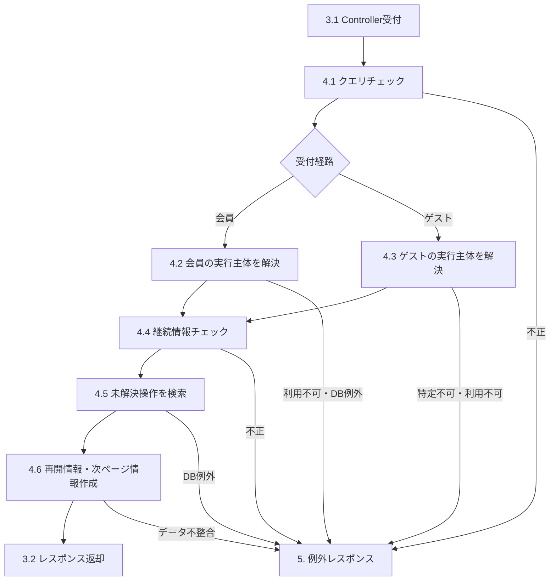

# APU006_02_未解決操作の再開情報取得

## 0. 処理フロー



## 1. 基本情報

| 項目 | 内容 |
| --- | --- |
| 機能ID | APU006_02 |
| 論理名 | 未解決操作の再開情報取得 |
| 物理名 | list-user-pending-operations |
| HTTPメソッド | GET |
| 会員用URL | /api/v1/operations |
| ゲスト用URL | /api/v1/guest/operations |
| API Gateway認証 | 会員：会員JWT必須／ゲスト：なし |
| Controller | UserOperationController |
| Business | ListUserPendingOperationsBusiness |
| DB参照 | users、carts、operation_histories |
| DB登録・更新・削除 | なし |
| 取得件数 | 50件固定。次ページ判定用に最大51件取得 |
| 作成日 | 2026-11-16 |
| 改訂内容 | status指定を廃止。内部制御入力のエラーを汎用応答へ統一 |

再読み込み・再ログイン等で操作IDを失った場合に、本人のPROCESSING記録を検索して結果照会へつなぐ。
「再開情報」は操作IDと照会先を指し、元の入力内容や更新APIの再送要求は返さない。
本API内で注文・カート処理を再実行しない。

### 1.1 対象操作・照会先

| operation_type | 会員 | ゲスト | 発見後の照会先 |
| --- | --- | --- | --- |
| CART_ITEM_ADD | ○ | ○ | APU006_01 |
| CART_ITEM_QUANTITY_UPDATE | ○ | ○ | APU006_01 |
| CART_ITEM_DELETE | ○ | ○ | APU006_01 |
| CART_MERGE | ○ | × | APU006_01 |
| ORDER_CREATE | ○ | × | APU004_04 |

管理者操作、会員初期化、Amplifyの認証操作、廃止済みカード操作は対象外。
FAILED・SUCCEEDEDは取得しない。履歴全体や失敗履歴を検索するAPIではない。

### 1.2 発見できる範囲

| 状況 | 本APIでの扱い |
| --- | --- |
| 注文・統合の受付記録がコミット済みでPROCESSING | 発見できる |
| 更新処理と操作履歴を同じTXで確定するカート追加・数量変更・削除 | 実行中の未コミット記録は見えない。通常、確定後はPROCESSING一覧には出ない |
| 既に成功・失敗が確定 | 対象外。元IDがあれば結果照会APIを使用 |
| ゲストCookie消失・期限切れ・統合済み | ゲスト主体を照会可能と確認できないため検索不可 |
| 初回ゲストCookie準備だけ完了 | 操作履歴未作成のため一覧には出ない |

**0件でも「未実行」「失敗確定」「新しい操作として再送可能」とは判断しない。**
成功済みの注文ID・操作IDを失った場合は注文履歴から確認する。

## 2. リクエスト仕様

### 2.1 共通クエリ

| 項目 | 型 | 必須 | 条件 |
| --- | --- | --- | --- |
| cursor | string | 任意 | 未指定は先頭取得。指定時1～2,048文字、4.4の形式 |
| Body | — | なし | JSONリクエストなし |

status、limit、actorId、actorType、userId、cartId、operationTypeの指定は受け付けない。
検索状態はBusiness／SQL内でPROCESSINGに固定し、DTOにstatusフィールドを設けない。
対象操作種別は受付経路で固定する。Idempotency-Keyは不要。

### 2.2 会員リクエスト例

| Header | 必須 | 内容 |
| --- | --- | --- |
| Authorization | 必須 | Bearer形式の会員アクセストークン。共通処理で扱う |

```http
GET /api/v1/operations
Authorization: Bearer <access-token>
```

### 2.3 ゲストリクエスト例

| Cookie | 必須 | 内容 |
| --- | --- | --- |
| ec_guest_cart_token | 主体特定に必要 | 既存ゲストカートの識別子。なければ検索しない |

```http
GET /api/v1/guest/operations
Cookie: ec_guest_cart_token=<guest-cart-token>
```

追加取得では前回のnextCursorをURLエンコードしてcursorへ指定する。初回はクエリを指定しない。

## 3. Controller

### 3.1 受付・Business呼出

| Controllerメソッド | Businessへ渡す値 |
| --- | --- |
| listMemberPendingOperations | クエリDTO、受付経路USER、検証済み会員sub |
| listGuestPendingOperations | クエリDTO、受付経路GUEST、共通解析済みCookie |

**共通機能使用：COM001_10 HTTP共通受付**。
親Controllerで扱う認証・共通ヘッダーチェックの詳細は記載しない。
受付経路はサーバー側で固定し、入力から切り替えない。
ControllerはDB検索・cursorデコード・状態判定を行わない。

### 3.2 応答返却

| 結果 | 処理 |
| --- | --- |
| 正常 | **共通機能使用：COM001_07**。HTTP 200、dataに検索結果、error=null |
| 例外 | **共通機能使用：COM001_08**。HTTP 200、data=null、errorに5章の内容 |
| ヘッダー | Content-Type: application/json、Cache-Control: no-store |
| Cookie | Set-Cookieを出力しない。発行・削除・期限延長なし |

## 4. Business

### 4.1 クエリチェック

BusinessでValidator.validateを実行する。Controllerの@Validでは先行実行しない。

| 対象 | 条件・実装 | NG時 |
| --- | --- | --- |
| cursor | 未指定可。指定時はCOM001_12で検証 | CURSOR_INVALID |
| クエリ構造 | cursorのみ。重複指定および旧仕様のstatus指定を拒否 | INVALID_REQUEST |

前後空白の除去・大小文字変換は行わない。
Bean Validationの違反情報はそのまま共通例外へ渡さず、外部向けINVALID_REQUESTへ変換する。
返却messageは「リクエストを処理できませんでした。」、fieldErrorsは[]に固定する。
違反項目名・期待値・桁数・正規表現・入力値はレスポンスへ含めない。
cursorの内部項目チェックは4.4で行う。

4.2以降の参照は、1つの読み取り専用REPEATABLE READトランザクションで行う。
プライマリDBを使用し、FOR UPDATEは行わない。
共通会員取得も同じTXに参加する。ページ間でTXは保持しない。

### 4.2 会員の場合：実行主体の解決

**共通機能使用：COM001_04 会員検索、COM001_05 会員利用状態判定**。

| テーブル | 条件 | 必要な取得項目 |
| --- | --- | --- |
| users | cognito_sub=検証済み会員sub | id、status |

| 結果 | 処理 |
| --- | --- |
| ACTIVE | actor_type=USER、actor_id=users.idの10進文字列 |
| 会員なし | USER_NOT_INITIALIZED |
| DISABLED | ACCOUNT_DISABLED |
| PENDING | MEMBER_NOT_READY |
| 未定義状態 | INTERNAL_ERROR |
| DB障害 | SERVICE_UNAVAILABLEまたはINTERNAL_ERROR |

会員用ではゲストCookieを使用しない。
ログイン前にGUESTとして実行した操作を、USERの履歴へ自動的に移し替えない。
CART_MERGEは会員主体で登録されるため、統合元Cookieがなくても本人の記録を検索できる。

### 4.3 ゲストの場合：実行主体の解決

| Cookie状態 | 処理 |
| --- | --- |
| 未指定 | RESOURCE_NOT_FOUND。検索成功・0件にはしない |
| 同名複数・空欄・64文字超・空白・制御文字・ASCII範囲外 | INVALID_REQUEST |
| 上記以外 | 下記SQLで検索。正規化しない |

```sql
SELECT id, status, expires_at
FROM carts
WHERE guest_cart_token = #{guestCartToken,jdbcType=VARCHAR}
  AND user_id IS NULL
```

| 結果 | 処理 |
| --- | --- |
| ACTIVEかつexpires_at > 照会TX開始時刻 | actor_type=GUEST、actor_id=carts.idの10進文字列 |
| 対象なし・EXPIRED・MERGED・期限切れ | RESOURCE_NOT_FOUND |
| ACTIVEかつexpires_at=null・状態不正 | INTERNAL_ERROR |
| DB例外 | SERVICE_UNAVAILABLEまたはINTERNAL_ERROR |

本APIはカートの新規作成・復活・統合・期限延長をしない。
主体を解決できないことを「未解決操作なし」と扱わない。

### 4.4 継続情報チェック

**共通機能使用：COM001_12。** scope=APU006_02、条件・主体＝解決済みUSER＋会員IDまたはGUEST＋カートID、状態はサーバー固定PROCESSING。未指定は先頭。指定時はdecodeで検証した受付日時・操作IDだけをSQLの境界に使う。権限・所有者は毎回別途確認。

次ページがある場合のみ、返した最後の行からencode。追加取得時は初回の期限を引き継ぎ返却直前に再確認する。旧形式・不一致・期限切れはCURSOR_INVALID、fieldErrors=[]。

### 4.5 未解決操作の検索

| 項目 | 内容 |
| --- | --- |
| テーブル | operation_histories |
| 主体条件 | actor_typeとactor_idが解決した主体に一致 |
| 状態 | operation_status=PROCESSING |
| 操作種別 | 1.1の受付経路別許可リスト |
| 順序 | created_at DESC、operation_id COLLATE "C" DESC |
| 件数 | 最大51件（返却50件＋次ページ判定1件） |
| 取得項目 | operation_id、operation_type、operation_status、is_retryable、created_at、updated_at |

```xml
SELECT operation_id, operation_type, operation_status,
       is_retryable, created_at, updated_at
FROM operation_histories
WHERE actor_type = #{actorType,jdbcType=VARCHAR}
  AND actor_id = #{actorId,jdbcType=VARCHAR}
  AND operation_status = 'PROCESSING'
  AND operation_type IN
  <foreach collection="allowedTypes" item="type"
           open="(" separator="," close=")">
    #{type,jdbcType=VARCHAR}
  </foreach>
<if test="cursorCreatedAt != null">
  AND (
       created_at &lt; #{cursorCreatedAt,jdbcType=TIMESTAMP_WITH_TIMEZONE}
       OR (
            created_at = #{cursorCreatedAt,jdbcType=TIMESTAMP_WITH_TIMEZONE}
            AND operation_id COLLATE "C"
                &lt; #{cursorOperationId,jdbcType=VARCHAR} COLLATE "C"
          )
      )
</if>
ORDER BY created_at DESC, operation_id COLLATE "C" DESC
LIMIT 51
```

- allowedTypesはサーバー内の固定リスト。リクエストから受け付けない。
- expires_atは履歴の削除可能日時であり、未解決操作の検索期限に使用しない。
- 日数による絞り込みはしない。長時間残ったPROCESSINGも調査・復旧対象として表示する。
- updated_atは復旧中に変わるためページ境界に使用しない。
- target_resource_id、request_hash、result_summary_jsonは取得・返却しない。
- 明細・注文・統合ログの状態確認は各結果照会APIで行い、本一覧からHTTP呼出しをしない。

| 件数 | 処理 |
| --- | --- |
| 0件 | operations=[]、hasNext=false、nextCursor=null |
| 1～50件 | 全件を返す。hasNext=false |
| 51件 | 先頭50件を返す。hasNext=true、返却50件目からnextCursorを作成 |

同時処理で状態が変わるため、複数ページ全体が同一時点の一覧であることは保証しない。
既存記録のcreated_at・operation_idは変更しない。
新しく追加された記録は先頭再取得で検出する。途中ページが0件でも、前ページの記録の成功・失敗は確定しない。

既存の主体別インデックスを利用可能。件数増加時の追加候補は
`(actor_type, actor_id, created_at DESC, operation_id COLLATE "C" DESC) WHERE operation_status='PROCESSING'`。
本書作成時点ではDB定義・DDLを変更しない。

### 4.6 再開情報・次ページ情報作成

| 判定・項目 | 処理 |
| --- | --- |
| operation_status | PROCESSINGであること |
| is_retryable | false必須。trueは不整合としてINTERNAL_ERROR |
| operation_id | 小文字UUID v4以外はINTERNAL_ERROR |
| created_at・updated_at | null・不正値はINTERNAL_ERROR。現在日時で補完しない |
| ORDER_CREATE | resultApiId=APU004_04 |
| カート関連 | resultApiId=APU006_01 |
| nextAction | CHECK_RESULT固定 |
| isRetryable | false固定 |
| nextCursor | 4.4の形式。hasNext=trueの場合のみ |
| asOf | 読み取りTX開始時刻 |

日時はUTC、ISO 8601、ミリ秒固定で返す。
再開先はAPI IDで返し、URLの自由入力やDB内文字列をそのまま遷移先として返さない。
フロントは受付経路（会員／ゲスト）とAPI IDに対応する固定URLへ操作IDを指定する。

本一覧の取得直後に成功・失敗へ変化している可能性がある。
発見した操作は、まず結果照会を行う。元の更新APIを自動実行しない。

## 5. 例外返却

**共通機能使用：COM001_08 共通例外変換、COM001_09 安全なログ出力**。

| 条件 | error.code | message |
| --- | --- | --- |
| cursor単項目不正 | CURSOR_INVALID | 続きの情報を取得できません。先頭から再読み込みしてください。 |
| 未定義・重複クエリ（status指定を含む）、Cookie形式不正 | INVALID_REQUEST | リクエストを処理できませんでした。 |
| cursor内部情報不正 | CURSOR_INVALID | 続きの情報を取得できません。先頭から再読み込みしてください。 |
| 会員未初期化 | USER_NOT_INITIALIZED | 会員情報の準備が必要です。 |
| 会員無効・準備未完了 | ACCOUNT_DISABLED／MEMBER_NOT_READY | COM001_05の対応文言 |
| ゲスト主体を特定できない | RESOURCE_NOT_FOUND | 操作情報を確認できませんでした。カートの状態をご確認ください。 |
| DB接続障害・タイムアウト | SERVICE_UNAVAILABLE | 操作情報の取得に失敗しました。時間をおいて再度お試しください。 |
| 不整合・想定外例外 | INTERNAL_ERROR | 操作情報の取得に失敗しました。時間をおいて再度お試しください。 |

アプリケーションで捕捉した例外はHTTP 200、data=null、errorあり。
API GatewayのJWT拒否、アプリに到達しない障害、応答消失は共通JSON・HTTP 200を保証しない。
Cookie・JWT・cursor全文・元リクエスト・個人情報をログ出力しない。

### 5.1 外部応答と内部ログの分離

| 出力先 | 記載内容 |
| --- | --- |
| API応答 | 公開エラーコード・汎用メッセージ・requestIdのみ。fieldErrors=[] |
| サーバーログ | requestId、処理箇所、内部理由コード（QUERY_NOT_ALLOWED、CURSOR_FORMAT_INVALID等）。必要時は固定定義の対象項目名 |
| 出力禁止 | クライアントが送った未知の項目名・値の反射、期待値・許容値一覧・制約情報・スタックトレースのAPI返却 |
| フロント表示 | INVALID_REQUEST時は「操作情報を確認できませんでした。再読み込みしてください。」 |

内部理由コード・バリデーション詳細はDTOの返却対象へ含めない。
親Controller／共通例外処理へ渡す場合も、本APIの公開メッセージ・空のfieldErrorsを保持する。
共通HTTP受付で検出した入力不正も、このAPIでは詳細を返さない方針に揃える。
JWT拒否等、API Gateway側の応答は別途共通セキュリティ設計で扱う。

レスポンスやJavaScriptは開発者ツールから確認できる前提とする。
正常系の操作状態・照会先などフロントの処理に必要な情報は返す。
Base64URLのcursorも暗号化ではないため秘密情報を入れず、情報の非表示を認可の代わりにしない。
会員／ゲストの主体照合とSQLの所有者条件は維持する。

## 6. データ復旧・呼出側の扱い

| 状況 | 対応 |
| --- | --- |
| 本APIのDB例外 | 読み取りTXをロールバック。更新していないため補償処理なし |
| 応答消失 | 同じGETを再実行可能 |
| 一覧あり | 操作IDを保持し、resultApiIdの結果照会へ |
| 結果照会で成功 | 元画面の最新状態を取得。注文なら注文完了・詳細へ案内 |
| 結果照会でPROCESSING | 元機能の復旧手順へ。再開可否は本一覧だけで決めない |
| 結果照会でFAILED | 結果照会側のisRetryable等に従う |
| 一覧0件 | 未解決記録を今回発見できなかった状態。注文履歴・カート等を確認 |
| INVALID_REQUEST | 入力の自動修正・無限再試行はしない。再読み込み操作でcursorを破棄して先頭から再取得。再発する場合はrequestIdで調査 |
| ゲスト主体不明 | 会員経路への自動置換や新ゲストカートへの再実行をしない |
| 統合の確定失敗でpendingが残存 | PROCESSING一覧の対象外。APU003_01の統合通知とAPU003_05の再試行手順を使用 |

注文・統合のPROCESSINGを経過時間だけでFAILEDに変更しない。
カート追加等の未コミット処理は一覧に現れないため、「0件」を新キー発行・再送許可の根拠にしない。
元の注文入力や操作IDを失った場合、本APIが復元できるのは見つかったPROCESSINGのIDだけ。
注文入力・配送先等を再構成して注文確定APIへ自動再送しない。

## 7. 返却項目

### 7.1 ヘッダー・共通構造

| 項目 | 型・値 | 内容 |
| --- | --- | --- |
| HTTPステータス | 200 | ECS内で処理・捕捉できた場合 |
| Content-Type | application/json | JSON |
| Cache-Control | no-store | キャッシュ抑止 |
| requestId | string | 今回の追跡ID |
| data | object / null | 正常時の結果。照会失敗時null |
| error | object / null | 正常時null |
| error.code／message | string | 5章 |
| error.fieldErrors | array | 本APIでは常に[]。内部制御項目の詳細を返さない |

### 7.2 data

| 項目 | 型 | null可 | 内容 |
| --- | --- | --- | --- |
| asOf | string | 不可 | 取得時点 |
| operations | array | 不可 | 最大50件。0件は[] |
| operations[].operationId | string | 不可 | 発見した操作ID |
| operations[].operationType | string | 不可 | 1.1の種別 |
| operations[].operationStatus | string | 不可 | PROCESSING |
| operations[].createdAt | string | 不可 | 操作記録作成日時 |
| operations[].updatedAt | string | 不可 | 操作記録最終更新日時 |
| operations[].resultApiId | string | 不可 | APU004_04／APU006_01 |
| operations[].nextAction | string | 不可 | CHECK_RESULT |
| operations[].isRetryable | boolean | 不可 | false |
| pageSize | integer | 不可 | 50 |
| hasNext | boolean | 不可 | 次ページがあるか |
| nextCursor | string | 可 | 次ページ取得用。次なしはnull |

### 7.3 正常JSON例

```json
{
  "requestId": "req-pending-001",
  "data": {
    "asOf": "2026-11-16T09:00:00.000Z",
    "operations": [
      {
        "operationId": "9d4506fb-e778-44bd-b5f4-dd216695ba9c",
        "operationType": "CART_MERGE",
        "operationStatus": "PROCESSING",
        "createdAt": "2026-11-16T08:59:59.000Z",
        "updatedAt": "2026-11-16T08:59:59.000Z",
        "resultApiId": "APU006_01",
        "nextAction": "CHECK_RESULT",
        "isRetryable": false
      }
    ],
    "pageSize": 50,
    "hasNext": false,
    "nextCursor": null
  },
  "error": null
}
```

### 7.4 0件JSON例

```json
{
  "requestId": "req-pending-002",
  "data": {
    "asOf": "2026-11-16T09:00:00.000Z",
    "operations": [],
    "pageSize": 50,
    "hasNext": false,
    "nextCursor": null
  },
  "error": null
}
```

### 7.5 例外JSON例（HTTP 200）

```json
{
  "requestId": "req-pending-003",
  "data": null,
  "error": {
    "code": "INVALID_REQUEST",
    "message": "リクエストを処理できませんでした。",
    "fieldErrors": []
  }
}
```

