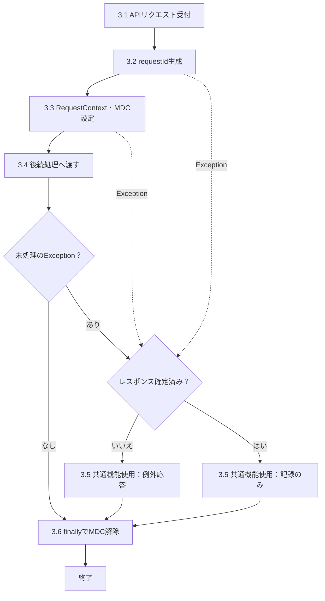

# COM001_01_要求追跡ID・要求コンテキスト

## 0. 処理フロー



## 1. 基本情報・実装箇所

| 項目 | 内容 |
| --- | --- |
| 機能ID | COM001_01 |
| 論理名 | 要求追跡ID・要求コンテキスト |
| 物理名 | request-context |
| 実装クラス | RequestContextFilter、RequestContext |
| 実行契機 | ECSが `/api/v1/*` のHTTPリクエストを受け付けたとき |
| 目的 | 1リクエスト内のログ・正常応答・エラー応答で同じrequestIdを使用する |
| DB操作 | なし。トランザクション・データ復旧処理なし |
| Controller／Business | 本機能には作成しない。受付Filterとして自動実行する |
| 適用範囲 | 同期Servlet処理。Servlet非同期処理・別スレッドへのMDC引継ぎは対象外 |
| 作成日 | 2026/11/11 |

本書での実装案：`OncePerRequestFilter` を継承し、Servlet Filterとして1回だけ登録する。認証・共通入力チェック・Controllerより前で実行する。SecurityFilterChain側への二重登録は行わない。

## 2. 入力・内部データ

### 2.1 Filterの入力

| 項目 | 型 | 必須 | 扱い |
| --- | --- | --- | --- |
| request | HttpServletRequest | 必須 | Servletコンテナから受け取る |
| response | HttpServletResponse | 必須 | Servletコンテナから受け取る |
| filterChain | FilterChain | 必須 | 後続処理の呼出先 |
| クライアント指定のrequestId | ヘッダー等 | 不要 | 採用・検証・ログ出力しない。ECSで生成する |
| Authorization・ボディ | — | 本機能では検証しない | 読み取り・変更をせず後続へ渡す |

必須3引数はフレームワーク契約。外部リクエスト項目としての必須チェックはない。入力の文字数・項目間チェックもない。

### 2.2 RequestContext

| 項目 | 型 | 設定値 |
| --- | --- | --- |
| requestId | String | `UUID.randomUUID().toString()` による36文字のUUID |

`RequestContext` は変更不可の値オブジェクトとする。認証トークン・氏名・メール・リクエストボディは格納しない。認証情報はCOM001_02の出力として別に扱う。

| 保存先 | キー | 用途 |
| --- | --- | --- |
| request属性 | `ec.requestContext` | 親Controller・共通例外処理が参照する正本 |
| SLF4J MDC | `requestId` | 同じスレッドで出力するログへの付与 |

独自のThreadLocalは作成しない。MDCから業務用のrequestIdを取得せず、RequestContextを使用する。

## 3. RequestContextFilterの処理

### 3.1 APIリクエスト受付

| 順序 | 処理 |
| --- | --- |
| 1 | 登録対象を `/api/v1/*`、DispatcherTypeをREQUESTとする |
| 2 | `doFilterInternal(request, response, filterChain)` を開始する |
| 3 | ローカル変数 `context = null` を用意する |
| 4 | 3.2〜3.5をtry/catch、3.6をfinallyで実行する |

対象外のURLは本Filterを通さない。CORS・認証・HTTPメソッド・JSON形式の検証は本機能では行わない。

### 3.2 requestId生成

| 処理 | 設定値・分岐 |
| --- | --- |
| ID生成 | `UUID.randomUUID().toString()` |
| Context作成 | `new RequestContext(requestId)` |
| 正常 | 3.3へ |
| Exception | 後続を呼び出さず3.5へ |

再送は別のHTTPリクエストなので新しいrequestIdを付与する。二重更新防止用のoperationIdとは別の値として扱う。API Gatewayの追跡IDとも同一化しない。

### 3.3 RequestContext・MDC設定

| 順序 | 処理 |
| --- | --- |
| 1 | `request.setAttribute("ec.requestContext", context)` |
| 2 | `MDC.put("requestId", context.requestId())` |
| 3 | 3.4へ |

途中でExceptionとなった場合は3.5へ進み、3.6も実行する。requestIdの生成は繰り返さない。

### 3.4 後続処理へ渡す

`filterChain.doFilter(request, response)` を1回だけ実行する。

| 戻り方 | 次の処理 |
| --- | --- |
| 正常に戻る | 3.6へ。レスポンスは書き換えない |
| 後続がエラーJSONを生成して戻る | 3.6へ。成功JSONで上書きしない |
| 未処理のExceptionが伝播する | 3.5へ |

親Controllerはrequest属性からRequestContextを取り出し、必要な値をBusinessの引数に渡す。各Controllerから本Filterを明示的に呼び出さない。

### 3.5 未処理のException

| 条件 | 処理 |
| --- | --- |
| `response.isCommitted() == false` | **共通機能使用：COM001_08 共通例外変換**。Exception、context、request、responseを渡す。正常に処理できればHTTP 200のエラーJSONを返す |
| `response.isCommitted() == true` | **共通機能使用：COM001_09 アプリケーションログ出力・秘匿**。二重書込みせず記録のみ行う |
| 例外変換・書込み自体が失敗 | 再帰的に例外応答を作らない。3.6実行後、Servletコンテナへ例外を伝播する |

COM001_08はFilterからも呼べる共通メソッドとして設計する。Controller向け例外ハンドラーだけでFilterの例外が自動処理される前提にはしない。

| 引き渡す項目 | 値 |
| --- | --- |
| Exception | 捕捉した例外。外部へ例外本文を直接返さない |
| 処理番号 | 例外が発生した3.2・3.3・3.4 |
| requestId | context生成済みならその値。生成前に失敗した場合はnullで渡す |
| DB確定状況 | 本機能はDB操作なし。後続処理の確定状況を上書きしない |

requestId生成前の失敗では、共通応答上のrequestIdを固定文字列 `unavailable` とする。この値は追跡IDではなく「生成できなかった」ことを示す。COM001_08／COM001_07の設計へ引き継ぐ。

### 3.6 終了処理

finallyで `MDC.remove("requestId")` を実行する。正常・業務エラー・Exceptionのいずれでも解除する。

`MDC.clear()` は使用せず、他の共通機能が管理するキーを消さない。request属性はリクエストの終了まで保持し、コンテナのリクエスト破棄に委ねる。後続の例外処理が参照できるよう、途中で削除しない。

## 4. 動作確認項目

| 条件 | 確認結果 |
| --- | --- |
| 正常なAPI呼出 | request属性・ログ・応答のrequestIdが一致する |
| クライアントがrequestIdを指定 | 指定値を採用せず、新しいUUIDを使用する |
| 同じリクエストを再送 | 前回とは異なるrequestId。operationIdとは独立 |
| 共通ヘッダーチェックで失敗 | 既に生成したrequestIdでエラーを返せる |
| 後続が業務エラーを返却 | 応答を上書きせず、MDCを解除する |
| 未処理のException | 共通例外処理へ1回だけ渡し、MDCを解除する |
| 書込み済みレスポンスで例外 | エラーJSONを追記しない |
| 同じスレッドで次の要求を処理 | 前のrequestIdがMDCに残っていない |
| 並行リクエスト | request属性・MDCのrequestIdが混ざらない |

## 5. 実装時の参照資料

- Spring公式：OncePerRequestFilter（Servlet受付Filterの基底クラス）
  https://github.com/spring-projects/spring-framework/blob/main/spring-web/src/main/java/org/springframework/web/filter/OncePerRequestFilter.java
- SLF4J公式：MDC（put/remove）
  https://www.slf4j.org/apidocs/org/slf4j/MDC.html

## 6. 返却・引き渡し項目

### 6.1 正常時の内部出力

本機能専用のHTTPエンドポイント・レスポンスボディは作成しない。Filterの戻り値はvoid。

| 引き渡し先 | 項目 | 型 | null | 用途 |
| --- | --- | --- | --- | --- |
| 親Controller・共通例外処理 | `request["ec.requestContext"]` | RequestContext | 不可 | 当該リクエストの情報 |
| Businessへ渡すDTO・共通応答生成 | `context.requestId` | String | 不可 | 要求の識別 |
| 同期処理中のログ | `MDC["requestId"]` | String | 不可 | ログの追跡。3.6で解除 |

HTTP応答のJSON `requestId` は **COM001_07 共通レスポンス生成** が設定する。本Filterは正常応答を直接生成しない。

### 6.2 Exception時の外部応答

後続処理の分類済みエラーはそのcode・messageを引き継ぐ。本機能自身の予期しないExceptionは以下とする。ECSが応答可能な場合に限る。

| 項目 | 値 |
| --- | --- |
| HTTPステータス | 200 |
| requestId | 生成済みUUID。生成前の失敗だけ `unavailable` |
| data | null |
| error.code | INTERNAL_ERROR |
| error.message | 処理を完了できませんでした。 |
| error.fieldErrors | [] |

```json
{
  "requestId": "b2cb098f-0d11-4e60-9cdc-a24e88062cad",
  "data": null,
  "error": {
    "code": "INTERNAL_ERROR",
    "message": "処理を完了できませんでした。",
    "fieldErrors": []
  }
}
```

レスポンス確定後・通信切断・プロセス停止・例外応答自体の失敗では、HTTP 200やJSON返却を保証しない。
