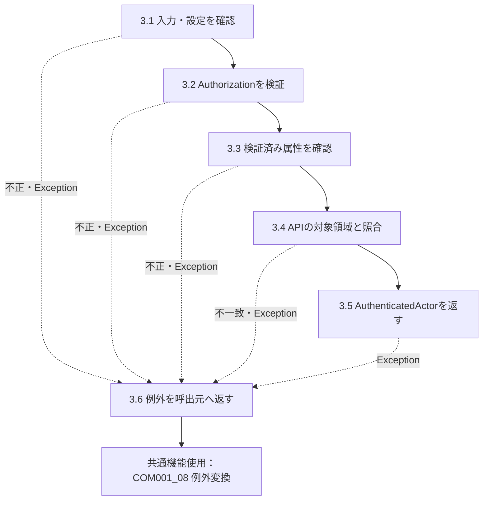

# COM001_02_共通ヘッダー・認証情報チェック

## 0. 処理フロー



## 1. 基本情報・実装箇所

API Gatewayで検証済みの認証情報を受け取り、呼び出されたAPIが会員用か管理者用かを照合し、後続処理で使う本人識別情報を返す。

| 項目 | 内容 |
| --- | --- |
| 機能ID | COM001_02 |
| 論理名 | 共通ヘッダー・認証情報チェック |
| 物理名 | resolve-authenticated-actor |
| 実装クラス | AuthenticatedActorResolver |
| メソッド | `resolve(AuthHeaderInput input, ExpectedActor expectedActor)` |
| 戻り値 | AuthenticatedActor |
| 呼出元 | 認証必須ルートの共通受付Filter／認証アダプター。COM001_01実行後、Controller実行前に呼ぶ |
| 対象 | 会員JWT必須API・管理者JWT必須API |
| DB・外部通信 | なし。Cognito呼出・JWT署名検証・セッション作成は行わない |
| Controller／Business | 本機能には作成しない。個別Controller・Businessで同じチェックを繰り返さない |
| 作成日 | 2026/11/11 |
| 改訂日 | 2026/11/14 |

### この機能へ渡す認証情報の前提

API GatewayでJWT検証済みの属性を、内部連携ヘッダーとしてECSへ渡す方式を使用する。下記ヘッダー名は本設計での採用案。

**Gatewayによる属性ヘッダーの上書きと、Gatewayを経由しないECSへのアクセス遮断が成立していることが必須。ヘッダー名や形式が正しいだけでは、検証済みの証明にならない。** この前提を満たせない構成では本方式を使用しない。

公開商品・ゲストカートでは本機能を呼ばない。公開ルートに内部属性ヘッダーが届いても会員・管理者として扱わない。

## 2. 入力項目

### 2.1 AuthHeaderInput

呼出元は各ヘッダーを単一文字列へまとめず、受信した値の一覧として渡す。値のトリム・小文字化・URLデコードは行わない。

| 入力項目 | HTTPヘッダー | 型 | 必須 | 内容 |
| --- | --- | --- | --- | --- |
| authorizationValues | Authorization | List<String> | 必須 | 元のBearerアクセストークン |
| subValues | X-EC-Verified-Sub | List<String> | 必須 | Gateway検証済みJWTのsub |
| issuerValues | X-EC-Verified-Issuer | List<String> | 必須 | 同じJWTのiss |
| clientIdValues | X-EC-Verified-Client-Id | List<String> | 必須 | 同じJWTのclient_id |
| tokenUseValues | X-EC-Verified-Token-Use | List<String> | 必須 | 同じJWTのtoken_use |

内部属性はクライアント指定値を転送せず、検証対象のJWTから上書きされた値を受け取る。ヘッダー名は大文字・小文字を区別せず収集する。

本機能はリクエストボディ・クエリ・Cookieを読み取らない。HTTPメソッド・Content-Type・JSON構文はCOM001_10の担当。

### 2.2 ExpectedActor・アプリケーション設定

| 項目 | 型 | 設定元・条件 |
| --- | --- | --- |
| expectedActor | Enum：USER／ADMIN | サーバー側の認証必須ルート設定から取得。ヘッダー・ボディ・クエリで指定させない |
| userIssuer | String | 会員用Cognitoプールのissuer。空欄不可 |
| adminIssuer | String | 管理者用Cognitoプールのissuer。空欄不可・userIssuerと異なること |
| userClientIds | Set<String> | 会員用の許可アプリクライアントID。空集合不可 |
| adminClientIds | Set<String> | 管理者用の許可アプリクライアントID。空集合不可 |
| maxAuthorizationLength | int | 初期案：16,384文字。正の整数。実際の経路・Webサーバーのヘッダー上限と合わせて設定 |

設定不正はアプリケーション起動時に検出し、起動を失敗させる。トークン長の上限は「Cognitoの仕様上の固定上限」ではなく、本アプリケーションの受付上限。

## 3. AuthenticatedActorResolverの処理

### 3.1 入力・設定を確認

| 判定対象 | 正常 | 不正時 |
| --- | --- | --- |
| input | null以外 | INTERNAL_ERROR |
| expectedActor | USERまたはADMIN | INTERNAL_ERROR |
| 対象領域のissuer・許可clientId設定 | 起動時検証済み・取得可能 | INTERNAL_ERROR |

正常なら3.2へ進む。HTTP要求側の不足と、共通受付内部の呼出不備を区別する。

### 3.2 Authorizationを検証

上から順に確認し、最初の不正で終了する。

| 順序 | チェック | 不正時 |
| --- | --- | --- |
| 1 | 値が1件だけ存在する。null・空欄を許可しない | UNAUTHENTICATED |
| 2 | ヘッダー全体がmaxAuthorizationLength以下 | UNAUTHENTICATED |
| 3 | `Bearer`＋半角スペース1文字＋トークン。Bearer部分だけ大文字・小文字を区別しない | UNAUTHENTICATED |
| 4 | トークンが空でなく、空白・改行・カンマを含まない | UNAUTHENTICATED |
| 5 | トークンがドット区切り3要素で、各要素が1文字以上の半角英数字・`-`・`_`のみ | UNAUTHENTICATED |

形式チェックは `(?i:Bearer) [A-Za-z0-9_-]+\.[A-Za-z0-9_-]+\.[A-Za-z0-9_-]+` の全体一致とする（Java文字列ではバックスラッシュをエスケープする）。

トークン部分をそのまま `accessToken` に格納して3.3へ進む。複数値がカンマで結合されて届いた場合も拒否する。

ここでは形式だけを確認する。JWTの内容を未検証でデコードして本人情報を採用したり、署名・有効期限の検証を再実装したりしない。

### 3.3 検証済み属性を確認

| 項目 | チェック | 不正時 |
| --- | --- | --- |
| 4種類の属性ヘッダー | それぞれ値が1件。null・空欄・カンマ・空白・制御文字を許可しない | INTERNAL_ERROR |
| sub | 1〜128文字 | INTERNAL_ERROR |
| issuer | 1〜2,048文字 | INTERNAL_ERROR |
| clientId | 1〜128文字 | INTERNAL_ERROR |
| tokenUse | 1〜16文字 | INTERNAL_ERROR |

正常なら3.4へ進む。Gatewayから渡されるべき属性の不足・不正は内部連携不備として扱い、未ログインへ切り替えて処理を続行しない。

### 3.4 APIの対象領域と照合

| expectedActor | issuerの照合先 | clientIdの照合先 |
| --- | --- | --- |
| USER | userIssuerと完全一致 | userClientIdsのいずれかと完全一致 |
| ADMIN | adminIssuerと完全一致 | adminClientIdsのいずれかと完全一致 |

| 判定 | 処理 |
| --- | --- |
| issuer・clientIdが一致し、tokenUseが文字列 `access` | 3.5へ |
| issuer・clientIdが不一致 | UNAUTHENTICATED |
| tokenUseが `access` 以外 | UNAUTHENTICATED。IDトークンは受け付けない |

issuerの末尾スラッシュ除去や大小文字変換は行わない。別領域のJWTを受け入れるためにUSER／ADMINを切り替えない。

### 3.5 AuthenticatedActorを返す

| 出力項目 | 設定値 |
| --- | --- |
| actorType | expectedActor |
| subject | 検証済みsub |
| issuer | 照合済みissuer |
| clientId | 照合済みclientId |
| accessToken | 3.2で取り出したトークン |

変更不可のオブジェクトとして返す。`toString()`等でaccessTokenを出力しない。

本機能は値を返すだけで、SecurityContext・HTTPセッションへの登録やHTTPレスポンスの書込みは行わない。

呼出元は成功結果をrequest属性 `ec.authenticatedActor` に保持して後続へ進める。失敗時は属性を設定せず、Controller・Businessを実行しない。処理開始時に同属性が存在した場合は呼出元が除去し、古い判定結果を利用しない。

**actorType=ADMINは「管理者用プールの本人情報」であり、業務上の管理者権限を保証しない。** adminsの登録・有効状態・権限や、会員の利用状態・所有権は後続の処理で確認する。userId／adminIdをsubから推測しない。

### 3.6 Exception・エラー処理

ResolverはHTTPレスポンスを直接生成せず、判定結果をコード付き例外として呼出元へ送出する。

| 発生箇所・条件 | 送出コード | 後続処理 |
| --- | --- | --- |
| 3.2のAuthorization不正 | UNAUTHENTICATED | 実行しない |
| 3.4の領域・clientId・tokenUse不一致 | UNAUTHENTICATED | 実行しない |
| 3.1の内部呼出不備・設定不備 | INTERNAL_ERROR | 実行しない |
| 3.3の属性不足・不正 | INTERNAL_ERROR | 実行しない |
| その他のException | INTERNAL_ERROR | 実行しない |

呼出元で **共通機能使用：COM001_08 共通例外変換**。requestIdはCOM001_01で作成した値を使用する。既にエラー応答済みの場合に再度書き込まない。

HTTP 200への変換はECSで捕捉・応答できた場合のみ。API Gatewayが拒否したJWTやヘッダー長超過等は、この機能に到達せず非200になる場合がある。

DB更新・登録、外部サービスへの書込みがないため、ロールバック・データ復旧は不要。内部連携不備は設定修正後に再実行し、認証不正は有効なトークン取得後に再実行する。

## 4. 動作確認項目

| 条件 | 確認結果 |
| --- | --- |
| 会員JWT＋USERルート＋正常な内部属性 | USER・本人subを返す |
| 管理者JWT＋ADMINルート＋正常な内部属性 | ADMIN・本人subを返す。管理権限を自動付与しない |
| Authorizationなし・複数・空欄・過長 | UNAUTHENTICATED |
| Bearer形式不正・トークン内の空白・改行・カンマ | UNAUTHENTICATED |
| IDトークン | tokenUse照合で拒否する |
| 会員issuerをADMINルートに渡す | UNAUTHENTICATED |
| 許可外clientId | UNAUTHENTICATED |
| sub欠損・内部属性の複数値 | INTERNAL_ERROR |
| クライアントが内部ヘッダーを偽装 | 経路試験でGatewayによる上書きを確認。直接ECSへ接続できないことも確認 |
| 公開・ゲストルートに偽の内部ヘッダーを付ける | 本機能で認証結果を作らず、会員APIとして実行しない |
| 例外発生 | Controller・Businessへ進まず、トークンをログやJSONへ出さない |

## 5. 参照資料

- API Gateway JWT authorizer：https://docs.aws.amazon.com/apigateway/latest/developerguide/http-api-jwt-authorizer.html
- HTTP APIのヘッダー変換：https://docs.aws.amazon.com/apigateway/latest/developerguide/http-api-parameter-mapping.html

AWS設定の操作手順は本書に含めない。内部属性名・対応するclaim・上書き設定・接続制限をIaC設計と一致させてから適用する。

## 6. 返却項目

### 6.1 正常時：内部戻り値

| 項目 | 型 | null | 用途 |
| --- | --- | --- | --- |
| actorType | ExpectedActor | 不可 | USER／ADMINの領域識別 |
| subject | String | 不可 | users／adminsのcognito_sub検索条件 |
| issuer | String | 不可 | 本人識別の発行元 |
| clientId | String | 不可 | 許可済みアプリクライアントの識別 |
| accessToken | String | 不可 | 必要な外部呼出へ渡す。氏名・会員情報と一緒にレスポンスへ出さない |

本機能専用のHTTP API・正常JSONは作成しない。親Controllerは必要な項目だけBusinessの引数へ渡す。トークンはDB・セッション・MDCへ保存しない。

### 6.2 エラー時：共通例外処理が生成するJSON

| 項目 | 認証不正 | 内部連携不備・Exception |
| --- | --- | --- |
| HTTPステータス | 200 | 200 |
| requestId | COM001_01のrequestId | 同左 |
| data | null | null |
| error.code | UNAUTHENTICATED | INTERNAL_ERROR |
| error.message | ログイン状態を確認できませんでした。再度ログインしてください。 | 処理を完了できませんでした。 |
| error.fieldErrors | [] | [] |

```json
{
  "requestId": "b2cb098f-0d11-4e60-9cdc-a24e88062cad",
  "data": null,
  "error": {
    "code": "UNAUTHENTICATED",
    "message": "ログイン状態を確認できませんでした。再度ログインしてください。",
    "fieldErrors": []
  }
}
```
