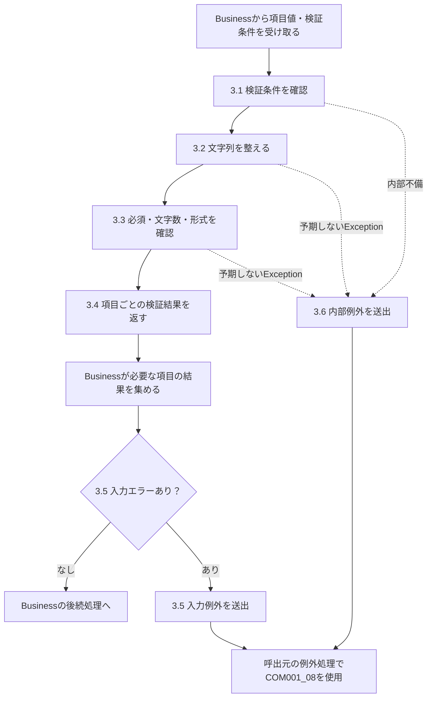

# COM001_03_入力検証・文字列処理

## 0. 処理フロー



## 1. 基本情報・実装箇所

文字列の整形と単項目チェックを共通化する。**どの項目を必須にするか、何文字まで許可するかは各Businessが指定する。**

| 項目 | 内容 |
| --- | --- |
| 機能ID | COM001_03 |
| 論理名 | 入力検証・文字列処理 |
| 物理名 | validate-request-fields |
| 実装クラス | RequestValidation / TextValidation |
| 呼出元 | 各APIのBusiness |
| HTTPエンドポイント | なし。Javaの共通部品として呼び出す |
| API Gateway認証 | 対象外。呼出元APIの認証条件に従う |
| Controller／Business | 本機能専用のController・Businessは作成しない |
| DB検索・登録・更新 | なし |
| 外部通信 | なし |
| 作成日 | 2026/11/14 |

### 1.1 公開メソッド

| クラス・メソッド | 入力 | 戻り値・役割 |
| --- | --- | --- |
| `TextValidation.trimEdges(String value)` | 文字列・null | 前後空白を除去した文字列。nullはnull |
| `RequestValidation.validateText(String value, TextRule rule)` | 項目値・検証条件 | `TextValidationResult`。3.1〜3.4を実行 |
| `RequestValidation.requireValid(List<TextValidationResult> results)` | 項目ごとの検証結果 | 正常ならvoid。不正なら入力例外。3.5を実行 |

状態を持たない部品とし、リクエスト間で入力値・エラー一覧を共有しない。

### 1.2 本機能に含めない処理

| 処理 | 実施箇所 |
| --- | --- |
| Authorization・信頼済み認証情報のチェック | COM001_02 |
| JSON構文・Content-Typeの確認 | COM001_10 |
| 許可されないボディ項目、クエリ、ボディ自体の必須判定 | 各Business |
| 数値の範囲、日付の存在、項目同士の一致・大小関係 | 各Business。複数機能で必要になれば共通部品の追加を検討 |
| DB上の重複、会員状態、在庫、所有権の確認 | 各Businessおよび対象の共通機能 |
| HTMLエスケープ・SQL対策 | 表示処理・DBアクセス処理。本機能で入力文字を置換しない |
| パスワードの登録・認証ポリシー | Cognito。ECSではパスワードを受け取らない |

## 2. 入力項目

### 2.1 検証対象値

| 項目 | 型 | null | 内容 |
| --- | --- | --- | --- |
| value | String | 可 | BusinessがDTO等から取り出した1項目の値 |
| rule | TextRule | 不可 | Businessがコードで定義した検証条件 |

HTTPリクエストそのものは受け取らない。数値・配列・オブジェクトを `String.valueOf` 等で文字列へ変換して検証に通さない。JSON型の扱いはDTO変換・各APIの設計で定義する。

### 2.2 TextRule

| 項目 | 型 | 必須 | 条件・用途 |
| --- | --- | --- | --- |
| field | String | 必須 | 応答に使用する項目名。例：name、email、keyword。サーバー側で固定 |
| required | boolean | 必須 | true：未入力不可／false：未入力可 |
| trim | boolean | 必須 | true：前後空白除去／false：入力値を保持 |
| minLength | int | 必須 | 0以上。未入力でない文字列の最小文字数 |
| maxLength | int | 必須 | minLength以上。最大文字数 |
| format | Enum | 必須 | NONE／EMAIL／PATTERN |
| pattern | Pattern | 条件付き | PATTERNの場合のみ必須。サーバー定義のコンパイル済み正規表現 |
| messages | Map<ValidationReason, String> | 必須 | 発生し得るエラー理由に対応する表示文言 |

検証条件・正規表現・表示文言をクライアントから指定させない。正規表現は用途に合わせて事前定義し、長い入力で過大な処理時間が発生しないものを使用する。

### 2.3 エラー理由と表示文言

以下は本部品の内部理由であり、HTTP応答の `error.code` ではない。表示文言は各Businessが画面仕様に合わせて渡す。

| ValidationReason | 発生条件 | 文言例 |
| --- | --- | --- |
| REQUIRED | 必須項目が未入力 | 氏名を入力してください。 |
| INVALID_TEXT | 不正なUTF-16文字列 | 入力できない文字が含まれています。 |
| TOO_SHORT | 最小文字数未満 | {項目名}は{最小文字数}文字以上で入力してください。 |
| TOO_LONG | 最大文字数超過 | 検索キーワードは50文字以内で入力してください。 |
| INVALID_FORMAT | メール形式・指定パターン不一致 | 有効なメールアドレスを入力してください。 |

文言中のプレースホルダーはBusinessが展開済みの文字列として渡す。入力値そのものを文言に埋め込まない。

## 3. 共通部品の処理

### 3.1 検証条件を確認

`validateText` の先頭で実施する。

| チェック対象 | 正常条件 | 不正時 |
| --- | --- | --- |
| rule | null以外 | 内部例外 |
| field | null・空白のみでない | 内部例外 |
| minLength／maxLength | 0 ≦ minLength ≦ maxLength | 内部例外 |
| format | NONE／EMAIL／PATTERN | 内部例外 |
| pattern | PATTERN時は非null、それ以外はnull | 内部例外 |
| messages | 非null。発生し得る理由の文言が存在し、空白のみでない | 内部例外 |

INVALID_TEXT・TOO_LONGの文言は常に必要。REQUIREDはrequired=true時、TOO_SHORTはminLength>0時、INVALID_FORMATはformatがNONE以外のときに必要。

- 正常：3.2へ。
- 不正：3.6へ。利用者の入力エラーとして返さない。

### 3.2 文字列を整える

| 順序 | 処理 |
| --- | --- |
| 1 | valueがnullなら加工せず3.3へ |
| 2 | UTF-16のサロゲートを走査し、上位・下位が正しいペアになっていることを確認 |
| 3 | ペア不正ならINVALID_TEXTの結果を3.4で返す。以降の検証は行わない |
| 4 | trim=trueなら `TextValidation.trimEdges(value)`、falseならvalueをそのまま使用 |
| 5 | 加工後の値を3.3へ渡す |

**trimEdgesの処理**

- nullはnull、空文字は空文字を返す。
- 先頭・末尾からコードポイント単位で走査する。
- `Character.isWhitespace(cp) || Character.isSpaceChar(cp)` がtrueの間だけ除去する。
- 半角・全角スペース、タブ、改行、ノーブレークスペース等が対象。途中の空白は保持する。
- 全文字が除去対象なら空文字を返す。
- 大文字・小文字、全角・半角、Unicode正規化の変換は行わない。

単独でtrimEdgesを呼ぶ場合は、整形だけを行う。必須・文字数・形式の検証が必要な項目にはvalidateTextを使用する。

### 3.3 必須・文字数・形式を確認

上から順に確認し、**1項目につき最初のエラーだけ**を返す。

| 順序 | チェック | 判定・次の処理 |
| --- | --- | --- |
| 1 | 未入力か | null、空文字、または全コードポイントが3.2の空白条件に一致する場合を未入力とする |
| 2 | 未入力かつrequired=true | REQUIREDとして3.4へ |
| 3 | 未入力かつrequired=false | 正常として3.4へ。最小文字数・形式チェックは行わない |
| 4 | 最大文字数以内か | 超過ならTOO_LONGとして3.4へ |
| 5 | 最小文字数以上か | 未満ならTOO_SHORTとして3.4へ |
| 6 | 指定形式に一致するか | 不一致ならINVALID_FORMATとして3.4へ |
| 7 | すべて正常 | 正常として3.4へ |

**文字数の数え方**

加工後の文字列に `value.codePointCount(0, value.length())` を使用する。単位はUnicodeコードポイント。サロゲートペアの絵文字は1文字、結合文字や複数コードポイントで構成する絵文字は複数文字として数える。画面側の文字数判定もこの単位に合わせる。

**形式チェック**

| format | 処理 |
| --- | --- |
| NONE | 形式チェックなし |
| EMAIL | 空白・制御文字を含まないことを確認後、Jakarta Validationの `@Email` で形式判定 |
| PATTERN | `pattern.matcher(value).matches()` による全体一致 |

EMAILは、共通部品内部のメール検証専用Bean（valueに `@Email` のみ付与）を作成し、注入済み `jakarta.validation.Validator` の `validate` を呼ぶ。違反集合が空なら正常。プロバイダーはSpring Bootのvalidation依存で使用するHibernate Validatorに統一し、バージョンはプロジェクトの依存管理に固定する。Controllerの `@Valid` にこの項目チェックを移さない。

空白は3.2の条件、制御文字は `Character.isISOControl(cp)` で判定する。メールの254文字上限・必須条件はBusinessがTextRuleで指定する。DNS照会、メール到達確認、メール所有者確認、Cognitoへの照会は行わない。

### 3.4 項目ごとの検証結果を返す

| 判定 | valid | value | error |
| --- | --- | --- | --- |
| 正常 | true | 3.2の加工後値。null・空文字の区別を保持 | null |
| 入力不正 | false | null | field・reason・message |

`TextValidationResult` は変更不可とする。入力不正時に加工途中の値を後続処理へ渡さない。トリムしない任意項目の空白のみの値は、未入力として正常判定しても値自体は変更しない。

通常の入力不正では、この時点でExceptionを投げない。Businessは必要な項目を検証して結果を集め、3.5を呼ぶ。

### 3.5 検証結果をまとめて判定

`requireValid(results)` で実施する。

| 条件 | 処理 |
| --- | --- |
| resultsがnull、要素がnull、同一fieldの結果が重複 | 3.6の内部例外 |
| 結果内のvalid・value・errorが3.4と矛盾 | 3.6の内部例外 |
| 全件正常、または空リスト | 正常終了。Businessが正常結果のvalueを使用して処理を継続 |
| 不正が1件以上 | 入力順にfield・messageを集め、`VALIDATION_ERROR` の入力例外を送出 |

空リストは「チェック対象なし」を意味する。必要なチェックを実際に実行したかはBusinessの責務。

入力例外は次の内容を持たせる。

| 項目 | 値 |
| --- | --- |
| code | VALIDATION_ERROR |
| message | 入力内容をご確認ください。 |
| fieldErrors | 各不正項目のfield・message。入力値・内部reasonは含めない |

呼出元の例外処理で **共通機能使用：COM001_08 共通例外変換**。本部品からHTTPレスポンスを直接書き込まない。

### 3.6 内部例外

| 条件 | 処理 |
| --- | --- |
| 検証条件・結果の構造不正 | 内部設定・呼出不備として例外送出 |
| Validator等の予期しないException | 原因を保持して呼出元へ伝播。VALIDATION_ERRORへ変換しない |

呼出元の例外処理で **共通機能使用：COM001_08 共通例外変換**。HTTP 200・INTERNAL_ERRORへ変換する。共通例外処理・ログ出力の内部仕様は本書では定義しない。

例外メッセージに対象値、メールアドレス、リクエストボディを含めない。

## 4. 呼出例・データ復旧

### 4.1 Businessでの呼出順

| 順序 | 処理 |
| --- | --- |
| 1 | API固有の許可項目・ボディ・クエリ条件を判定する |
| 2 | **共通機能使用：COM001_03**。各項目にvalidateTextを呼ぶ |
| 3 | **共通機能使用：COM001_03**。結果一覧にrequireValidを呼ぶ |
| 4 | 正常結果のvalueを取得する |
| 5 | 項目間チェック・DB照合等のAPI固有処理を行う |

例：商品検索のkeywordはrequired=false、trim=true、minLength=0、maxLength=50、format=NONE。正常結果がnullまたは空文字なら、Businessが検索条件なしとして扱う。

例：氏名はrequired=true、trim=true、minLength=1、maxLength=50、format=NONE。これは呼出例であり、全APIへ自動適用する条件ではない。

### 4.2 データ復旧

| 状況 | 復旧方法 |
| --- | --- |
| 入力エラー | フロントで該当項目を修正して再送 |
| 内部例外 | 原因を調査・修正後に再実行。入力値の再送だけで解消すると断定しない |
| DB・外部データ | 本機能は読み書きしないため、ロールバック・補償処理は不要 |

原則としてBusinessの更新処理前に呼ぶ。既に更新トランザクション内にいる場合のロールバックは呼出元Businessの設計に従い、本機能からcommit・rollbackは行わない。

## 5. 動作確認項目

| 入力・条件 | 期待結果 |
| --- | --- |
| 必須項目にnull／空文字／全角空白のみ | REQUIRED |
| 任意項目にnull | 正常・value=null |
| 任意項目に空白のみ、trim=true | 正常・value="" |
| 任意項目に空白のみ、trim=false | 正常・入力値を保持 |
| 「　山田 太郎　」、trim=true | 「山田 太郎」。途中の空白は保持 |
| keywordが50文字／51文字 | 正常／TOO_LONG |
| 補助平面の文字を含む入力 | サロゲートペアを1コードポイントとして数える |
| 単独の上位・下位サロゲート | INVALID_TEXT |
| 形式不正かつ文字数超過 | TOO_LONGのみ |
| EMAIL：user@example.com／user+tag@example.com | 正常 |
| EMAIL：user／a@@example.com／a b@example.com | INVALID_FORMAT |
| EMAIL：途中に改行・タブ | INVALID_FORMAT |
| PATTERN：部分一致だけ成立 | INVALID_FORMAT |
| 複数項目が不正 | requireValidで入力順のfieldErrorsを返す |
| minLength > maxLength、必要な文言なし | INTERNAL_ERROR |
| 予期しないValidator例外 | INTERNAL_ERROR。入力不正として処理しない |

参照：Javaの文字数・空白判定、Jakarta Validationのメール判定仕様。
- https://docs.oracle.com/en/java/javase/25/docs/api/java.base/java/lang/String.html
- https://docs.oracle.com/en/java/javase/25/docs/api/java.base/java/lang/Character.html
- https://jakarta.ee/specifications/bean-validation/3.1/apidocs/jakarta/validation/constraints/Email.html

参照先のJavaバージョンを採用バージョンとして指定するものではない。@Emailの詳細な許容形式はプロバイダー依存のため、依存更新時も上記ケースと採用済みメール形式の回帰確認を行う。

## 6. 返却項目

### 6.1 正常・入力不正時の内部戻り値

`validateText` は以下を返す。正常HTTP応答は本機能では作成しない。

| 項目 | 型 | null | 内容 |
| --- | --- | --- | --- |
| field | String | 不可 | rule.field |
| valid | boolean | 不可 | 正常true／入力不正false |
| value | String | 可 | 正常時の加工後値。不正時はnull |
| error | ValidationIssue | 可 | 正常時null、不正時は以下の情報 |
| error.field | String | 不可 | rule.field |
| error.reason | ValidationReason | 不可 | 内部判定理由 |
| error.message | String | 不可 | Businessが指定した該当理由の文言 |

trimEdgesはStringまたはnullを返す。requireValidは正常時void、不正時は例外を送出する。

### 6.2 例外時の外部応答

本機能が送出した例外を、共通例外処理で変換した場合の応答。

| 項目 | 入力不正 | 内部例外 |
| --- | --- | --- |
| HTTPステータス | 200 | 200 |
| requestId | COM001_01のrequestId | 同左 |
| data | null | null |
| error.code | VALIDATION_ERROR | INTERNAL_ERROR |
| error.message | 入力内容をご確認ください。 | 処理を完了できませんでした。 |
| error.fieldErrors | field・messageの配列 | [] |

入力不正の応答例：

```json
{
  "requestId": "b2cb098f-0d11-4e60-9cdc-a24e88062cad",
  "data": null,
  "error": {
    "code": "VALIDATION_ERROR",
    "message": "入力内容をご確認ください。",
    "fieldErrors": [
      {
        "field": "keyword",
        "message": "検索キーワードは50文字以内で入力してください。"
      }
    ]
  }
}
```

内部例外の応答例：

```json
{
  "requestId": "b2cb098f-0d11-4e60-9cdc-a24e88062cad",
  "data": null,
  "error": {
    "code": "INTERNAL_ERROR",
    "message": "処理を完了できませんでした。",
    "fieldErrors": []
  }
}
```

