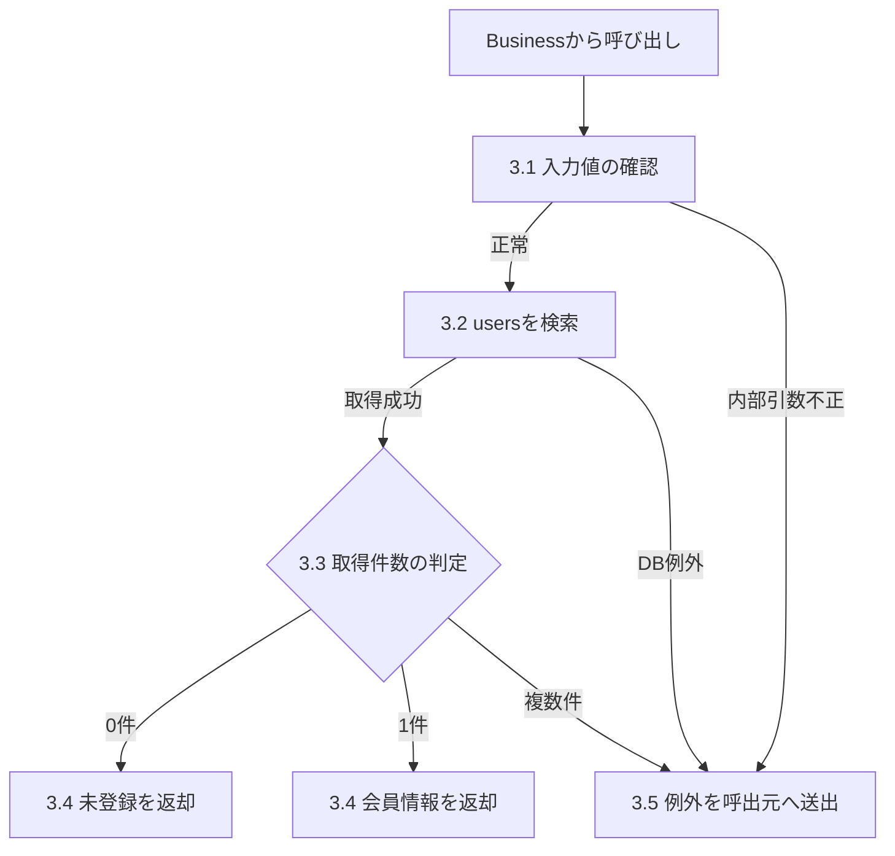

# COM001_04_subによる会員情報検索

## 0. 処理フロー



## 1. 基本情報・担当範囲

| 項目 | 内容 |
| --- | --- |
| 機能ID | COM001_04 |
| 論理名 | subによる会員情報検索 |
| 物理名 | find-user-by-sub |
| 実装クラス・メソッド | `UserQueryService.findBySub(String sub)` |
| DBアクセス | `UserMapper.selectBySub` |
| 呼出元 | 会員初期化等、会員情報を必要とするBusiness |
| 参照先 | `users` |
| 更新・登録・削除 | なし |
| Controller・URL | なし。ECS内部の共通部品として呼び出す。 |

| 担当 | 処理 |
| --- | --- |
| 呼出元Controller | 共通認証処理で確認した会員のsubをBusinessへ渡す。 |
| 呼出元Business | **共通機能使用：COM001_04 subによる会員情報検索**。未登録の場合の業務分岐を行う。 |
| UserQueryService | subを受け取り、Mapperを呼び出して会員情報または未登録を返す。 |
| UserMapper | subを完全一致条件にしてusersを検索する。 |

認証情報の確認は呼出前のCOM001_02、会員状態の利用可否判定は呼出後のCOM001_05が担当する。本機能では実行しない。

## 2. 入力項目

HTTPリクエストを直接受け付けず、次のメソッド引数を受け取る。

| 項目 | Java型 | 必須 | 内容 |
| --- | --- | --- | --- |
| sub | String | 必須 | COM001_02で確認された、会員用Cognitoプールのsub。 |

- リクエストボディに指定されたsubやメールアドレスを本人検索に使用しない。
- 管理者用プールのsubは対象外。管理者はadmins用の検索部品を使用する。
- 文字列のトリム・大文字小文字変換は行わない。

## 3. 処理詳細

### 3.1 入力値の確認 — UserQueryService

外部入力の検証はCOM001_02で完了している前提とする。ここでは内部呼び出しの誤りを検出する。

| チェック | NG条件 | NG時 |
| --- | --- | --- |
| 必須 | nullまたは空白のみ | IllegalArgumentExceptionを送出。DB検索しない。 |
| 長さ | 128文字を超える | IllegalArgumentExceptionを送出。DB検索しない。 |

項目間チェックはない。内部引数不正を「未登録」や利用者の入力エラーとして返さない。

### 3.2 usersを検索 — UserMapper

| 項目 | 設定 |
| --- | --- |
| テーブル | users |
| 検索条件 | `cognito_sub = 引数sub` |
| 一致方法 | 完全一致 |
| 使用する一意制約 | `uk_users_cognito_sub` |
| 状態条件 | 指定しない。ACTIVE・DISABLED・PENDINGを含めて取得する。 |
| 並び順・ページング | 不要 |
| 行ロック | `FOR UPDATE`は付けない。 |
| 上限 | LIMIT 1は付けない。複数件を正常な1件として扱わない。 |

| 取得カラム | Java側の項目 | 型 |
| --- | --- | --- |
| id | id | Long |
| cognito_sub | cognitoSub | String |
| name | name | String |
| email | email | String |
| status | status | String |

```sql
SELECT
    id,
    cognito_sub,
    name,
    email,
    status
FROM users
WHERE cognito_sub = #{sub, jdbcType=VARCHAR}
```

- `#{sub}`を使用して値をバインドする。SQL文字列へ連結しない。
- Mapperは上記5項目をUserRecordへ明示的にマッピングする。
- Mapperの戻り値を`UserRecord`とし、0件はnull、複数件はMyBatisの件数不整合例外とする。
- 初期化処理の競合後の再検索でもDBへ問い合わせる。本SELECTは`useCache="false" flushCache="true"`とし、以前の未登録結果を再利用しない。
- 氏名・メール・状態はDB値をそのまま返す。Cognito照会や値の補完は行わない。

### 3.3 取得件数の判定 — UserQueryService

| 結果 | 判定 | 次の処理 |
| --- | --- | --- |
| 0件（Mapperのnull） | 未登録 | 3.4でOptional.empty()を返す。 |
| 1件 | 登録済み | 3.4でOptional.of(userRecord)を返す。 |
| 複数件 | データ整合性異常 | 3.5へ。先頭行を採用しない。 |
| DB処理失敗 | 検索結果不明 | 3.5へ。0件とみなさない。 |

### 3.4 検索結果を返す — UserQueryService

1件取得時は5項目がnullでないこと、およびcognitoSubが検索したsubと一致することを確認する。不整合時は内部例外として3.5へ進む。正常時は次の型で返却する。

```java
public Optional<UserRecord> findBySub(String sub)
```

| 戻り値 | 呼出元Businessでの扱い |
| --- | --- |
| 会員情報あり | **共通機能使用：COM001_05 会員状態の判定**。その結果に従って業務処理を続ける。 |
| 未登録 | APU001_01（会員初期化）では登録処理へ進む。それ以外は各APIの未初期化エラーとして扱う。 |

本機能が会員初期化APIを呼び出したり、会員レコードを作成したりすることはない。

### 3.5 例外を呼出元へ送出 — UserQueryService

| 発生事象 | 本機能の動作 | 最終的なerror.code |
| --- | --- | --- |
| 内部引数不正 | IllegalArgumentExceptionを送出 | INTERNAL_ERROR |
| DB接続不可・接続取得タイムアウト・検索タイムアウト | 原因を保持した例外を送出 | SERVICE_UNAVAILABLE |
| 複数行取得・SQL誤り・マッピング不整合・その他の想定外例外 | 原因を保持した例外を送出 | INTERNAL_ERROR |

**共通機能使用：COM001_08 例外・エラーレスポンス変換**  
例外は呼出元まで伝播し、HTTP境界でCOM001_08が変換する。本機能から同部品を直接呼ばず、JSONやHTTPステータスを生成しない。

- DB例外をcatchしてOptional.empty()へ置き換えない。
- 本機能内で自動再試行しない。
- API固有の部分失敗を許容する場合は呼出元Businessが明示的に扱う。登録処理への誤分岐を避けるため、未登録とは必ず区別する。

## 4. トランザクション・データ復旧

| 項目 | 方針 |
| --- | --- |
| トランザクションの開始・終了 | 本機能では開始・commit・rollbackを行わない。呼出元Businessが管理する。 |
| 呼出元にトランザクションがある場合 | 同じトランザクションのMapper呼び出しとして実行する。REQUIRES_NEWで分離しない。 |
| 読み取り結果 | 検索時点の情報。後続更新まで会員状態が変わらないことは保証しない。 |
| 障害時のデータ復旧 | 本機能は読み取りのみのため復旧更新は不要。 |
| 呼出元で更新済みの場合 | 例外を握りつぶさず、呼出元の設計に従ってトランザクションをrollbackする。 |
| 障害解消後 | 呼出元APIを再実行して検索する。更新を伴うAPIの再送可否はそのAPIの設計に従う。 |

## 5. 実装時の確認観点

| ケース | 期待結果 |
| --- | --- |
| 該当subあり | DBの5項目を返す。DB更新なし。 |
| 該当subなし | Optional.empty()。会員登録しない。 |
| DISABLED・PENDING | 取得対象に含める。本機能では利用可否を決めない。 |
| DB障害 | 例外。未登録として扱わない。 |
| 初回検索0件→別処理で登録→再検索 | キャッシュした0件ではなくDBを再検索する。 |
| 不正な内部引数 | DB検索せず例外。 |

## 6. 参照資料

- [機能一覧：共通アプリケーション機能](https://docs.google.com/spreadsheets/d/1_3cp7E1CKQ3fda4SCl4G7kGrbhWOb3ZThdh4oUXIS2s/edit#gid=2026111108)
- [DB設計書：01_users](https://docs.google.com/spreadsheets/d/1Ka2DV7_iX2cCcRSIbu7-sHf4spx2TAV8p5SXogauFX8/edit#gid=1151925833)
- [MyBatis公式：Mapper XML／パラメータ・キャッシュ設定](https://mybatis.org/mybatis-3/sqlmap-xml.html)

DB設計書に残る旧API番号・HTTP 403/409/503の記載は、本書の採番・ECS応答方針には適用しない。ECSが生成できる例外レスポンスはHTTP 200で返す方針とする。

## 7. 返却項目・例外時の返却

### 7.1 本機能の戻り値

戻り値は`Optional<UserRecord>`。HTTPレスポンスではない。

| 項目 | 型 | 内容 |
| --- | --- | --- |
| Optional | Optional&lt;UserRecord&gt; | 0件ならempty、1件なら会員情報を格納。 |
| UserRecord.id | Long | users.id |
| UserRecord.cognitoSub | String | users.cognito_sub |
| UserRecord.name | String | users.name |
| UserRecord.email | String | users.email |
| UserRecord.status | String | users.status。未知の値をACTIVE等へ置き換えない。 |

5カラムはDB上NOT NULL。DB・マッピング異常で必須値が欠損した場合は正常な会員情報として扱わず、内部エラーとする。

### 7.2 例外時に呼出元APIが返す共通項目

**共通機能使用：COM001_08 例外・エラーレスポンス変換**

| 項目 | 型 | 値 |
| --- | --- | --- |
| HTTPステータス | — | 200（ECSで例外を処理し応答を生成できる場合） |
| requestId | String | 共通処理で設定された要求追跡ID |
| data | Object / null | null |
| error.code | String | SERVICE_UNAVAILABLEまたはINTERNAL_ERROR |
| error.message | String | 共通エラー定義、または呼出元APIで定めた利用者向け文言 |
| error.fieldErrors | Array | [] |

SQL・DB接続情報・内部例外メッセージは返却しない。

APU001_01から呼び出してDB取得に失敗した場合の例：

```json
{
  "requestId": "req-example-001",
  "data": null,
  "error": {
    "code": "SERVICE_UNAVAILABLE",
    "message": "会員情報を取得・準備できませんでした。再試行してください。",
    "fieldErrors": []
  }
}
```

未登録のOptional.empty()は上記エラーJSONへ自動変換しない。呼出元Businessの分岐に戻す。

