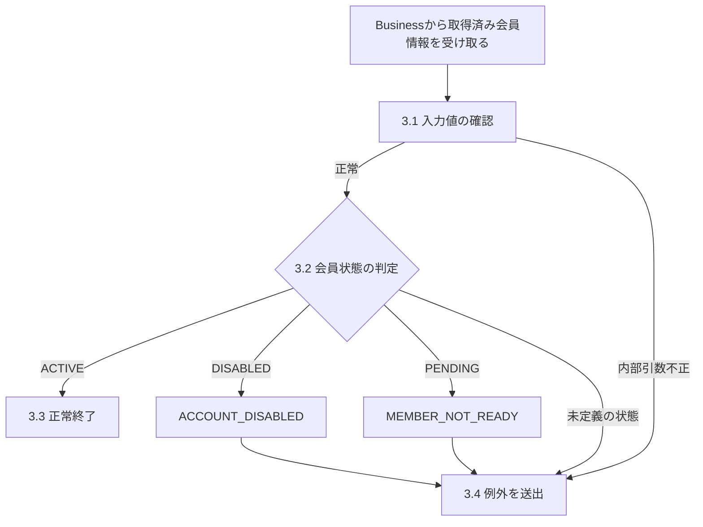

# COM001_05_会員利用状態判定

## 0. 処理フロー



## 1. 基本情報・担当範囲

| 項目 | 内容 |
| --- | --- |
| 機能ID | COM001_05 |
| 論理名 | 会員利用状態判定 |
| 物理名 | check-member-status |
| 実装クラス・メソッド | `MemberStatusPolicy.checkUsable(UserRecord user)` |
| 呼出元 | 会員初期化・会員向け業務APIのBusiness |
| 目的 | 取得済みの会員状態がACTIVEであることを確認する。 |
| Controller・URL | なし。ECS内部の共通部品。 |
| DB・外部サービスアクセス | なし |
| 登録・更新・削除 | なし |

| 担当 | 処理 |
| --- | --- |
| 呼出元Business | 会員検索、未登録の分岐、本機能の呼び出し、判定通過後の業務処理 |
| MemberStatusPolicy | 会員状態を判定し、利用不可・不正状態なら例外を送出 |
| HTTP境界の共通処理 | 送出された例外を共通エラーJSONへ変換 |

Controllerは本機能を直接呼ばない。JWT・ヘッダーの検証、プロフィール検証、注文等の所有権確認は本機能に含めない。

## 2. 入力項目・呼び出し条件

### 2.1 入力項目

| 項目 | Java型 | 必須 | 内容 |
| --- | --- | --- | --- |
| user | UserRecord | 必須 | COM001_04で取得した会員情報、または会員初期化で登録・取得した会員情報 |
| user.status | String | 必須 | users.statusの値。本機能が判定に使用する項目 |

- HTTPリクエストボディのstatusは使用しない。
- 氏名・メール等は本機能では検証しない。
- 状態のトリム・大文字変換・補完は行わない。
- 現時点では全呼出元に同じ判定を適用するため、機能一覧の「用途」はメソッド引数に設けない。初期化中という理由でDISABLED・PENDINGを許可しない。

### 2.2 呼び出す位置

| 順序 | 呼出元Businessの処理 |
| --- | --- |
| 1 | **共通機能使用：COM001_04 subによる会員情報検索** |
| 2 | 未登録なら各APIの未初期化分岐へ。APU001_01のみ登録処理へ進む。 |
| 3 | 会員情報が得られたら、**共通機能使用：COM001_05 会員利用状態判定** |
| 4 | 正常終了した場合だけ、会員データの応答組み立てや後続の業務処理へ進む。 |

APU001_01で同時登録競合後に既存会員を再取得した場合も、本機能を通す。未登録を表すOptional.empty()をnullにして渡さない。

## 3. 処理詳細 — MemberStatusPolicy

### 3.1 入力値の確認

| チェック | NG条件 | 処理 |
| --- | --- | --- |
| 会員情報 | userがnull | IllegalArgumentExceptionを送出。3.4へ。 |
| 状態の必須 | user.statusがnull・空文字・空白のみ | IllegalStateExceptionを送出。3.4へ。 |

これらは内部呼び出し・取得データの異常であり、入力フォームのVALIDATION_ERRORにはしない。項目間チェックはない。

### 3.2 会員状態の判定

文字列の完全一致で判定する。

| user.status | 判定 | 処理 |
| --- | --- | --- |
| ACTIVE | 利用可能 | 3.3へ進む。 |
| DISABLED | 利用停止・無効 | ACCOUNT_DISABLEDを持つ業務例外を送出。3.4へ。 |
| PENDING | 旧データの会員準備未完了 | MEMBER_NOT_READYを持つ業務例外を送出。3.4へ。 |
| 上記以外 | 未定義の状態 | IllegalStateExceptionを送出。3.4へ。 |

- DISABLED・PENDINGをACTIVEへ変更しない。
- PENDINGをCognitoのメール未確認状態と同一視しない。Cognitoへの再照会や確認メール送信は行わない。
- 未定義状態を利用可能として扱わない。
- 管理者の権限判定には使用しない。

### 3.3 正常終了

```java
public void checkUsable(UserRecord user)
```

ACTIVEの場合は戻り値なしで正常終了する。呼出元Businessは保持している会員情報を使用して処理を続行する。

本機能の判定は渡された会員情報に対するもの。判定後の状態変更まで防ぐものではなく、更新処理に必要な再確認やロックは各Businessで設計する。

### 3.4 例外を送出

| 発生条件 | 例外 | error.code |
| --- | --- | --- |
| DISABLED | 業務例外（RuntimeException系） | ACCOUNT_DISABLED |
| PENDING | 業務例外（RuntimeException系） | MEMBER_NOT_READY |
| userがnull | IllegalArgumentException | INTERNAL_ERROR |
| 状態欠損・未定義 | IllegalStateException | INTERNAL_ERROR |
| その他の想定外例外 | 原因を保持した実行時例外 | INTERNAL_ERROR |

例外は呼出元へ伝播させる。本機能ではJSONを生成せず、自動再試行もしない。

**共通機能使用：COM001_08 例外・エラーレスポンス変換**  
HTTP境界で例外を処理する。本機能からCOM001_08を直接呼び出す処理は実装しない。

## 4. DB処理・データ復旧

| 項目 | 内容 |
| --- | --- |
| DB検索 | なし。取得済みUserRecordを使用する。 |
| DB登録・更新・削除 | なし。状態変更・Cognito変更も行わない。 |
| トランザクション | 本機能では開始・終了・commit・rollbackを行わない。 |
| 本機能単独の復旧 | データを変更しないため不要。 |
| 呼出元が更新済みの場合 | 例外を正常扱いせず、呼出元Businessのトランザクション方針に従ってrollbackする。 |
| 利用停止・準備未完了 | 再初期化や自動再送で解除しない。状態の確認・修正は運用側で行う。 |

## 5. 確認観点

| 入力・状況 | 期待結果 |
| --- | --- |
| ACTIVE | 正常終了。DB・Cognitoへのアクセスなし。 |
| DISABLED | ACCOUNT_DISABLED。後続業務は実行しない。 |
| PENDING | MEMBER_NOT_READY。自動有効化しない。 |
| nullのUserRecord | INTERNAL_ERROR。未登録とは判定しない。 |
| null・空欄・未知のstatus | INTERNAL_ERROR。 |
| `active`・` ACTIVE ` | 未定義状態としてINTERNAL_ERROR。 |
| 初期化の競合後にDISABLEDを取得 | 通常と同じくACCOUNT_DISABLED。 |

## 6. 参照資料

- [機能一覧：共通アプリケーション機能](https://docs.google.com/spreadsheets/d/1_3cp7E1CKQ3fda4SCl4G7kGrbhWOb3ZThdh4oUXIS2s/edit#gid=2026111108)
- [エラーコード・メッセージ一覧](https://docs.google.com/spreadsheets/d/1_3cp7E1CKQ3fda4SCl4G7kGrbhWOb3ZThdh4oUXIS2s/edit#gid=2026111203)
- [DB設計書：users](https://docs.google.com/spreadsheets/d/1Ka2DV7_iX2cCcRSIbu7-sHf4spx2TAV8p5SXogauFX8/edit#gid=1151925833)
- COM001_04_subによる会員情報検索

MEMBER_NOT_READYは現在のエラー一覧ではAPU001_01欄に定義されている。本機能の他の呼出元にも、同じコード・文言を適用する。

## 7. 返却項目・例外時の応答

### 7.1 本機能の戻り値

| 結果 | 呼出元への返却 |
| --- | --- |
| 利用可能 | voidで正常終了 |
| 利用不可・内部異常 | 3.4の例外を送出 |

本機能専用の成功JSONやHTTPエンドポイントは設けない。

### 7.2 呼出元APIの例外レスポンス

**共通機能使用：COM001_08 例外・エラーレスポンス変換**

| 項目 | 型 | 値 |
| --- | --- | --- |
| HTTPステータス | — | 200（ECSで例外を捕捉し応答を生成できる場合） |
| requestId | String | 共通処理の要求追跡ID |
| data | Object / null | null |
| error.code | String | 下表のコード |
| error.message | String | 下表の文言 |
| error.fieldErrors | Array | [] |

| error.code | error.message |
| --- | --- |
| ACCOUNT_DISABLED | このアカウントでは会員機能を利用できません。 |
| MEMBER_NOT_READY | 会員情報の確認が必要です。 |
| INTERNAL_ERROR | 処理を完了できませんでした。 |

API Gateway等による拒否や通信断は、ECSのHTTP 200統一の対象外。内部例外の内容や未定義の状態値はレスポンスに含めない。

### 7.3 例：利用停止会員

```json
{
  "requestId": "req-example-001",
  "data": null,
  "error": {
    "code": "ACCOUNT_DISABLED",
    "message": "このアカウントでは会員機能を利用できません。",
    "fieldErrors": []
  }
}
```

