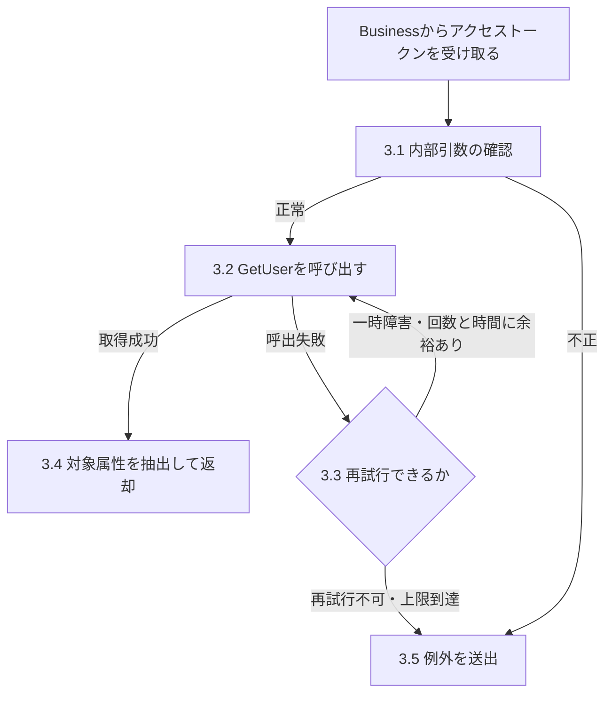

# COM001_06_Cognito本人属性取得クライアント

## 0. 処理フロー



## 1. 基本情報・担当範囲

| 項目 | 内容 |
| --- | --- |
| 機能ID | COM001_06 |
| 論理名 | Cognito本人属性取得クライアント |
| 物理名 | get-cognito-user |
| 実装クラス・メソッド | CognitoUserClient.getUser(String accessToken) |
| 使用SDK | AWS SDK for Java 2.x／CognitoIdentityProviderClient |
| 外部処理 | Cognito GetUser |
| 呼出元 | APU001_01のBusiness（未登録会員の初期化時） |
| Controller・独自URL | なし。ECS内部の外部連携部品 |
| DB検索・登録・更新・削除 | なし |

| 担当 | 実行内容 |
| --- | --- |
| 呼出元Controller | 共通受付で確認したアクセストークン・主体情報をBusinessへ渡す。 |
| 呼出元Business | **共通機能使用：COM001_06 Cognito本人属性取得クライアント**。取得後に属性の必須・重複・形式・sub一致・メール確認済みを判定する。 |
| CognitoUserClient | GetUser呼出、対象属性の抽出、SDKのタイムアウト・リトライ設定、例外分類 |
| HTTP境界の共通処理 | 例外を共通エラーJSONへ変換する。 |

属性を取得できただけでは、会員登録可能とは判定しない。

## 2. 入力項目・呼出条件

### 2.1 メソッド引数

| 項目 | 型 | 必須 | 内容 |
| --- | --- | --- | --- |
| accessToken | String | 必須 | 会員アクセストークン本体。Bearer接頭辞を含めない。 |

- COM001_02で会員用の主体確認が済んだ要求を対象とする。任意のリクエストボディからトークンを採用しない。
- ヘッダーの形式、JWT・issuer・client・token_use等の共通チェックはここで再実装しない。
- expectedSubは呼出元Businessが保持し、取得したsubと照合する。本機能の引数には設けない。
- 管理者トークン・IDトークン・Refresh tokenは使用しない。

### 2.2 外部接続の前提

| 項目 | 設定・条件 |
| --- | --- |
| リージョン | 会員Poolのリージョンをサーバー設定で固定 |
| 接続先 | SDK標準のCognito HTTPSエンドポイント。ブラウザ指定URLは使用しない |
| SDKクライアント | 設定済みBeanを再利用。リクエストごとに生成しない |
| 必要scope | aws.cognito.signin.user.admin |
| App Client属性読取 | sub・name・email・email_verifiedが取得できる設定を確認 |
| 認可 | GetUserは利用者アクセストークンで認可。IAM権限追加を代替にしない |
| DBトランザクション | 登録トランザクション開始前に呼ぶ。通信待ちの間、DBロックを保持しない |

GetUserのリクエストにはUserPoolId・ClientId・Usernameを指定しない。認証対象の制限は共通受付で行い、取得後はBusinessでsubを照合する。

## 3. 処理詳細 — CognitoUserClient

### 3.1 内部引数の確認

| チェック | NG条件 | 処理 |
| --- | --- | --- |
| 必須 | null・空文字・空白のみ | IllegalArgumentExceptionを送出。Cognitoを呼ばない。 |

トークンをトリム・補完・別トークンへ置換しない。内部呼出誤りはINTERNAL_ERRORとして扱い、利用者の項目入力エラーにしない。項目間チェックはない。

### 3.2 GetUserを呼び出す

| Cognitoリクエスト項目 | 設定値 |
| --- | --- |
| AccessToken | 引数accessTokenをそのまま設定 |

```java
GetUserResponse response = cognitoClient.getUser(
    GetUserRequest.builder()
        .accessToken(accessToken)
        .build()
);
```

SDKが通信形式を組み立てる。独自のHTTP送信・AdminGetUserへのフォールバックは実装しない。認証情報の更新・再ログインも本機能では行わない。

### 3.3 タイムアウト・上限付きリトライ

本書の初期設定値を外部設定として持ち、運用で調整可能にする。以下は本機能の設計値であり、AWSの既定値ではない。

| 設定 | 初期値・方針 |
| --- | --- |
| apiCallTimeout | 8秒。再試行・待機を含む全体上限 |
| apiCallAttemptTimeout | 3秒。1回の試行上限 |
| 接続タイムアウト | 1秒 |
| ソケット待機タイムアウト | 2秒（同期HTTPクライアント） |
| 接続プール取得待機 | 1秒 |
| リトライ方式 | SDKのStandardRetryStrategy |
| maxAttempts | 2（初回1回＋再試行最大1回） |
| 待機 | SDK標準のバックオフ・ジッターを使用 |
| 二重リトライ | Businessや本アダプターで独自再送ループを追加しない |

| 条件 | 再試行 |
| --- | --- |
| 一時的な接続障害・読み取り／試行タイムアウト | SDKの一時障害判定に従い、上限内で可 |
| TooManyRequestsException | 上限内で可 |
| InternalErrorException・外部サービスの一時的5xx | 上限内で可 |
| 認証拒否・ユーザー未確認・存在なし・不正パラメータ | 不可 |
| 全体8秒到達・要求中断・上限到達 | 不可 |

SDKの回路遮断等で再試行されない場合もあるため、必ず2回呼ぶ仕様とはしない。SDKは認証拒否等を再試行しない設定とする。失敗時は最終例外を3.5で分類する。

### 3.4 対象属性を抽出して返す

| GetUserの取得元 | 返却対象 |
| --- | --- |
| UserAttributesのNameがsub | そのName・Value |
| Nameがname | 同上 |
| Nameがemail | 同上 |
| Nameがemail_verified | 同上 |

返却型は、対象4属性の**名前・値のリスト**を持つCognitoUserAttributesとする。

- 同名属性が複数あっても、順序・件数を保持する。Map化で上書きしない。
- 不足属性を空文字や既定値で補完しない。欠損はリストに含めない。
- 値は加工しない。email_verifiedもBooleanへ変換せず文字列のまま返す。
- Usernameをsubの代わりに使用しない。MFA情報・不要なカスタム属性は返さない。
- レスポンス本体がnull、属性要素や属性名がnullなど、構造自体が壊れている場合は内部例外とする。
- 対象属性のValueがnullの場合は保持し、Businessの属性必須チェックに渡す。対象属性が0件なら空リストを返す。

**呼出元Businessの判定（本機能では実装しない）**

| チェック | 呼出元の処理 |
| --- | --- |
| 必須属性・重複・氏名／メールの形式 | 不正時はMEMBER_PROFILE_INVALID |
| subと検証済み主体の一致 | 不一致時はIDENTITY_MISMATCH |
| email_verified | 不足・不正形式は属性不正、有効なfalseはEMAIL_CONFIRMATION_REQUIRED。trueのみ登録へ進める |

DB検索・会員作成・カート統合は本機能の対象外。

### 3.5 SDK例外を分類して送出

以下のコードを保持するRuntimeException系の連携例外に変換し、元例外を原因として保持する。SDK例外文言をそのまま利用者へ返さない。

| 発生事象 | error.code | 備考 |
| --- | --- | --- |
| NotAuthorizedException／UserNotFoundException | UNAUTHENTICATED | 再認証へ。RDS未登録とは扱わない |
| UserNotConfirmedException | EMAIL_CONFIRMATION_REQUIRED | 確認手続きへ |
| PasswordResetRequiredException | UNAUTHENTICATED | 繰り返し自動再試行しない。内部原因を記録し、現行の回復運用へ |
| TooManyRequestsException（再試行後も失敗） | RATE_LIMIT_EXCEEDED | 時間をおいて再試行 |
| InternalErrorException・一時的5xx・通信タイムアウト・一時的接続障害 | COGNITO_UNAVAILABLE | 認証失敗や未登録と断定しない |
| InvalidParameterException／ResourceNotFoundException／OperationNotEnabledException | INTERNAL_ERROR | 呼出条件・Pool／リージョン・設定を運用確認 |
| ForbiddenException（Cognito側WAF拒否） | INTERNAL_ERROR | アプリの管理者権限不足とは区別。自動再試行しない |
| SDK設定・シリアライズ等の非一時的エラー、構造不正、想定外例外 | INTERNAL_ERROR | 設定・実装を確認 |

SdkClientException全体を無条件で一時障害にしない。原因から通信の一時障害と設定・実装不備を区別する。

**共通機能使用：COM001_08 例外・エラーレスポンス変換**  
送出した例外をHTTP境界で変換する。本機能からCOM001_08を直接呼ばず、HTTPレスポンスを生成しない。

## 4. データ復旧・機密情報

| 項目 | 方針 |
| --- | --- |
| DB処理 | なし |
| Cognito更新 | なし。GetUserによる参照のみ |
| 失敗時の復旧更新 | 不要。未登録とみなして会員を作成しない |
| 呼出元への影響 | 取得・属性検証成功まで会員登録TXへ進めない |
| 外部障害解消後 | 呼出元APIの再試行で再取得する |
| キャッシュ | 本機能では取得属性・トークンをキャッシュしない |
| トークン更新 | Amplify側の責務。Refresh tokenをECSへ要求しない |

ログには要求追跡ID・処理名・経過時間・分類コード・安全なAWSリクエストID等のみを記録する。AccessToken、要求／応答DTOの丸ごと出力、氏名・メール、SDKのHTTPワイヤーログは出力しない。例外原因を保持していても、ログへ無加工で展開しない。

## 5. 確認観点

| ケース | 期待結果 |
| --- | --- |
| 正常応答 | 対象4属性を文字列のまま返す |
| 同名属性が複数 | 消さずに返し、Businessで重複検出できる |
| 属性不足・email_verified=false | 本機能では業務判断せず、Businessへ渡す |
| sub不一致 | BusinessでIDENTITY_MISMATCH |
| 認証拒否 | 再試行せずUNAUTHENTICATED |
| 一時障害後に回復 | 最大2試行・全体8秒の範囲で成功 |
| 一時障害継続 | COGNITO_UNAVAILABLE。DB登録なし |
| 利用制限継続 | RATE_LIMIT_EXCEEDED |
| 不正設定・想定外応答 | INTERNAL_ERROR。自動登録しない |
| ログ確認 | トークン・氏名・メールが記録されない |

## 6. 参照資料

- [機能一覧：COM001_06](https://docs.google.com/spreadsheets/d/1_3cp7E1CKQ3fda4SCl4G7kGrbhWOb3ZThdh4oUXIS2s/edit#gid=2026111108)
- [共通エラーコード・メッセージ](https://docs.google.com/spreadsheets/d/1_3cp7E1CKQ3fda4SCl4G7kGrbhWOb3ZThdh4oUXIS2s/edit#gid=2026111203)
- [Cognito GetUser公式仕様](https://docs.aws.amazon.com/cognito-user-identity-pools/latest/APIReference/API_GetUser.html)
- [Java SDKタイムアウト](https://docs.aws.amazon.com/sdk-for-java/latest/developer-guide/timeouts.html)
- [Java SDKリトライ](https://docs.aws.amazon.com/sdk-for-java/latest/developer-guide/retry-strategy.html)

## 7. 返却項目・例外レスポンス

### 7.1 本機能の正常戻り値

型：CognitoUserAttributes。HTTP応答ではなくBusinessに返す内部DTO。

| 項目 | 型 | null | 内容 |
| --- | --- | --- | --- |
| attributes | List&lt;CognitoAttribute&gt; | 不可 | 対象属性リスト。空・同名複数を保持 |
| attributes[].name | String | 不可 | sub／name／email／email_verified |
| attributes[].value | String | 可 | 受信値を加工せず保持 |

内部DTOの内容例（ブラウザにこのまま返却しない）：

```json
{
  "attributes": [
    {"name": "sub", "value": "00000000-0000-4000-8000-000000000001"},
    {"name": "name", "value": "テスト 会員"},
    {"name": "email", "value": "user@example.com"},
    {"name": "email_verified", "value": "true"}
  ]
}
```

### 7.2 例外時に呼出元APIが返す項目

| 項目 | 型 | 内容 |
| --- | --- | --- |
| HTTPステータス | — | 200（ECSで例外を処理し応答を生成できる場合） |
| requestId | String | 共通要求追跡ID |
| data | Object / null | null |
| error.code | String | 3.5のコード |
| error.message | String | 下表の文言 |
| error.fieldErrors | Array | [] |

| error.code | error.message |
| --- | --- |
| UNAUTHENTICATED | ログイン状態を確認できませんでした。再度ログインしてください。 |
| EMAIL_CONFIRMATION_REQUIRED | メールアドレスの確認を完了してください。 |
| RATE_LIMIT_EXCEEDED | 時間をおいて再度お試しください。 |
| COGNITO_UNAVAILABLE | 会員情報を確認できませんでした。時間をおいて再試行してください。 |
| INTERNAL_ERROR | 処理を完了できませんでした。 |

API Gatewayの拒否・応答を生成できない障害・通信断はHTTP 200統一の対象外。CognitoのHTTPステータスはそのままフロントへ転送しない。

### 7.3 外部通信失敗の応答例

```json
{
  "requestId": "req-example-001",
  "data": null,
  "error": {
    "code": "COGNITO_UNAVAILABLE",
    "message": "会員情報を確認できませんでした。時間をおいて再試行してください。",
    "fieldErrors": []
  }
}
```

