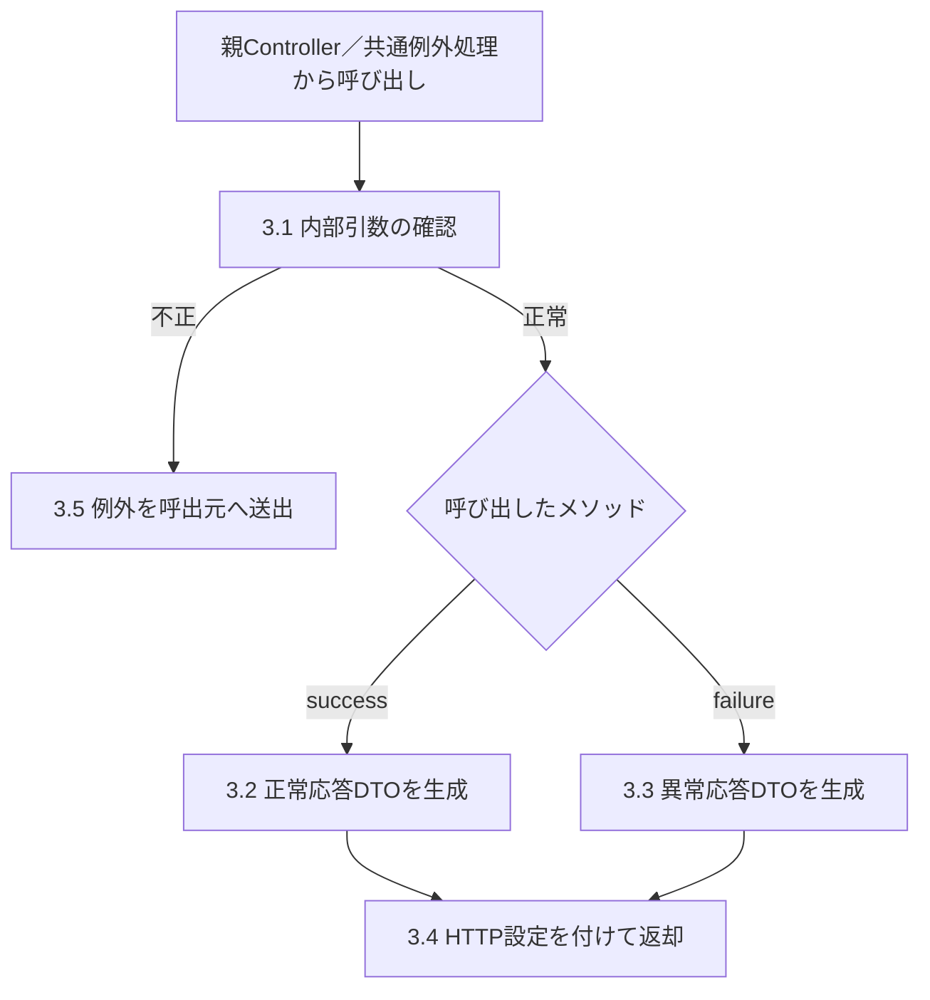

# COM001_07_共通レスポンス生成

## 0. 処理フロー



## 1. 基本情報・担当範囲

| 項目 | 内容 |
| --- | --- |
| 機能ID | COM001_07 |
| 論理名 | 共通レスポンス生成 |
| 物理名 | create-api-response |
| 実装クラス | ApiResponseFactory |
| 呼出元 | 親Controller（BaseController）、COM001_08の共通例外処理 |
| 目的 | requestId・data・errorを持つ共通応答を生成する |
| HTTP方針 | 正常・ECSで応答可能なエラーとも200 |
| DB・外部通信 | なし |
| 独自URL | なし。ECS内部の共通部品 |

| 部品 | 担当処理 |
| --- | --- |
| 各Business | 業務処理、結果DTOの生成、失敗時の例外送出 |
| 各Controller | Businessを呼び、親Controllerの正常応答メソッドに結果DTOを渡す |
| 親Controller | 保持済みrequestIdを取得し、**共通機能使用：COM001_07 共通レスポンス生成** |
| COM001_08 | 例外をcode・message・fieldErrorsに変換し、**共通機能使用：COM001_07 共通レスポンス生成** |
| ApiResponseFactory | 共通DTO・HTTPステータス・ヘッダーの組み立て |
| Spring MVC | 返されたDTOをJSON化して送信 |

各APIの設計書には、親Controllerが実装する共通処理の詳細を重複記載しない。本機能はThrowableを受け取らず、例外種別の判定や業務結果の再判定を行わない。

## 2. 入力項目

### 2.1 正常応答

```java
<T> ResponseEntity<ApiResponse<T>> success(String requestId, T data)
```

| 引数 | 型 | 必須 | 内容 |
| --- | --- | --- | --- |
| requestId | String | 必須 | COM001_01で設定済みの要求追跡ID |
| data | T | 任意 | 各APIの正常結果DTO。結果項目がない場合はnullを許可 |

### 2.2 異常応答

```java
ResponseEntity<ApiResponse<Void>> failure(String requestId, ApiError error)
```

| 引数・項目 | 型 | 必須 | 内容 |
| --- | --- | --- | --- |
| requestId | String | 必須 | 設定済み要求追跡ID |
| error | ApiError | 必須 | COM001_08等で生成した利用者向けエラー情報 |
| error.code | String | 必須 | 共通エラー一覧のコード |
| error.message | String | 必須 | 利用者向け文言 |
| error.fieldErrors | List&lt;FieldErrorDetail&gt; | 必須 | 項目エラー。対象がなければ空リスト |
| fieldErrors[].field | String | 必須 | APIの項目名・パス |
| fieldErrors[].message | String | 必須 | 項目単位の利用者向け文言 |

フィールドエラーのDTO名は本書の実装名とする。入力値そのものを保持するrejectedValueは設けない。

## 3. 処理詳細 — ApiResponseFactory

### 3.1 内部引数の確認

| 確認項目 | NG条件 | 処理 |
| --- | --- | --- |
| requestId | null・空文字・空白のみ | IllegalArgumentException |
| failureのerror | null | IllegalArgumentException |
| error.code／message | null・空文字・空白のみ | IllegalArgumentException |
| error.fieldErrors | null | IllegalArgumentException |
| fieldErrorsの各要素 | null、field／messageがnull・空白のみ | IllegalArgumentException |

- 外部リクエストの項目チェックではなく、共通部品の呼び出し誤りを検出する。
- requestIdを新規採番・トリムしない。COM001_01の値を引き継ぐ。
- codeとmessageの対応は呼出元で確定済みとする。本機能でコード表を再検索しない。
- successとfailureを別メソッドにすることで、dataとerrorの同時設定を防ぐ。
- data内部の業務項目は検証しない。DB Entity・SDK応答・機密情報をそのまま渡さないことは呼出元の責務。

### 3.2 正常応答DTOを生成

| 応答項目 | 設定値 |
| --- | --- |
| requestId | 引数requestId |
| data | 引数data |
| error | null |

- dataを二重にラップしない。JSON文字列をdataに渡して再度JSON化しない。
- 正常時にerror.code=SUCCESSは設定しない。
- 処理中結果もerror=nullとし、各APIのdata.operationStatus等で表す。受理・処理中を注文成立等の成功確定へ読み替えない。
- 正常で結果項目がない場合もHTTP 204に変えず、data=null・error=nullの共通形式を返す。

### 3.3 異常応答DTOを生成

| 応答項目 | 設定値 |
| --- | --- |
| requestId | 引数requestId |
| data | null |
| error | 引数errorを共通エラーDTOとして設定 |

- エラー時に途中の業務データをdataへ残さない。
- fieldErrorsは空リストを含め必ず出力する。項目順は呼出元から受け取った順序を維持する。
- 共有DTOは不変とし、fieldErrorsは防御的コピーを保持する。応答生成後に別処理から書き換わらないようにする。
- SDK・SQL例外のメッセージやスタックトレースを追加しない。

### 3.4 HTTP設定を付けて返却

| 設定 | 値 |
| --- | --- |
| ステータス | 200 OK |
| Content-Type | application/json |
| JSON文字コード | UTF-8 |
| Cache-Control | no-store |
| 本文 | 3.2または3.3のApiResponse |

ResponseEntityでステータス・ヘッダー・DTOを返す。ServletのOutputStreamへ直接書き込まない。JSONへの変換・送信はSpring MVCのMessageConverterに任せる。

**JSON出力設定**

- requestId・data・errorは常に出力し、null項目を省略しない。
- 異常時のerror.fieldErrorsも省略しない。
- 共通応答DTOにnullを含める設定を適用し、アプリ全体のNON_NULL設定等によって共通形式が崩れないようにする。
- data内の型・日時・金額表記は各結果DTOと共通ガイドラインに従う。本機能で全数値の文字列化や金額計算をしない。
- 正常・異常を含め本Factoryの応答はno-storeとする。公開商品APIのキャッシュ採用は別途明示的に設計する。

requestId用ヘッダーやCORSヘッダーの管理は既存共通処理に従い、本機能で重複設定しない。Cookieの発行・削除も本機能では行わない。

### 3.5 本機能内の例外を送出

| 発生箇所 | 動作 |
| --- | --- |
| 内部引数不正 | IllegalArgumentExceptionを呼出元へ送出 |
| DTO生成等の想定外例外 | 原因を保持して呼出元へ伝播 |
| JSON変換・送信時の例外 | Factory返却後のため、HTTP境界の共通処理が扱う |

**共通機能使用：COM001_08 共通例外変換**  
本機能の例外もHTTP境界でINTERNAL_ERRORへ変換する。本機能自身からCOM001_08を呼び返さない。

COM001_08からfailureを呼ぶ経路自体が失敗した場合に、同じ不正引数で再帰呼び出ししない。共通例外処理側で最小エラー応答の退避経路を設計する。すでに応答を送信済みの場合は二重書き込みしない。

## 4. DB・トランザクション・データ復旧

| 項目 | 方針 |
| --- | --- |
| DB検索・登録・更新・削除 | なし |
| 外部サービス呼出 | なし |
| トランザクション操作 | 開始・commit・rollbackを行わない |
| 本機能のデータ復旧 | 保存処理がないため不要 |
| 更新APIの正常応答 | Business側で必要なcommitが完了してから生成する |
| commit後のJSON生成失敗・通信断 | DB更新済みの可能性がある。失敗確定やrollback済みとは扱わない |
| 結果不明の復旧 | 各APIの操作結果照会・べき等再試行に従う。本機能から再実行や補償削除を行わない |

## 5. 呼び出し例

親Controllerの正常応答メソッド内：

```java
// 共通機能使用：COM001_07 共通レスポンス生成
return apiResponseFactory.success(requestId, resultDto);
```

COM001_08が例外を分類した後：

```java
// 共通機能使用：COM001_07 共通レスポンス生成
return apiResponseFactory.failure(requestId, apiError);
```

Businessから直接ResponseEntityを返さない。Controllerが本Factoryを使用した後に、別の共通処理でさらにラップしない。

## 6. 確認観点・参照資料

| ケース | 期待結果 |
| --- | --- |
| 正常DTOあり | HTTP 200、dataにDTO、error=null |
| 正常DTOなし | HTTP 200、data=null、error=null。本文あり |
| 業務エラー | HTTP 200、data=null、errorに指定値 |
| 項目エラーなし | fieldErrors=[]を出力 |
| 項目エラーあり | 指定順で出力。入力値を含めない |
| アプリでnull省略を設定 | 共通のdata・errorは省略されない |
| 内部引数不正 | 例外。正常応答を作らない |
| 同時リクエスト | requestId・DTOが他要求と混在しない |
| commit後の応答送信失敗 | 業務更新を再実行・削除しない |

- [共通機能一覧](https://docs.google.com/spreadsheets/d/1_3cp7E1CKQ3fda4SCl4G7kGrbhWOb3ZThdh4oUXIS2s/edit#gid=2026111108)
- [共通API形式](https://docs.google.com/spreadsheets/d/1_3cp7E1CKQ3fda4SCl4G7kGrbhWOb3ZThdh4oUXIS2s/edit#gid=1841051813)
- [Spring Framework：ResponseEntity](https://docs.spring.io/spring-framework/reference/web/webmvc/mvc-controller/ann-methods/responseentity.html)

## 7. 返却項目・JSON例

### 7.1 共通レスポンス

| 項目 | 型 | null | 内容 |
| --- | --- | --- | --- |
| requestId | String | 不可 | 共通要求追跡ID |
| data | 各APIの結果型 | 可 | 正常結果。異常時はnull |
| error | ApiError | 可 | 正常時null、異常時エラー |
| error.code | String | 不可 | 共通エラーコード |
| error.message | String | 不可 | 利用者向け文言 |
| error.fieldErrors | Array | 不可 | 項目エラー。なしの場合[] |
| error.fieldErrors[].field | String | 不可 | APIの項目名・パス |
| error.fieldErrors[].message | String | 不可 | 項目別文言 |

error配下のnull条件はerrorが存在する場合に適用する。正常・異常の判別はHTTP 200だけで行わず、errorの有無を使用する。正常でも処理中かどうかはdata内の業務結果で判定する。

### 7.2 正常応答例

```json
{
  "requestId": "req-example-001",
  "data": {
    "items": [],
    "hasNext": false,
    "nextCursor": null
  },
  "error": null
}
```

### 7.3 項目エラー例

```json
{
  "requestId": "req-example-002",
  "data": null,
  "error": {
    "code": "VALIDATION_ERROR",
    "message": "入力内容をご確認ください。",
    "fieldErrors": [
      {
        "field": "quantity",
        "message": "数量は1以上の整数で入力してください。"
      }
    ]
  }
}
```

### 7.4 本機能の例外を共通処理で変換した場合

```json
{
  "requestId": "req-example-003",
  "data": null,
  "error": {
    "code": "INTERNAL_ERROR",
    "message": "処理を完了できませんでした。",
    "fieldErrors": []
  }
}
```

例外を捕捉し、応答送信前に生成できた場合の形式。API Gatewayの非200応答、通信断、送信済み応答、コンテナ停止等までHTTP 200・共通JSONを保証しない。

