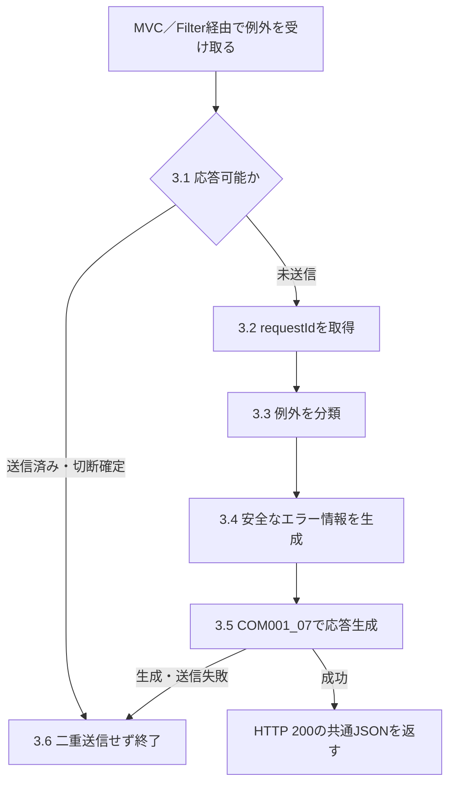

# COM001_08_共通例外変換

## 0. 処理フロー



## 1. 基本情報・実装範囲

| 項目 | 内容 |
| --- | --- |
| 機能ID | COM001_08 |
| 論理名 | 共通例外変換 |
| 物理名 | handle-api-exception |
| 主な実装クラス | ApiExceptionHandler |
| 適用対象 | ECSの業務APIで発生し、応答可能な例外 |
| HTTP方針 | 例外応答もHTTP 200。error.codeで区別 |
| DB・外部通信 | なし |
| 独自URL | なし |

### 1.1 担当と呼出経路

| 担当 | 処理 |
| --- | --- |
| Business・外部連携部品 | 業務例外・連携例外を送出。業務上必要な例外変換を行う |
| SpringのTX基盤／Business | commit・rollback、結果不明時の復旧管理 |
| ApiExceptionHandler | 例外分類、文言決定、項目エラー整形、共通応答への受け渡し |
| COM001_07 | requestId／data／error、HTTP 200、JSON・no-storeの生成 |
| COM001_09 | 共通ログ出力。機密情報を記録しない |

- MVC経路は`@RestControllerAdvice`と`@ExceptionHandler`で実装する。各Controllerへ同じcatch処理を置かない。
- 親Controllerを継承していても、共通例外処理はAdvice側へ集約する。
- JSON解析・引数解決の失敗など、Controllerメソッド実行前のMVC例外も対象とする。
- Filterの例外はAdviceだけでは扱えないため、次の接続を設ける。

| 発生箇所 | 接続方法 |
| --- | --- |
| MVC：Controller／Business／JSON解析 | Advice → 共通分類処理 → COM001_07 |
| Spring Security：認証拒否 | AuthenticationEntryPoint → 本機能のFilter用応答処理 |
| Spring Security：認可拒否・CSRF拒否 | AccessDeniedHandler → 本機能のFilter用応答処理 |
| 独自受付Filter：自身のチェック失敗 | Filter内で捕捉 → 本機能のFilter用応答処理 |

Filter用処理は共通分類処理とCOM001_07を再利用し、生成した本文を一度だけ書き込む。その後はFilterChainを進めない。下流が処理済みの例外を別Filterで再処理しない。

Gatewayの拒否、Amplifyの例外、コンテナ停止、JVMの致命的Errorは本機能の対象外。

## 2. 入力項目

HTTPリクエストボディではなく、例外発生時の内部情報を受け取る。

| 項目 | 型・取得元 | 必須 | 用途 |
| --- | --- | --- | --- |
| exception | Exception | 必須 | 発生した例外 |
| request | HttpServletRequest | 必須 | requestId・API識別情報・処理済みフラグの参照 |
| response | HttpServletResponse | 必須 | 送信済み確認、Filter経路での応答 |
| requestId | COM001_01のリクエスト属性 | 通常必須 | 同じ要求の追跡IDを引き継ぐ |
| API識別情報 | サーバー側のルート定義等 | 任意 | API固有文言の選択。リクエスト指定IDは信用しない |

### 2.1 業務・連携例外の契約

| 内部項目 | 内容 |
| --- | --- |
| errorCode | エラー一覧に登録されたコード |
| messageKey | 任意。サーバー内の登録済み文言キー |
| fieldErrors | 任意の項目エラー。外部入力を含めない |
| cause | 原因追跡用。レスポンスには含めない |

例外クラス名は実装で統一する。例外のgetMessage()を利用者向け文言として無条件に採用しない。

入力構造（未知のJSON項目・型違い・未知クエリ）と項目値を区別する。前者はINVALID_REQUEST。後者（DTO単項目・項目間・管理APIのID値）はVALIDATION_ERROR。公開商品詳細のID不正は不存在と同じRESOURCE_NOT_FOUND。署名付きカーソル不正はCURSOR_INVALID、fieldErrors=[]。共通文言の正本は機能一覧09。

## 3. 処理詳細 — ApiExceptionHandler

### 3.1 応答可能か確認

| 条件 | 処理 |
| --- | --- |
| response.isCommitted()がtrue | 本文・ステータスを変更せず3.6へ |
| クライアント切断が確定 | 再送せず3.6へ |
| 本要求のエラー応答生成が再入した | 再帰処理せず3.6の退避経路へ |
| その他 | 処理済み／処理中フラグを設定し、3.2へ |

送信前の失敗でも、業務処理のcommitが完了している場合がある。応答可能かどうかとDB更新の成否は別に扱う。

### 3.2 requestIdを取得

1. COM001_01がリクエスト属性へ設定したrequestIdを取得する。
2. 有効な値があればそのまま使用する。MDCや外部ヘッダーから別の値で上書きしない。
3. 属性が欠損・不正なら、サーバーでUUID文字列を1回生成して同属性へ格納し、以後の応答・ログで共有する。共通受付の設定異常として記録する。

退避時も追跡IDを確保するための例外経路とする。クライアントから渡された値を無検証で使用しない。

### 3.3 例外を分類

**判定順は表の上からとし、明示された業務・連携コードを優先する。**

| 優先 | 例外・条件 | error.code |
| --- | --- | --- |
| 1 | 登録済みコードを持つ業務例外・連携例外 | そのコードを維持 |
| 2 | リクエストDTOのBean Validation違反 | VALIDATION_ERROR |
| 3 | 不正JSON・未知プロパティ・JSON型不一致・必須bodyなし | INVALID_REQUEST |
| 4 | パス／クエリ引数の型不一致・必須パラメータ不足 | INVALID_REQUEST |
| 5 | HTTPメソッド不一致をECSで捕捉 | METHOD_NOT_ALLOWED |
| 6 | Content-Type不正をECSで捕捉 | UNSUPPORTED_MEDIA_TYPE |
| 7 | 認証拒否として明示された例外 | UNAUTHENTICATED |
| 8 | CSRF・Origin違反として明示された例外 | CSRF_VALIDATION_FAILED |
| 9 | 管理者権限不足等の認可拒否 | FORBIDDEN |
| 10 | 未変換のDB接続・検索タイムアウト、一時的DBアクセス障害 | SERVICE_UNAVAILABLE |
| 11 | 未変換の一意制約違反・SQL誤り・データ不整合 | INTERNAL_ERROR |
| 12 | IllegalArgumentException・IllegalStateException・その他想定外 | INTERNAL_ERROR |

**分類時の補足**

- Bean Validationは`jakarta.validation.ConstraintViolationException`のうち、登録済みリクエストDTOの違反を対象とする。DB制約例外や内部オブジェクトの違反と混同しない。
- 互換経路としてMethodArgumentNotValidException等を受ける場合も、外部入力DTOの違反だけをVALIDATION_ERRORへ変換する。標準設計ではDTO検証はBusinessで実行する。
- COM001_06が設定済みのCOGNITO_UNAVAILABLE・RATE_LIMIT_EXCEEDED等を、汎用INTERNAL_ERRORで上書きしない。
- MEMBER_CONFLICT等の業務固有コードは、制約名・業務条件を把握したBusinessで変換する。全ての一意制約違反を会員重複にしない。
- 未登録・他会員データの不存在扱いは各Businessで決める。本機能はDBを再検索しない。
- 原因例外をたどる場合は既知のラッパーだけを対象とし、循環・過度な深掘りを防ぐ。例外メッセージの文字列検索で分類しない。
- 期限切れ・未登録等を判別できない障害を、UNAUTHENTICATEDへまとめない。
- 入力不正用の明示例外と、内部引数不正のIllegalArgumentExceptionを区別する。

### 3.4 エラー情報を生成

**文言選択順：登録済みの例外messageKey → API固有文言 → 共通コード文言。**

| 項目 | 生成方法 |
| --- | --- |
| code | 3.3の登録済みコード |
| message | サーバー内の文言定義から取得 |
| fieldErrors | 入力エラーのみ安全な項目名・文言を設定。その他は[] |

- 未登録コード・不正な文言キー・文言欠損はINTERNAL_ERROR＋固定文言に置換する。
- API識別情報が取れない場合は共通文言を使用する。INVALID_REQUEST等も共通の既定文言を用意する。
- 本番でスプレッドシートを参照しない。エラー一覧をもとにコード内定義／メッセージリソースを管理する。

**項目エラーの変換**

| 処理 | 内容 |
| --- | --- |
| 項目名 | DTOの公開プロパティパスに変換。例：items[0].quantity |
| 項目名を特定できない | 全体エラーとし、架空のfieldを作らない |
| 文言 | 登録済みの検証文言。入力値の埋め込みは禁止 |
| 並び順 | DTOの定義済み表示順、同一項目は文言順。重複するfield＋messageを除去 |
| 除外 | rejectedValue、Bean名、メソッド名、SQL、例外スタック |

項目間エラーも、Businessが関連付けた公開項目のみfieldErrorsへ設定する。

### 3.5 共通応答を生成・返却

**共通機能使用：COM001_07 共通レスポンス生成**

```java
return apiResponseFactory.failure(requestId, apiError);
```

| 経路 | 返却方法 |
| --- | --- |
| MVC | ResponseEntityを返す。Spring MVCがJSONを送信 |
| Filter／Security | 同じFactoryのステータス・ヘッダー・本文をServlet応答へ反映。JSONを一度だけ書き込む |

**共通機能使用：COM001_09 共通ログ出力**

要求追跡ID・例外分類・API識別情報・安全な処理位置を記録する。リクエストボディ、トークン、氏名・メール、SQLパラメータ、SDK応答を丸ごと出力しない。共通ログの実装詳細はCOM001_09で定義する。

HTTP 200・application/json・Cache-Control: no-store、data=nullの形式とする。応答生成後にBusinessへ戻して処理を再開しない。

### 3.6 送信不可・ハンドラー自身の失敗

| 状況 | 処理 |
| --- | --- |
| 応答送信済み | ログのみ。reset・sendError・追加JSON書き込みを行わない |
| 切断確定 | 再送しない。送信失敗を記録して終了 |
| 分類・Factory生成が失敗、未送信 | 退避処理を1回だけ実行 |
| 退避処理も失敗 | 再帰処理しない。記録可能な範囲でログを残し、基盤側へ伝播 |

**退避処理**

1. 有効なrequestIdを確保する。
2. COM001_07や文言検索を再呼び出しせず、固定の最小DTOを生成する。
3. code=INTERNAL_ERROR、message=「処理を完了できませんでした。」、fieldErrors=[]とする。
4. 未送信の本文バッファだけを破棄し、不要なContent-Length等を解除する。CORS・追跡ヘッダー等を不用意に消さない。
5. 共通DTOを使わない単純なMap等をJSON化し、HTTP 200・no-storeで1回だけ送信する。

MVCのJSON変換中に失敗した場合も、未送信で本機能へ到達できた場合のみ退避を試みる。JavaのErrorやコンテナ障害まで正常なJSON返却を保証しない。

## 4. DB更新・トランザクション・復旧

| 状況 | 処理責務 |
| --- | --- |
| 入力チェック段階で失敗 | Businessへ進まない、または更新前に例外で終了 |
| BusinessのTX内で例外 | TX基盤がBusinessの設定に従ってrollback。本機能はTX終了後の例外を扱う |
| DBのcommit結果が不明 | 未反映と断定しない。各APIの結果照会・べき等再試行へ |
| commit後の応答生成・送信失敗 | 更新を取り消さない。既存の成立記録を照会する |
| 本機能の復旧 | DB操作がないため、復旧更新・補償削除は不要 |

HTTP 200を返すことは業務成功やrollback成功を意味しない。本機能はcommit・rollback・再試行・操作履歴更新を行わない。Business内で例外を握りつぶして正常終了させない。

## 5. 主なコード・文言

| code | 共通文言 |
| --- | --- |
| VALIDATION_ERROR | 入力内容をご確認ください。 |
| INVALID_REQUEST | リクエストの内容が正しくありません。 |
| METHOD_NOT_ALLOWED | この操作は指定された方法では実行できません。 |
| UNSUPPORTED_MEDIA_TYPE | リクエストの形式が正しくありません。 |
| UNAUTHENTICATED | ログイン状態を確認できませんでした。再度ログインしてください。 |
| FORBIDDEN | この操作を実行する権限がありません。 |
| CSRF_VALIDATION_FAILED | 操作を確認できませんでした。画面を再読み込みしてください。 |
| SERVICE_UNAVAILABLE | 処理を完了できませんでした。時間をおいて再試行してください。 |
| INTERNAL_ERROR | 処理を完了できませんでした。 |

ACCOUNT_DISABLED・MEMBER_NOT_READY・COGNITO_UNAVAILABLE等の業務／連携コードは、共通エラー一覧・COM001_05・COM001_06の文言を使用する。

一覧でAPU001_01欄にあるINVALID_REQUEST・METHOD_NOT_ALLOWED・UNSUPPORTED_MEDIA_TYPEは、本機能の共通既定値としても同じ文言を使用する。API固有の登録済み文言があれば優先する。

## 6. 確認観点・参照資料

| ケース | 期待結果 |
| --- | --- |
| 不正JSON | Controller／Business未実行、INVALID_REQUEST |
| DTOの必須違反 | VALIDATION_ERROR、公開項目パスのみ |
| 内部null引数 | INTERNAL_ERROR。入力エラーにしない |
| Cognito連携例外 | アダプターが設定したコードを維持 |
| 未変換のDB一意制約違反 | INTERNAL_ERROR。勝手にMEMBER_CONFLICTにしない |
| Filterの認証・CSRF拒否 | 共通経路からJSONを1回だけ送信 |
| 応答送信済み | 二重書き込みなし |
| Factory自身の例外 | 固定最小応答への退避は最大1回 |
| DB更新後の通信断 | 再更新・補償削除なし。結果照会へ |
| requestId欠損 | 退避IDを1回生成して応答・ログで共用 |

- [共通機能一覧](https://docs.google.com/spreadsheets/d/1_3cp7E1CKQ3fda4SCl4G7kGrbhWOb3ZThdh4oUXIS2s/edit#gid=2026111108)
- [エラーコード・メッセージ](https://docs.google.com/spreadsheets/d/1_3cp7E1CKQ3fda4SCl4G7kGrbhWOb3ZThdh4oUXIS2s/edit#gid=2026111203)
- [Spring MVC：ExceptionHandler](https://docs.spring.io/spring-framework/reference/web/webmvc/mvc-controller/ann-exceptionhandler.html)
- [Spring Security：Servlet構成](https://docs.spring.io/spring-security/reference/servlet/architecture.html)

## 7. 返却項目・JSON例

### 7.1 返却仕様

| 項目 | 型 | 内容 |
| --- | --- | --- |
| HTTPステータス | — | 200（応答可能な場合） |
| requestId | String | 要求追跡ID |
| data | null | 異常時は常にnull |
| error.code | String | 登録済みコード |
| error.message | String | 安全な利用者向け文言 |
| error.fieldErrors | Array | 対象なしは[] |
| error.fieldErrors[].field | String | 公開項目名・パス |
| error.fieldErrors[].message | String | 項目別文言 |

### 7.2 入力エラー例

```json
{
  "requestId": "req-example-001",
  "data": null,
  "error": {
    "code": "VALIDATION_ERROR",
    "message": "入力内容をご確認ください。",
    "fieldErrors": [
      {
        "field": "quantity",
        "message": "数量は1以上の整数で入力してください。"
      }
    ]
  }
}
```

### 7.3 内部例外・退避応答例

```json
{
  "requestId": "req-example-002",
  "data": null,
  "error": {
    "code": "INTERNAL_ERROR",
    "message": "処理を完了できませんでした。",
    "fieldErrors": []
  }
}
```

応答済み・切断時には新たな返却項目を追加しない。フロントはHTTP非200・共通形式でない応答・通信断も別途処理する。

