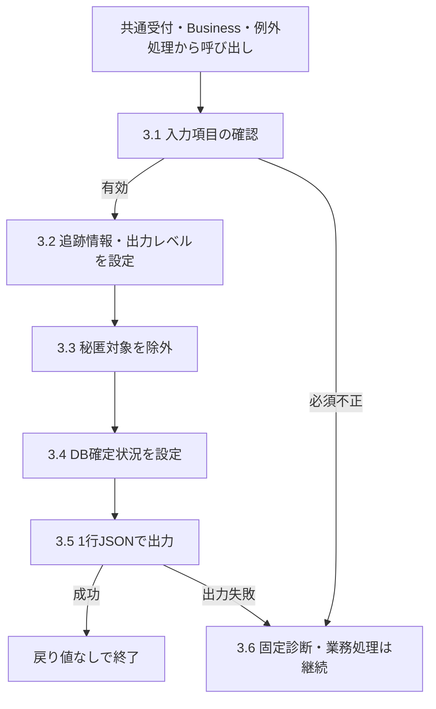

# COM001_09_アプリケーションログ出力・秘匿

## 0. 処理フロー



## 1. 基本情報・担当範囲

| 項目 | 内容 |
| --- | --- |
| 機能ID | COM001_09 |
| 論理名 | アプリケーションログ出力・秘匿 |
| 物理名 | write-application-log |
| 実装クラス | ApplicationLogger、SensitiveDataMasking |
| 主メソッド | ApplicationLogger.write(ApplicationLogEvent event) |
| 呼出元 | 共通受付、Controller／Business、外部連携部品、COM001_08 |
| 出力先 | 標準出力。ECSのawslogsでCloudWatch Logsへ収集 |
| DB・業務外部API | 呼び出さない |
| 独自HTTP API | なし |

| 担当 | 処理 |
| --- | --- |
| 呼出元 | イベント・処理位置・結果・DB確定状況を指定する |
| ApplicationLogger | 追跡項目・レベル・日時を設定し、安全なログを出力する |
| SensitiveDataMasking | 許可項目だけでログDTOを生成し、秘匿項目・不正値を除外する |
| COM001_01 | requestId・MDCの設定と終了時の片付け |
| ECS／CloudWatch | ログ収集・保管・閲覧権限・保持期間・監視 |

呼び出す箇所には**共通機能使用：COM001_09 アプリケーションログ出力・秘匿**と記載する。

本ログは調査用であり、注文成立やべき等処理の正本ではない。operation_histories等の業務記録を置き換えない。

## 2. 入力項目・出力タイミング

### 2.1 ApplicationLogEvent

任意Map・自由文・リクエストDTO全体を受け取らず、次の型付き項目だけを受け取る。

| 項目 | 型 | 必須 | 内容 |
| --- | --- | --- | --- |
| eventType | Enum | 必須 | REQUEST_START／REQUEST_END／PROCESS／ERROR |
| functionId | String | 原則必須 | サーバー内で定義した機能ID |
| step | String | 任意 | 設計書の処理番号。例：3.2。F01等を別途採番しない |
| requestId | String | 任意 | 明示された内部コンテキストのID。省略時はMDCから取得 |
| operationId | String | 任意 | 形式・長さの検証済み操作識別子 |
| outcome | Enum | 条件付き | IN_PROGRESS／SUCCESS／BUSINESS_ERROR／SYSTEM_ERROR／UNKNOWN |
| errorCode | String | 任意 | 共通エラー一覧のコード |
| dbStatus | Enum | 必須 | 3.4で定義する状態。既定値UNKNOWN |
| transactionName | String | 任意 | 業務内のTX名。例：ORDER_CREATE。サーバー定義値のみ |
| durationMs | Long | 任意 | 0以上の処理時間 |
| httpStatus | Integer | 任意 | 実際に設定したHTTPステータス |
| cause | Throwable | 任意 | 型・安全なコード位置の抽出用。原文は出力しない |

- REQUEST_STARTのoutcomeはIN_PROGRESSとする。REQUEST_END・ERRORではoutcomeを必須とする。
- ルート確定前や不明なルートではfunctionId=UNKNOWNを許可する。生URLで代用しない。
- requestId・operationIdは一度検証された内部値を渡す。単に形式が合う任意入力を安全な値とみなさない。
- requestIdの取得のためにHttpServletRequestやトークンを本機能へ渡さない。

### 2.2 呼び出す位置

| イベント | 呼出元・タイミング | 重複防止 |
| --- | --- | --- |
| REQUEST_START | 共通受付。requestId設定後 | 1要求につき1回 |
| PROCESS | Businessの主要分岐・外部連携結果・DB確定後 | 全行・全ループには置かない |
| ERROR | COM001_08で例外分類後 | 伝播する同一例外を各層でERROR出力しない |
| REQUEST_END | 共通受付の終了処理。例外経路も含む | 1要求につき1回 |

受付Filterが終了を記録する前に、例外処理は安全なoutcome・errorCodeを要求コンテキストへ設定する。HTTP 200だけを見てSUCCESSにしない。REQUEST_ENDはサーバー処理終了を意味し、ブラウザの受信成功を保証しない。

## 3. 処理詳細

### 3.1 入力項目を確認 — ApplicationLogger

| チェック | NG時の扱い |
| --- | --- |
| eventまたはeventTypeがnull | 本来のイベントを出力せず、3.6へ |
| 終了・エラーイベントのoutcome不足 | UNKNOWNにする。成功と推測しない |
| dbStatusがnull・判別不能 | UNKNOWNにする |
| functionId・step・transactionNameが定義外 | 当該値を出さない。機能IDはUNKNOWNへ |
| durationMsが負数、httpStatusが100〜599以外 | 当該項目を除外 |
| 不正な識別子・上限超過 | 当該項目を除外。切り詰めて別のIDにしない |

入力不正によって業務APIを失敗させない。元の不正値を診断ログへ再出力しない。

### 3.2 追跡情報・出力レベルを設定 — ApplicationLogger

1. 明示された内部requestIdを優先し、省略時はMDCのrequestIdを使う。
2. 両方存在して一致しない場合は明示された内部コンテキストを使用し、contextMismatch=trueを付ける。他方の値は出力しない。
3. どちらも得られない場合はrequestId=null、contextMissing=trueとする。本機能で別IDを採番しない。
4. timestampをUTCのISO 8601形式で生成する。durationMsは呼出元が単調増加時計で計測した値を使う。
5. 次の表でレベルを決める。

| イベント・結果 | レベル |
| --- | --- |
| REQUEST_START、通常のPROCESS、正常終了 | INFO |
| 入力・業務ルール・認証／認可拒否 | WARN |
| 想定外例外・外部／DB障害・結果不明 | ERROR |
| REQUEST_END | INFO。outcome・errorCodeで成否を識別 |

非同期処理や別スレッドでMDCが自動継承されると仮定しない。必要なrequestIdを明示的に引き継ぎ、タスク終了時にコンテキストを復元・解除する。HTTP要求のMDC管理はCOM001_01に任せ、本機能は書き換えない。

### 3.3 秘匿対象を除外 — SensitiveDataMasking

**元データを丸ごと出力して後から隠すのではなく、許可された項目だけで新しいログDTOを作る。**

| 対象 | 扱い |
| --- | --- |
| パスワード、Access／ID／Refresh token、確認コード、Cookie、秘密鍵 | 出力しない |
| 氏名・メール・住所・電話番号・検索キーワード | 出力しない |
| カード番号（モックを含む）、セキュリティコード | 出力しない |
| リクエスト／レスポンス／DB Entity／SDK DTO | toString・JSON化して出力しない |
| URL・クエリ・ヘッダー・SQLとバインド値 | 出力しない。サーバー定義のfunctionId・stepで位置を示す |
| 会員ID・Cognito sub・注文番号 | 本機能の標準項目には含めない |
| 例外メッセージ・causeのメッセージ | 出力しない |
| スタック位置 | クラス名・メソッド名・行番号のみ、最大20フレーム |
| requestId・operationId | 検証済みの追跡値だけを許可 |

- exceptionClassは型名から取得する。Throwableをロガーの末尾引数として渡さない。
- 原因チェーンは循環を検出し、最大3階層まで型名のみ取得する。各causeのメッセージやsuppressed例外全文は出さない。
- JSONシリアライザーで改行・引用符をエスケープする。文字列連結でJSONを組み立てない。
- 固定messageはeventTypeとerrorCodeの登録済みテンプレートから選ぶ。利用者入力や例外文言を埋め込まない。
- MDCを丸ごと出力しない。必要なrequestIdだけを取得する。
- 本番のMyBatisパラメータログ、HTTPワイヤーログ、DTOを含む自動アクセスログ等も無効化・調整する。本部品の秘匿だけで他のロガーの漏えいまで防げるとは扱わない。

識別子の長さ・許容文字は各共通設計を使用する。追跡用UUIDを文字列として扱う際も、Cookie値・トークンを代入しない。

### 3.4 DB確定状況を設定 — ApplicationLogger

| dbStatus | 意味 | 設定できる時点 |
| --- | --- | --- |
| NOT_APPLICABLE | 対象イベントにDB処理なし | 外部呼出等 |
| READ_ONLY | DB参照のみ | 参照処理として確認できる場合 |
| IN_PROGRESS | 更新TXが進行中 | commit・rollback確定前 |
| COMMITTED | 対象TXのcommit成功を確認済み | TX境界から正常復帰、またはcommit後通知 |
| ROLLED_BACK | 対象TXのrollback完了を確認済み | rollback完了を確認した後 |
| UNKNOWN | commit／rollbackの結果を確認できない | 通信断・commit時例外等 |

- HTTP 200・例外の有無・INSERT成功だけでCOMMITTED／ROLLED_BACKを決めない。
- @Transactionalメソッド内のreturn直前は、まだcommit成功とは限らない。
- 複数TXがあるAPIはtransactionNameを付け、TXごとにPROCESSログを記録する。
- 注文成立TXがCOMMITTED、次回用保存TXがROLLED_BACKとなる場合もある。API全体を一律ROLLED_BACKと表現しない。
- 本機能はDBや操作履歴を照会して確定状況を推測しない。REQUEST_ENDで単一のDB状態を表せない場合はUNKNOWNとし、TXごとのログを参照する。

### 3.5 1行JSONで出力 — ApplicationLogger

| 項目 | 方針 |
| --- | --- |
| 形式 | UTF-8の構造化JSON、1イベント1行 |
| ライブラリ | SLF4J／Logback |
| ログDTO | 許可項目のみ。不変オブジェクトとして生成 |
| 出力先 | 標準出力 |
| 収集 | ECSタスクのawslogs設定でCloudWatch Logsへ送る |
| DB保存・AWS API直接送信 | 実施しない |

安全なDTOをJSON化し、専用ロガーに文字列として渡す方式とする。専用ConsoleAppenderはそのJSONを二重エンコードせず、余分な平文プレフィックスやMDC全項目を付けない。additivity=false等で同一イベントの二重出力を防ぐ。

本機能内に独自の無制限キューや再送スレッドを作らない。ログ保持期間・閲覧権限・awslogsのバッファ設定はIaC／運用設計で管理する。

### 3.6 ログ処理の失敗

| 状況 | 動作 |
| --- | --- |
| 入力不正・JSON化失敗・捕捉可能な出力例外 | 呼出元へ例外を伝播せず、業務結果を維持 |
| 診断が可能 | 固定文言APPLICATION_LOG_WRITE_FAILEDを最小の退避経路へ出す |
| 診断自体も失敗 | 再帰・再送せず終了 |
| CloudWatch配送失敗 | アプリから成功確認できない。基盤側のログ配送監視で検知 |

退避ログに元の入力・例外メッセージを含めない。障害中の大量出力を避けるため、固定診断はプロセス単位で最大60秒に1回に抑制し、出力失敗回数をプロセス内カウンターへ加算する。これは本書の初期設定値とし調整可能にする。

COM001_08から本機能が呼ばれるため、ログ失敗を再びCOM001_08へ送って無限ループを起こさない。JVMの致命的Errorやプロセス停止まで吸収する設計ではない。

## 4. DB更新・データ復旧

| 項目 | 方針 |
| --- | --- |
| DB検索・更新・登録 | なし |
| TX操作 | commit・rollbackしない |
| ログ失敗時の業務復旧 | 業務処理の再実行・補償削除・成功結果の取消を行わない |
| ログ欠落 | 本機能では永続再送しない。必達・完全な監査記録を保証しない |
| 注文等の結果確認 | 業務DB・操作履歴を正とする |
| API応答 | ログ失敗だけを理由に成功をエラーへ変更しない |

## 5. 呼出例・確認観点

### 5.1 呼出例

```java
// 共通機能使用：COM001_09 アプリケーションログ出力・秘匿
applicationLogger.write(event);
```

eventには型付きの安全な項目のみ設定する。Businessでログ出力のためにrequestや結果DTOを丸ごと渡さない。

### 5.2 確認観点

| ケース | 期待結果 |
| --- | --- |
| 正常な要求 | 同一requestIdで開始・主要処理・終了を検索できる |
| HTTP 200の業務エラー | outcomeとerrorCodeで異常を識別できる |
| 複数要求・スレッド再利用 | requestIdが混在しない |
| 例外内にトークン・メール・SQL値を含む | メッセージが出力されず型・コード位置だけ記録 |
| 秘匿データを含むDTO | 入力契約上受け取らず、toStringもしない |
| commit成功後に通信断 | COMMITTEDを取り消さず、送信結果はUNKNOWNとして区別 |
| 複数TXの一部失敗 | transactionNameごとの状態を維持 |
| JSON化・出力失敗 | ログの再帰なし、業務処理を変更しない |
| 標準出力ログの確認 | 1行1JSON、二重出力・不要なMDCなし |

## 6. 参照資料

- [共通機能一覧](https://docs.google.com/spreadsheets/d/1_3cp7E1CKQ3fda4SCl4G7kGrbhWOb3ZThdh4oUXIS2s/edit#gid=2026111108)
- [実装ガイドライン：GL-10](https://docs.google.com/document/d/1LuoyyuKzh0KIR_dEdwXQnCaOrPDbcEwuzmZdcOvAmhc/edit)
- [ECSからCloudWatchへのログ送信](https://docs.aws.amazon.com/AmazonECS/latest/developerguide/using_awslogs.html)
- [Logback MDC](https://logback.qos.ch/manual/mdc.html)

## 7. 返却項目・ログ出力例

### 7.1 呼出元への返却

| 結果 | 戻り値・応答 |
| --- | --- |
| 通常終了 | void |
| 捕捉可能なログ失敗 | void。業務側へ例外を送出しない |
| HTTPレスポンス | 本機能では生成しない。error.code等も追加しない |

### 7.2 出力項目

| 項目 | 型 | 内容 |
| --- | --- | --- |
| timestamp | String | UTC・ISO 8601 |
| level | String | INFO／WARN／ERROR |
| eventType | String | イベント種別 |
| service／environment | String | サーバー設定から取得 |
| requestId | String / null | 要求追跡ID |
| functionId | String | 機能IDまたはUNKNOWN |
| step | String | 設計書の節番号。未指定時は省略 |
| operationId | String | 検証済み操作ID。未指定・不正時は省略 |
| outcome | String | 業務・処理結果 |
| errorCode | String | 分類済みコード。なしの場合は省略 |
| dbStatus | String | 対象DB処理の確定状況 |
| transactionName | String | 必要な場合のみ |
| durationMs／httpStatus | Number | 取得できた場合のみ |
| exceptionClass／causeClasses | String / Array | 型名のみ。例外がある場合のみ |
| stackFrames | Array | 安全なクラス・メソッド・行番号のみ |
| message | String | 登録済み固定文言 |
| contextMissing／contextMismatch | Boolean | 該当時のみtrue |

### 7.3 出力例

読みやすさのため整形しているが、実際は1行で出力する。

```json
{
  "timestamp": "2026-11-14T04:30:00.000Z",
  "level": "INFO",
  "eventType": "PROCESS",
  "service": "ec-api",
  "environment": "dev",
  "requestId": "00000000-0000-4000-8000-000000000001",
  "functionId": "APU001_01",
  "step": "3.6",
  "outcome": "SUCCESS",
  "dbStatus": "COMMITTED",
  "transactionName": "USER_INITIALIZE",
  "message": "トランザクションの確定を確認しました。"
}
```

stepは呼出元の実際の設計書番号に合わせる。以下はHTTP 200でも業務エラーとなった要求の終了例。

```json
{
  "timestamp": "2026-11-14T04:30:01.000Z",
  "level": "INFO",
  "eventType": "REQUEST_END",
  "service": "ec-api",
  "environment": "dev",
  "requestId": "00000000-0000-4000-8000-000000000002",
  "functionId": "APU001_01",
  "outcome": "BUSINESS_ERROR",
  "errorCode": "ACCOUNT_DISABLED",
  "dbStatus": "READ_ONLY",
  "durationMs": 35,
  "httpStatus": 200,
  "message": "要求処理を終了しました。"
}
```

